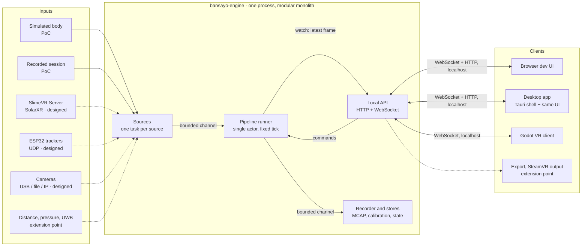
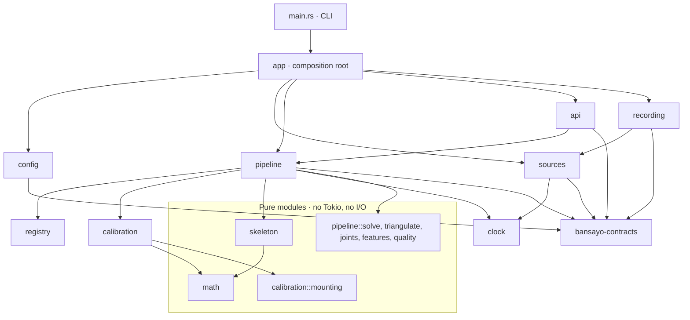
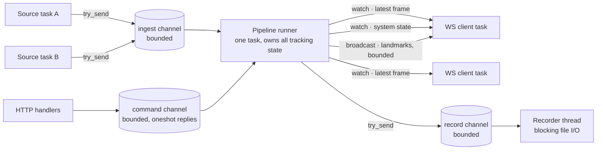
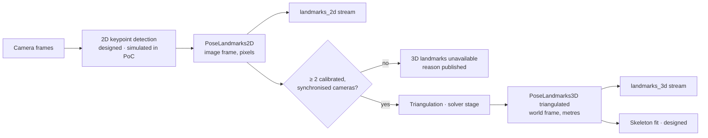
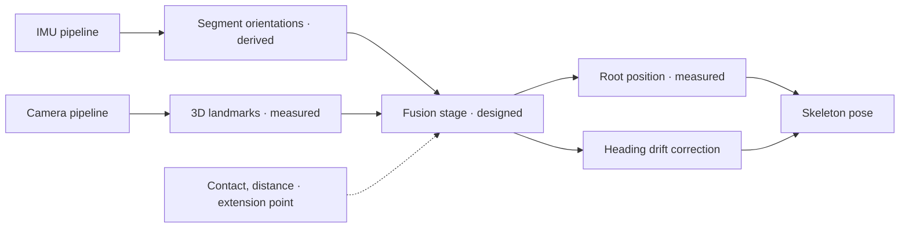
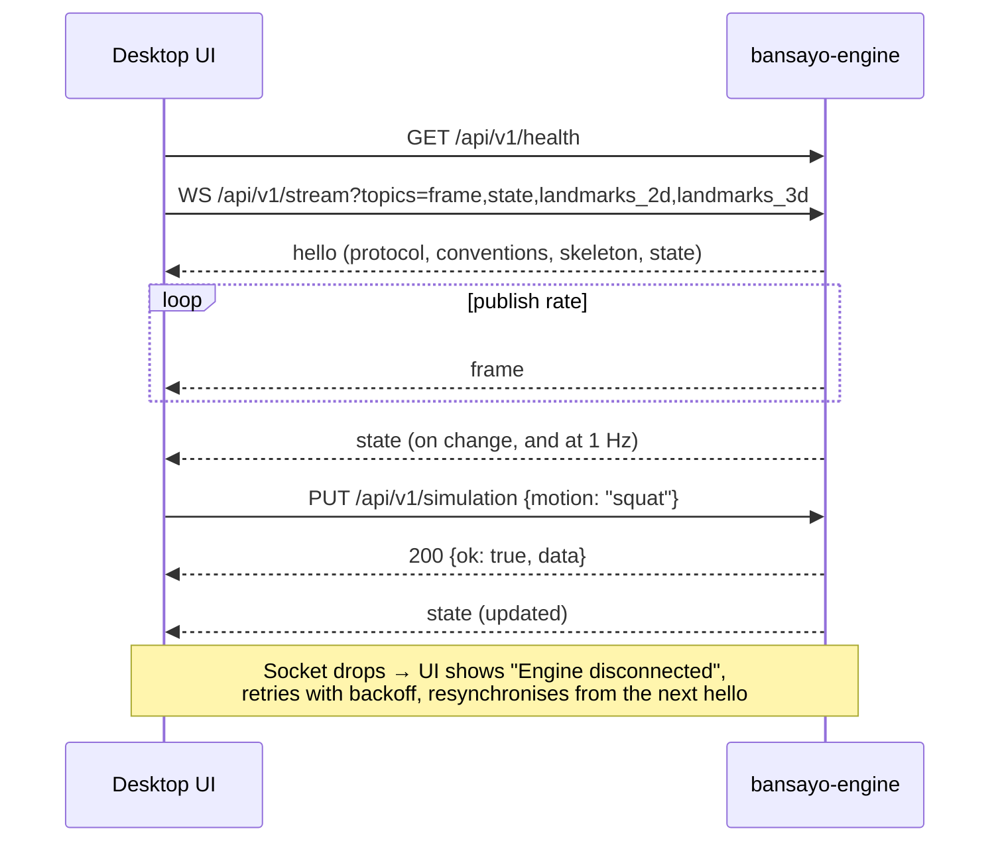
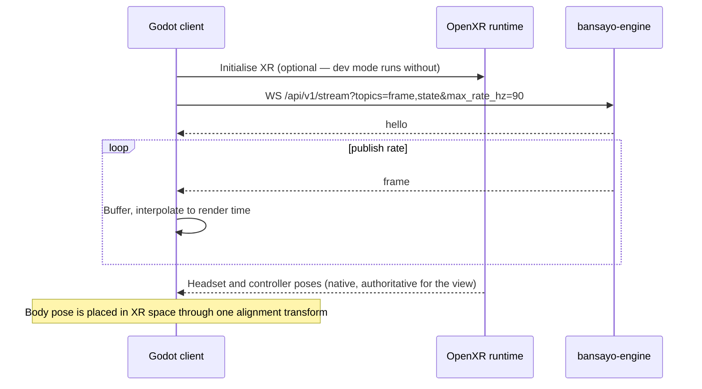

# 02 — Architecture

## 1. Process topology

Three kinds of process, one direction of dependency: clients depend on the engine's network
contract, never on its code. The one exception is the desktop shell, which links the engine
library purely to host it (ADR-006).



Solid lines are PoC. Dashed lines are designed adapters with no code yet.

### Process ownership

| Process | Owns | Does not own |
|---|---|---|
| `bansayo-engine` | Device I/O, time, calibration, skeleton solving, measurements, quality, recording, configuration | Rendering, UI state |
| Desktop UI (browser or Tauri webview) | Presentation, interaction, view state | Kinematics, calibration maths, simulation |
| Tauri shell | Window, lifecycle, hosting the engine library in-process | Any tracking logic, any data path — the UI talks to the engine over the network contract only |
| Godot VR client | XR session, rendering, native headset tracking, interpolation for display | Biomechanics, joint angles, calibration maths |

The engine runs without any client. Clients run against any engine reachable on the configured
address, including one started by another client.

## 2. Engine internals

### Crates

Two crates. A third is not justified until something other than the engine needs the domain logic
without the runtime (ADR-001).

| Crate | Contents | May depend on |
|---|---|---|
| `bansayo-contracts` | Every type that crosses a process boundary or is persisted: identifiers, frames, observations, landmarks, skeleton, pose, calibration, state, wire messages, API bodies. Serde + ts-rs derives only | `serde`, `ts-rs`. No I/O, no Tokio, no nalgebra |
| `bansayo-engine` | Library plus the `bansayo-engine` binary | `bansayo-contracts`, Tokio, Axum, nalgebra, MCAP, tracing |

### Modules of `bansayo-engine`



| Module | Responsibility | Notes |
|---|---|---|
| `app` | Builds everything from config, spawns tasks, owns graceful shutdown | The only place modules are wired together |
| `config` | YAML schema, loading, validation with path-qualified errors | Unknown fields are rejected |
| `clock` | Session clock; maps device time to session time | See [03 §2](03-domain-model.md) |
| `sources` | `Source` trait and adapters: `simulated`, `replay` | One Tokio task per source; a source never awaits the pipeline |
| `registry` | Device descriptors, device state machine, stream statistics, segment assignments | Owned by the pipeline runner |
| `calibration` | Profile store, reference-pose mounting capture, invalidation rules | Persistent, versioned |
| `skeleton` | Skeleton definition, proportion scaling, forward kinematics | Pure |
| `pipeline` | Observation buffer, solver stages (including multi-camera triangulation), joint measurements, quality, feature availability, tick loop | `runner` is the only stateful part |
| `recording` | MCAP writer, reader, session index | Blocking file I/O on a dedicated thread |
| `api` | Axum router, HTTP handlers, WebSocket fan-out, response envelope, origin checks | Translates requests into runner commands |
| `math` | Conversions between contract arrays and nalgebra, frame helpers | Pure |
| `error` | `EngineError` and per-module error enums (`thiserror`) | |

Dependency rule: nothing depends on `api`; `api` depends on nothing but `pipeline` commands and
contract types. Pure modules import neither Tokio nor Axum, and are where the unit tests live.

### Concurrency model



- **One actor owns the state.** The pipeline runner is a single task holding the observation
  buffer, registry, calibration cache and skeleton. HTTP handlers send it commands and await a
  oneshot reply. There are no locks around tracking state and no global state.
- **Sources are isolated.** Each source runs in its own task and pushes with `try_send`. A full
  channel drops the newest event and increments that device's `dropped` counter. A stalled camera
  cannot delay a tracker.
- **Consumers cannot apply backpressure to tracking.** Pose frames go out through a `watch`
  channel: a slow client skips frames, it never queues them. Landmarks use a bounded `broadcast`;
  a lagging client loses the oldest.
- **Blocking work leaves the runtime.** MCAP writing runs on a dedicated thread. Camera inference
  will run on dedicated threads with a single-slot "latest frame" mailbox, so stale frames are
  dropped before inference rather than after.
- **Shutdown.** Ctrl-C or the embedding host cancels a token (the opt-in `--shutdown-on-stdin-close` flag adds closing stdin as a trigger, for a supervising process that cannot deliver Ctrl-C to a child on Windows); sources stop, the runner drains,
  the recorder finalises the MCAP file, the API closes sockets with a normal close code.

### Rates

Each stage has its own rate; none is derived from another.

| Stage | Rate | Set by |
|---|---|---|
| Physical sensor sampling | Device-specific | Firmware |
| Source delivery | As received | Device / adapter config (`rate_hz` for simulated) |
| Camera capture, inference | Per camera | Camera processing profile |
| Skeleton solve and publication | `engine.publish_rate_hz` (default 60) | Engine config |
| WebSocket delivery | `min(publish rate, client max_rate_hz)` | Client query parameter |
| UI render | Display refresh | Browser |
| VR render | Headset refresh, with interpolation | XR runtime |

The solver samples the latest valid observation per device at each tick. A separate internal
fusion rate is an extension point, introduced only when a filter needs it.

## 3. Dataflow by input mode

The pipeline is the same in every mode; stages with no input produce labelled gaps.

### IMU only

```mermaid
flowchart LR
  T["IMU trackers<br/>orientation in sensor reference frame"] --> V["Validate, timestamp"]
  V --> B["Observation buffer<br/>latest per device"]
  B --> O["Segment orientation<br/>heading alignment × reading × mounting"]
  O --> F["Fill unobserved segments<br/>rest pose relative to parent · inferred"]
  F --> K["Forward kinematics<br/>default proportions"]
  K --> RT["Root height from floor contact<br/>inferred"]
  RT --> J["Joint measurements"]
  J --> Q["Quality and features"]
  Q --> P["Frame: pose + joints + quality"]
```



Rotations are `derived`. Positions are `inferred`: there is no positional reference.

### Camera only



With one camera the product is 2D landmarks and image-plane angles. A detector that outputs
model-inferred 3D emits `PoseLandmarks3D` of kind `model_relative`, which is a different type from
triangulated landmarks and is never placed in the world frame.

Triangulation is a stage inside the solver (`pipeline/triangulate.rs`, called from
`pipeline/solve.rs`), so live mode and replay run the same code. Its output is derived from the
recorded 2D landmarks and the calibration profiles; it is not recorded itself. The skeleton fit
remains designed: camera-only setups publish 3D landmarks but no skeleton pose.

### Hybrid



In the PoC the two pipelines run side by side and independently (fusion stage 1 of the roadmap in
[05](05-calibration-and-fusion.md)), with one exception: when trackers and a triangulated pelvis
both exist, the skeleton root uses the measured pelvis position instead of the floor-contact guess.
There is no heading correction and no other camera/IMU fusion.

## 4. Client communication

### Desktop



### VR



Both clients read the same messages. Neither performs kinematics.

## 5. Technology choices

Versions are the current stable releases at the time of writing (November 2026). They were checked
against the registries, not assumed.

| Area | Choice | Reason, and what was rejected |
|---|---|---|
| Engine language | Rust (stable, 1.92+) | As preferred. No Go: nothing here is done better by a second language |
| Async runtime | Tokio 1.x | Standard; Axum requires it |
| Local API | Axum 0.8 | HTTP and WebSocket in one router, same runtime |
| Maths | nalgebra 0.35 | Quaternions and isometries with clear conventions; used only inside the engine |
| Contracts → TypeScript | ts-rs 12 | Generates `.ts` from the Rust types; no hand-written duplicate model (ADR-004) |
| Configuration | YAML via `serde_norway` | `serde_yaml` is archived and `serde_yml` is deprecated; `serde_norway` is the maintained API-compatible fork (ADR-012) |
| Recording | MCAP 0.26 crate, JSON message encoding | Indexed, self-describing, opens in Foxglove for inspection (ADR-005) |
| Session metadata | JSON sidecar per session | SQLite deferred until there is a query the directory listing cannot answer (ADR-005) |
| Logging | `tracing` + `tracing-subscriber` | Structured, pretty or JSON output |
| Errors | `thiserror` 2 | Typed errors per module |
| CLI | `clap` 4 | `--config`, `--check`, version and help |
| GPU inference | ONNX Runtime via `ort` 2 with CUDA — designed | `ort` is still a release candidate; pin exactly when it is introduced |
| Pose model | RTMPose (Apache-2.0) — designed | Ultralytics YOLO-pose rejected: AGPL-3.0. Dataset terms of the pretrained weights need review before distribution (ADR-009) |
| Camera capture | Decided by a spike on Windows 11: `nokhwa` vs `cameras` — designed | Not chosen on paper; maintenance status of both must be checked on the target OS |
| Desktop shell | Tauri 2.x | Stable line. Tauri 3 is alpha and is not used |
| Frontend | React 19, TypeScript, Vite | As preferred |
| 3D rendering | three.js, used imperatively | No react-three-fiber: the viewport runs outside React's render cycle by design (ADR-007) |
| UI state | React `useSyncExternalStore` over a small engine client | No state library |
| Styling | CSS Modules + CSS custom properties | No UI framework, no utility-CSS framework |
| Native VR | Godot 4 (latest stable) + OpenXR, GDScript | godot-rust/gdext deferred: the client only parses JSON and sets transforms (ADR-010) |
| Real IMU input | SlimeVR Server through SolarXR — designed | Published schema; avoids re-implementing the tracker UDP protocol, which is documented only by source (ADR-008) |

## 6. Repository and build structure

```text
Bansayo/
├── Cargo.toml                  Rust workspace, members = crates/*
├── rust-toolchain.toml         Pinned stable toolchain
├── README.md                   Setup, build, run
├── LICENSE                     MIT
├── .gitignore
│
├── config/                     Example configurations (YAML)
│   ├── bansayo.example.yaml     Annotated reference for every setting
│   ├── sim-full-body.yaml      12 trackers, 2 cameras
│   ├── sim-multi-camera.yaml   12 trackers, 4 cameras, triangulation settings
│   ├── sim-six-trackers.yaml   6 trackers (pelvis, chest, thighs, shins), no camera
│   └── sim-camera-only.yaml    1 camera, no trackers
│
├── contracts/                  Generated artefacts. Never edited by hand
│   ├── ts/                     TypeScript types emitted by ts-rs
│   └── examples/               Golden JSON messages, verified by Rust tests
│
├── crates/
│   ├── bansayo-contracts/
│   │   └── src/
│   │       ├── lib.rs
│   │       ├── ids.rs          DeviceId, SourceId, SegmentId, validation
│   │       ├── time.rs         TimeUs, TimeQuality
│   │       ├── frames.rs       FrameRef
│   │       ├── device.rs       DeviceDescriptor, SensorCapability, DeviceStatus, StreamStatus
│   │       ├── observation.rs  SensorObservation, ObservationData, SourceEvent
│   │       ├── landmarks.rs    PoseLandmarks2D, PoseLandmarks3D, LandmarkSchema
│   │       ├── skeleton.rs     SkeletonDefinition, SegmentDef, JointDef
│   │       ├── pose.rs         SkeletonPose, SegmentPose, JointMeasurement
│   │       ├── quality.rs      Provenance, TrackingState, TrackingQuality, Reason, FeatureStatus
│   │       ├── calibration.rs  CalibrationProfile, CalibrationKind, CalibrationState
│   │       ├── session.rs      RecordingSession, playback and recording state
│   │       ├── state.rs        SystemState
│   │       ├── wire.rs         ServerMessage (hello, state, frame, landmarks_2d, notice)
│   │       └── api.rs          Request and response bodies, ApiResponse envelope
│   │
│   └── bansayo-engine/
│       ├── src/
│       │   ├── main.rs         CLI entry
│       │   ├── lib.rs          pub fn run(config, shutdown)
│       │   ├── app.rs          Composition root
│       │   ├── error.rs
│       │   ├── clock.rs
│       │   ├── config/         schema.rs, load.rs, validate.rs
│       │   ├── math/           convert.rs, frames.rs
│       │   ├── skeleton/       definition.rs, proportions.rs, fk.rs
│       │   ├── sources/        mod.rs (Source trait), replay.rs
│       │   │   └── simulated/  body.rs, motions.rs, trackers.rs, camera.rs, scenario.rs
│       │   ├── registry/       devices.rs, assignments.rs, stream_stats.rs
│       │   ├── calibration/    store.rs, mounting.rs, invalidation.rs
│       │   ├── pipeline/       runner.rs, command.rs, buffer.rs, solve.rs, joints.rs,
│       │   │                   quality.rs, features.rs
│       │   ├── recording/      writer.rs, reader.rs, sessions.rs
│       │   └── api/            router.rs, envelope.rs, origin.rs, ws.rs,
│       │                       state.rs, devices.rs, calibration.rs, simulation.rs, sessions.rs
│       └── tests/              smoke.rs, replay_determinism.rs
│
├── apps/
│   ├── desktop/
│   │   ├── package.json  vite.config.ts  tsconfig.json  index.html
│   │   ├── src/
│   │   │   ├── main.tsx  App.tsx
│   │   │   ├── engine/         Connection, HTTP client, stores (the only code that touches the wire)
│   │   │   ├── shell/          AppShell, NavRail, StatusBar, TransportBar
│   │   │   ├── workspaces/     overview/  studio/  devices/  cameras/  sessions/
│   │   │   ├── viewport/       three.js, imperative: MotionViewport, SkeletonRig, layers/
│   │   │   ├── calibration/    ReferencePoseFlow
│   │   │   ├── ui/             Primitives: Panel, StatePill, ProvenanceTag, OriginBadge, Sparkline…
│   │   │   ├── lib/            Pure helpers: quaternion maths, formatting, hash routing
│   │   │   └── styles/         tokens.css, base.css
│   │   └── src-tauri/          Standalone Cargo package (not a workspace member); path-depends on bansayo-engine
│   │
│   └── vr/                     Godot 4 project
│       ├── project.godot
│       ├── scenes/             main.tscn, training_room.tscn
│       ├── scripts/            engine_client.gd, pose_buffer.gd, debug_skeleton.gd,
│       │                       body_root.gd, dev_rig.gd, status_panel.gd
│       └── README.md
│
├── data/                       Runtime data, git-ignored
│   ├── calibration/            One JSON file per calibration profile
│   ├── sessions/<id>/          recording.mcap + session.json
│   └── state/                  assignments.yaml (runtime overrides of config defaults)
│
└── docs/
```

Directories that do not exist until their milestone arrives: `firmware/`, `models/`. No empty
placeholder modules are created for designed-but-unimplemented features.

### Build

| Target | Command | Notes |
|---|---|---|
| Engine | `cargo build -p bansayo-engine` | Does not compile Tauri or any webview dependency |
| Engine tests | `cargo test --workspace` | Also regenerates and verifies `contracts/` |
| Regenerate contracts | `cargo test -p bansayo-contracts` | Fails if checked-in output is stale |
| Run engine | `cargo run -p bansayo-engine -- --config config/sim-full-body.yaml` | |
| UI in browser | `npm run dev` in `apps/desktop` | Needs a running engine |
| Desktop app | `npm run tauri dev` in `apps/desktop` | Hosts the engine in-process |
| VR client | Open `apps/vr` in Godot, or `godot --path apps/vr` | Needs a running engine |

`apps/desktop/src-tauri` is deliberately outside the Cargo workspace. The engine builds and tests
without pulling in the desktop toolchain, and the two agents never edit the same manifest.

## 7. Component ownership matrix

| Component | Code owner in the PoC | Consumes | Provides |
|---|---|---|---|
| `crates/bansayo-contracts` | Agent 1 | Contract spec (doc 04) | Rust types, generated TS, golden examples |
| `crates/bansayo-engine` | Agent 1 | Contracts, config | HTTP + WebSocket API, recordings |
| `config/` | Agent 1 | Config schema (doc 04) | Example configurations |
| `contracts/` (generated) | Agent 1's generator | — | Types and examples for Agent 2 |
| `apps/desktop/src` | Agent 2 | `contracts/ts`, HTTP + WebSocket API | Desktop UI |
| `apps/desktop/src-tauri` | Agent 2 | `bansayo-engine` library entry point `run` | Desktop shell |
| `apps/vr` | Agent 2 | WebSocket API, wire spec | VR client |
| `docs/` | Architect | — | Specification, review |
| Root `Cargo.toml`, `rust-toolchain.toml`, `.gitignore` | Agent 1 | — | — |
| Root `README.md` | Agent 1. It links to `apps/desktop/README.md` and `apps/vr/README.md`, which Agent 2 owns | — | — |
