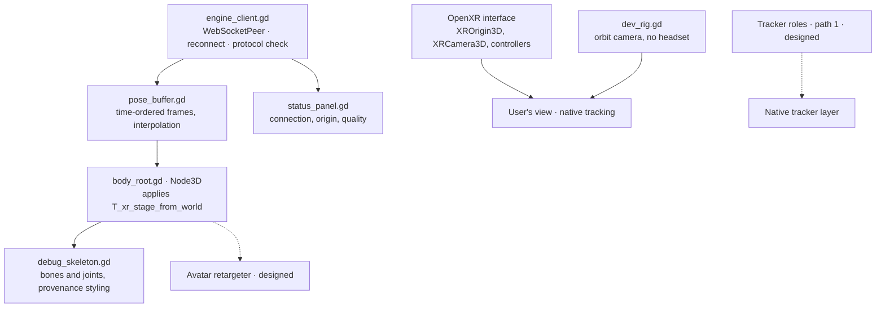

# 08 — VR client

A Godot 4 + OpenXR application that is a second client of the engine. It consumes the same
WebSocket stream as the desktop UI and contains no biomechanics.

## 1. Two tracking paths, kept separate

| | Path 1 — SlimeVR → SteamVR → OpenXR | Path 2 — Bansayo engine → Godot |
|---|---|---|
| What it carries | Individual tracker poses that the XR runtime exposes as devices | The canonical skeleton, joint measurements, quality and provenance |
| Who solves the body | SlimeVR Server | Bansayo engine |
| How Godot sees it | OpenXR action paths for tracker roles | The WebSocket stream from [04](04-contracts.md) |
| Good for | Full-body tracking in existing SteamVR titles | Bansayo's own visualisation and training feedback |
| Status | Designed, runtime-dependent | **PoC** |

The two are never merged inside the client. If both are present they are separate layers that can
be shown together for comparison. Combining them is fusion, and fusion belongs in the engine.

### What is and is not guaranteed on path 1

- SlimeVR Server presents its trackers to SteamVR through its OpenVR driver, which emulates Vive
  trackers.
- An OpenXR application sees those trackers only if the runtime implements the Vive tracker
  interaction extension (`XR_HTCX_vive_tracker_interaction`) and each tracker has a role assigned
  in SteamVR. Godot exposes them as action paths under `/user/vive_tracker_htcx/role/…`.
- SteamVR supports this. Other OpenXR runtimes generally do not, so a SlimeVR tracker visible in
  SteamVR is **not** automatically visible to an OpenXR application on another runtime.
- Godot's `XRBodyTracker` API is marked experimental and body tracking is not standardised across
  runtimes. The client does not depend on it.

This must be verified with the actual headset and runtime before anything is built on it
([11](11-risks-and-validation.md)).

## 2. Architecture



| Script | Responsibility |
|---|---|
| `engine_client.gd` | Connects to the engine, reconnects with backoff, checks `protocol_version`, parses messages, emits signals: `hello_received`, `skeleton_changed`, `state_changed`, `frame_received`, `connection_changed` |
| `pose_buffer.gd` | Keeps a short buffer of frames and returns the pose to render for the current time |
| `body_root.gd` | The single node under which all engine-supplied body content lives; holds the alignment transform |
| `debug_skeleton.gd` | Builds bones and joints from the `SkeletonDefinition` and updates them each frame; styles by provenance |
| `status_panel.gd` | An in-world panel: connection state, origin badge, tracking state and coverage |
| `dev_rig.gd` | Desktop camera and controls used when no XR interface initialises |

GDScript only. godot-rust/gdext is deferred: the client parses JSON and sets transforms, and that
does not justify a native build step. It becomes worthwhile if the client ever needs to share
non-trivial code with the engine (ADR-010).

## 3. Coordinates

Bansayo's world frame and Godot's world share handedness (right), up axis (+Y), unit (metre) and
character-forward (+Z). Quaternions are `[x, y, z, w]` in both. **No axis conversion is applied.**
A segment's `rotation` becomes a Godot `Quaternion(x, y, z, w)` and `position_m` a `Vector3`.

The only transform is alignment between Bansayo's world and the XR stage:

```text
T_xr_stage_from_world = translation · yaw rotation
```

It is applied once, on `body_root`. In the PoC it is identity and labelled as assumed.

### Headset alignment (designed)

Procedure for the `xr_alignment` profile: the user stands in the reference pose wearing the
headset; the engine's head segment pose and the headset's pose in stage space give the yaw and
translation that make them coincide. Both floors are `y = 0` when both are calibrated, so the
vertical component is a consistency check, not a free parameter. The profile is computed and
stored by the engine. The client will receive the transform as a new field of system state, which
is an additive, compatible change to the contract.

## 4. Native tracking and supplied body poses

| Source | Drives | Rule |
|---|---|---|
| OpenXR headset pose | The camera | Always. The engine's head segment never moves the user's view; doing so would cause discomfort |
| OpenXR controllers | Hand models and UI pointers | Always |
| Engine skeleton | The body visualisation | Rendered in aligned space. In the PoC it is a separate figure in front of the user, not attached to them |
| OpenXR tracker roles (path 1) | A separate tracker layer | Designed |

First-person embodiment — drawing the engine's body under the user's own head — requires headset
alignment and is not in the PoC.

## 5. Interpolation and latency

Frames arrive at the engine's publish rate; the headset renders faster and on its own clock.

- The client buffers frames with their `t_us` and renders a fixed short delay behind the newest
  frame, interpolating between the two frames that bracket the render time: spherical
  interpolation for rotations, linear for positions.
- The client's mapping from session time to its own clock is estimated from arrival times, in the
  same way the engine estimates device clock offsets.
- If no bracketing pair exists (a gap), the last pose is held briefly, then the figure fades and
  the status panel reports the gap. The client does not extrapolate.
- Provenance changes are not interpolated: a segment that becomes inferred switches style at once.

The buffer delay is a named constant chosen at implementation and reported, not a claim about
end-to-end latency. Latency is to be measured with hardware.

## 6. Skeleton mapping and retargeting

The debug skeleton needs no mapping: it draws whatever segments the definition contains.

For avatars (designed), segments map one-to-one onto Godot's humanoid profile:

| Bansayo segment | Godot `SkeletonProfileHumanoid` bone |
|---|---|
| `pelvis` | `Hips` |
| `spine` | `Spine` |
| `chest` | `Chest` |
| `neck` | `Neck` |
| `head` | `Head` |
| `left_clavicle` | `LeftShoulder` |
| `left_upper_arm` | `LeftUpperArm` |
| `left_forearm` | `LeftLowerArm` |
| `left_hand` | `LeftHand` |
| `left_thigh` | `LeftUpperLeg` |
| `left_shin` | `LeftLowerLeg` |
| `left_foot` | `LeftFoot` |

Right side likewise. Because every Bansayo segment frame is world-aligned in the T-pose, the
retargeting rule is one multiplication per bone:

```text
bone_global_rotation(t) = q_world_from_segment(t) · bone_global_rest_rotation
```

where the rest rotation is the avatar bone's global rotation in its own T-pose. Bone lengths come
from the avatar; only the root position is taken from the stream, scaled by the ratio of avatar
to skeleton leg length so the feet stay on the floor. Avatar bones with no Bansayo segment
(fingers, toes, upper chest) keep their rest pose.

## 7. Connection management and loss behaviour

| Situation | Behaviour |
|---|---|
| Engine not reachable at start | Room renders; status panel shows "Engine not connected" and the address; retries with backoff |
| Protocol mismatch | Status panel shows both versions; no body is drawn |
| Connection lost | Figure holds briefly, fades, status panel reports it; reconnect and resynchronise from `hello` |
| `pose: null` | No figure; the status panel shows the engine's reason |
| Tracker lost | The engine marks the segment inferred; the client draws it in the inferred style |
| Headset removed or XR session lost | The body stream continues; the view switches to the desktop rig if the session ends |
| Skeleton revision changes | The debug skeleton is rebuilt from the new definition |

The engine address comes from a project setting, overridable by the `BANSAYO_ENGINE_URL`
environment variable.

## 8. PoC scope

- A training room: floor with a metre grid, neutral lighting, origin marker.
- The debug skeleton, styled by provenance, standing on the room's floor.
- The status panel.
- The stream consumer with reconnect, protocol check and interpolation.
- **Development mode**: with no XR interface available the project runs as a normal desktop 3D
  application with an orbit camera. This is the mode used for validation without a headset.
- XR mode: initialises OpenXR when present and places the user in the room facing the figure.
  This path is written but **cannot be verified without a headset**, and is reported as such.

Validation in the PoC is limited to Godot's headless import and script check plus a run in
development mode against a live engine.

## 9. Intended experiences and where they fit

| Experience | Needs from the engine | Needs in the client |
|---|---|---|
| Full-body avatar | Skeleton stream | Avatar retargeter |
| Virtual mirror | Skeleton stream | A mirrored copy of the avatar; headset alignment for first person |
| Stretching and movement guidance | Joint measurements, later exercise state | A target-pose ghost and angle indicators |
| Martial-arts practice | Joint measurements, phase detection | Target zones, timing feedback |
| Joint-angle feedback | Joint measurements with provenance | In-world readouts anchored to joints |
| Training replay | Replay mode on the same stream | Transport controls sent over the HTTP API |
| Virtual trainer | A second pose stream (recorded reference) | A second figure |

Every metric shown in VR is computed by the engine and arrives on the stream. The client's work is
presentation.

## 10. Next steps for headset integration

1. Install the XR runtime and confirm the project starts an OpenXR session in the training room.
2. Verify scale and floor height against the real room.
3. Implement the `xr_alignment` procedure in the engine and apply the transform in `body_root`.
4. Add the avatar retargeter using the mapping in §6.
5. With SlimeVR Server and SteamVR running, verify which tracker roles the runtime exposes and
   add the native tracker layer.
6. Measure motion-to-photon latency for the body stream and tune the interpolation delay.
