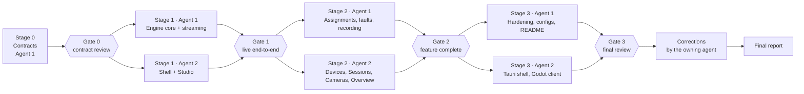

# 10 — PoC implementation plan

## 1. Delegation model

| Role | Does | Does not |
|---|---|---|
| **Architect** (Fable) | Owns `docs/`, the contracts and every architectural decision; briefs the agents; reviews code at each gate; assigns corrections; approves | Write application code, including to unblock integration |
| **Agent 1** (Opus) — core platform | All Rust in `crates/`, example configs, generated contracts | Touch `apps/`; change a contract without approval |
| **Agent 2** (Opus) — user applications | Desktop UI, Tauri shell, Godot client | Touch `crates/`, `config/` or `contracts/`; declare its own copy of a contract type |

Exactly two implementation agents. Neither spawns further agents. An agent that hits a decision
bigger than a local implementation choice stops and asks the architect.

Nobody commits during implementation. The architect reviews the working tree at each gate; the
repository owner commits.

## 2. Prerequisites

Nothing is installed by the agents without the owner's say-so. To build and validate the PoC:

| Tool | Version | Needed for | This machine (macOS arm64) |
|---|---|---|---|
| Rust (rustup, stable) | 1.92 or newer | Engine, desktop shell | Present (1.92, Homebrew) |
| Node.js and npm | Node 22 LTS or newer | Desktop UI | Present (24.20 / 11.19) |
| Platform build tools | Windows: Visual Studio Build Tools with "Desktop development with C++". macOS: Xcode Command Line Tools | Rust linking, Tauri | Present |
| WebView runtime | Windows: WebView2 (ships with Windows 11). macOS: system WebKit | Tauri | Present |
| **Godot 4**, standard build (not .NET), latest stable, on `PATH` as `godot` | 4.x | VR client validation | **Missing — install before Stage 3** |

Not needed for the PoC, needed for later milestones: SteamVR and a headset, SlimeVR Server,
NVIDIA driver with CUDA and cuDNN matching ONNX Runtime, PlatformIO. Python is not needed at any
point.

The brief names Windows 11 as the development environment. The PoC contains nothing
platform-specific, but it is being built and checked on macOS; a Windows build and smoke test is
the first validation task afterwards.

## 3. Stages and gates

Agents work concurrently only after Gate 0, when the generated types and golden examples exist.

| Gate | The architect checks |
|---|---|
| 0 | Generated TypeScript and golden JSON match [04](04-contracts.md) field by field; receivers tolerate unknown fields; identifier validation exists |
| 1 | Simulated motion → engine → WebSocket → three.js skeleton, live, after a reference-pose capture triggered over the API; dependency direction in the engine; no pose data in React state |
| 2 | Every row of the acceptance tables below; the three example configurations behave as the feature table in [03 §5](03-domain-model.md) says |
| 3 | The full review checklist in §8 |

## 4. Agent 1 brief — Rust tracking engine

**Read first:** [02](02-architecture.md), [03](03-domain-model.md), [04](04-contracts.md),
[05](05-calibration-and-fusion.md), [06](06-recording-and-playback.md),
[09](09-robustness-and-quality.md).

**Owns:** `Cargo.toml`, `rust-toolchain.toml`, `.gitignore`, `README.md`, `crates/`, `config/`,
`contracts/` (generated output).

**Provides to Agent 2:** generated types in `contracts/ts/`, golden messages in
`contracts/examples/`, the HTTP and WebSocket API, and the library entry points:
`kinexa_engine::config::load(path)`; `kinexa_engine::start(config)`, which returns a handle
exposing the bound address and a graceful `shutdown`; and `kinexa_engine::run(config, shutdown)`,
which is `start` plus waiting for the shutdown signal.

### Stage 0 — contracts

- Workspace scaffold with the two crates.
- `kinexa-contracts`: every type in [04 §3–5](04-contracts.md), with serde and ts-rs derives.
- Identifier newtypes that validate their pattern on construction and deserialisation.
- A test that writes `contracts/ts/` and `contracts/examples/` and fails if checked-in output
  differs. One example per message type, a full `SystemState`, and one of each API body.
- Wire types accept unknown fields. Configuration types reject them.

### Stage 1 — engine core and streaming

- Configuration loading and validation ([04 §6](04-contracts.md)); `--config`, `--check`.
- Session clock and the device clock offset estimator.
- Skeleton definition `kinexa.body.v1`, proportion scaling, forward kinematics.
- The `Source` trait and the simulated source: a deterministic body with the six motions
  (`reference_pose`, `standing`, `squat`, `knee_flexion`, `arm_raise`, `front_kick`), virtual
  trackers with seeded mounting rotations emitting orientation observations, virtual cameras
  emitting projected 2D landmarks.
- Device registry with the state machine and stream statistics; assignments from configuration.
- Pipeline runner: observation buffer, solver stages, joint measurements, quality, feature
  availability, fixed-rate tick.
- Calibration store and reference-pose mounting capture with the stillness check. Without it
  every segment is `inferred` and the skeleton does not move, so it belongs in this stage.
- Axum API: `health`, `state`, `skeleton`, `simulation`, `calibration/reference-pose`, and the
  WebSocket stream with topics and rate limiting; response envelope; origin allow-list.
- Structured logging, typed errors, graceful shutdown.

### Stage 2 — assignments, faults, recording

- Runtime assignment changes, persisted to the data directory, with the invalidation rules.
- Scripted scenarios and the manual fault endpoint.
- MCAP recording, session index, replay source, playback controls, mode switching.

### Stage 3 — hardening

- The four example configurations: `kinexa.example.yaml` (annotated), `sim-full-body.yaml`
  (twelve trackers, two cameras), `sim-six-trackers.yaml` (pelvis, chest, thighs, shins; no
  camera), `sim-camera-only.yaml` (one camera, no trackers).
- Source supervision with capped backoff.
- `README.md`: prerequisites, build, run, the API in brief, what is simulated.

### Acceptance

| # | Criterion | Check |
|---|---|---|
| A1.1 | `cargo fmt --check`, `cargo clippy --all-targets -- -D warnings` and `cargo test --workspace` pass | Run |
| A1.2 | Generated contracts are current | Contract test |
| A1.3 | The engine starts from each example configuration and serves `GET /health` | Smoke test |
| A1.4 | A WebSocket client receives `hello` first, then frames with strictly increasing `seq` at the publish rate | Integration test |
| A1.5 | Before calibration every segment is `inferred` with reason `mounting_calibration_missing` | Test |
| A1.6 | After reference-pose capture during the reference motion, tracked segments are `derived`, and solved segment rotations match the simulator's ground truth within a stated tolerance | Test |
| A1.7 | Joint angles during `squat` and `front_kick` follow the scripted angles within a stated tolerance | Test |
| A1.8 | Capture during a moving motion fails with the movement message | Test |
| A1.9 | Reassigning a tracker makes its mounting profile `stale` and its old segment `inferred` | Test |
| A1.10 | Disconnecting a tracker: device `disconnected`, segment `inferred` after the staleness window, dependent joints `null` with a reason; recovery on reconnect | Test |
| A1.11 | `sim-camera-only`: landmarks stream, `pose` is `null`, `skeleton_pose` unavailable with a reason | Test |
| A1.12 | Recording produces a session; two replays of it produce identical frame sequences | Test |
| A1.13 | Recording during replay, and replay during recording, return `conflict` | Test |
| A1.14 | An invalid configuration reports every problem with its path and the engine exits non-zero | Test |
| A1.15 | A request with a foreign `Origin` is refused; a malformed session id never reaches the filesystem | Test |
| A1.16 | Ctrl-C during recording leaves a readable session | Manual |
| A1.17 | Nothing in the engine depends on the number of trackers or cameras; both lists may be empty | Review, and A1.3 |

### Quality bar

Small modules (typically under 300 lines); no `unwrap` or `expect` in recoverable runtime paths;
every queue bounded with its overflow policy stated; named constants; no `unsafe`; no generic
plugin framework; observations and solved poses are distinct types; unit tests on the pure
modules (quaternion conventions, forward kinematics, mounting maths, joint angles, clock offset,
configuration validation, feature rules, contract round-trips).

### Excluded

Real device adapters, camera capture, inference, triangulation, heading alignment, SQLite, frame
stepping, export, anything under `apps/`.

## 5. Agent 2 brief — desktop UI and VR client

**Read first:** [03](03-domain-model.md) (for meaning), [04](04-contracts.md),
[07](07-desktop-ui.md), [08](08-vr-client.md), [09 §2](09-robustness-and-quality.md).

**Owns:** `apps/desktop/` including `src-tauri/`, `apps/vr/`, and a `README.md` inside each.

**Consumes:** `contracts/ts/` through an import alias; `contracts/examples/` as test fixtures and
for early development; the HTTP and WebSocket API.

### Stage 1 — shell and Studio

- Vite + React + TypeScript project; design tokens; base styles; self-hosted fonts.
- `engine/`: connection with backoff and protocol check, typed HTTP client, stores, hooks,
  actions.
- Shell: navigation rail, status bar, transport bar, live region, hash routing.
- Studio: the viewport (skeleton, provenance styling, floor, selection, view presets), segment
  list, inspector, joint table with the rolling trace, simulation controls.
- All connection and empty states from [07 §6](07-desktop-ui.md).
- Development before the engine is ready uses the golden examples replayed by a test helper.
  That helper is a development fixture, never shipped as a data source.

### Stage 2 — remaining workspaces

- Devices: cards, table view, assignment, body map, simulated fault controls, reference-pose
  flow.
- Sessions and playback transport.
- Cameras: landmark preview and detail; camera inset in Studio.
- Overview.
- Viewport extras as time allows: tracker markers, camera frustums, trails, angle arcs.

### Stage 3 — Tauri and Godot

- Tauri 2 shell hosting the engine library, attach-if-running, content security policy, graceful
  shutdown.
- Godot project per [08 §8](08-vr-client.md): training room, debug skeleton, status panel, stream
  consumer with interpolation, development mode, XR initialisation.
- `README.md` in each app: run instructions, what is unverified, next steps for the headset.

### Acceptance

| # | Criterion | Check |
|---|---|---|
| A2.1 | Type check, build and unit tests pass | Run |
| A2.2 | No contract type is declared outside `contracts/ts`; only `engine/` touches the network | Review |
| A2.3 | Against a running engine the skeleton moves in real time and the motion selector changes it | Visual |
| A2.4 | Inferred and derived segments are visibly different; `SIMULATED` is always shown while data is simulated | Visual |
| A2.5 | Pose frames do not pass through React state; no per-frame allocation in the render loop | Review |
| A2.6 | Stopping the engine clears live values, shows the disconnected banner and recovers when it returns | Visual |
| A2.7 | Reference-pose flow works end to end and shows the engine's failure reasons | Visual |
| A2.8 | Reassigning and disconnecting a tracker are reflected in Devices, Studio and Overview | Visual |
| A2.9 | Record, list, replay, scrub, exit replay | Visual |
| A2.10 | Each of the three example configurations produces the layout in [07 §7](07-desktop-ui.md) | Visual |
| A2.11 | Usable at 1440, 1024 and 800 px wide; no horizontal overflow | Screenshots |
| A2.12 | Every control is keyboard-reachable with a visible focus ring; shortcuts work | Manual |
| A2.13 | Text contrast meets AA against its surface | Computed |
| A2.14 | The Tauri app starts, hosts the engine and shows the same UI | Run; report if the toolchain prevents it |
| A2.15 | The Godot project imports without script errors and, in development mode, shows the skeleton moving against a live engine | Headless import, then run |
| A2.16 | The Godot client reads the same messages with no conversion of axes | Review against golden examples |

### Quality bar

Feature-organised components; strict TypeScript with no `any`; presentational components pure;
tokens for every colour, size and duration; no UI framework, state library, router or chart
library; no invented accuracy or latency figure anywhere in the interface; unit tests on pure
helpers (quaternion maths, formatting, selectors).

### Excluded

Any tracking, calibration or simulation logic; the Analysis workspace; a full calibration
workspace; video; avatars; changes outside `apps/`.

### If scope must be cut

Desktop first. The order of cuts is the reverse of the priority table in
[07 §11](07-desktop-ui.md), then the Godot client is reduced to a connection and a moving debug
skeleton in development mode. Whatever is cut is reported, not stubbed.

## 6. Contract changes

1. The agent that needs a change describes it to the architect: what, why, and whether it is
   additive.
2. The architect decides, updates [04](04-contracts.md) and tells both agents.
3. Agent 1 changes the crate and regenerates. Agent 2 adapts.

No agent works around a contract problem locally.

## 7. End-to-end demonstration

The script the final review runs:

1. `cargo run -p kinexa-engine -- --config config/sim-full-body.yaml`
2. `npm run dev` in `apps/desktop`; open the UI. Overview reports missing mounting calibration.
3. Run the reference-pose flow. Segments become derived.
4. In Studio select `squat`; inspect left knee flexion and its trace.
5. Disconnect a shin tracker from Devices; observe the limb, the joint table, the status bar.
   Reconnect.
6. Reassign a tracker; observe the stale calibration; recapture.
7. Record ten seconds of `front_kick`; stop; replay; scrub; exit replay.
8. Restart the engine with `sim-six-trackers.yaml`, then `sim-camera-only.yaml`; observe the UI
   adapt.
9. Start the Godot client in development mode against the same engine; the same motion appears.
10. Start the Tauri app.

## 8. Final review checklist

| Area | Question |
|---|---|
| Dependency direction | Does anything depend on `api`? Do pure modules import Tokio? Does the UI reach the network outside `engine/`? |
| Protocol consistency | Do the generated types, the golden examples, the Godot parser and [04](04-contracts.md) agree? |
| Device-count assumptions | Any fixed array size, index or id for trackers, cameras or segments? |
| Error handling | Any discarded error, `unwrap` in a runtime path, or silent drop? |
| Source organisation | File sizes, cohesion, feature-based layout, dead code |
| Configuration usage | Any behavioural threshold hard-coded? Any setting unused? |
| Misleading claims | Any value shown without origin and provenance? Any accuracy or latency figure? Any unimplemented feature presented as working? |
| UI consistency | Tokens only; consistent state and provenance encoding; all states handled |
| Duplication | Any second copy of a contract type, a kinematic computation or a feature rule? |
| Integration | Does the demonstration in §7 run from a clean checkout? |
| Documentation | Do the READMEs describe what exists, and say what is simulated and unverified? |

Each finding goes back to the agent that owns the file.

## 9. Testing scope

The global rule set on this machine asks for test-first development and 80 % coverage. The brief
for this project asks for targeted tests and quick correctness checks instead, and for the rest
to be recorded as future validation. The brief governs here: unit tests on core logic, a small
number of integration smoke tests, type checks, short visual inspection with a few screenshots,
and headless Godot validation. Everything else is listed in
[11 §4](11-risks-and-validation.md).

## 10. Definition of done

- Every acceptance criterion is met, or its failure is stated in the final report with the reason.
- The demonstration in §7 runs.
- The final report lists what is simulated, what needs hardware, what is unimplemented and what
  is unverified, matching [11 §3](11-risks-and-validation.md).
