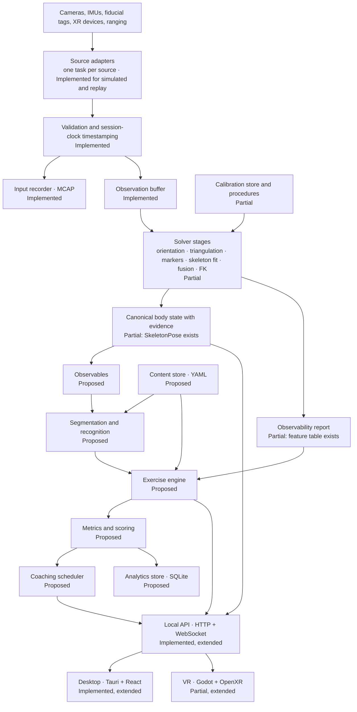

# 01 — Product vision

Status legend used in every document of this set:

| Tag | Meaning |
|---|---|
| **Implemented** | Exists in the working tree and is covered by the evidence in [docs/13](../../13-implementation-status.md) |
| **Partial** | Exists, but only on simulated inputs or without the part named next to the tag |
| **Planned** | Specified in `docs/01`–`docs/12` before this task, no code |
| **Proposed** | Introduced by this architecture set |

## 1. What the product is

Bansayo becomes a **martial-arts training, movement-analysis, flexibility and coaching platform**
built on the existing tracking engine. One engine process turns whatever sensors the athlete owns
into one canonical description of the body, analyses that description against declarative
technique, drill, workout and form definitions, and serves the result to a desktop application and
a VR application that contain no analysis logic of their own.

The existing rule of the project is kept and extended to training:

> The system never presents a value as better than it is.

For training this means: a repetition count, a kick height, a score or a coaching cue is published
only when the measurements behind it were actually observed with sufficient quality, and every
stored measurement records how it was obtained so that progress over months compares like with
like.

## 2. Product goals

| # | Goal | Consequence in the architecture |
|---|---|---|
| G1 | One training engine, two presentations | Exercise, recognition, scoring and coaching run only in the engine ([14](14-runtime-and-api-contracts.md)); desktop and VR are clients of the same `training` stream |
| G2 | Any sensor set, honest capability | Training logic reads **observables** with evidence, never devices ([04](04-movement-domain-model.md)); what is offered follows from what is observable ([08 §9](08-tracking-and-sensor-fusion.md)) |
| G3 | Content is data | Techniques, combinations, forms, workouts, programs, scoring models and cues are versioned YAML ([13](13-configuration-schemas.md)); the engine contains no technique names |
| G4 | Defensible progress | Every stored metric carries method, tracking configuration, calibration set and definition version; series are only joined within a comparability class ([12 §5](12-data-and-progress.md)) |
| G5 | Local-first | No account, no cloud, no network requirement ([ADR-031](adr/ADR-031-local-first-execution.md)) |
| G6 | Useful early | The first slice delivers repetition counting and feedback on a roundhouse kick on the simulator and on one webcam before any multi-camera or IMU work ([18](18-implementation-roadmap.md)) |
| G7 | A training aid, not a judge | No grading, certification, injury or medical claim ([17](17-security-privacy-and-safety.md)) |

## 3. Non-goals

- Formal grading, competition judging or certification.
- Impact force, contact quality, muscle activation, centre of pressure or injury-risk measurement.
- Partner or sparring analysis (two bodies). The engine tracks exactly one athlete.
- Hand, finger and face tracking.
- Cloud sync, accounts, social features, remote coaching.
- A general-purpose rule language for content authors.
- A marketplace or licence-management system for reference content.

## 4. Disciplines in scope

| Discipline | Initial content | First-class concepts beyond single strikes |
|---|---|---|
| Karate (Shotokan as the representative style) | Kicks, punches, basic blocks, stances, Heian Shodan | Stances, stance transitions, kata |
| Taekwondo (Kukkiwon/WT as the representative style) | Kicks, stances, Taegeuk Il Jang | Poomsae, chamber/retraction mechanics |
| Muay Thai | Punches, teep, round and low kick, knees, elbows, check | Combinations, guard, rhythm |
| General | Squat, lunge, balance, leg raise, hip mobility | Holds, range of motion, symmetry |

"Representative style" names the variant shipped first. A technique identifier never implies a
universal standard; every definition belongs to a style and may have siblings
([05 §2](05-technique-library.md)).

## 5. Conceptual pipeline, validated against the code

The brief's conceptual pipeline is kept with four corrections that come from the existing engine.

Corrections to the brief's diagram:

1. **Recording branches off before the solver.** Sessions store inputs and context, and replay
   re-runs the solver (existing ADR-005). Training adds a second, derived recording of solved motion
   ([12 §7](12-data-and-progress.md)); it does not replace input recording.
2. **Calibration is a store read by solver stages**, not a pipeline step every sample passes
   through (existing [docs/05](../../05-calibration-and-fusion.md)).
3. **"Tracking quality" is not a stage.** Evidence (provenance, confidence, uncertainty, method)
   travels with every value, and a separate observability report says which observables exist.
4. **Recognition precedes the exercise engine and is separate from fusion.** Fusion ends at the
   canonical body state; nothing after that point can see a device
   ([ADR-018](adr/ADR-018-training-crate-and-runtime-boundaries.md)).

## 6. What already exists and is reused

| Existing investment | Reused as |
|---|---|
| `bansayo-contracts` types, ts-rs generation, golden examples | The only place wire and persisted types are defined; training types are added there |
| Source task model, bounded ingest, supervision | Unchanged; new adapters are new `Source` implementations |
| Session clock and `TimeQuality` | Unchanged; the only time base for analysis |
| Calibration store, states, invalidation table | Extended with new kinds; no second calibration mechanism |
| Solver as ordered pure stages | New stages are appended; no estimator framework |
| Triangulation stage | Reused; time-aligned variant proposed in [ADR-023](adr/ADR-023-time-aligned-triangulation.md) |
| 19-segment skeleton `bansayo.body.v1`, forward kinematics, joint measurements | The canonical skeleton; keypoint set and observables extend it |
| Provenance, origin, reasons, feature table | The base of evidence and observability |
| MCAP input recording and deterministic replay | Regression corpus for analysis; re-analysis of old sessions |
| HTTP + WebSocket API, envelope, versioning rule | Extended additively: new topics and routes under `/api/v1` |
| Desktop shell, workspaces, imperative viewport, UI primitives | New workspaces are added to the same shell |
| Godot client, stream consumer, pose buffer | Extended with training scenes; still presentation only |

## 7. Operating modes

Seven modes share one exercise engine. They differ only in the **plan** given to a training session
and in presentation; they are specified in [03](03-training-modes.md).

| Mode | Plan kind | Context given to recognition |
|---|---|---|
| Free Training | `free` | The athlete's enabled technique set (open set) |
| Guided Technique Practice | `technique` | One technique, one side |
| Combinations and Drills | `combination` | An ordered step grammar |
| Workout | `workout` | A block list of the other kinds |
| Kata / Poomsae | `form` | A hierarchical step list with facings |
| Flexibility and Mobility | `mobility` | Holds and controlled raises |
| Assessment / Benchmark | `assessment` | A fixed protocol with entry gates |

## 8. Success criteria for the platform

- An athlete with one webcam completes a guided kicking session with repetition counts and timing
  feedback, and sees those results next to last week's.
- Adding a second camera, printed tags or IMUs changes configuration and calibration only; no
  technique, workout or scoring definition changes, and additional metrics appear because their
  inputs became observable.
- The same saved workout runs on the desktop and in VR without modification.
- A stored session can be re-analysed after an algorithm change, and results from before and after
  are distinguishable by version.
- No accuracy figure appears anywhere in the product before the validation plan in
  [16](16-accuracy-and-validation.md) has produced it.
