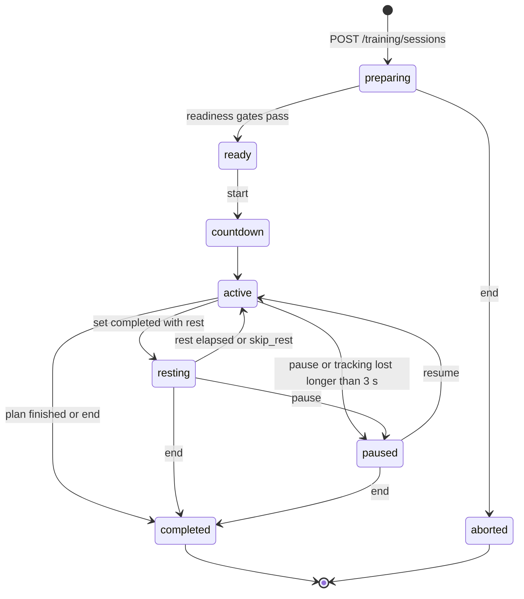

# 03 — Training modes

All modes are **plans executed by one exercise engine** ([06](06-exercise-and-workout-engine.md)).
A mode is not a code path in a client. This document fixes, for each mode, the plan, the
recognition context, what the athlete sees, what is stored, and what is withheld when observation
is insufficient.

The class and lessons below are **proposed**. For the sessions that run today and the order
of the next releases, see the [training roadmap](18-implementation-roadmap.md#22-next-training-releases).

## 1. Common session skeleton

Every mode runs the same top-level lifecycle; only the plan differs.



Readiness gates, evaluated in `preparing` and published as `TrainingState.readiness`:

| Gate | Blocking | Passes when |
|---|---|---|
| `athlete_selected` | Yes | An active athlete exists |
| `plan_valid` | Yes | Every referenced definition resolves and validates |
| `tracking_minimum` | Yes | At least one observable required by the plan's `required_observables` is available |
| `metrics_available` | No | Reported per metric: available, degraded or unavailable with reasons |
| `calibration` | Per plan | Calibration kinds listed in the plan's metric gates are `valid`. Blocking only for `assessment` |
| `space_check` | No (desktop), Yes (VR) | Athlete confirmed clear space; in VR the play-area bounds satisfy [11 §7](11-vr-architecture.md) |
| `safety_ack` | Yes, once per athlete per content version | The athlete acknowledged the technique's safety notes |

A non-blocking gate that fails is shown before the countdown with the list of metrics that will not
be measured. The session can still start.

## 2. Mode matrix

| Aspect | Free | Technique | Combination | Workout | Form | Mobility | Assessment |
|---|---|---|---|---|---|---|---|
| Plan kind | `free` | `technique` | `combination` | `workout` | `form` | `mobility` | `assessment` |
| Recognition | Open set over enabled techniques | Closed: one definition | Grammar-driven expected steps plus confusables | Per item | Step FSM plus offline alignment | Hold and raise detectors | Closed, strict gates |
| Repetition source | Activity segmenter | Phase machine | Sequence automaton | Per item | Step machine | Hold machine | Protocol |
| Live cues | Off by default | One per repetition | One per round | Per item | One per step in guided sub-mode; none in performance sub-mode | Range and timer only | None during trials |
| Score | None | Components | Sequence accuracy + timing | Completion + per-item | Per-step components | None; measurements only | Result with uncertainty |
| Stored | Movement events, statistics | Repetitions, metrics | Rounds, step results | All of the above | Step results, alignment | Holds, range measurements | Assessment result |
| Demonstration | — | Yes | Yes | Per item | Yes | Yes | Procedure instructions |

## 3. Free Training

**Purpose.** Track and label what the athlete chooses to do, without a script.

**Plan.**

```yaml
plan:
  kind: free
  technique_set: [taekwondo.dollyeo_chagi, taekwondo.ap_chagi, muay_thai.jab]   # optional; default = athlete's enabled set
  duration_s: 600            # optional time cap
  coaching: off              # off | summary_only
```

**Behaviour.**

1. The activity segmenter ([07 §2](07-recognition-and-coaching.md)) cuts the motion into candidate
   movement segments.
2. Every enabled technique's phase machine runs over each segment. A segment is labelled with a
   technique only when exactly one machine completes and its recognition confidence is at least
   `recognition.accept_confidence` (default 0.75). Two completing machines yield the label
   `ambiguous` with both candidates; none yields `unknown`.
3. `unknown` and `ambiguous` segments are counted and stored as movement events with their
   duration and peak end-effector speed. They never receive technique metrics or cues.
4. Repetitions of a labelled technique are grouped into implicit sets separated by pauses longer
   than `free.set_gap_s` (default 8 s).

**Shown.** Avatar, optional joint-angle overlay, a running list of recognised movements with
counts, session clock, tracking state.

**Withheld.** Technique feedback is off unless `coaching: summary_only`, in which case the
end-of-session summary lists, per recognised technique, the metrics that reached grade A or B.

## 4. Guided Technique Practice

**Purpose.** Learn or refine one technique.

**Plan.**

```yaml
plan:
  kind: technique
  technique: taekwondo.dollyeo_chagi
  side: right                # left | right | alternate
  stages: [demo, slow, normal]     # any ordered subset
  sets: 3
  reps: 10
  rest_s: 45
  reference: default         # default | personal_best | <reference id> | none
  coaching: standard         # minimal | standard | detailed
```

**Stages.** The nine deliverables in the brief map to stages and engine outputs:

| Brief item | Realisation |
|---|---|
| Technique demonstration | Stage `demo`: the reference clip plays; no tracking required |
| Starting stance instructions | `ready` sub-state: the start-stance definition's `instructions` are shown until the stance predicate holds for 500 ms |
| Target movement trajectory | Reference end-effector path sent with the clip ([07 §6](07-recognition-and-coaching.md)) |
| Slow practice | Stage `slow`: the technique's `tempo.slow` scale (default 0.5) widens phase time limits and enables per-phase holds; speed metrics are not recorded |
| Normal-speed practice | Stage `normal`: definition time limits apply |
| Repetition counting | `rep_completed` events |
| Technique assessment | Metric measurements and component scores per repetition |
| Suggested corrections | Cue scheduler output |
| Progress tracking | Stored measurements; comparison in the set summary |

**Repetition outcomes.**

| Outcome | Condition | Counted | Scored |
|---|---|---|---|
| `completed` | All mandatory phases entered in order within limits | Yes | Yes |
| `incomplete` | Machine left `idle` but timed out before the last mandatory phase | No | No; the furthest phase is stored |
| `rejected_quality` | Completed, but tracking gap longer than the technique's `max_gap_ms` inside the repetition | Yes | No |
| `wrong_side` | The mirror-side machine completed instead | No | No; shown as a notice |
| `excluded` | The athlete removed it afterwards | No | No |

### First Taekwondo technique clinic

Start with the two draft techniques already in the library, *ap chagi* (front kick) and
*dollyeo chagi* (roundhouse). The athlete selects one kick and one side after warming up.
Show a demonstration, allow slow solo practice, then run two normal-paced sets of four with
rest between them. Offer the other side as a separate run. Use the same kick, side and stage
for the repeat set so the athlete can tell what changed.

Give the athlete one thing to work on between sets. For example, show the retraction phase
on the attempt timeline and, when the timing cue meets its evidence gate, let them repeat the
set with that cue in mind. On one webcam, label body-relative heights and timing estimates
with their grades. If the support-foot pivot is out of view, show the reason and withhold
that correction. Use comparable normal-paced sets for the side-by-side review and the
existing grade and baseline rules for a trend across sessions. [Coaching rules](07-recognition-and-coaching.md) · [Progress rules](12-data-and-progress.md)

## 5. Combinations and Drills

**Purpose.** Practise ordered movements with timing.

**Plan.**

```yaml
plan:
  kind: combination
  combination: muay_thai.combo.jab_cross_low_kick
  stance: orthodox           # orthodox | southpaw | as_defined
  rounds: 10
  rest_s: 5                  # between rounds
  tempo_bpm: null            # optional metronome; null = free timing inside each step's window
  coaching: standard
```

The grammar (sequence, repeat, choice, optional, timing windows, side variation) is in
[06 §4](06-exercise-and-workout-engine.md). A **round** is one traversal of the grammar.

**Step results.** Each expected step ends with one of: `correct`, `wrong_technique` (a confusable
technique completed), `wrong_side`, `late` (after the window), `early` (before the window opened),
`missing` (window expired), plus zero or more `extra` movement events between steps. A round's
`sequence_accuracy` is `correct steps / expected steps`. A round is `completed` only if every
mandatory step is `correct`; otherwise `partial` with the fraction stored.

**Cues.** No cue is emitted between steps. At most one cue is emitted after a round, and only for
the earliest non-correct step.

## 6. Workout Mode

**Purpose.** Run a structured session.

**Plan.**

```yaml
plan:
  kind: workout
  workout: user.tkd_kicks_15min
  level: 2                   # optional index into the workout's levels
```

Hierarchy and semantics (sets, blocks, rest, completion, goals) are in
[06 §5](06-exercise-and-workout-engine.md). A workout item embeds exactly one of the other plan
kinds except `workout`. Timed items (`duration_s`) end on the clock; counted items end on the
count or on the item's `time_cap_s`.

### Full Body in 20 — a music-led follow-along class

Les Mills TONE pairs instructor-led cardio, strength and core work with music and intensity
options. For Bansayo, use that class format with original movement sequences, prompts and
music. [Les Mills TONE](https://www.lesmills.com/workouts/les-mills-tone)

| Class clock | Block | What the athlete follows |
|---|---|---|
| 0–3 min | Warm-up | March, step side to side, then add arm swings. Preview each new move while the feet keep moving. |
| 3–7 min | Cardio | Alternate a minute of step-touch with overhead reaches and a minute of alternating knee lifts. Repeat once. Offer a march with low reaches throughout. |
| 7–12 min | Full-body strength | Do a squat, wall push-up, hip hinge, wall push-up and squat, one station per minute. Each minute includes 40 seconds of movement and 20 seconds to recover or change position. Offer a shallower squat and a more upright wall push-up. |
| 12–17 min | Core and coordination | Alternate standing cross-crawls and side steps with arm sweeps for five one-minute stations, starting with cross-crawls. Keep the same 40/20 split. Offer alternating toe taps in place of knee lifts. |
| 17–20 min | Cooldown | Ease back to a walk, lower the arms, then finish with comfortable shoulder and calf movements. |

Use a `free` item with `coaching: off` and a `duration_s` target for each timed station.
Key the movement prompt and easier option to the item ID. The engine owns block changes and
remaining time. For the pilot, pair an original 120 BPM loop with a visual preview eight
beats before each change. The 40-second work and 20-second recovery intervals then fall on
whole eight-count phrases. Athletes can move at half time. Pause and resume the loop and
prompts at the same position as the session clock. A muted class follows the same schedule.

Credit active time and completed blocks for following along. An easier variation earns the
same time credit. Attach a rep count or technique cue only to an explicitly tracked item
with a supported movement definition and sufficient evidence.

### First guided kicking workout

For the first playable version, follow a warm-up with separate front-kick and roundhouse
sets on each side, rest between sets, then cool down. Keep the volume selectable. Show completed
reps against the target per kick and side, including partial sets when the athlete ends early.
Once both kicks can be distinguished on the chosen setup, add the longer workout's
front-kick–roundhouse round. Verify that reversing their order yields a sequence error even
when both reps were recognised. [Draft kicking workout](examples/workout-guided-kicking.yaml)

## 7. Kata and Poomsae Mode

**Purpose.** Learn and perform structured forms.

**Plan.**

```yaml
plan:
  kind: form
  form: taekwondo.kukkiwon.taegeuk_1
  sub_mode: guided           # guided | segment | performance
  section: null              # section id, required for sub_mode: segment
  tempo_scale: 1.0
  reference: default
```

| Sub-mode | Behaviour | Algorithm |
|---|---|---|
| `guided` | The next step is prompted; the engine waits for it; feedback after each step | Hierarchical step machine |
| `segment` | One section repeated, guided | Same, restricted to the section |
| `performance` | No prompts; the full form is performed and analysed afterwards | Online step machine for progress display; **offline alignment** after the last step produces the stored per-step result |

Each step checks, in this order and only where observable: technique recognised, stance predicate,
facing within tolerance, travel direction, timing class. A check whose observables are unavailable
is reported as `not_assessed`, never as passed ([07 §5](07-recognition-and-coaching.md)).

Variants: a form definition belongs to one style. Alternative valid executions inside one style are
expressed with `choice` nodes in the step list; a different lineage is a different form id.

Pilot one named section each of Shotokan **Heian Shodan** (karate kata) and Kukkiwon
**Taegeuk Il Jang** (Taekwondo poomsae). Have an instructor for each style verify the counts,
sides, turns and stance labels against the named version before publishing the lessons.
The existing Taegeuk example is a schema draft. Author the Shotokan section and resolve
the movement and stance definitions used by both excerpts. [Draft Taegeuk form](examples/form-taegeuk-1.yaml)

In a lesson, preview the section and its floor path, guide one count at a time, then let the
athlete repeat the section from its start. After all sections are available, offer a silent
full run. Its review should locate an omitted or extra step and let the athlete reopen that
section for practice. A replay with one omitted step must still align the following steps.
At `basic`, the review marks facing and travel as `not_assessed`.

## 8. Flexibility and Mobility Mode

**Purpose.** Measure and train range of motion and control.

**Plan.**

```yaml
plan:
  kind: mobility
  items:
    - movement: general.mobility.standing_hip_flexion_raise
      side: alternate
      reps: 6
    - movement: general.mobility.side_split_hold
      holds: 3
      hold_s: 30
      rest_s: 30
```

**Measurement classes**, fixed vocabulary stored with each range measurement:

| Class | Definition used by the engine | How the engine knows |
|---|---|---|
| `active_dynamic` | Peak joint angle reached during a self-driven movement | Movement kind `dynamic`; no hold |
| `active_static` | Joint angle held by the athlete's own muscles, limb unsupported | Movement kind `hold` with `support: none` declared in the definition |
| `supported_static` | Joint angle held with floor, wall, hand or gravity assistance | Movement kind `hold` with `support` ≠ `none` declared in the definition |
| `passive` | Range produced by an external force | **Never inferred.** Stored only when the athlete selects a definition that declares it |

The engine cannot observe muscle effort or external force. Active versus supported is therefore a
property of the **chosen movement definition**, never a classification of the motion.

**Control quality.** A hold is `stable` while the measured joint angle stays within
`hold.tolerance_rad` (default 0.087 rad, 5°) of its running median and the limb end-point speed
stays below `hold.max_speed_m_s` (default 0.10). Stable duration, not elapsed time, is what counts
towards `hold_s`.

**Safety behaviour** ([17 §3](17-security-privacy-and-safety.md)): no prompt asks for more range
than the athlete's stored comfortable baseline plus the definition's `progression_step`; holds are
capped at the definition's `max_hold_s`; a mandatory rest follows every hold; the UI shows the
limitation text on first use of each definition.

### First flexibility session

After a warm-up, start with four controlled standing hip flexion raises per side, then
two comfortable hamstring forward-fold holds. Pilot a 15-second stable-time target, capped
by the movement definition, with its mandatory rest after each hold. Show the side during
raises and the accumulated stable time during holds. If a required landmark disappears for
five seconds, the hold must earn zero seconds during that gap.

Let the athlete repeat the session at the same comfortable range. Report peak limb elevation
per side and stable hold time separately. On one webcam, label elevation in a suitable view
as an image-plane estimate. Compare like movements with the same support and measurement
method. Add a supported ankle dorsiflexion hold when heel and toe landmarks are available.
The optional hip-flexion benchmark requires calibrated multi-view tracking and grade-A
trials. [Measurement feasibility](22-measurement-feasibility.md) · [Hip-flexion benchmark](examples/assessment-hip-flexion.yaml)

## 9. Assessment / Benchmark Mode

**Purpose.** Produce a measurement that can be compared with the same assessment run later.

**Plan.**

```yaml
plan:
  kind: assessment
  assessment: general.assessment.front_kick_height
  side: both
```

An assessment definition ([13 §9](13-configuration-schemas.md)) fixes procedure, start conditions,
calibration prerequisites, required observables and grades, trial count, the aggregation rule and
the comparability key. Differences from the other modes:

- Calibration and tracking gates are **blocking**. The assessment does not start below its
  declared `required_profile` or with a stale calibration.
- No cue is shown during trials.
- A trial below grade A is repeated up to `max_extra_trials`; if the required number of grade-A
  trials is not reached the result is stored as `invalid` with reasons and is excluded from
  progress.
- The result stores the aggregate, the per-trial values, the within-session standard deviation and
  the full measurement context ([12 §5](12-data-and-progress.md)).

## 10. Interoperability rules

| Rule | Decision |
|---|---|
| Can a mode be embedded in another? | Only `workout` embeds others. No deeper nesting |
| Can the client change mode mid-session? | No. End the session and start another |
| Can desktop and VR attend the same session? | Yes. Any number of clients observe; any client may send commands; the engine applies commands in arrival order ([14 §6](14-runtime-and-api-contracts.md)) |
| Is recording tied to a mode? | No. `record` options are part of session creation for every mode |
| What happens when tracking degrades mid-session? | Metrics lose grade or are suppressed individually; the session pauses only after 3 s without any required observable |
