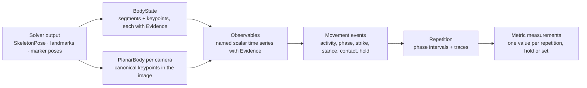

# 04 — Movement domain model

The discipline-independent representation of human movement that every training component reads.
Nothing in this document names YOLO, RTMPose, MediaPipe, an IMU part, an ESP32 or a headset; those
appear only in the adapters of [08](08-tracking-and-sensor-fusion.md).

Conventions of [docs/03](../../03-domain-model.md) (world frame, quaternions, time, provenance,
origin) are inherited unchanged. Decision record:
[ADR-019](adr/ADR-019-canonical-movement-representation.md).

## 1. Layers



| Layer | Defined in | Authored as | Status |
|---|---|---|---|
| `SkeletonPose`, joint measurements | `bansayo-contracts::pose`, `skeleton` | Rust | **Implemented** |
| `BodyState`, `PlanarBody`, `Evidence` | `bansayo-contracts::motion` | Rust | **Proposed** |
| Observable catalogue | `bansayo-training::observables` | Rust, closed set | **Proposed** |
| Movement events, repetitions | `bansayo-training::segment`, `recognize` | Rust engine driven by YAML definitions | **Proposed** |
| Metric definitions | Content store | YAML over a closed set of metric kinds | **Proposed** |

**Boundary rule.** Content (YAML) may reference observables, metric kinds and aggregators by id. It
can never define a new observable or a new formula. A new observable is a code change in one file
with a unit test; see §9.

## 2. Canonical skeleton

`bansayo.body.v1` (19 segments, **Implemented**) remains the canonical skeleton. Two additions:

### 2.1 Canonical keypoint set `bansayo.body.v1.points` (Proposed)

26 named points. The first 19 are the segment origins in skeleton order and are identical to the
existing landmark schema `bansayo.body.v1.joints`; seven end points are appended.

| Index | Name | Anatomical meaning | Skeleton source |
|---|---|---|---|
| 0 | `pelvis` | Midpoint between the hip joint centres | Origin of `pelvis` |
| 1 | `spine` | Lumbar pivot | Origin of `spine` |
| 2 | `chest` | Thoracic pivot | Origin of `chest` |
| 3 | `neck` | Base of the neck | Origin of `neck` |
| 4 | `head` | Atlanto-occipital pivot | Origin of `head` |
| 5, 9 | `left_clavicle`, `right_clavicle` | Sternoclavicular joint | Origin of the clavicle |
| 6, 10 | `left_shoulder`, `right_shoulder` | Glenohumeral joint centre | Origin of the upper arm |
| 7, 11 | `left_elbow`, `right_elbow` | Elbow joint centre | Origin of the forearm |
| 8, 12 | `left_wrist`, `right_wrist` | Wrist joint centre | Origin of the hand |
| 13, 16 | `left_hip`, `right_hip` | Hip joint centre | Origin of the thigh |
| 14, 17 | `left_knee`, `right_knee` | Knee joint centre | Origin of the shin |
| 15, 18 | `left_ankle`, `right_ankle` | Ankle joint centre | Origin of the foot |
| 19 | `head_top` | Vertex | `head` origin + tail |
| 20, 21 | `left_hand_tip`, `right_hand_tip` | Distal end of the hand segment | `hand` origin + tail |
| 22, 23 | `left_toe`, `right_toe` | Distal end of the foot | `foot` contact point "toe" |
| 24, 25 | `left_heel`, `right_heel` | Posterior calcaneus | `foot` contact point "heel" |

The index order is normative and versioned with the schema id. Segment order follows
`SkeletonDefinition.segments` as published by the engine.

### 2.2 Detector schema mapping (Proposed)

A pose detector publishes landmarks in its own schema. A **schema map** converts a detector schema
to canonical keypoints. Maps are data tables in `bansayo-engine/src/pipeline/schema_map.rs`, one per
supported detector schema, each entry being a weighted sum of detector landmarks:

| Canonical | From COCO-17 | From Halpe-26 | Provenance of the canonical point |
|---|---|---|---|
| `left_hip`, `right_hip` | hip landmarks | hip landmarks | As observed |
| `pelvis` | 0.5·L hip + 0.5·R hip | `hip` (pelvis) if present, else the midpoint | As observed |
| `neck` | 0.5·L shoulder + 0.5·R shoulder | `neck` | As observed |
| `spine`, `chest` | Interpolated on the pelvis–neck line at the skeleton's rest ratios | Same | `inferred` |
| `left_clavicle`, `right_clavicle` | Not mapped | Not mapped | Absent |
| `head` | Midpoint of the ears | Midpoint of the ears | As observed |
| `head_top` | Not mapped | `head` (top) | As observed, or absent |
| shoulders, elbows, wrists, knees, ankles | Direct | Direct | As observed |
| `*_toe` | Not mapped | 0.5·big toe + 0.5·small toe | As observed, or absent |
| `*_heel` | Not mapped | `heel` | As observed, or absent |
| `*_hand_tip` | Not mapped | Not mapped | Absent |

Consequences that the rest of the architecture relies on:

- With a COCO-17 detector there are **no foot points**. Every observable that needs heel or toe
  (foot yaw, support-foot pivot, ankle dorsiflexion, toe height) is unavailable. The recommended
  detector schema for training is therefore Halpe-26 ([ADR-021](adr/ADR-021-pose-estimation-integration.md)).
- Detector "hip" and "shoulder" landmarks are dataset annotation conventions, not anatomical joint
  centres. Angles involving the pelvis and shoulder girdle carry a systematic, detector-specific
  offset that cancels in within-athlete, same-method trends and does **not** cancel across methods.
  This is one reason for comparability classes ([12 §5](12-data-and-progress.md)).
- The list of supported detector schemas is closed in code. An unknown `schema_id` makes the camera
  `unavailable` with reason `landmark_schema_unsupported`.

## 3. Evidence

Every value above the solver carries evidence. This extends, and never merges, the three existing
labels (origin, provenance, confidence).

```ts
type MethodId =
  | "imu_mounted"          // IMU orientation through mounting and heading profiles
  | "imu_gyro"             // angular velocity read directly from a gyroscope
  | "imu_optical_fused"    // IMU orientation corrected by an optical orientation
  | "marker_cluster"       // rigid fiducial cluster through a marker_mounting profile
  | "triangulated"         // multi-view triangulation of a detector landmark
  | "skeleton_fit_axis"    // segment long axis from two measured joint centres
  | "skeleton_fit_plane"   // segment twist from the plane of a flexed child joint
  | "fk"                   // forward kinematics from root, rotations and proportions
  | "xr_device"            // headset, controller or XR tracker pose through xr_alignment
  | "depth_camera"         // depth sensor point
  | "image_plane"          // 2D detector landmarks of one camera, normalised
  | "monocular_lift"       // model-inferred 3D from one camera
  | "rest_fill"            // parent-relative rest pose
  | "floor_contact";       // floor-contact root rule

interface Evidence {
  provenance: Provenance;          // measured | derived | inferred | unavailable
  method: MethodId;
  confidence: number | null;       // 0..1, relative indicator (existing meaning)
  sigma: number | null;            // 1-sigma uncertainty in the value's own unit; null = not estimated
  sigma_basis: "propagated" | "validated" | null;
  t_obs_us: TimeUs | null;         // capture time of the newest contributing observation
  sources: DeviceId[];
}
```

Rules:

1. `sigma` is `propagated` when computed by the formulas in §8, `validated` when taken from a table
   produced by the validation plan ([16](16-accuracy-and-validation.md)). No `validated` table
   ships until that plan has run. The UI never shows a propagated sigma as an accuracy; it uses it
   only to grade and to draw uncertainty bands labelled "estimated".
2. A value combined from several inputs takes the **weakest provenance**, the **lowest-fidelity
   method** (order in §3.1), the minimum confidence, and a sigma propagated from the inputs' sigmas;
   if any input sigma is `null`, the result's sigma is `null`.
3. `t_obs_us` differs from the frame's `t_us` because the solver samples and holds. Derivatives are
   computed across distinct `t_obs_us` values, never across ticks (§6.3).

### 3.1 Method fidelity order

Used by rule 2 and by metric gates. Highest first:

```text
triangulated = marker_cluster = imu_optical_fused = xr_device = depth_camera
  > imu_mounted = imu_gyro = skeleton_fit_axis
  > skeleton_fit_plane = fk
  > image_plane
  > monocular_lift
  > floor_contact = rest_fill
```

## 4. BodyState and PlanarBody

```ts
interface SegmentState {
  rotation: Quat;                          // q_world_from_segment
  axis: Evidence;                          // evidence for the long-axis direction
  twist: Evidence;                         // evidence for rotation about the long axis
  angular_velocity_rad_s: Vec3 | null;     // in world; null when not available
  angular_velocity: Evidence;
}

interface KeypointState { position_m: Vec3; evidence: Evidence }

interface BodyState {
  skeleton_rev: number;
  segments: SegmentState[];                // index-aligned with SkeletonDefinition.segments
  keypoints: (KeypointState | null)[];     // index-aligned with bansayo.body.v1.points
  root: KeypointState;                     // same as keypoints[0], never null when BodyState exists
}

interface PlanarKeypoint { x: number; y: number; confidence: number }   // see normalisation below

interface PlanarBody {
  camera_id: DeviceId;
  t_obs_us: TimeUs;
  scale_px: number | null;                 // reference torso length in pixels; null until captured
  keypoints: (PlanarKeypoint | null)[];    // index-aligned with bansayo.body.v1.points
  view: "frontal" | "lateral" | "oblique" | "unknown";
}

interface MotionSample {
  seq: number;                             // equals frame.seq
  t_us: TimeUs;                            // solver tick time
  origins: Origin[];
  body: BodyState | null;                  // null when no world skeleton exists
  planar: PlanarBody[];                    // one per camera delivering landmarks; may be empty
}
```

Why axis and twist are separate. Two measured joint centres fix a segment's long axis but say
nothing about rotation around it. Many martial-arts observables (hip internal rotation, forearm
pronation in a punch) are pure twist. Separating the two evidences is what prevents a camera-only
system from reporting a forearm rotation it never observed.

**How BodyState is built** from what exists today:

| BodyState field | Today | With the proposed solver stages |
|---|---|---|
| `segments[i].rotation` | `SkeletonPose.segments[i].rotation` (IMU-derived or rest-filled) | Arbitrated per segment ([08 §7](08-tracking-and-sensor-fusion.md)) |
| `axis`, `twist` evidence | Both copied from `SegmentPose.provenance`, method `imu_mounted` or `rest_fill` | Set per contributing method |
| `keypoints[0..18]` | `SegmentPose.position_m`, method `fk`; root `triangulated` when measured | Measured keypoints replace FK positions where they exist |
| `keypoints[19..25]` | FK of tails and contact points | Measured when the detector provides them |
| `PlanarBody` | Not built | From `landmarks_2d` through the schema map |

`PlanarBody` normalisation: `x` and `y` are in **torso lengths**, origin at the planar `pelvis`
keypoint, +x to image right, **+y up** (the image y axis is flipped). The reference torso length
`scale_px` (pelvis to neck, pixels) is captured while the athlete holds the start stance in the
`ready` sub-state and is held constant for the session; before capture, planar observables are
unavailable with reason `planar_scale_missing`. `view` is classified from the ratio of apparent
shoulder width to torso length in that same capture: ≥ 0.55 `frontal`, ≤ 0.25 `lateral`, otherwise
`oblique`.

## 5. Anatomical conventions

| Quantity | Convention |
|---|---|
| Segment frame | World-aligned in the T-pose rest: +X subject's left, +Y up, +Z forward (existing) |
| Long axis | Pelvis, spine, chest, neck, head: +Y. Thigh, shin: −Y. Left arm segments: +X. Right arm segments: −X. Foot: heel → toe |
| Side sign `s` | +1 for left, −1 for right |
| Angles | Radians on the wire and in storage. Degrees only in UI text and in authoring fields whose key ends in `_deg` |
| Yaw / heading | Rotation about world +Y. Zero when the forward axis points along world +Z. **Positive = turning to the athlete's left** (counter-clockwise seen from above) |
| Flexion | Positive in the direction that closes the joint from the anatomical position |
| Lengths for normalisation | `stature` = `skeleton.height_m`; `leg_length` = thigh + shin tail lengths; `arm_length` = upper arm + forearm tail lengths; `shoulder_width` = distance between shoulder origins; `foot_length` = heel to toe. All from the active `SkeletonDefinition` |

### Limitations of pose-derived joint measurements (normative statements for UI copy)

1. Joint angles are angles between **model segment axes**, not anatomical joint coordinate-system
   angles. They are not clinical goniometry and `validated` is `false` for every definition.
2. Planar decompositions (hip flexion vs abduction) become ill-conditioned when the limb leaves
   the plane; the engine suppresses them instead of reporting an unstable number (§6.1).
3. Detector keypoints sit on dataset-specific annotation points and move on the image with
   clothing, occlusion and blur.
4. IMU and marker observations sit on soft tissue that moves relative to bone, most strongly at
   impact-like accelerations.
5. Body proportions are population averages until measured (`body_proportions: assumed`); every
   FK-derived position inherits that.

## 6. Observable catalogue `bansayo.observables.v1`

An observable is a named scalar time series. Sided observables are written `name.left` /
`name.right`; in content they are addressed through roles (`name.active`, `name.support`,
`name.lead`, `name.rear`) resolved when an exercise is instantiated ([05 §3](05-technique-library.md)).

```ts
interface ObservableValue {
  id: string;                    // e.g. "knee_flexion.left"
  value: number | null;          // native unit, null when unavailable
  norm: number | null;           // normalised form where one is defined, else null
  evidence: Evidence;
  fresh: boolean;                // true when any input had a new t_obs_us this tick
  reasons: Reason[];             // why unavailable or degraded
}
```

Input requirement classes used in the tables: **P**(k) position of keypoint k; **A**(s) long axis
of segment s; **R**(s) full rotation of segment s; **W**(s) angular velocity of segment s;
**I**(k) image-plane keypoint k.

### 6.1 Joint and segment angles (rad)

`a_p` denotes the long axis of the distal segment expressed in the proximal segment's frame.

| Id | Definition | Inputs (world realisation) | Image-plane realisation |
|---|---|---|---|
| `knee_flexion.{side}` | Angle between thigh and shin long axes; 0 = straight | A(thigh), A(shin) | Angle at I(knee) between I(hip) and I(ankle), `π −` interior angle |
| `elbow_flexion.{side}` | Angle between upper-arm and forearm long axes; 0 = straight | A(upper_arm), A(forearm) | Same construction at I(elbow) |
| `hip_flexion.{side}` | `atan2(a_p.z, −a_p.y)` of the thigh in the pelvis frame; positive forward | R(pelvis), A(thigh) | Lateral view only: angle of I(hip)→I(knee) from the downward trunk line |
| `hip_abduction.{side}` | `atan2(s·a_p.x, −a_p.y)`; positive away from the midline | R(pelvis), A(thigh) | Frontal view only: same construction |
| `thigh_elevation.{side}` | `acos(−a_p.y)`; 0 = hanging, π/2 = horizontal | R(pelvis), A(thigh) | Angle of I(hip)→I(knee) from image down |
| `thigh_azimuth.{side}` | `atan2(s·a_p.x, a_p.z)`; 0 = forward, π/2 = to the side, π = backward | R(pelvis), A(thigh) | None |
| `hip_rotation.{side}` | Twist of `q_pelvis_from_thigh` about the thigh long axis (swing–twist decomposition), `s`-signed so that positive = internal rotation | R(pelvis), R(thigh) | None |
| `ankle_dorsiflexion.{side}` | Angle between shin long axis and foot long axis, minus its rest value; positive = toes towards shin | A(shin), A(foot) | Lateral view only |
| `shoulder_elevation.{side}` | Angle between upper-arm axis and the chest's downward axis | R(chest), A(upper_arm) | Angle of I(shoulder)→I(elbow) from the downward trunk line |
| `shoulder_azimuth.{side}` | Direction of the upper arm in the chest transverse plane; 0 = forward, π/2 = to the side | R(chest), A(upper_arm) | None |
| `trunk_forward_lean` | Angle of the chest up axis from world up in the pelvis sagittal plane | R(pelvis), A(chest) | Lateral view only |
| `trunk_lateral_lean` | Same, in the pelvis frontal plane; positive = leaning left | R(pelvis), A(chest) | Frontal view only |
| `trunk_inclination` | Unsigned angle between the chest up axis and world up | A(chest) | Angle of I(pelvis)→I(neck) from image up |
| `trunk_axial_rotation` | Twist of `q_pelvis_from_chest` about the pelvis up axis; positive = chest turned left | R(pelvis), R(chest) | None |
| `pelvis_yaw` | Heading of the pelvis forward axis, `atan2(f.x, f.z)` | R(pelvis) **or** P(left_hip), P(right_hip) with forward = (L − R) × up | None |
| `chest_yaw` | Heading of the chest forward axis | R(chest) **or** P(left_shoulder), P(right_shoulder) | None |
| `pelvis_obliquity` | Elevation angle of the right-hip → left-hip line; positive = left hip higher | P(left_hip), P(right_hip) or R(pelvis) | Frontal view only |
| `foot_yaw.{side}` | Heading of heel → toe projected on the floor | P(heel), P(toe) or R(foot) | None |

Suppression rules built into the implementations (reason code in brackets):

- `hip_flexion`, `hip_abduction`, `trunk_forward_lean`, `trunk_lateral_lean`: unavailable when the
  projection of the axis onto the defining plane has norm < 0.35 [`out_of_plane`].
- `thigh_azimuth`, `shoulder_azimuth`: unavailable when the corresponding elevation < 0.26 rad
  [`direction_undefined`].
- `foot_yaw`: unavailable when the heel–toe line is steeper than 1.05 rad from the floor
  [`foot_vertical`].
- Any twist-based observable (`hip_rotation`, `trunk_axial_rotation`): unavailable unless the
  `twist` evidence of both segments has provenance `measured` or `derived` [`twist_not_observed`].
- Image-plane realisations marked "lateral view only" / "frontal view only": unavailable when
  `PlanarBody.view` differs [`view_unsuitable`].

The five joint measurements that exist today (`*_knee_flexion`, `*_elbow_flexion`, `*_hip_flexion`,
`*_shoulder_elevation`, `trunk_forward_lean`) keep their ids and formulas on the `frame` message.
Their mathematics moves from `bansayo-engine/src/pipeline/joints.rs` into
`bansayo-training::observables::angles`, and `joints.rs` calls it, so there is one implementation.

One existing formula must be reconciled during that move. `docs/03` defines `trunk_forward_lean` in
the pelvis sagittal plane, positive forward; the code in `pipeline/joints.rs` (`TrunkLean`) reads
the chest up axis in world without the pelvis and, by inspection, returns a negative value for a
forward lean. This was found by reading the code and was not run. The definition in the table above
(pelvis sagittal plane, positive forward) is the normative one; the move includes a unit test that
asserts the sign ([19 §3](19-risks-and-open-questions.md), item O-01).

### 6.2 Positions and distances

Native unit metres in `world`; normalised form in the unit shown. Image-plane realisations provide
**only** the normalised form (via `scale_px` and the skeleton's torso-to-length ratios).

| Id | Definition | Normalised by | Inputs |
|---|---|---|---|
| `ankle_height.{side}`, `knee_height.{side}`, `toe_height.{side}`, `heel_height.{side}`, `wrist_height.{side}` | World `y` of the keypoint | `leg_length` | P(k); floor calibration for the metric form |
| `pelvis_height` | World `y` of `pelvis` | `leg_length` | P(pelvis) |
| `foot_reach.{side}` | Horizontal distance from `pelvis` to the ankle | `leg_length` | P(pelvis), P(ankle) |
| `wrist_reach.{side}` | Distance from shoulder to wrist | `arm_length` | P(shoulder), P(wrist) |
| `guard_distance.{side}` | Distance from wrist to the midpoint of the head segment | `arm_length` | P(wrist), P(head), P(head_top) or FK |
| `stance_width` | Separation of the ankles along the pelvis lateral axis | `shoulder_width` | P(ankles), `pelvis_yaw` |
| `stance_length` | Separation of the ankles along the pelvis forward axis (unsigned) | `leg_length` | P(ankles), `pelvis_yaw` |
| `lead_side` | +1 left foot forward, −1 right foot forward, 0 when `stance_length` < 0.10 `leg_length` | — | As `stance_length` |
| `root_x`, `root_z` | Horizontal position of `pelvis` in world | — | P(pelvis), provenance `measured` |
| `com_proxy_offset.{side}` | Horizontal distance from the mass-weighted centre of the canonical keypoints (segment mass fractions after Winter) to the midpoint of that side's heel and toe | `foot_length` | All P(k); feet |
| `foot_contact.{side}` | 1 when `min(heel_height, toe_height)` < 0.03 m and ankle speed < 0.30 m/s for 50 ms; else 0. A `contact` observation assigned to the foot overrides the estimate | — | P(heel), P(toe), speed; or contact sensor |

`com_proxy_offset` is a **proxy**: it uses population mass fractions and model segments. It is
never labelled centre of mass, and centre of pressure is not estimated at all.

### 6.3 Rates

| Id | Unit | Definition | Preferred method |
|---|---|---|---|
| `ankle_speed.{side}`, `wrist_speed.{side}`, `knee_speed.{side}`, `elbow_speed.{side}` | m/s; norm `leg_length`/s or `arm_length`/s | Magnitude of keypoint velocity | Differentiated `triangulated` position |
| `root_speed` | m/s | Horizontal speed of `pelvis` | Differentiated position |
| `knee_extension_rate.{side}`, `elbow_extension_rate.{side}` | rad/s | Negative time derivative of the flexion angle | Difference of W(distal) and W(proximal) when both are `imu_gyro`; else differentiated angle |
| `hip_flexion_rate.{side}` | rad/s | Derivative of `thigh_elevation` | As above |
| `wrist_extension_rate.{side}` | `arm_length`/s | Derivative of normalised `wrist_reach` | Differentiated |
| `pelvis_yaw_rate`, `chest_yaw_rate` | rad/s | Vertical component of W(segment), or derivative of yaw | `imu_gyro` |
| `shin_angular_speed.{side}`, `thigh_angular_speed.{side}`, `forearm_angular_speed.{side}` | rad/s | Magnitude of W(segment) | `imu_gyro` |

Differentiation rule (normative): a derivative is recomputed only on ticks where the input is
`fresh`; it is the first-order backward difference of the **low-pass-filtered** input across the
two newest distinct `t_obs_us`; between fresh inputs it is held with `fresh: false`. The live
filter is a second-order critically damped low-pass with the cut-off of the input's class from
`analysis.filters` ([13 §4](13-configuration-schemas.md)); defaults: positions 12 Hz, angles
12 Hz. Completed repetitions are **re-filtered** before metric computation with a zero-phase
fourth-order Butterworth (second order applied forward and backward) at the same cut-off, so stored
metrics have no filter lag. Cut-offs are defaults pending the timing validation in
[16 §4](16-accuracy-and-validation.md).

### 6.4 Normalised image-plane observables

When `body` is `null` and at least one `PlanarBody` exists, the observables of §6.1–6.3 that have
an image-plane realisation are served from the camera chosen by `analysis.planar_camera` (default:
the camera with the highest mean keypoint confidence over the last second). Their evidence has
`method: "image_plane"`, `provenance: "derived"`, `sigma: null`. They exist to make segmentation,
phase detection, counting and timing work on one camera. Metric gates decide whether a number
computed from them may be stored ([05 §8](05-technique-library.md)).

A monocular 3D lifter, if ever configured, produces observables with `method: "monocular_lift"`,
`provenance: "inferred"`. They are accepted by phase detection and by no metric.

## 7. Movement events and repetitions

```ts
type MovementEventKind =
  | "activity_start" | "activity_end"       // segmenter
  | "phase_enter"                           // technique phase machine
  | "strike_peak"                           // key instant of a strike (definition names the observable)
  | "stance_enter" | "stance_exit"
  | "contact_change"
  | "hold_start" | "hold_end";

interface MovementEvent {
  seq: number;                  // per training session, strictly increasing
  t_us: TimeUs;                 // interpolated event time, see below
  kind: MovementEventKind;
  subject: string | null;       // technique id, phase id, stance id, or side
  value: number | null;         // e.g. peak speed for strike_peak
  evidence: Evidence;
}

interface PhaseInterval { phase: string; t_start_us: TimeUs; t_end_us: TimeUs; evidence: Evidence }

interface Repetition {
  rep_index: number;            // per training session, from 1
  technique: ContentRef;        // id@version
  side: "left" | "right";
  stance: "orthodox" | "southpaw" | null;
  outcome: "completed" | "incomplete" | "rejected_quality" | "wrong_side" | "excluded";
  t_start_us: TimeUs; t_end_us: TimeUs;
  phases: PhaseInterval[];
  strike_t_us: TimeUs | null;
  recognition_confidence: number;         // 0..1, see 07 §3
  capability_profile: CapabilityProfileId;
}
```

Event time: a threshold crossing between two fresh samples is placed by linear interpolation of
the observable between their `t_obs_us`; an extremum is placed at the vertex of the parabola through
the three samples around it. Timing resolution is therefore better than one sample period but is
bounded by input rate and timestamp quality; the timing sigma stored in `evidence.sigma` is
`0.5 × input period` for `time_quality` `synchronized` or `estimated`, and
`0.5 × input period + 10 ms` for `receive_time`.

## 8. Uncertainty propagation (defaults, pending validation)

| Quantity | Propagated sigma |
|---|---|
| Triangulated keypoint | `max(e_rms, e_floor) · d / f / sin(θ) / sqrt(n − 1)` with `e_rms` the RMS reprojection error (px), `e_floor` = `evidence.detector_noise_floor_px` (default 2.0), `d` mean camera distance (m), `f` mean focal length (px), `θ` largest pairwise ray angle, `n` views used |
| Time-interpolated view contribution | Adds `v · Δt_sync` in quadrature, `v` the keypoint speed and `Δt_sync` = `evidence.sync_sigma_ms` (default 4 ms) |
| Marker-cluster position | Triangulated corner sigma of the cluster's best tag; orientation sigma = corner sigma / tag edge length |
| Segment long axis from two keypoints | `sqrt(σ_a² + σ_b²) / L`, `L` the segment length (rad) |
| Angle between two axes | Root sum of squares of the two axis sigmas |
| IMU tilt | `evidence.imu.tilt_sigma_rad` (default 0.035) |
| IMU heading | `evidence.imu.heading_sigma0_rad` (default 0.05) + `evidence.imu.heading_drift_rad_s` (default 0.0017) × time since the last heading alignment or optical correction |
| FK position | `null` while `body_proportions` is `assumed`; otherwise root sum of squares along the chain |
| Image-plane values | `null` |

These formulas exist to **rank and gate**, not to state accuracy. They are replaced per method by
`validated` tables as validation produces them.

## 9. Extension points

| To add | Change | No change needed in |
|---|---|---|
| A new observable | One function + catalogue entry + unit test in `bansayo-training::observables`; bump `bansayo.observables` minor revision | Contracts, clients, existing content |
| A new detector schema | One schema-map table | Observables, content |
| A finer skeleton (hands, spine) | New `SkeletonDefinition` and keypoint schema id; observables declare the minimum model they need | Sources, clients |
| A new tracking method | New `MethodId` value (compatible enum addition), its sigma rule, its place in the fidelity order | Content; metric gates name methods only when they must exclude one |

## 10. Validation of this layer

- Unit tests per observable on synthetic poses with known angles, including each suppression rule.
- Property test: every observable is invariant under a rigid world transform of the whole body
  except the ones defined against world up or heading.
- Mirror test: swapping left and right in the input swaps sided observables and negates the signed
  unsided ones (`pelvis_yaw`, `trunk_lateral_lean`, `trunk_axial_rotation`, `pelvis_obliquity`).
- Regression: recorded simulator sessions replayed through the observables give identical series
  between runs (deterministic replay, existing guarantee).
