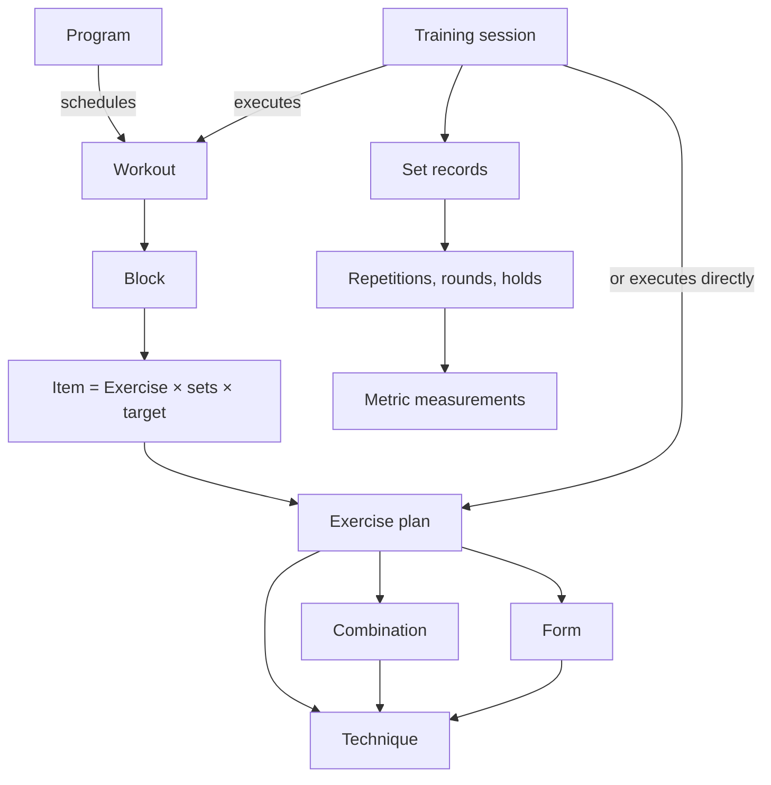
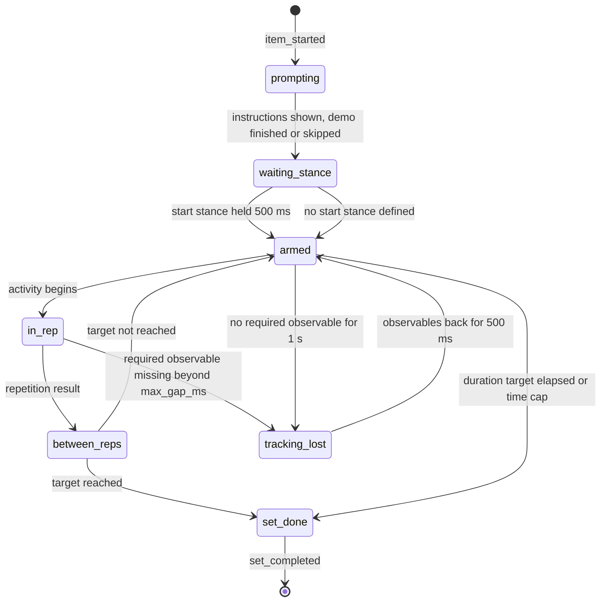

# 06 — Exercise and workout engine

The engine component that executes plans: lifecycle, sequences, repetitions, sets, timers, tempo,
difficulty, completion, progression and the real-time event stream. It is presentation-independent
by construction: it lives in the pure crate `bansayo-training` and has no access to any client.

Status: **Proposed**. Decision record: [ADR-027](adr/ADR-027-exercise-engine.md).

## 1. Vocabulary and containment

| Term | Definition | Authored in | Runtime entity |
|---|---|---|---|
| **Technique** | A movement definition ([05](05-technique-library.md)) | `techniques/` | — |
| **Combination** | A grammar over techniques with timing | `combinations/` | Round |
| **Form** | A hierarchical step list with facings | `forms/` | Form run |
| **Exercise** | One plan of kind `technique`, `combination`, `form`, `mobility`, `free` or `assessment`, with its parameters. Not a separate file: it is the `plan` node inside a workout item or a session request | inline | Item |
| **Set** | One run of an exercise to its target (repetitions, rounds, holds or time) | workout item | `SetRecord` |
| **Block** | An ordered list of items, optionally repeated as a circuit | workout | — |
| **Workout** | An ordered list of blocks with completion rules and goals | `workouts/` | — |
| **Training session** | One execution of one plan by one athlete on one date | — | `TrainingSession` |
| **Program** | Workouts scheduled over weeks with progression rules | `programs/` | Enrolment |



A session started from the Train screen with a single technique is internally a one-block,
one-item workout. There is exactly one execution path.

## 2. Component contract

```rust
// bansayo-training::exercise  (pure: no clock, no I/O, no async)
pub struct ExerciseEngine { /* compiled plan + state */ }

pub enum Input<'a> {
    Tick { t_us: TimeUs },                      // every solver tick, even without a body
    Sample(&'a ObservableFrame),                // observables for this tick (04 §6)
    Movement(&'a MovementEvent),                // from segmentation and recognition (07)
    Repetition(&'a RepetitionResult),           // completed, incomplete, rejected
    Command(Command),                           // from clients
    Capability(&'a CapabilityReport),           // on change
}

impl ExerciseEngine {
    pub fn new(plan: CompiledPlan, ctx: SessionContext) -> Self;
    pub fn step(&mut self, input: Input) -> Vec<TrainingEvent>;
    pub fn state(&self) -> TrainingState;       // cheap snapshot
    pub fn recognition_context(&self) -> RecognitionContext;   // what to look for now
}
```

| Aspect | Decision |
|---|---|
| Purpose | Turn a plan plus movement events into training state and events |
| Responsibilities | Lifecycle, position in the plan, counting, set targets, timers, rest, tempo grid, goal evaluation, safety limits, pause on tracking loss |
| Not responsible for | Detecting movements (recognition), computing metrics (metrics), choosing cues (coaching), persistence (store), any rendering or audio |
| Inputs | `Input` above |
| Outputs | `TrainingEvent`s and `TrainingState`; a `RecognitionContext` telling recognition which definitions and sides are expected |
| Time | Only the `t_us` it is given. Timers are differences of session-clock times, so replaying the same inputs reproduces the same events |
| Failure handling | Invalid command → rejected with a reason, state unchanged. Missing observables → sub-state `tracking_lost`; auto-pause after `training.pause_after_tracking_loss_ms` (default 3000) |
| Performance | O(active recognisers) per tick; no allocation on ticks without events |
| Extension | New plan kinds are new variants of `CompiledPlan` with their own item machine; the session machine is unchanged |

## 3. Lifecycle

Session-level states are in [03 §1](03-training-modes.md). Inside `active`, each item runs this
machine:



| Sub-state | Published as `TrainingState.current.sub_state` | Client behaviour expected |
|---|---|---|
| `prompting` | `prompting` | Show title, instructions, demonstration |
| `waiting_stance` | `waiting_stance` | Show the stance to take |
| `armed` | `armed` | Ready indicator |
| `in_rep` | `in_rep` with `phase_id` | Phase indicator, live gauges |
| `between_reps` | `between_reps` | Show the repetition result and at most one cue |
| `tracking_lost` | `tracking_lost` | Show what is missing; no counting |
| holds | `holding` | Hold timer counts stable time only |

When the start stance's predicate cannot be evaluated in the current capability report (stance
geometry needs world keypoints, so this is the normal case at profile `basic`), the stance gate is
replaced by 500 ms of stillness (activity below the segmenter's `end_below`) and the stance is
reported as not assessed ([22 §4](22-measurement-feasibility.md)).

For `hold` definitions `in_rep` is replaced by `holding`; a hold ends when the stable time reaches
`hold_s`, the athlete releases, or `max_hold_s` elapses.

## 4. Sequence grammar (combinations and forms)

One grammar, compiled by one function, executed by one automaton. Combinations use it with
timing windows; forms use it with step attributes.

```text
sequence := [ node… ]
node     := step | repeat | choice | optional | rest
step     := { step: { technique, side?, window_ms?, id?, …form-only attributes } }
repeat   := { repeat: { times: <1..20>, sequence } }
choice   := { choice: { options: [ sequence, sequence, … ] } }       # 2..4 options
optional := { optional: { sequence } }
rest     := { rest: { ms } }
```

| Rule | Decision |
|---|---|
| Nesting depth | At most 3 |
| Expanded length | At most 64 steps for a combination, 200 for a form; exceeded → validation error |
| `side` | `lead | rear | left | right | same | opposite`. `same`/`opposite` refer to the previous step's resolved side. Default: the technique's only side, else `lead` |
| Side variation of the whole combination | Plan field `stance` resolves `lead`/`rear`. Combination field `sides: as_written | mirrored | alternate`; `alternate` mirrors every second round |
| `window_ms: [min, max]` | Allowed time from the previous step's anchor to this step's anchor. Anchor = `strike_peak` if the technique defines a strike, else repetition end. Default `[0, 1500]`. The first step has no window |
| Tempo | Plan field `tempo_bpm`. When set, each step's ideal anchor time is the next metronome beat; `combo.tempo_error` is recorded; windows still apply |
| `rest` | A pause inside the sequence during which movement events are ignored |
| Compilation | To a non-deterministic finite automaton whose states are positions between steps. `choice` and `optional` create branches; `repeat` is unrolled |

### Matching algorithm (normative)

At every position the automaton has an **expected set**: the steps reachable next, each a
`(technique, side)` pair with its window. The recognition context is the expected set plus the
union of their `confusable_with` definitions on both sides.

On each repetition result `r` delivered while a round is in progress:

1. If `r` matches exactly one expected step and its anchor lies inside the window → that step is
   `correct`; advance along that branch.
2. If `r` matches an expected step but before the window opened → `early`; advance.
   After the window closed → `late`; advance.
3. If `r` is the expected technique on the other side → `wrong_side`; advance past the step.
4. If `r` is a confusable of an expected step → `wrong_technique` (with the technique observed);
   advance past the step.
5. Otherwise → the movement is recorded as `extra`; no advance.

When a window's maximum elapses with no matching result → the earliest expected mandatory step is
`missing`; advance. When branches are ambiguous (two options start with the same step) both are
kept alive until a later step disambiguates; the surviving branch with the most `correct` steps
is reported.

A round ends when the automaton reaches its final state, or when two consecutive steps are
`missing` (the round is `abandoned`). The next round is armed when the start stance holds again or
after `combination.round_gap_ms` (default 800) of inactivity.

User-defined combinations are ordinary files under `user.<athlete_id>.…` written through
`PUT /content/combinations/{id}`; nothing in the engine source enumerates combinations.

## 5. Workouts

### 5.1 Structure

```yaml
schema: bansayo.workout/v1
id: user.daniel.tkd_kicks_15min
version: 1
names: { display: "15-minute kicking session" }
discipline: taekwondo
intensity: moderate                 # low | moderate | high — a label shown to the athlete
estimated_duration_s: 900
blocks:
  - id: warmup
    kind: warmup                    # warmup | skill | main | conditioning | cooldown
    rounds: 1                       # > 1 turns the block into a circuit
    rest_between_rounds_s: 0
    items:
      - id: hip_raises
        plan: { kind: technique, technique: general.mobility.standing_hip_flexion_raise, side: alternate, stages: [normal] }
        sets: 1
        target: { reps: 10 }
        rest_s: 20
        time_cap_s: 120
        goals: []
levels:
  - level: 1
    overrides: { roundhouse_right: { target: { reps: 8 }, rest_s: 60 } }
completion: { require: main_blocks, time_cap_s: 1200 }
```

Complete example: [examples/workout-guided-kicking.yaml](examples/workout-guided-kicking.yaml).

| Element | Semantics |
|---|---|
| `target` | Exactly one of `{ reps: n }` (completed repetitions or rounds per set; per side when `side: alternate` or `both`), `{ duration_s: n }` (clock), `{ holds: n, hold_s: m }` |
| `sets`, `rest_s` | Sets per item; rest after every set except the last of the block. Rest can be skipped by command; a hold's `min_rest_s` cannot |
| `time_cap_s` | Per set. On expiry the set ends as `capped` with what was achieved |
| `rounds` | The block's items are run in order `rounds` times (one set each per round when `rounds > 1`) |
| `kind` | `warmup` and `cooldown` blocks never emit score-based cues and their repetitions are stored with `scored: false` |
| `levels` | Difficulty. A level is a list of per-item overrides of `sets`, `target`, `rest_s`, `time_cap_s` and of plan fields `stages`, `tempo_bpm`, `coaching`. Level 1 is the easiest. Without `levels` the workout has a single level |
| `completion.require` | `all_items` or `main_blocks` (every block whose kind is `skill`, `main` or `conditioning`) |
| `completion.time_cap_s` | Session cap. On expiry the current set is capped and the cooldown block, if any, is offered |
| `goals` | Measurable targets, §5.2 |

Validation rules beyond the schema: a workout containing any technique with
`safety.warmup_required: true` must contain a `warmup` block before it; total repetitions of one
technique per session may not exceed that technique's `max_reps_per_set × max_sets_per_session`.

### 5.2 Goals

```yaml
goals:
  - metric: kick.peak_ankle_height
    stat: median                    # median | best | mean | sd over the set's grade-A values
    compare: at_least               # at_least | at_most | within
    value: 0.95                     # a number, or [lo, hi] for within
    relative_to: baseline           # absolute | baseline | last_session | personal_best
```

With `relative_to` other than `absolute`, `value` is a ratio of the reference value, taken from
the same comparability class ([12 §5](12-data-and-progress.md)). A goal evaluates to `met`,
`not_met`, or `not_assessed` (fewer than 3 grade-A values, or no reference value in the same
class). `not_assessed` is never shown as failure.

### 5.3 Completion and summaries

| Level | Emitted | Content |
|---|---|---|
| Repetition | `rep_completed` | Outcome, phase durations, metric measurements, component scores, optional cue |
| Set | `set_completed` | Counts by outcome, per-metric median and dispersion over grade A/B, goals, up to two cues, comparison with the previous set |
| Item | `item_completed` | Aggregates over sets |
| Session | `session_completed` | Totals, active time, per-technique aggregates, goals, new personal bests, tracking-quality summary, suggested focus (at most three) |

## 6. Programs and progression

```yaml
schema: bansayo.program/v1
id: user.daniel.kicks_8_weeks
version: 1
names: { display: "8 weeks of kicking fundamentals" }
weeks: 8
schedule:
  - { week: 1, day: 1, workout: user.daniel.tkd_kicks_15min }
  - { week: 1, day: 3, workout: user.daniel.hip_mobility_20min }
progression:
  - rule: level_ladder
    apply_to: user.daniel.tkd_kicks_15min
    advance_when: { completion_rate_at_least: 0.9, session_rpe_at_most: 7, consecutive_sessions: 2 }
    regress_when: { completion_rate_below: 0.6 }
  - rule: deload
    every_weeks: 4
    level_delta: -1
```

Progression rule kinds — closed set, no expressions:

| Rule | Parameters | Effect |
|---|---|---|
| `fixed` | — | Level never changes |
| `level_ladder` | `advance_when`, `regress_when` | Moves the workout's level by ±1 for the next scheduled occurrence |
| `double_progression` | `reps_range: [lo, hi]`, `item` | Adds one repetition per set after a session in which every set reached its target; at `hi`, resets to `lo` and advances the level |
| `deload` | `every_weeks`, `level_delta` | Applies the delta for that week only |

Condition keys — closed set: `completion_rate_at_least`, `completion_rate_below` (completed
targets / planned targets), `session_rpe_at_most`, `session_rpe_at_least` (the athlete's 1–10
rating entered at session end; absent rating → the condition is false), `consecutive_sessions`,
`goals_met_at_least` (fraction).

The engine evaluates the rules when a session of an enrolled program completes and stores the
resulting level for the next occurrence. It **proposes** the next session on the Train screen; it
never starts one and never changes content files. Enrolment state is in the analytics store
([12 §4](12-data-and-progress.md)).

## 7. Commands

`POST /api/v1/training/command` ([14 §5](14-runtime-and-api-contracts.md)).

| Command | Valid in | Effect |
|---|---|---|
| `start` | `ready` | → `countdown` (`training.countdown_s`, default 5) |
| `pause` / `resume` | `active`, `resting` / `paused` | Timers stop and resume; recognition is ignored while paused |
| `skip_rest` | `resting` | Ends rest unless a mandatory `min_rest_s` remains |
| `skip_item` | `active`, `resting` | Current item ends as `skipped` |
| `repeat_item` | `active`, `resting` | Restarts the current item's current set; the abandoned set is stored as `abandoned` |
| `skip_demo` | `prompting` | → `waiting_stance` |
| `set_side` | `armed`, `between_reps` | Changes the active side for techniques that allow it |
| `end` | Any | → `completed` if at least one repetition, hold or round was recorded, else `aborted` |
| `ack_safety` | `preparing` | Records the acknowledgement for the listed content versions |

Commands from several clients are applied in arrival order. A command invalid in the current state
returns `conflict` and changes nothing.

## 8. Training events

Delivered on the `training` stream topic and stored ([12 §3](12-data-and-progress.md)). Every event
has `{ event_seq, t_us, type, … }`; `event_seq` is strictly increasing per session.

| `type` | Payload (in addition to position indices) | Stored |
|---|---|---|
| `session_started` | plan summary, capability profile, tracking configuration id | Yes |
| `readiness_changed` | gates | No (state only) |
| `item_started`, `set_started` | item id, exercise summary, target | Yes |
| `stance_ready` | stance id | No |
| `rep_started` | `rep_index`, side | No |
| `phase_changed` | `rep_index`, `phase_id`, `t_us` | Within the repetition record |
| `strike` | `rep_index`, `t_us`, peak value | Within the repetition record |
| `rep_completed` | `RepetitionResult`: repetition, measurements, scores, cue | Yes |
| `rep_rejected` | `rep_index`, outcome, reasons | Yes |
| `movement_unrecognised` | duration, peak speed, candidates | Yes (free mode) / counted (others) |
| `step_result` | step id, result, technique observed, timing | Yes |
| `round_completed` | accuracy, timings, cue | Yes |
| `hold_started`, `hold_progress` (1 Hz), `hold_completed` | stable time, measured angle with grade | `hold_completed` only |
| `cue` | cue id, text key, parameters, priority, evidence | Yes |
| `set_completed`, `item_completed`, `block_completed` | summaries (§5.3) | Yes |
| `rest_started`, `rest_ended` | duration | No |
| `tracking_lost`, `tracking_restored` | missing observables, reasons | Yes |
| `safety_notice` | code, text key | Yes |
| `goal_evaluated` | goal, result | Yes |
| `personal_best` | metric, value, previous | Yes |
| `session_paused`, `session_resumed` | cause | Yes |
| `session_completed`, `session_aborted` | session summary | Yes |

Clients must derive nothing from event order that `TrainingState` does not also state: the state
is authoritative, events are increments. A client that misses events
(`event_seq` gap) fetches them with `GET /training/sessions/{id}/events?after_seq=n`.

## 9. Timers, tempo and limits

| Timer | Source | Notes |
|---|---|---|
| Countdown, rest, item, session | Session clock via `Tick` | Published in `TrainingState.current.timer` at state changes and at 1 Hz; clients interpolate locally for display |
| Hold | Stable time only | Pauses while the hold is unstable |
| Metronome | `tempo_bpm` | The engine publishes the beat grid origin `t0_us` and period; clients generate the audio and visual beat locally from the session-clock mapping they already maintain |

Safety limits enforced by the engine (configurable in `training.limits`,
[13 §4](13-configuration-schemas.md)):

| Limit | Default | Behaviour |
|---|---|---|
| Repetitions per set of a technique | The technique's `max_reps_per_set` | Set ends as `capped`; `safety_notice` |
| High-intensity strikes per session (families `kick.*`, `knee.*`) | 400 | `safety_notice` at the limit and every 50 after; not blocking |
| Session duration | 90 min | `safety_notice`; not blocking |
| Hold duration | The definition's `max_hold_s` | Hold ends |
| Rest after a hold | The definition's `min_rest_s` | Cannot be skipped |
| Stretch target beyond baseline | Baseline + the definition's `progression_step` | Larger targets are not prompted |

## 10. Dependencies, configuration, validation

- **Depends on:** `bansayo-contracts` (types), `bansayo-training::content` (compiled definitions),
  `recognize` and `metrics` through the runner only (the exercise engine receives their results as
  inputs; it does not call them).
- **Configuration:** `training:` section of the engine configuration
  ([13 §4](13-configuration-schemas.md)).
- **Validation:** table-driven tests of the session and item machines; property test that any
  command sequence leaves the machine in a defined state; golden event logs for the shipped
  example workout driven by simulator motions; replay test asserting identical event logs for
  identical inputs.
- **Status:** Proposed; first implementation in roadmap Phase 1
  ([18](18-implementation-roadmap.md)).
