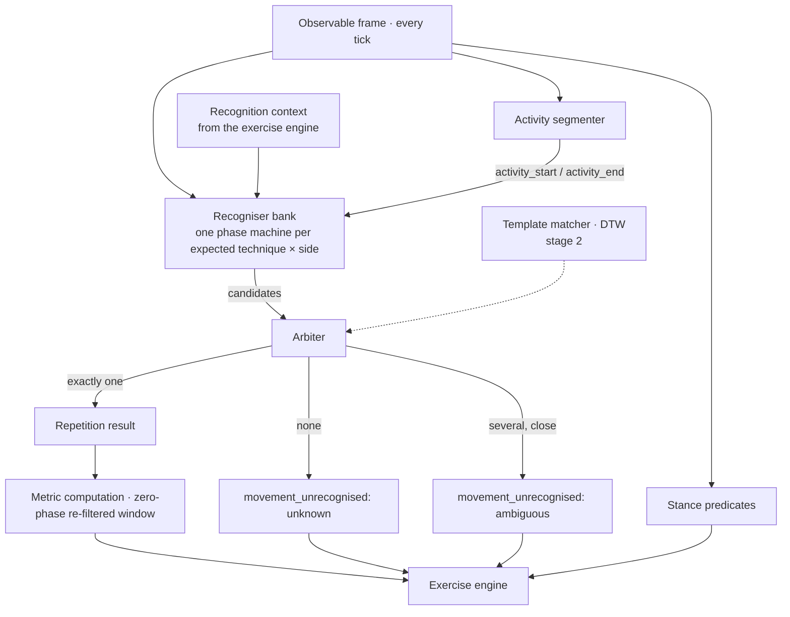
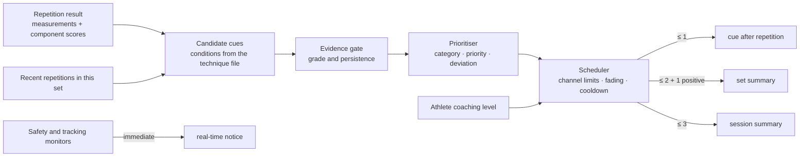

# 07 — Recognition, references, scoring and coaching

Four components that sit between the observables and the exercise engine's events. They are kept
in one document because each consumes the previous one's output, and their contracts are easier to
check side by side.

Status: **Proposed**. Decision records: [ADR-026](adr/ADR-026-recognition-engine.md),
[ADR-028](adr/ADR-028-scoring-and-coaching.md).

## 1. Recognition pipeline



| Aspect | Decision |
|---|---|
| Purpose | Turn observable time series into repetitions, step tokens and stance intervals |
| Not responsible for | Fusion or any device knowledge; counting, targets and timers (exercise engine); judging quality (scoring) |
| Inputs | `ObservableFrame` per tick; `RecognitionContext` (expected definitions, sides, mode) |
| Outputs | `MovementEvent`s, `RepetitionResult`s with phase intervals and recognition confidence |
| Stages | **Stage 1** deterministic phase machines (Phase 1 of the roadmap). **Stage 2** template verification with DTW (Phase 3). **Stage 3** learned classifier behind the same arbiter interface (only after the data condition in §3.4) |
| Configuration | `recognition:` in the engine configuration; per-definition blocks in technique files |
| Failure handling | Unavailable observables make conditions *unknown*, never true. A machine that cannot evaluate a mandatory condition reports the technique as `not_detectable` in the current capability profile |
| Performance | Tens of machines × a few comparisons per tick; DTW only once per completed segment (≤ 240 × 240 cells × ≤ 8 dimensions) |

### 1.1 Why not start with a learned model

No labelled martial-arts motion dataset in this system's skeleton and sensor mix exists, public
optical datasets have unreviewed licences and different marker sets
([19 §2](19-risks-and-open-questions.md)), and in every guided mode the expected technique is
already known. A deterministic machine is explainable to the athlete ("the chamber was not
detected"), testable against the simulator, and works from the first repetition.

## 2. Activity segmentation

A segmenter independent of any technique marks when the body is doing *something*.

```text
activity(t) = max( ankle_speed.left, ankle_speed.right, knee_speed.left, knee_speed.right )   in leg_length / s
            , ( wrist_speed.left, wrist_speed.right, elbow_speed.left, elbow_speed.right )    in arm_length / s
            , root_speed / leg_length )
```

| Parameter (`recognition.segmenter`) | Default | Meaning |
|---|---|---|
| `start_above` | 1.0 | Activity level that opens a segment |
| `start_hold_ms` | 40 | Must stay above this long |
| `end_below` | 0.4 | Level that closes a segment |
| `end_hold_ms` | 150 | Must stay below this long |
| `min_ms` | 150 | Shorter segments are discarded as noise |
| `max_ms` | 4000 | Longer segments are closed and reported as `unknown` with `reason: too_long` |
| `merge_gap_ms` | 80 | Two segments closer than this are merged |

Unavailable inputs are dropped from the maximum. With no input available, no segment opens.

In guided modes the segmenter still runs: its segments bound the search window of the expected
machines and produce the `extra` movements of [06 §4](06-exercise-and-workout-engine.md).

## 3. Technique recognition

### 3.1 Phase machine

One instance per (definition, side) in the recognition context. Semantics of conditions, optional
phases and limits are in [05 §6](05-technique-library.md).

- `idle` → first phase: when the definition's segmentation driver exceeds `start_above` **and** the
  first phase's `enter` condition is true. `rep_start` is back-dated to the start of the enclosing
  activity segment.
- Completion: the `complete` condition after the last mandatory phase; `rep_end` is the later of
  that instant and the end of the activity segment, capped at `segmentation.max_ms`.
- Abort: any `max_ms` exceeded, or the activity segment ends before completion → `incomplete`,
  with `reached_phase`.
- Quality rejection: a required observable unknown for longer than `max_gap_ms` while not `idle`
  → `rejected_quality`.

### 3.2 Recognition confidence

A number in `[0, 1]` attached to every completed repetition. Stage 1:

```text
c_evidence = minimum confidence of the required observables over the repetition
             × 0.8 if any required observable was realised by image_plane
c_fit      = 1.0
             × 0.85 if an optional phase with a known condition was not entered
             × 0.80 if the repetition duration is within 10 % of segmentation.min_ms or max_ms
recognition_confidence = c_evidence × c_fit
```

Stage 2 multiplies by `g(d)`, where `d` is the DTW distance to the nearest template of that
technique (§4): `g = 1` for `d ≤ d_accept`, falling linearly to `0.5` at `d_reject`, `0.5` beyond.
`d_accept` and `d_reject` are per technique, stored with its templates, set to the 90th and 99th
percentile of pairwise distances inside the template set. The template stage can lower confidence;
it never creates a detection the machine did not make.

### 3.3 Arbiter

At `activity_end` (or immediately when the only expected machine completes in a closed-set mode):

| Completed machines in the segment | Result |
|---|---|
| None | `unknown` (free mode) / `extra` or `incomplete` of the expected machine (guided modes) |
| One | Accepted if `recognition_confidence ≥ recognition.accept_confidence` (default 0.75 in free mode, 0.5 in closed-set modes); otherwise `unknown` with the candidate attached |
| Several | Sort by (number of mandatory phases, confidence). Accept the first if its confidence exceeds the second's by ≥ `recognition.ambiguity_margin` (default 0.10); otherwise `ambiguous` with the candidates |
| The expected technique on the other side only | `wrong_side` |

`unknown`, `ambiguous` and `incomplete` are first-class results. They are stored and counted; they
never receive metrics, scores or cues.

### 3.4 Growing beyond rules

| Step | Trigger | What changes |
|---|---|---|
| Collect | From Phase 1 | Every session stores repetitions with phase intervals; sessions with input recording can be re-analysed |
| Annotate | Phase 3 | The Technique workspace lets an instructor confirm or correct labels and phase boundaries; corrections are stored as annotations, never overwriting engine output |
| Templates | ≥ 10 confirmed repetitions per technique and side from ≥ 2 athletes | Stage 2 enabled for that technique |
| Learned classifier | ≥ 200 confirmed repetitions per class from ≥ 10 athletes **and** measured stage-1/2 recall below the target in [16 §5](16-accuracy-and-validation.md) | A classifier implementing the arbiter's `Candidate` interface may be added for free mode only. It is evaluated on recordings it was not trained on. Until then no model is trained |

## 4. Temporal alignment

Two different problems, two algorithms.

### 4.1 Signal alignment inside one movement — DTW

Used for: template verification (§3.2), `path_deviation` metrics, ghost time-warping, per-step
comparison in forms.

| Parameter | Decision |
|---|---|
| Resampling | Both series to 60 Hz over their own duration |
| Feature vector | Per family, fixed in code. Kicks: `thigh_elevation.active`, `thigh_azimuth.active`, `knee_flexion.active`, `knee_flexion.support`, `pelvis_yaw` (relative to `rep_start`), normalised `ankle_height.active`, normalised `foot_reach.active`. Arm strikes: normalised `wrist_reach.active`, `elbow_flexion.active`, `shoulder_elevation.active`, `shoulder_azimuth.active`, `chest_yaw` (relative), normalised `wrist_height.active`. Paths (`path_deviation`): the named keypoints in the pelvis-heading frame at `rep_start`, normalised by `leg_length` or `arm_length` |
| Scaling | Angles divided by π; normalised lengths as they are |
| Missing dimensions | A dimension unavailable in either series for more than 20 % of its length is dropped from both. Fewer than 60 % of the dimensions remaining → no distance (`null`) |
| Local distance | Euclidean over the remaining dimensions, divided by the square root of their count |
| Constraint | Sakoe–Chiba band of 20 % of the longer length; symmetric step pattern; end points anchored |
| Result | Path-length-normalised accumulated distance, and the warping path |
| Anchors | When both series have phase intervals, the path is forced through matching phase boundaries (piecewise DTW). This keeps the ghost and the athlete in the same phase |

### 4.2 Step alignment across a form — symbolic global alignment

Forms vary in speed, pauses, and omitted or added movements. Aligning raw signals of a whole form
would let one skipped step shift everything after it. The stored result of a performance is
therefore computed on **tokens**:

1. During the performance, every movement segment produces a token: the recognised technique and
   side (or `unknown`), its end stance, facing at its end, and its time interval.
2. After the last step, the token list is aligned to the form's expanded step list by global
   alignment (Needleman–Wunsch) with these costs:

| Pair | Cost |
|---|---|
| Same technique, same side | 0 |
| Same technique, other side | 1 |
| Token is a declared confusable of the step's technique | 1 |
| Token `unknown` against any step | 1.5 |
| Any other technique | 2 |
| Step with no token (omitted) | 2 |
| Token with no step (extra) | 1 |

3. `choice` branches are aligned separately and the cheapest wins.
4. Each matched pair is then checked for stance, facing, travel and timing class, and — when a
   reference is selected — compared to the reference step by the DTW of §4.1.

The online step machine used in `guided` sub-mode is the automaton of
[06 §4](06-exercise-and-workout-engine.md) with windows disabled and one extra rule: it waits
indefinitely for the expected step and reports wrong techniques without advancing.

## 5. Forms: per-step checks

| Check | Passes when | `not_assessed` when |
|---|---|---|
| Technique | A token of the step's technique and side matched | Never |
| Stance | The step's stance predicate held ≥ 300 ms at the end of the step | A predicate observable is unavailable |
| Facing | `|pelvis_yaw at step end − expected facing|` ≤ `facing_tolerance_deg` (default 25), both relative to the heading at the form's first step | `pelvis_yaw` not `measured`/`derived`, or IMU heading `assumed` |
| Travel | Direction of root displacement within `travel_tolerance_deg` (default 35) of the expected direction, and length ≥ 0.4 `leg_length` when a step is expected | Root position `inferred` |
| Timing class | Step duration class (`slow`, `normal`, `fast`, `pause`) matches after dividing by the performance's median `normal` step duration | — |
| Kiai / kihap | Not assessed. There is no audio input | Always |

Expected facing is authored in degrees relative to the start, positive to the left
([13 §8](13-configuration-schemas.md)).

## 6. Reference movement system

### 6.1 Kinds

| `kind` | Source | Label shown |
|---|---|---|
| `expert` | A recorded demonstration by a named practitioner | "Reference: <name>, <style>" |
| `athlete_selected` | A repetition the athlete chose from their own history | "Your selected attempt" |
| `personal_best` | Maintained automatically per technique, side and metric | "Your best valid attempt" |
| `synthetic` | Generated from the simulator's scripted motions | "Synthetic illustration" — always labelled |

The technique definition itself (phases, bands with rationale) is the *canonical definition*; it is
not a clip and is never drawn as a ghost.

### 6.2 Data

```ts
interface ReferenceMovement {
  schema_version: 1;
  id: string;                              // ^ref-[a-z0-9]{10}$
  kind: "expert" | "athlete_selected" | "personal_best" | "synthetic";
  technique: ContentRef;
  side: "left" | "right";                  // as recorded
  athlete_id: AthleteId | null;            // owner for the two personal kinds
  performer: { name: string; style: string | null; level: string | null } | null;
  licence: string;                         // SPDX id or "private"
  review: { status: "unreviewed" | "reviewed"; by: string | null; on: string | null };
  source: { session_id: SessionId; rep_index: number } | { generator: string };
  capability_profile: CapabilityProfileId;
  skeleton: { height_m: number; leg_length_m: number; arm_length_m: number };
  duration_us: number;
  phases: PhaseInterval[];
  strike_t_us: number | null;
  measurements: MetricMeasurement[];       // the reference's own metric values
  created_utc: string;
}
```

Stored as `<data_dir>/references/<id>/reference.json` plus `clip.json`: BodyState samples at
60 Hz holding, per segment, `rotation` and the axis/twist provenance, and the root position
**divided by the performer's leg length**. Shipped references live in the repository under
`content/references/` with the same layout.

### 6.3 Using a reference with another body

| Difference | Handling |
|---|---|
| Height, limb proportions | The clip is rotations. The engine applies them to the **viewer's** skeleton by forward kinematics and multiplies the normalised root trajectory by the viewer's leg length. `GET /references/{id}/clip` returns positions already computed for the current `skeleton_rev`; clients do no kinematics |
| Dominant side | Mirroring: swap left and right segments, map each quaternion `(x, y, z, w)` → `(x, −y, −z, w)`, negate root `x` |
| Speed | The ghost is time-warped to the athlete's phases by the piecewise alignment of §4.1; in demonstration it plays at its own speed × the stage's tempo scale |
| Range of motion | A reference's metric values are **targets only for components whose scoring target source is `reference`**. Range-type components default to `personal` targets (§7.2) |
| Experience level | Tolerances are multiplied by the athlete's `tolerance_scale` (beginner 1.5, intermediate 1.0, advanced 0.75) |
| Segments not observed in the reference (twist `inferred`) | Drawn in the inferred style; excluded from DTW dimensions and from targets |

### 6.4 Lifecycle

| Step | Rule |
|---|---|
| Create | `POST /references` from a stored repetition whose outcome is `completed`. The engine copies the repetition's motion from the session's motion recording, so the session must have been recorded with `motion: true` |
| Eligibility for `expert` | Recorded at profile `multi_view` or higher, every measurement used as a target at grade A |
| Review | An `expert` reference is `unreviewed` until a named reviewer is entered. Unreviewed references are usable and labelled |
| Version | References are immutable. A new recording is a new id; a technique lists its default reference id per side in `<data_dir>/content` state, changeable in the UI |
| Licence | Mandatory. Shipped clips must be recorded for the project with a written release from the performer and are published under CC BY 4.0. No clip derived from third-party video or datasets is shipped |
| Personal best | Updated when a grade-A measurement exceeds the stored one in the same comparability class; the previous clip is kept until retention removes it |
| Delete | Removes the folder; scores computed against it keep its id and are no longer extendable |

## 7. Scoring

### 7.1 Principles

1. A score is a set of **components**, each tied to one measurement and one target.
2. There is no objective technique-quality number. The only composite is `reference_match`:
   how closely the measurable dimensions matched the *selected* targets.
3. A component without an adequate measurement is `null` with reasons — never zero, never guessed.
4. Every score names its scoring model version and its targets; scores are compared over time
   only inside one comparability class.

### 7.2 Scoring model `bansayo.scoring/v1`

```yaml
schema: bansayo.scoring/v1
id: scoring.kick.basic
version: 1
applies_to: { families: [kick.front, kick.roundhouse, kick.side] }
components:
  - id: completion
    label: Movement completion
    source: { kind: outcome }                 # 1.0 when the repetition completed
    required: true
    weight: 0                                 # a gate, not part of the mean
  - id: height
    label: Height
    source: { metric: kick.peak_ankle_height, use: norm }
    target: { from: personal, stat: median, window_sessions: 5 }
    direction: at_least
    tolerance: { inner: 0.03, outer: 0.15 }   # in the metric's (normalised) unit
    min_grade: B
    weight: 2
  - id: pivot
    label: Support-foot pivot
    source: { metric: kick.support_pivot }
    target: { from: reference }
    direction: at_least
    tolerance: { inner: 0.17, outer: 0.70 }
    min_grade: B
    weight: 2
composite: { id: reference_match, min_coverage: 0.7 }
```

| Field | Semantics |
|---|---|
| `source` | `{ kind: outcome }`, `{ metric, use: value|norm }`, or `{ step_results }` (sequence accuracy) |
| `target.from` | `reference` — the selected reference's measurement of the same metric. `personal` — the athlete's statistic over grade-A values of the last `window_sessions` sessions in the same comparability class. `definition` — an explicit `value` in this file, allowed only with a non-empty `rationale` string |
| `direction` | `at_least` (only a shortfall counts), `at_most`, `match` (both directions) |
| `tolerance` | Deviation ≤ `inner` scores 1.0; ≥ `outer` scores 0.0; linear between. Multiplied by the athlete's `tolerance_scale` |
| `min_grade` | Minimum measurement grade for the component to be scored |
| `required` | A required component that is `null` makes the composite `null` |
| `weight` | Relative weight in the composite; 0 = gate only |

Component result and composite:

```ts
interface ComponentScore {
  id: string;
  score: number | null;            // 0..1
  measurement: MetricMeasurement | null;
  target: { value: number; from: "reference" | "personal" | "definition"; ref_id: string | null } | null;
  deviation: number | null;        // signed, in the metric's unit
  reasons: Reason[];               // why null
}

interface ScoreResult {
  model: ContentRef;
  components: ComponentScore[];
  reference_match: number | null;  // weighted mean of available components with weight > 0
  coverage: number;                // available weight / total weight
  comparability_class: string;
}
```

`reference_match` is published only when every `required` component is available and
`coverage ≥ min_coverage`; missing optional components are left out and the remaining weights are
renormalised. The UI shows it in five bands with the coverage next to it, never with decimals and
never without its target label.

### 7.3 Missing data and calibration dependencies

| Situation | Result |
|---|---|
| Measurement grade below `min_grade` | Component `null`, reason `measurement_quality` |
| No target (no reference selected; fewer than 3 baseline sessions) | Component `null`, reason `no_target` |
| Calibration required by the metric not valid | The measurement is already `X`; component `null` |
| Target and measurement in different comparability classes | Component `null`, reason `not_comparable` |
| Scoring model version changes | New comparability class; old scores are kept and not mixed |

## 8. Coaching



### 8.1 Cue definition

```yaml
cues:
  - id: pivot_more
    category: technique              # safety | tracking | technique | timing | balance | guard
    basis: reference                 # measurement | reference | history | style
    when: { component: pivot, below: 0.5 }
    priority: 2                      # 1 = most important within a category
    min_grade: B
    observed: cue.kick.pivot.observed      # i18n key: "Supporting foot turned {deviation_deg}° less than the reference."
    suggestion: cue.kick.pivot.suggestion  # i18n key: "Practise the pivot at reduced speed."
    focus: external                  # external | internal — wording class, see below
    drill: { stage: slow }           # optional suggested follow-up
```

Condition forms — closed set:

| Form | True when |
|---|---|
| `{ component: <id>, below: <x> }` | That component's score is below `x` |
| `{ metric: <id>, beyond: inner|outer, direction: low|high }` | The metric deviates from its target beyond the tolerance |
| `{ trend: { metric, worse_by: <fraction>, over_reps: <n> } }` | The median of the last `n` values is worse than the median of the first `n` of the set by the fraction |
| `{ step: wrong_side | wrong_technique | late | early | missing }` | The earliest non-correct step has that result |

`basis` makes the four kinds of statement in the brief explicit and is rendered as a tag next to
the cue: **measurement** (an objective observation), **reference** (a deviation from the selected
reference), **history** (a change against the athlete's own record), **style** (guidance specific
to the definition's style).

Wording: project-authored suggestions use an external focus of attention (the effect or target of
the movement) wherever one exists; `focus: internal` is allowed and flagged. This follows the
motor-learning literature on attentional focus; it is a wording guideline, not a claim of effect in
this product.

### 8.2 Scheduler (normative)

| Channel | Limit | Eligible categories | Selection |
|---|---|---|---|
| `realtime` (during movement) | 1 active notice | `safety`, `tracking` only | Immediate |
| `after_rep` | **At most 1 cue** | All | Below |
| `after_round` (combinations) | At most 1 | All | Earliest non-correct step; else as `after_rep` over the round |
| `after_step` (form, guided) | At most 1 | All | First failed check in the order of §5 |
| `after_set` | At most 2 corrective + 1 positive | All | Corrective: candidates true in ≥ 40 % of scored repetitions, by priority. Positive: the component most improved against the previous set, else against baseline |
| `session_summary` | At most 3 focus points | All | Most frequent corrective cues across sets; each with its `drill` |
| `long_term` (Progress) | At most 3 | `history` basis | Trends over ≥ 4 sessions classified by the rule in [12 §6](12-data-and-progress.md) |

`after_rep` selection:

1. **Evidence gate.** The condition must hold on this repetition with grade ≥ `min_grade`, **and**
   in at least 2 of the last 3 scored repetitions when every involved measurement is grade A, or 3
   of the last 4 when any is grade B. One-off deviations produce no cue.
2. **Order.** Category order `safety` > `tracking` > `balance` > `technique` > `guard` > `timing`,
   then `priority`, then normalised deviation (deviation / `outer`).
3. **Cooldown.** A cue is not repeated for `coaching.cooldown_reps` (default 3) after being issued
   unless its normalised deviation grew by ≥ 0.25.
4. **Fading.** By coaching level:

| Level | `after_rep` | `after_set` | Notes |
|---|---|---|---|
| `minimal` | None | Yes | Summary feedback only |
| `standard` | At most every second repetition in sets of 8 or more; every repetition in shorter sets | Yes | Default |
| `detailed` | Every repetition | Yes | Intended for slow stage and short sets |

5. **Resolution.** When a cued component stays within `inner` for 3 consecutive scored repetitions,
   one `resolved` cue is issued and the cooldown is cleared.

Stage `slow` uses the same rules with timing and speed cues disabled.

### 8.3 What coaching never does

- It never issues a cue from a grade-C or suppressed measurement.
- It never interrupts a combination or a form performance.
- It never states or implies correctness in absolute terms; every corrective cue names its basis.
- It never comments on body shape, pain, injury, or medical matters.

### 8.4 Text and localisation

Cue, instruction and safety texts are i18n keys resolved by clients from
`content/i18n/<lang>.yaml` served by the engine (`GET /content/i18n/{lang}`). Parameters are
passed as numbers in SI units with a formatting hint (`deg`, `cm`, `ms`, `percent`); clients
format. English ships first.

## 9. Validation

| Component | Method | Target (engineering goal) |
|---|---|---|
| Segmenter | Annotated recordings: segment precision/recall at IoU ≥ 0.5 | ≥ 0.95 each in guided modes |
| Phase machines | Simulator ground truth, then instructor-annotated recordings | Repetition count error ≤ 1 per 20; phase boundary error within 2 sample periods on the simulator |
| Arbiter (free mode) | Confusion matrix on annotated free-training recordings | `unknown` preferred over a wrong label: precision ≥ 0.95, recall reported, not targeted |
| DTW | Synthetic time-warped copies recover the warp; mirrored clips match their mirrored templates | Exact on synthetic data |
| Form alignment | Scripted omissions and insertions on simulator forms | Every scripted edit recovered |
| Scoring | Property tests: monotonic in deviation; `null` propagation; renormalisation | — |
| Scheduler | Table tests of every limit; replay of recorded sessions asserts the cue-count limits | Limits never exceeded |

Targets are goals to be measured per [16](16-accuracy-and-validation.md), not results.
