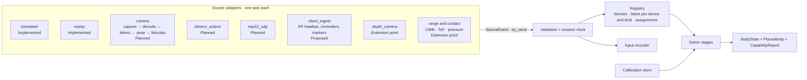
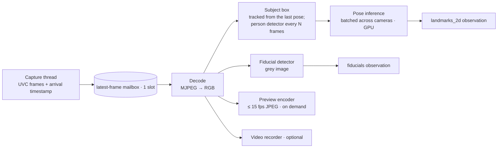
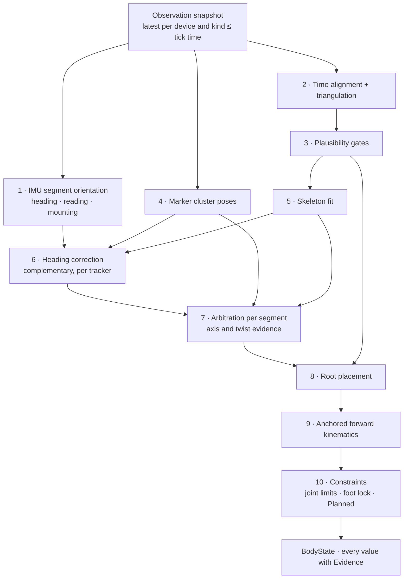
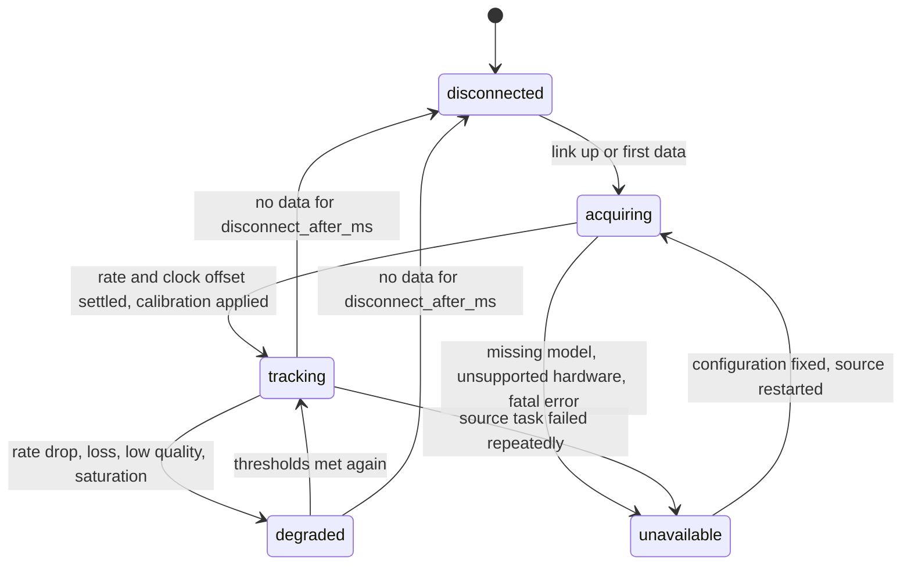

# 08 — Tracking inputs and sensor fusion

How cameras, IMUs, fiducial tags, XR devices and ranging sensors enter the engine, how the solver
turns them into the canonical body state of [04](04-movement-domain-model.md), and how the system
states what it can and cannot observe.

Decision records: [ADR-020](adr/ADR-020-camera-processing-stack.md),
[ADR-021](adr/ADR-021-pose-estimation-integration.md),
[ADR-022](adr/ADR-022-sensor-ingestion.md),
[ADR-023](adr/ADR-023-time-aligned-triangulation.md),
[ADR-025](adr/ADR-025-sensor-fusion-ladder.md),
[ADR-034](adr/ADR-034-capability-profiles-and-comparability.md).

## 1. What exists today

Verified by reading the code on 16 November 2026.

| Capability | Status | Evidence |
|---|---|---|
| Source task model, bounded ingest, supervision, validation | **Implemented** | `sources/mod.rs`, `supervision.rs`, `validation.rs` |
| Simulated trackers and simulated cameras | **Implemented** | `sources/simulated/` |
| Replay source | **Implemented** | `recording/replay.rs` |
| Real camera capture, pose inference | **Planned**. `models/*.onnx` exist locally; nothing loads them; no `ort` or capture dependency in `Cargo.toml` | `models/README.md`, `crates/bansayo-engine/Cargo.toml` |
| SolarXR, ESP32 UDP, real camera source kinds | **Planned**. Parsed by the config schema and rejected as not implemented | `config/validate.rs` |
| Mounting calibration by reference pose | **Implemented** | `calibration/mounting.rs` |
| Camera intrinsics/extrinsics as profiles | **Partial**: declared by the simulator in memory; the store loads only `mounting` profiles from disk | `calibration/store.rs` |
| Triangulation (weighted DLT, reprojection gating, skew gating) | **Partial**: simulated cameras only | `pipeline/triangulate.rs` |
| Skeleton pose | **Partial**: rotations from IMU orientation only; root from triangulated pelvis or floor contact | `pipeline/solve.rs` |
| Skeleton fit from landmarks, heading alignment, any filter or fusion | **Planned** | [docs/05 §8](../../05-calibration-and-fusion.md) |
| Clock offset estimator | **Partial**: implemented and unit-tested, not called by any source | `clock.rs` |
| Fiducials, depth, ranging, XR input | **Proposed** here | — |

### 1.1 Engine changes required before any real device (P0)

These are defects of fit, found in the code, that every later step depends on.

| Id | Today | Required change |
|---|---|---|
| T-01 | The registry keeps **one** latest observation per device regardless of kind. A device that sends orientation and then diagnostics or acceleration overwrites the orientation and the solver sees none | Keep the latest observation **per (device, observation kind)**. `seq` monotonicity is checked per (device, kind) |
| T-02 | `Source::run` returns `impl Future`; `SourceContext` carries simulator-only `control` and `faults` channels; `app.rs` builds sources only from the simulated config | Split `SourceContext` into a common part (`events`, `clock`, `cancel`, `dropped`) and a simulator extension. `app.rs` builds sources through one `fn spawn(kind, …)` match per source kind. No `dyn Source` is needed |
| T-03 | `Store::load` accepts only `mounting` profiles from disk | Load every `CalibrationKind`; unknown kinds are `invalid`, not dropped |
| T-04 | The solver consumes only `orientation` and `landmarks_2d`; position, distance, contact, acceleration and angular velocity are validated and recorded but unused | Stages added in §7 consume them. Until a stage exists the corresponding observable is unavailable with reason `not_implemented` |
| T-05 | `OffsetEstimator` is never called | Every source with a device clock maps device time through it; sources without one use arrival time minus `latency_ms` and report `receive_time` |
| T-06 | Triangulated landmarks have no uncertainty | Add `sigma_m: number \| null` to `TriangulatedLandmark3D` (additive), filled by the formula in [04 §8](04-movement-domain-model.md) |
| T-07 | Validation rejects orientation in any frame but the device's own `sensor_reference`, and `nominal_rate_hz > 1000` | Kept for IMU orientation. The new `pose` observation (§2.2) carries poses in other frames. The rate limit stays; faster IMUs are decimated in the adapter |

## 2. Tracking provider architecture



### 2.1 Source kinds

| `kind` | Devices announced | Capabilities | Transport | Status | Priority |
|---|---|---|---|---|---|
| `simulated` | `imu_tracker`, `camera` | `orientation`, `landmarks_2d`, diagnostics; **to add:** `angular_velocity`, `fiducials_2d`, a feet-capable landmark schema, occlusion and blur models | In-process | **Implemented** (additions P0) | P0 |
| `replay` | As recorded | As recorded | File | **Implemented** | — |
| `camera` | `camera` | `image`, `landmarks_2d`, `fiducials_2d` | USB (UVC), file, RTSP | Planned | P0 |
| `slimevr_solarxr` | `imu_tracker` | `orientation`; raw rates only if the feed provides them | WebSocket | Planned | P2 |
| `esp32_udp` | `imu_tracker`, auxiliary sensors | `orientation`, `angular_velocity`, `acceleration`, `distance`, `contact`, diagnostics | UDP | Planned (draft in [docs/04 §7](../../04-contracts.md)) | P2 |
| `client_ingest` | `xr_device` | `pose` | WebSocket from a client | Proposed | P2 |
| `depth_camera` | `depth_camera` | `landmarks_3d_metric` | Vendor SDK | Extension point | P2 |
| `range` | `range_sensor`, `contact_sensor` | `distance`, `contact` | Through `esp32_udp` `AUX` | Extension point | P2 |

Each source is individually enabled (`enabled: true|false`), configured, supervised and reported
in `SystemState.devices`. No source is required. A disabled or failed source changes the
capability report, never the training logic.

IP cameras (RTSP) are accepted by the `camera` kind for **slow** work only (mobility, forms review):
their latency and jitter are unknown until measured, so a camera with `transport: rtsp` is excluded
from triangulation unless a valid `time_sync` profile exists for it, and its observations carry
`time_quality: receive_time`.

### 2.2 Contract additions (all additive under `protocol_version` 1)

```ts
type DeviceKind = "imu_tracker" | "camera"
  | "marker_cluster" | "xr_device" | "depth_camera" | "range_sensor" | "contact_sensor";   // new

type SensorCapability = /* existing */ | "fiducials_2d" | "pose" | "landmarks_3d_metric";   // new

type ObservationData = /* existing variants */
  | { kind: "fiducials"; detections: FiducialDetections }                 // 09 §3
  | { kind: "pose"; frame: FrameRef; q: Quat; m: Vec3 }                   // rigid pose in a named frame
  ;

interface SensorObservation {            // existing type, new optional fields
  flags?: ("accel_saturated" | "gyro_saturated" | "low_light" | "motion_blur")[];
}
// ObservationData "distance" gains optional fields:
//   target?: "floor" | "peer" | "surface";  peer?: DeviceId
```

A saturated IMU sample is delivered with its flag and `confidence: 0`; it is recorded and it makes
dependent observables unavailable for that sample with reason `sensor_saturated`.

## 3. Camera processing stack

One OS thread chain per camera; nothing here runs on the async runtime.



| Decision | Choice | Notes |
|---|---|---|
| Capture | `nokhwa` with the Media Foundation backend on Windows | Pending the spike in [ADR-020](adr/ADR-020-camera-processing-stack.md). Fallback: a thin Media Foundation wrapper over the `windows` crate, inside the same module boundary |
| Pixel format | MJPEG at the camera's highest frame rate for the chosen resolution | Uncompressed YUY2 only where USB bandwidth allows |
| Exposure | **Manual, set by the engine** from `exposure_s` in the camera config; auto-exposure off; gain raised before exposure is lengthened | §3.2 |
| Decode | `zune-jpeg` | Replace with `turbojpeg` only if the measured decode time exceeds 4 ms for a 1280×720 frame |
| Backpressure | One-slot mailbox between capture and decode: a new frame replaces an unprocessed one and increments `dropped` | Stale frames are dropped before inference (existing rule) |
| Person detection | YOLOX (the local `yolox-m-humanart.onnx`) every `detect_every` frames (default 10) and whenever the tracked box is lost | Between detections the box is the previous keypoints' bounding box × 1.25 |
| Pose model | RTMPose top-down, Halpe-26 output | [ADR-021](adr/ADR-021-pose-estimation-integration.md). The local `rtmpose-m.onnx` is a COCO-17 model (per its source config; output count not verified); usable, without foot observables |
| Inference runtime | ONNX Runtime through `ort`, execution providers in order `cuda`, `directml`, `cpu` | One inference thread; crops from all cameras due in the same 4 ms window are batched |
| Subject selection | The person whose box is largest and nearest the image centre when the session's `ready` state begins; then tracked by box overlap. Any other person is ignored. Two candidates within 10 % of each other → notice `multiple_people`, no pose until resolved | The engine tracks one athlete |
| Fiducial detection | On the full grey frame at capture resolution, every frame | [09 §3](09-optical-markers-and-calibration.md) |
| Timestamps | Arrival time on the session clock minus the camera's `time_sync` offset, else minus `latency_ms` from config; `time_quality: estimated` with a `time_sync` profile, else `receive_time` | §4.3 |
| Preview | Separate HTTP endpoint serving the latest JPEG at ≤ 15 fps, only while a client requests it | Never on the WebSocket |
| Missing model or GPU | Camera `unavailable` with the path or provider error; fallback provider gives `degraded` (existing rule in [docs/09](../../09-robustness-and-quality.md)) | |

### 3.1 Camera requirements (guidance shown in the calibration wizard)

| Property | Minimum | Recommended for kick metrics | Why |
|---|---|---|---|
| Resolution | 1280 × 720 | 1920 × 1080 | Tag decoding range ([09 §4](09-optical-markers-and-calibration.md)); landmark precision |
| Frame rate | 30 fps | ≥ 100 fps | A kick's extension lasts on the order of 100–200 ms; speed metrics need ≥ 100 Hz for grade A ([05 §10](05-technique-library.md)) |
| Shutter | Rolling accepted | Global | Rolling shutter skews fast limbs within one frame |
| Exposure | Manual control required | ≤ 1/500 s | §3.2 |
| Lens | Horizontal field of view 60–90° | Same | Wider lenses need the fisheye model, which is not supported |
| Mounting | Rigid, 1.0–1.8 m high, whole body in view | ≥ 3 cameras, ≥ 60° apart around the athlete | Ray angle for depth; occlusion cover |

### 3.2 Motion blur arithmetic

Pixel footprint at distance `d` for image width `W` and horizontal field of view `HFOV`:
`mm_per_px = 2 · d · tan(HFOV/2) / W`. Blur length = limb speed × exposure / `mm_per_px`.

Worked for a foot at 15 m/s (the upper range reported for roundhouse kicks is roughly 13–18 m/s;
literature figures are quoted from abstracts and are not verified against full texts), 2.5 m from
a 70° camera:

| Image width | mm per px | Blur at 1/250 s | at 1/500 s | at 1/1000 s |
|---|---|---|---|---|
| 1280 | 2.73 | 22 px | 11 px | 5.5 px |
| 1920 | 1.82 | 33 px | 16 px | 8.2 px |

Consequences fixed in the design: detector landmarks of the striking foot are unreliable around
the strike instant on ordinary webcams, so (a) peak-speed metrics are gated on frame rate and
confidence, (b) the engine sets short manual exposure, and (c) IMUs, not tags, are the tool for
strike timing (§5).

## 4. From pixels to a world skeleton

### 4.1 Stages

| Stage | Input | Output | Status |
|---|---|---|---|
| 2D landmarks | Camera frames | `PoseLandmarks2D` in the detector schema | Planned |
| Planar body | 2D landmarks + schema map | `PlanarBody` per camera | Proposed |
| Time alignment | Per-camera landmark history | Views at a common instant | Proposed, §4.3 |
| Triangulation | Aligned views + camera profiles | `PoseLandmarks3D::Triangulated` with sigma | Partial (simulated) |
| Plausibility gate | Triangulated set + skeleton | Points rejected for speed or bone length | Proposed, §4.4 |
| Skeleton fit | Gated points + schema map | Segment rotations (axis, twist evidence), measured keypoints | Planned → specified in §4.5 |

### 4.2 One-camera mode

One camera never yields metric 3D. With a single camera the engine publishes:

- `landmarks_2d` and `PlanarBody` (normalised by the reference torso length);
- image-plane realisations of observables ([04 §6.4](04-movement-domain-model.md));
- **no** `BodyState`, no heights in metres, no speeds in m/s, no headings.

A monocular 3D lifter is an extension point. If configured it emits
`PoseLandmarks3D::ModelRelative` (existing type), feeds observables with method `monocular_lift`,
and qualifies for no metric grade. FreeMoCap's single-camera behaviour (projecting onto a plane)
is not adopted, because it presents a planar projection as 3D.

### 4.3 Time alignment of unsynchronised cameras

Commodity USB cameras free-run. Two 60 fps cameras differ in phase by up to ±8.3 ms; for a limb at
15 m/s **each millisecond of skew displaces the triangulated point by up to 15 mm**. The existing
gate (`triangulation.max_skew_ms: 20`, ADR-017) therefore admits errors up to 0.3 m on a kicking
foot, and tightening it to a few milliseconds would discard most frame pairs.

Proposed ([ADR-023](adr/ADR-023-time-aligned-triangulation.md), **Pending Validation**):

1. **Per-camera latency offset.** A `time_sync` profile per camera holds `offset_us`, applied at
   ingest. Procedure in [09 §8](09-optical-markers-and-calibration.md).
2. **Interpolation to a common instant.** The solver keeps the last four landmark sets per camera.
   The set time `t*` is the oldest of the cameras' newest frame times. For each camera:
   - newest frame within `triangulation.align_exact_ms` (default 2) of `t*` → used as is;
   - otherwise, if two frames bracket `t*`, are no further apart than 1.5 nominal periods, and a
     landmark is detected in both → linear interpolation of that landmark to `t*`, confidence
     `0.9 × min` of the two, flagged `time_interpolated` in the view record;
   - otherwise the view is left out (the existing behaviour).
3. **Uncertainty.** Interpolated views add `speed × evidence.sync_sigma_ms` to the point's sigma.
4. `triangulation.mode: gated | aligned` selects the behaviour; `gated` (today's) is the default
   until the validation in [16 §3](16-accuracy-and-validation.md) passes.

Cost: up to one frame period of the slowest camera in added latency. Hardware-triggered cameras
skip all of this (`time_quality: synchronized`).

### 4.4 Plausibility gate

Simple gates first; a filter only on evidence ([ADR-025](adr/ADR-025-sensor-fusion-ladder.md)).

| Gate | Rule | On failure |
|---|---|---|
| Speed | Displacement from the previous accepted position ÷ Δt ≤ `gates.max_speed_m_s` (default 30 for wrists, ankles, toes, heels; 15 elsewhere) | Point rejected, reason `implausible_speed` |
| Bone length | Distance to the adjacent measured joint within ±25 % of the skeleton's segment length | The lower-confidence point of the pair is rejected, reason `implausible_bone_length`. Catches left/right swaps |
| Floor | `y ≥ −0.05 m` | Rejected, reason `below_floor` |

Rejected points are `null` in the published set and counted per landmark in the capability
report. Nothing is replaced by a prediction.

### 4.5 Skeleton fit

A closed-form stage, `pipeline/skeleton_fit.rs`, run when measured keypoints exist. No
optimisation, no temporal state.

| Segment | Long axis | Twist | Twist evidence |
|---|---|---|---|
| `pelvis` | — (rotation built directly) X = normalise(left_hip − right_hip); Y = component of (neck − pelvis) orthogonal to X; Z = X × Y | — | `derived`, `skeleton_fit_axis`; needs both hips and neck |
| `chest` | Same construction with shoulders and (neck − pelvis) | — | `derived` |
| `spine` | Interpolated between pelvis and chest rotations (slerp 0.5) | — | `inferred` |
| `neck`, `head` | neck → head; head yaw from the ear line when both ears are detected | Ear line | `derived` with ears, else `inferred` |
| `thigh` | hip → knee | From the knee plane when `knee_flexion` ≥ 0.35 rad: the flexion axis is thigh axis × shin axis | `derived`, `skeleton_fit_plane`; else minimal twist relative to the pelvis, `inferred` |
| `shin` | knee → ankle | From the foot: heel → toe direction projected perpendicular to the shin | `derived` with foot points, else as thigh's knee plane, else `inferred` |
| `foot` | heel → toe (or ankle → toe) | Sole normal from ankle, heel, toe | `derived` with all three points, else `inferred` |
| `upper_arm` | shoulder → elbow | Elbow plane when `elbow_flexion` ≥ 0.35 rad | As thigh |
| `forearm` | elbow → wrist | None observable | `inferred` |
| `hand` | Follows the forearm | — | `inferred` |
| `clavicle` | Rest pose relative to chest | — | `inferred` |

This removes the present restriction that camera-only setups publish no skeleton pose. With
`skeleton_fit` enabled, `pose` is produced from cameras alone, each segment labelled by the
evidence above. `SegmentPose` gains `observed_position_m` (the measured joint centre, the additive
field already foreseen in [docs/03](../../03-domain-model.md)) and `twist_provenance`.

Body proportions are **not** adapted continuously: changing bone lengths during a session would
change every FK-derived value. They change only through the body-proportion procedure
([09 §8](09-optical-markers-and-calibration.md)).

### 4.6 What is taken from FreeMoCap, and what is not

FreeMoCap's documented triangulation uses a minimum of two cameras (three or more recommended),
triangulates with all cameras, and when the error exceeds a target retries with camera subsets,
combining subset results with error-dependent weights.

| Idea | Decision |
|---|---|
| Reprojection-error-driven rejection of views | Already present (drop the worst view and re-solve). Kept |
| Error target in undistorted normalised coordinates instead of pixels | Adopted as an option: `triangulation.error_space: pixels | normalised` so one threshold serves cameras of different resolution. Default stays `pixels` |
| Weighted average over camera subsets | Not adopted. With ≤ 4 cameras the drop-worst loop reaches the same set, and a weighted blend of inconsistent solutions hides the disagreement the reprojection error is meant to expose |
| Three or more cameras recommended | Adopted as guidance: with two cameras an outlier cannot be identified, only rejected |
| Its data model, code or a recording importer | Not adopted: AGPL-3.0 (existing ADR-014) |
| Calibration from a board seen by several cameras | Same idea, own implementation with an AprilTag board ([09 §7](09-optical-markers-and-calibration.md)) |

## 5. IMU integration

### 5.1 What an IMU contributes

| Signal | Use | Not used for |
|---|---|---|
| Orientation (on-device fusion, gravity-referenced, heading free) | Segment tilt, always; segment heading after alignment and while corrected | Absolute heading on its own beyond the drift bound |
| Angular velocity | Direct observable for `*_angular_speed`, extension rates and yaw rates; strike and phase timing at the IMU's rate; bridging camera gaps | — |
| Acceleration | Stillness checks in calibration; gravity alignment inside the device; saturation and impact-like event flags for timing | **Position.** Acceleration is never integrated to a published position |
| Magnetometer | Not used | Indoor heading: disturbed by building steel and electronics |

**Why not position from acceleration.** Double integration turns a constant accelerometer bias `b`
into a position error `½·b·t²`: a 0.05 m/s² bias (about 5 mg) is 2.5 cm after 1 s, 2.5 m after
10 s, and an orientation error of 1° leaks 0.17 m/s² of gravity into the horizontal axes, which
alone is 8.5 cm after 1 s. Kicks add centripetal accelerations of the order of `v²/r`
(15 m/s at 0.9 m ≈ 250 m/s² ≈ 25 g at the foot), beyond a ±16 g range. Position always comes from
an optical or ranging observation, or from kinematics anchored to one (§7.3).

### 5.2 Hardware guidance

| Item | Decision | Note |
|---|---|---|
| Ranges | Gyroscope at the widest range the part offers (±4000 °/s on the LSM6DSV family); accelerometer ±16 g | Saturation is expected at the ankle during fast kicks; it is flagged, not hidden |
| High-g parts | The LSM6DSV80X / LSM6DSV320X variants exist; their ranges were not read from the datasheet. Treated as an option for shin/ankle trackers, not a requirement | [19](19-risks-and-open-questions.md) O-07 |
| Output rate to the engine | 200 Hz orientation + angular velocity + acceleration per tracker; decimated in firmware from the sensor rate | The validation limit is 1000 Hz (T-07) |
| Placement for kicks | Pelvis, both thighs, both shins; feet optional | Minimum for hip and knee observables through occlusion |
| Placement for punches | Chest, both upper arms, both forearms | |
| First adapter | SlimeVR Server through SolarXR (existing ADR-008) for orientation | Whether it exposes raw rates is unverified; if not, timing observables need `esp32_udp` |
| Second adapter | `esp32_udp` with the draft telemetry of [docs/04 §7](../../04-contracts.md), using its `IMU` message with gyroscope and accelerometer and the `SYNC` exchange | Gives `time_quality: synchronized` |

### 5.3 Calibration and drift

- **Mounting** by reference pose: Implemented.
- **Heading alignment**: Planned two-pose procedure ([docs/05 §4](../../05-calibration-and-fusion.md)).
  Until it exists every heading-dependent observable from `imu_mounted` is graded at most B, and
  IMU-only form facing is `not_assessed`.
- **Heading drift**: bounded by optical correction when cameras or tags see the segment (§7.2);
  otherwise the heading sigma grows with time ([04 §8](04-movement-domain-model.md)) until the
  grade gates close. The UI then offers re-alignment.
- **Soft-tissue motion**: not modelled. Stated as a limitation; visible as a discrepancy between
  IMU and optical evidence, which the capability report exposes per segment.

### 5.4 Ingestion quality

Per tracker, published in `DeviceStatus.stream` (existing fields) plus: packet loss fraction over
5 s, clock offset stability (standard deviation of the offset estimate), and counts of saturated
samples. Wi-Fi jitter does not reorder data: the solver orders by `t_us`. A tracker whose loss
exceeds `quality.degraded_loss_fraction` (default 0.05) is `degraded`.

## 6. Other inputs

| Input | Observation | Role | Status |
|---|---|---|---|
| Printed fiducial clusters | `fiducials` from cameras | Segment pose of tagged segments; heading reference for IMUs; left/right disambiguation | [09](09-optical-markers-and-calibration.md) |
| XR headset, controllers, hand tracking | `pose` in `xr_stage` via `client_ingest` | Head and hand keypoints with method `xr_device` after `xr_alignment`; play-area bounds | Proposed, [11 §6](11-vr-architecture.md) |
| XR body trackers | Same | As above, per tracker role → segment assignment | Extension point; runtime-dependent |
| Depth camera | `landmarks_3d_metric` in `camera/<id>` | Metric keypoints from one viewpoint; floor plane | Extension point |
| UWB tag/anchors | `distance` with `peer` | Root position constraint | Extension point |
| Downward ToF on the shin or foot | `distance` with `target: floor` | Foot height above floor, contact | Extension point |
| Pressure insole or mat | `contact` | Foot contact, replaces the estimate | Extension point |

## 7. Sensor fusion



The solver stays an ordered list of plain functions in `pipeline/solve.rs`
(existing ADR-011). Stages 1, 2 and 8 exist; the others are added in the order of the roadmap.
A stage with no input is skipped and leaves its outputs unavailable.

### 7.1 Which problem justifies which algorithm

| Problem | Algorithm | Why this and not more |
|---|---|---|
| IMU tilt and short-term orientation | The device's own fusion (complementary / vendor filter) | Already solved on the sensor; the engine does not re-fuse raw rates |
| IMU heading offset and drift | **Per-tracker complementary correction** towards optical heading (§7.2) | One scalar state per tracker; no model needed |
| Camera landmarks → 3D | Weighted linear triangulation with view rejection (exists) | Closed form; refinement only if residuals on real cameras demand it |
| Outliers, swaps | Speed and bone-length gates (§4.4) | Deterministic and explainable. A per-keypoint constant-velocity Kalman filter is added only if gates measurably fail on real data |
| Segment rotation from points | Closed-form skeleton fit | No optimisation while every segment has two measured ends |
| Different rates and latencies | Sample-and-hold per (device, kind) at the tick, each value carrying `t_obs_us`; derivatives across observation times | A common-time state estimator is unnecessary while consumers handle `t_obs_us` |
| Short occlusion of a distal joint | Anchored FK from the nearest measured joint through IMU/tag-rotated segments (§7.3) | Pure kinematics, no integration |
| Tightly coupled position + orientation under long occlusion | Error-state Kalman filter or factor-graph smoother over a window | **Not built.** Stage 7 of the existing roadmap; reconsidered only with recorded evidence that the above cannot meet a stated metric requirement |

### 7.2 Heading correction (stage 6)

For each IMU tracker assigned to segment `s`, whenever an optical long-axis estimate for `s`
exists (skeleton fit or marker cluster) with confidence ≥ 0.6 and the axis is more than 30° from
vertical:

```text
err   = signed yaw from the IMU-derived axis (horizontal projection) to the optical axis
δψ    ← δψ + (Δt / τ) · err            τ = fusion.heading_tau_s (default 5 s)
q_world_from_segment = Rot_y(δψ) · q_heading_alignment · q_reading · q_mounting
```

- `|err|` > 60° is ignored unless it persists for 2 s, in which case `δψ` is reset to it
  (re-acquisition after a strap slip) and a `notice` is sent.
- `δψ` is runtime state, not written to the `heading_alignment` profile.
- While corrected within the last `fusion.heading_valid_s` (default 10 s), the segment's method is
  `imu_optical_fused`; afterwards it reverts to `imu_mounted` and its heading sigma grows.

### 7.3 Arbitration and anchored kinematics (stages 7–9)

Per segment, first available row wins, separately for axis and twist:

| Priority | Axis from | Twist from |
|---|---|---|
| 1 | IMU, heading corrected (`imu_optical_fused`) | Same |
| 2 | Marker cluster (`marker_cluster`) | Same |
| 3 | Skeleton fit (`skeleton_fit_axis`) | IMU with valid heading alignment (`imu_mounted`) |
| 4 | IMU with valid heading alignment (`imu_mounted`) | Skeleton-fit plane (`skeleton_fit_plane`) |
| 5 | IMU with assumed heading (`imu_mounted`, heading reason attached) | Same |
| 6 | Rest pose relative to parent (`rest_fill`, `inferred`) | Same |

Optical axis outranks an uncorrected IMU because its heading is absolute; a corrected IMU outranks
optical because it is faster and unaffected by blur.

Keypoint positions, first available:

1. Measured: triangulated landmark, marker cluster through its mounting transform, XR device,
   depth point.
2. **Anchored FK**: the nearest measured keypoint up the chain plus the segment tails rotated by
   the arbitrated rotations — provenance `derived`, method `fk`, only when every rotation on the
   path is `measured` or `derived`.
3. FK from the root with any inferred rotation on the path — `inferred`.

Root: triangulated pelvis (exists) → marker cluster on the pelvis → XR/depth/ranging root →
floor-contact rule (`inferred`, exists).

### 7.4 Predicted versus observed

| Rule | Decision |
|---|---|
| Engine output | Contains only observed or kinematically derived values at or before the tick. The engine never extrapolates and never fills a gap with a prediction |
| Smoothing | Only the documented analysis low-pass on observables ([04 §6.3](04-movement-domain-model.md)); the published pose and landmarks are unsmoothed |
| Client display | Clients interpolate between received frames with a fixed delay (exists in the VR client). Extrapolation for display is not implemented; if added later it is a client-side, visually flagged option and never feeds a metric |
| Scoring | Uses engine values only, gated by grade |

## 8. Floor and absolute position

| Method | Gives | Claimed order of accuracy (unvalidated here) | Cost | Complexity | Latency | Mounting | Indoor reliability | Decision |
|---|---|---|---|---|---|---|---|---|
| AprilTag board on the floor seen by calibrated cameras | Floor plane, world origin and heading | Bounded by camera calibration | Paper print | Low | None (calibration time) | Lay flat once | High | **Primary** floor calibration |
| Foot landmarks while standing | Floor height check | Centimetres, detector-dependent | None | Low | — | — | High | Consistency check after calibration; not a calibration |
| Multi-view triangulation | Keypoint heights, root position | Bounded by calibration, sync and detector noise | 2+ cameras | Medium | One camera frame | Rigid cameras | High | Primary positional source |
| Depth camera | Metric points from one view; floor plane | Vendor-stated, range-dependent | Medium–high | Medium (vendor SDK, C bindings) | Tens of ms | One device | Affected by sunlight and dark fabric | Extension point |
| Downward ToF on shin/foot | Foot-to-floor distance | Millimetres to centimetres at short range, tilt-sensitive | Low | Medium (firmware `AUX`) | Low | On the limb; adds mass | High | Extension point for foot contact and height |
| UWB anchors + tag | Root position | Decimetres typical; the body blocks line of sight | Medium | High (anchor survey) | Tens of ms | 3–4 anchors | Multipath, body shadowing | Extension point; **not** recommended before cameras |
| VR tracking space | Head and hand positions; floor | Runtime-dependent | Headset | Low | Low | — | High | Used through `xr_alignment`; floor consistency check |

Derived quantities and their rules:

| Quantity | Rule |
|---|---|
| Ground-relative height | World `y` after a valid `floor_plane` profile. Without one, heights in metres are suppressed |
| Athlete height normalisation | Heights and lengths are stored both raw and divided by `leg_length`/`stature` from the skeleton |
| Relative distance between segments | From keypoints of the same solved set only |
| Foot contact | The estimate of [04 §6.2](04-movement-domain-model.md), or a contact sensor |
| Absolute position | Root in `world` only with provenance `measured` |

No centimetre-level claim is made anywhere before [16](16-accuracy-and-validation.md) has measured
it.

## 9. Capability discovery and profiles

### 9.1 Observability first

`pipeline/features.rs` (the existing rule table) is extended to produce a `CapabilityReport` at
every state change:

```ts
type CapabilityProfileId =
  "none" | "basic" | "inertial" | "multi_view" | "marker_assisted" | "hybrid" | "extended";

interface InputAvailability {
  class: "P" | "A" | "R" | "W" | "I";       // 04 §6
  target: string;                           // keypoint or segment name
  state: "available" | "degraded" | "unavailable";
  methods: MethodId[];                      // currently contributing
  rate_hz: number | null;
  reasons: Reason[];
}

interface CapabilityReport {
  profile: CapabilityProfileId;
  profile_override: CapabilityProfileId | null;
  tracking_config_id: string;               // 16 hex chars
  calibration_set_id: string;               // 16 hex chars
  inputs: InputAvailability[];
  observables: { id: string; state: "available" | "degraded" | "unavailable";
                 method: MethodId | null; reasons: Reason[] }[];
}
```

Training logic reads `observables`. The **profile is a label** derived from the same facts for
display and for comparability classes; no code branches on device counts.

### 9.2 Profile rules

Highest matching row wins.

| Profile | Rule | Intended capability (not an accuracy level) |
|---|---|---|
| `extended` | `multi_view` or `hybrid`, plus a contributing depth, ranging or floor-distance source with valid calibration | Additional world-position constraints |
| `hybrid` | `multi_view`, plus ≥ 1 IMU assigned with valid mounting | Fast-movement timing and occlusion bridging |
| `marker_assisted` | `multi_view`, plus ≥ 1 marker cluster assigned, with valid `marker_mounting`, currently tracked | Rotation of tagged segments |
| `multi_view` | The pelvis and ≥ 8 of the 12 limb joints (shoulders, elbows, wrists, hips, knees, ankles) available by `triangulated` | Metric 3D reconstruction |
| `inertial` | No world keypoints, ≥ 1 IMU with valid mounting | Joint angles between instrumented segments; timing |
| `basic` | Only image-plane observables | Counting, timing, image-plane angles |
| `none` | Nothing usable | — |

`tracking.profile_override` may force a **lower** profile (to rehearse a degraded setup or to keep
a series comparable); it can never raise one. Individual sources are disabled with
`enabled: false`.

`tracking_config_id` is the first 16 hex characters of SHA-256 over the canonical JSON of:
enabled devices (id, kind, model, resolution, nominal rate), detector and model identifiers,
assignments, the `triangulation`, `gates`, `fusion` and `analysis` configuration sections, the
observable catalogue revision and the engine's major.minor version. `calibration_set_id` is the
same over the ids and content hashes of every `valid` profile in use.

## 10. Failure and recovery



This is the existing device state machine ([docs/03 §4](../../03-domain-model.md)). What training
adds is the propagation above it:

| Failure | Tracking layer | Observables | Training session |
|---|---|---|---|
| One of three cameras lost | Device `disconnected`; fewer views per landmark | Sigma grows; some landmarks `null`; grades may drop to B | Continues. Affected metrics are graded lower or suppressed per repetition |
| Only one camera left | Triangulation unavailable (`insufficient_cameras`) | World observables unavailable; image-plane realisations take over | Continues at profile `basic`; metrics that need world values are suppressed; `tracking_lost` only if no required observable remains |
| IMU dropout during a kick | Segment falls back down the arbitration table | Method changes mid-repetition → the window's combined method is the lowest | Repetition counted; metrics graded by the lowest method; a gap longer than `max_gap_ms` → `rejected_quality` |
| Tag cluster occluded | Cluster device `degraded` then `disconnected` | Twist observables unavailable | Continues; affected components `null` |
| Camera moved (reprojection error rises) | `camera_extrinsics` → `stale` after the rule in [09 §9](09-optical-markers-and-calibration.md) | Camera leaves triangulation | Notice; grades fall; assessment aborts |
| GPU provider failure | Camera `degraded` on fallback provider, or `unavailable` | Rates drop; rate-gated metrics suppressed | Continues if required observables remain |
| Everything lost | System `disconnected` | None | Auto-pause after 3 s; session resumes when observables return |

Recovery is automatic wherever the cause is transient; calibration is retained; no value is held
across a gap.

## 11. Configuration

Engine YAML sections introduced here (`sources` of the new kinds, `triangulation.mode`, `gates`,
`fusion`, `evidence`, `tracking`) are specified in [13 §4](13-configuration-schemas.md), with
examples for one camera, two cameras, cameras plus tags, cameras plus IMUs, and hybrid.

## 12. Validation

Per stage: unit tests on synthetic geometry (as today for triangulation); simulator scenarios with
occlusion, blur, skew and IMU heading drift injected and ground truth known; recorded real
sessions replayed with sources masked to compare profiles on identical motion. Accuracy validation
against references is in [16](16-accuracy-and-validation.md).
