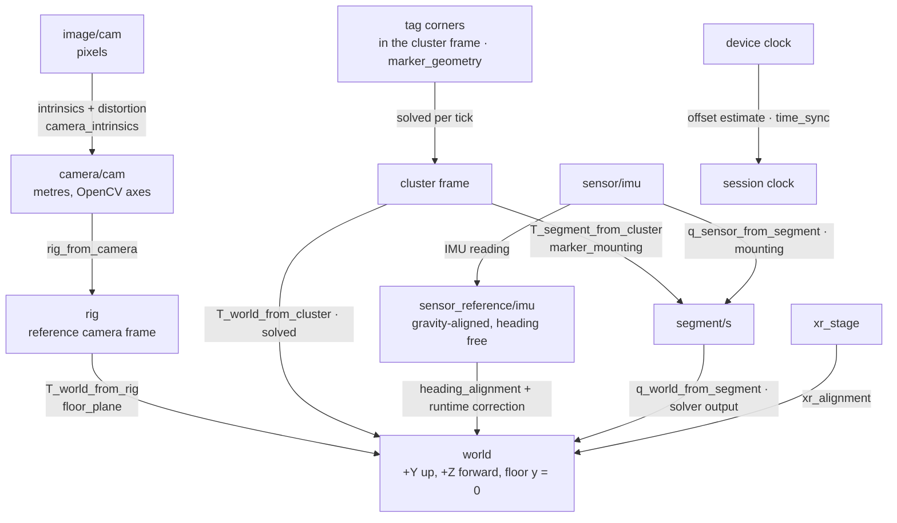

# 09 — Optical markers and calibration

Printed fiducial tags on 3D-printed wearable carriers, the camera calibration that depends on the
same tags, and every calibration procedure the training platform needs.

Decision record: [ADR-024](adr/ADR-024-fiducial-markers-and-board-calibration.md).
Status of everything here: **Proposed**, except where a row says otherwise. Numbers derived by
arithmetic are design values to be confirmed by the tests in [16 §3](16-accuracy-and-validation.md).

## 1. What tags are for — and what they are not

| Tags do | Tags do not |
|---|---|
| Give the pose of a **rigid carrier** strapped to a segment, including rotation about the segment's long axis, which joint-centre landmarks cannot give | Reveal joint centres or bone orientation directly: the carrier sits on soft tissue and is related to the segment only through a calibrated transform |
| Give an absolute heading reference that corrects IMU drift on the same segment | Survive motion blur at striking speed ([08 §3.2](08-tracking-and-sensor-fusion.md)); they are a slow-to-medium-speed aid |
| Disambiguate left from right when the pose detector swaps limbs | Replace the pose detector: untagged segments and joint positions still come from landmarks |
| Calibrate cameras (board) with the same detector that tracks the body | Work outside the size/distance/resolution envelope of §4 |

## 2. Fiducial system choice

| Option | Assessment | Decision |
|---|---|---|
| **AprilTag `tag36h11`** | 6×6 data cells inside a one-cell border (8×8 black square, 10×10 with the white margin); 587 identifiers; large minimum Hamming distance, hence few false detections; reference implementation in C (BSD-2-Clause); corner refinement | **Chosen** for body clusters and for the calibration board |
| AprilTag `tag25h9` | 5×5 data cells (7×7 square); 35 identifiers; larger cells for the same edge, so about 14 % more range; more false positives | **Allowed** per cluster by configuration for 720p rigs. Requires Hamming distance 0 |
| AprilTag `tag16h5` | 30 identifiers; high false-positive rate | Rejected |
| AprilTag `tagStandard41h12` | More identifiers, more cells per edge → shorter range for wearable sizes | Rejected for wearables |
| ArUco (OpenCV dictionaries) | Comparable function; the practical implementation is OpenCV | Rejected: would add OpenCV as a dependency for no gain over AprilTag |
| ChArUco board | Good sub-pixel corners for calibration; again OpenCV | Rejected: an AprilTag grid board calibrates with the detector already present |
| Circular / retro-reflective / active LED markers | Different hardware class (IR illumination, strobing) | Out of scope |

Family facts above are standard but were not re-verified against the AprilTag sources during this
task ([19](19-risks-and-open-questions.md) O-05).

Detector implementation: the AprilTag 3 C library through Rust bindings, isolated in
`bansayo-engine/src/sources/camera/fiducial.rs` behind

```rust
pub trait FiducialDetector: Send {
    fn detect(&mut self, grey: &GreyImage) -> Vec<TagDetection>;   // corners in pixels, sub-pixel refined
}
```

so that the binding crate or a pure-Rust port can be swapped without touching anything else. The
choice of binding crate is **Pending Validation**: licence, maintenance and a Windows build must be
confirmed in a spike ([ADR-024](adr/ADR-024-fiducial-markers-and-board-calibration.md)).

## 3. Detection contract

Recorded as an input observation, exactly like 2D landmarks: **corners in pixels are recorded;
poses are derived by the solver** and are not recorded (same principle as existing ADR-016).

```ts
interface TagDetection {
  family: "tag36h11" | "tag25h9";
  id: number;
  corners_px: [[number, number], [number, number], [number, number], [number, number]];
                                   // counter-clockwise starting at the tag's bottom-left, image frame
  hamming: number;                 // corrected bit errors
  decision_margin: number;         // detector's decode margin
}

interface FiducialDetections {
  frame_meta: CameraFrameMetadata; // existing type
  frame: FrameRef;                 // { type: "image", id }
  origin: Origin;
  detector: string;                // e.g. "apriltag3"
  tags: TagDetection[];
}
// ObservationData: { kind: "fiducials", detections: FiducialDetections }
// Stream topic `fiducials` carries the same object for overlays.
```

Acceptance at the adapter: `tag36h11` with `hamming ≤ 1` and `decision_margin ≥ 30`;
`tag25h9` with `hamming = 0` and `decision_margin ≥ 40`; identifier must be registered (§5.3) —
unregistered identifiers are counted and dropped. Thresholds are `fiducials.*` configuration.

## 4. Size, distance, resolution, blur, light

### 4.1 Decode range

`mm_per_px = 2 · d · tan(HFOV/2) / W` ([08 §3.2](08-tracking-and-sensor-fusion.md)); a `tag36h11`
cell is `edge / 8`, a `tag25h9` cell `edge / 7`, where `edge` is the side of the black square.
Design rule (to be validated): **≥ 4 px per cell to decode, tag edge ≥ 32 px to use its corners
for pose.**

Maximum distance for 4 px per cell, 70° horizontal field of view:

| Tag edge | `tag36h11` @ 1280 | @ 1920 | @ 3840 | `tag25h9` @ 1280 | @ 1920 |
|---|---|---|---|---|---|
| 40 mm | 1.1 m | 1.7 m | 3.4 m | 1.3 m | 2.0 m |
| 50 mm | 1.4 m | 2.1 m | 4.3 m | 1.6 m | 2.4 m |
| 60 mm | 1.7 m | 2.6 m | 5.1 m | 2.0 m | 2.9 m |
| 80 mm | 2.3 m | 3.4 m | 6.9 m | 2.6 m | 3.9 m |

Consequences:

- A 40 mm wrist or ankle tag is **not usable at room scale with 1080p webcams**. Wrists, ankles and
  hands are therefore not tagged by default; the forearm and shin carriers sit distally and the
  joint positions keep coming from landmarks.
- Default edges: torso 80 mm, thigh and shin 60 mm, upper arm and forearm 50 mm. With 1080p
  cameras at 70° this gives a working distance of about 2.1–3.4 m; the wizard computes and shows
  the envelope for the actual cameras and warns when a configured cluster is outside it.
- 4K capture or narrower lenses extend the range; both are configuration, not design changes.

### 4.2 Viewing angle and pose ambiguity

A single planar tag seen nearly face-on has a two-fold pose ambiguity, and its decode fails beyond
roughly 60–70° of obliquity. Mitigations used, in order:

1. **Multi-view corners.** Corners seen by two or more calibrated cameras are triangulated; a
   rigid fit to ≥ 3 triangulated corners has no ambiguity.
2. **Multi-tag rigid clusters.** Several tags on one rigid carrier at different orientations: at
   least one faces a camera, and corners from two non-coplanar tags make single-view pose
   well-posed.
3. **Single view, single tag.** Accepted only when the two planar solutions differ in reprojection
   error by a factor ≥ 2; otherwise position only (depth from apparent size), no orientation.

### 4.3 Motion blur and light

From [08 §3.2](08-tracking-and-sensor-fusion.md): at 1/500 s a point moving 15 m/s smears 16 px on
a 1080p image at 2.5 m, four or more cells of a 60 mm tag. Tags decode only while their image
motion during the exposure stays below about one cell:

| Segment (typical peak speed class) | Tag readable |
|---|---|
| Torso, pelvis, thigh of the support leg | Through most of a technique |
| Upper arm, thigh of the striking leg | Outside the fastest ~100 ms |
| Forearm, shin of the striking limb | In stance, chamber, guard, holds and slow practice; **not** around the strike |

Design consequences: tag-derived observables are expected to drop out around strikes, and the
arbitration table ([08 §7.3](08-tracking-and-sensor-fusion.md)) falls back to IMU or landmarks
automatically; flexibility, stance, form and slow-stage work benefit most.

Lighting: matte paper or matte laminate only (glossy laminate produces specular washout); even,
flicker-free light sufficient for the configured exposure; the adapter sets the `low_light` flag
when mean tag contrast falls below `fiducials.min_contrast` (default 40 grey levels).

## 5. Wearable design

### 5.1 Rigid cluster on a flexible band

A **cluster** is one rigid 3D-printed carrier holding several flat tags in a known arrangement,
attached to the body by an elastic or hook-and-loop band. The band may flex; the carrier may not.
A tag is never applied directly to fabric or skin, and never to a carrier that bends: a bent tag
shifts its corners and its decode margin.

| Carrier model | Shape | Tags | Intended segments |
|---|---|---|---|
| `cuff3-50` | Three faces at 0°, +60°, −60° on a curved saddle | 3 × 50 mm | Upper arm, forearm (lateral side out) |
| `cuff3-60` | Same | 3 × 60 mm | Thigh, shin (anterior-lateral side out) |
| `plate1-80` | Single flat plate | 1 × 80 mm | Chest, upper back, sacrum |
| `plate2-80` | Two plates hinged rigid at 120° | 2 × 80 mm | Sacrum/pelvis where one camera sees from the side |

Carrier rules: face flatness ≤ 0.5 mm over the tag; a white margin of at least one cell around
every tag; matte black body between faces; tag edge printed at the nominal size ± 0.5 mm and
measured after printing (§6.1); mass kept low to limit soft-tissue wobble (design target ≤ 40 g
for limb cuffs); no rigid part over a joint; rounded edges; nothing on the instep, shin crest or
knuckles where it could injure in contact with the floor or the athlete's own body.

### 5.2 Body locations

| Segment | Carrier | Placement | Gains | Limits |
|---|---|---|---|---|
| `pelvis` | `plate2-80` | Sacrum | Pelvis heading and tilt without relying on hip landmarks | Hidden in frontal views; needs a rear or side camera |
| `chest` | `plate1-80` front, optional second on the upper back | Sternum | Chest heading; shoulder–hip separation | Covered by a guard in frontal views |
| `left_thigh`, `right_thigh` | `cuff3-60` | Distal third, lateral | Thigh rotation (hip rotation observable) | Blur on the striking leg |
| `left_shin`, `right_shin` | `cuff3-60` | Distal third, antero-lateral | Shin rotation; foot direction proxy | Blur; occlusion by the other leg |
| `left_upper_arm`, `right_upper_arm` | `cuff3-50` | Mid, lateral | Upper-arm rotation | Occlusion in guard |
| `left_forearm`, `right_forearm` | `cuff3-50` | Distal third, dorsal | Forearm pronation (the only way to observe it without an IMU) | Blur around the strike; small tags → range |
| `head` | Not tagged | — | — | Head pose comes from landmarks or the XR headset |
| Wrists, hands, ankles, feet | Not tagged | — | — | §4.1 |

### 5.3 Identifiers and registration

| Rule | Decision |
|---|---|
| Identifier ranges (`tag36h11`) | 0–47 calibration board A; 48–89 reserved for further boards; 90–99 static anchor tags (§9); 100–586 body clusters |
| Uniqueness | Each identifier appears in at most one cluster or board per installation; validated at configuration load |
| Cluster as a device | A cluster is a registry device of kind `marker_cluster`, capabilities `pose`, transport `optical`, announced by the engine's internal `markers` source. It therefore has state, reasons, assignment to a segment (`PUT /devices/{id}/assignment`) and calibration references like any tracker |
| Cluster configuration | `trackables:` in the engine configuration ([13 §4](13-configuration-schemas.md)): id, carrier model, family, tag identifiers in face order |
| Cluster state | `tracking` when its pose was solved within `engine.stale_after_ms`; `degraded` when solved from a single view; `disconnected` after `quality.disconnect_after_ms` without a solution — which is normal during strikes and is not shown as an error |
| Replacement of a damaged tag | Reprint with the **same identifier** → only `marker_geometry` of that cluster becomes `stale`. A different identifier → edit the cluster's tag list; `marker_geometry` and `marker_mounting` become `stale` |

## 6. Cluster calibration

Two new calibration kinds (additive enum values).

### 6.1 `marker_geometry` — where the tags are on the carrier

| Step | Detail |
|---|---|
| Nominal geometry | From the carrier model file `markers/models/<model>.yaml`: per face, `T_cluster_from_tag` (rotation and translation) and nominal edge length |
| Printed size | The user measures one tag edge with calipers and enters it (`edge_mm_measured`); corner coordinates scale accordingly |
| Refinement capture | The cluster is turned slowly for 10 s in view of ≥ 2 calibrated cameras. Every frame in which two faces are visible yields a relative pose between them; the per-pair relative poses are averaged (rotation by quaternion mean, translation by median) and the cluster's corner model is rebuilt from the averaged poses |
| Acceptance | RMS distance between the refined model and triangulated corners ≤ `markers.geometry_max_rms_mm` (default 1.5); each face observed in ≥ 30 frames |
| Stored | Profile `marker-geometry-<cluster>`: corner coordinates in the cluster frame, measured edge, RMS, frame counts |
| Without refinement | The nominal model is used with state `assumed` and a reason on every dependent value |

### 6.2 `marker_mounting` — where the carrier is on the segment

`T_segment_from_cluster`: a rotation and the cluster origin in the segment frame. Captured in the
**same reference-pose capture** as IMU mounting (existing procedure, extended):

```text
In the reference pose every segment's world rotation is identity, therefore
  q_segment_from_cluster = mean( q_world_from_cluster )            over the capture window
  t_segment_from_cluster = mean( p_cluster − p_segment_origin )    in world = segment axes
where p_segment_origin is the triangulated joint centre of that segment's proximal joint,
or its FK position when the landmark is missing (then the profile's quality records `origin_from: fk`).
```

Stillness check: cluster position spread ≤ 5 mm and angular spread ≤ 0.02 rad over 1 s, else
"Movement detected during capture". The profile is keyed by (cluster, segment), depends on
`marker_geometry` of the cluster and on `camera_extrinsics` of the cameras used, and is invalidated
like IMU mounting when the cluster is reassigned.

In use:

```text
q_world_from_segment = q_world_from_cluster · q_segment_from_cluster⁻¹
p_segment_origin     = p_cluster − q_world_from_segment · t_segment_from_cluster
```

The second line is an **estimate of a joint centre through soft tissue**. It has provenance
`derived`, never `measured`, and is used only when the joint's own landmark is missing.

## 7. Camera calibration with an AprilTag board

**Current path (17 November 2026):** `scripts/calibrate_cameras.py` calibrates with a ChArUco
board through OpenCV and imports profiles with `POST /calibration/profiles`. It is kept until body
clusters are built; the procedure below is the in-engine successor
([ADR-024](adr/ADR-024-fiducial-markers-and-board-calibration.md), revision). §7.4 applies to both.

### 7.1 Board

`bansayo-board-a3`: 6 × 4 `tag36h11` tags, identifiers 0–23 row-major from the top-left, edge
50 mm, pitch 62.5 mm, printed on A3 and mounted on a rigid flat panel. A printed arrow marks the
board's +Z (the athlete's forward direction when the board lies on the floor). The user enters the
measured edge length and the panel thickness. Board identifiers 24–47 are reserved for an A2
variant (8 × 6).

### 7.2 Intrinsics (`camera_intrinsics`, existing kind and data type)

| Step | Detail |
|---|---|
| Capture | The user moves the board in front of one camera. A frame is accepted when ≥ 8 tags decode and the board pose differs from every accepted frame by ≥ 10° or ≥ 15 % of image width. Live coverage map on a 4 × 4 image grid |
| Stop condition | ≥ 20 accepted frames **and** ≥ 12 of 16 grid cells contain corners **and** board tilt spans ≥ 30° |
| Solve | Closed-form initialisation by Zhang's method from the per-frame homographies; refinement of `fx, fy, cx, cy, k1, k2, p1, p2, k3` and per-frame board poses by damped Gauss–Newton with a numeric Jacobian (`calibration/optimize.rs`, on `nalgebra`; the same routine serves §7.3 and §6.1) |
| Acceptance | RMS reprojection error ≤ `calibration.intrinsics_max_rms_px` (default 0.6 at 1280 wide, scaled with width) |
| Stored | `CameraIntrinsicsData` (unchanged) plus `quality: { rms_px, frames, coverage_cells }`, method `apriltag_board` |
| Model | Pinhole + Brown–Conrady, as today. Lenses beyond about 100° horizontal field of view need a fisheye model, which is **not** supported; such a camera fails acceptance |

### 7.3 Extrinsics (`camera_extrinsics`) and floor (`floor_plane`)

| Step | Detail |
|---|---|
| Rig capture | The board is carried through the volume. Frames where ≥ 2 cameras see ≥ 6 tags each (within the time-alignment rule) give relative camera poses through the board |
| Graph | Cameras are nodes, co-visibility edges are weighted by observation count. Every camera must be connected to the reference camera (the first in configuration); otherwise the wizard names the unconnected camera |
| Solve | Initial poses along the maximum spanning tree; bundle adjustment over camera poses and board poses with intrinsics fixed |
| Acceptance | RMS reprojection ≤ `calibration.extrinsics_max_rms_px` (default 1.0 at 1280 wide); ≥ 40 shared frames per edge of the spanning tree |
| Floor capture | The board is laid on the floor in the middle of the training area, arrow pointing in the athlete's forward direction. World origin = board centre lowered by the panel thickness; +Y = board normal; +Z = arrow |
| Stored | `floor_plane`: `T_world_from_rig`, panel thickness, residual; method `apriltag_board`. `camera_extrinsics` per camera: `q_world_from_camera`, `t_world_from_camera_m` (existing fields) plus `rig_from_camera` so that re-laying the board recomputes world poses without a new rig capture. `camera_extrinsics` depends on `camera_intrinsics` and on `floor_plane` |

### 7.4 Calibration check (QA gate)

Run at the end of the wizard and on demand; its result is stored with the calibration set and used
by comparability ([12 §5](12-data-and-progress.md)).

| Check | Pass | Warn | Fail |
|---|---|---|---|
| Triangulation RMS reprojection of the board carried once through the volume | ≤ 1.5 px | ≤ 3 px | > 3 px |
| Board edge length recovered from triangulated corners vs entered | within 1 % | within 2 % | beyond |
| Athlete standing: both heel heights | within ± 3 cm of 0 | ± 5 cm | beyond |
| Athlete standing: measured stature (head top) vs entered height, when the detector has a head-top point | within ± 3 cm | ± 5 cm | beyond |

`calibration_qa` = worst of the checks. Assessments require `pass`.

## 8. Procedure catalogue

All procedures run through one engine-side state machine and one API
([14 §5](14-runtime-and-api-contracts.md)): `idle → collecting → solving → review → committed | cancelled | failed`,
publishing `SystemState.calibration_procedure` with live guidance (coverage, stillness, counts).

| # | Procedure | Kind | Needs | User action | Status |
|---|---|---|---|---|---|
| 1 | Camera intrinsics | `camera_intrinsics` | Board | §7.2 | Proposed (kind and consumer exist) |
| 2 | Camera extrinsics | `camera_extrinsics` | 1; board | §7.3 | Proposed (kind and consumer exist) |
| 3 | Floor and world | `floor_plane` | 2; board | Lay the board on the floor | Proposed |
| 4 | Camera time offsets | `time_sync` | 2 | Five fast arm swings in view of all cameras. Per camera, the 2D wrist-speed signal is cross-correlated against the reference camera's after resampling to 1 kHz; `offset_us` = lag of the maximum. Accepted when the correlation peak ≥ 0.8 | Proposed, **Pending Validation** |
| 5 | Body proportions | `body_proportions` | 3 | Enter height; hold the reference pose 3 s in view of ≥ 2 cameras. Segment lengths = median measured joint distances, accepted within ± 20 % of the default ratios. Writes a `valid` profile; `SkeletonDefinition.rev` increments. In profile `basic`: height only, state `assumed` | Partial (height only exists) |
| 6 | Marker geometry | `marker_geometry` | 2 | §6.1 | Proposed |
| 7 | IMU readiness and bias | `imu_bias` | — | Trackers still on a surface | Planned (existing design) |
| 8 | Mounting: IMU and marker | `mounting`, `marker_mounting` | Assignments; 2 for markers | Hold the reference pose | IMU: **Implemented**. Marker: Proposed |
| 9 | Heading alignment | `heading_alignment` | 8 | Two-pose bend (existing design) **or**, when cameras see the instrumented segments, 10 s of free movement: heading offset per tracker = circular mean of the optical-vs-IMU yaw error (same error as [08 §7.2](08-tracking-and-sensor-fusion.md)); method `optical` | Planned / Proposed |
| 10 | Headset alignment | `xr_alignment` | 3 | Reference pose wearing the headset (existing design) | Planned |
| 11 | Planar scale | — (session state, not a profile) | 1 camera | Hold the start stance; reference torso length is captured ([04 §4](04-movement-domain-model.md)) | Proposed |
| 12 | Calibration check | QA record | 3 | §7.4 | Proposed |

Wizard order is the table order; steps whose prerequisites are absent (no board, one camera, no
trackers) are skipped with a statement of what will consequently be unavailable.

## 9. Invalidation additions

Added to the existing table in `calibration/invalidation.rs` ([docs/05 §5](../../05-calibration-and-fusion.md)).

| Event | Profiles affected | New state |
|---|---|---|
| Median reprojection error of one camera over 10 s exceeds twice its calibration-time value for 30 s while the other cameras stay normal | `camera_extrinsics` of that camera | `stale`; notice `camera_moved` |
| A static anchor tag (identifiers 90–99, fixed to a wall or the floor edge) moves more than 2 cm from its stored position | `camera_extrinsics` of the cameras that see it differently | `stale` |
| `floor_plane` recaptured | `camera_extrinsics` (world poses recomputed from `rig_from_camera`), `marker_mounting`, `xr_alignment` | Extrinsics recomputed and `valid`; the others `stale` |
| Camera resolution, lens or focus setting changed | `camera_intrinsics` → `camera_extrinsics`, `time_sync` | `stale` (existing rule, extended to `time_sync`) |
| Camera frame rate or exposure mode changed | `time_sync` | `stale` |
| Cluster reassigned to another segment | `marker_mounting` for the old pair | `stale` |
| Tag reprinted or cluster tag list edited | `marker_geometry`, then `marker_mounting` | `stale` |
| Body proportions recalibrated | Nothing rotational; `SkeletonDefinition.rev` increments; a new calibration set begins | — |
| Heading alignment older than `calibration.heading_max_age_s` (default 1800) with no optical correction since | `heading_alignment` | `stale` |

A change of calibration set never rewrites stored measurements; it starts a new calibration set id
on subsequent ones ([12 §5](12-data-and-progress.md)).

## 10. Coordinate frames and transforms



Solid arrows are stored calibration or per-tick solutions as labelled. `rig` is internal to the
calibration module and is not a `FrameRef` value.

## 11. How tag observations enter fusion

| Step | Rule |
|---|---|
| Solve (stage 4 in [08 §7](08-tracking-and-sensor-fusion.md)) | Per cluster and tick: collect accepted detections of its tags from all calibrated cameras in the aligned view set. Triangulate every corner seen in ≥ 2 views. With ≥ 3 triangulated corners: rigid fit (Kabsch) of the cluster's corner model → `T_world_from_cluster`, method `marker_cluster`, provenance `measured`, sigma from the fit residual. Otherwise single-view pose under the rules of §4.2, confidence × 0.6, device state `degraded` |
| Rotation of the segment | Enters arbitration at priority 2 for axis and twist ([08 §7.3](08-tracking-and-sensor-fusion.md)); `derived` through `marker_mounting` |
| Heading correction | A cluster and an IMU on the same segment: the cluster supplies the optical heading for stage 6 |
| Joint positions | Never overridden by a cluster. The cluster-derived joint estimate is used only when the joint's landmark is absent |
| Skeleton reconstruction | Clusters **constrain** rotations; they do not replace the pose model. Removing every tag returns the system to `multi_view` with no other change |
| Left/right swaps | A triangulated limb landmark more than 0.5 segment lengths from where the limb's cluster places that segment is rejected (`implausible_bone_length` gate, extended) |

## 12. Failure handling

| Condition | Behaviour |
|---|---|
| Tag partially occluded | The detector fails to decode it: no detection. No partial tags are used |
| Carrier slipped on the limb | Appears as a persistent disagreement between cluster-derived and landmark-derived segment axis. Mean disagreement > 0.26 rad (15°) over 5 s → `marker_mounting` `stale`, notice, cluster removed from arbitration |
| Wrong tag printed (identifier not registered) | Counted in the camera's diagnostics; listed in the Devices workspace as "unregistered tag <id>" |
| Duplicate identifier in view (two clusters printed alike) | Both instances rejected; notice `duplicate_tag` |
| False detection | Bounded by family choice, Hamming and decision-margin thresholds, and by geometry: a detection inconsistent with its cluster's rigid model (corner residual > 3× sigma) is dropped |

## 13. Validation

Static tag position and orientation accuracy on a measured fixture, decode rate versus distance,
angle, speed and exposure, cluster-versus-landmark agreement, and repeatability of mounting
capture are specified in [16 §3](16-accuracy-and-validation.md). The simulator gains a fiducial
projector (corners of configured clusters through the declared camera models, with blur-dependent
dropout) so that every solver rule above has a deterministic test before hardware exists.
