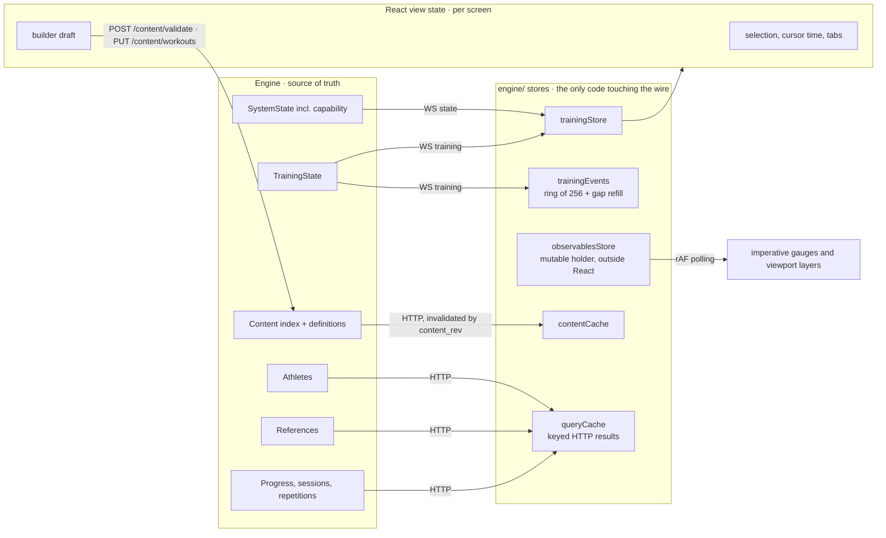
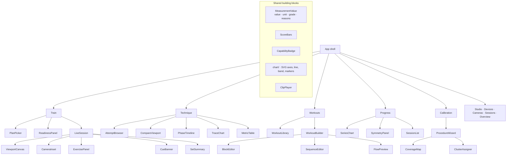

# 10 — Desktop application architecture

Screens, components, state ownership and interaction flows for training on the desktop. The
application stays what it is today — a React + three.js UI in a Tauri shell that talks to the
engine only over the network contract (existing ADR-006, ADR-007) — and gains workspaces.

Decision record: [ADR-032](adr/ADR-032-desktop-integration.md). No UI is implemented by this task.

## 1. What exists and is reused

| Existing (verified in `apps/desktop/src`) | Reuse |
|---|---|
| Shell: navigation rail, status bar, transport bar (`shell/App.tsx`, `TransportBar.tsx`) | Unchanged frame; new workspaces are entries in the `NAV` table |
| Hash routing (`lib/hashRoute.ts`) — keeps only the first path segment | Extended to return the remaining segments (§3) |
| Stores: `createStore` (get/set/subscribe), `frameStore` as a mutable holder outside React, hooks `useSystemState`, `useSampledFrame`, `useAction` | Same two patterns for training data (§4) |
| Connection (`engine/connection.ts`): receive-only WebSocket, ignores unknown message types, stops on protocol mismatch | Subscribes to the new topics; unknown-type tolerance already makes this safe |
| Imperative viewport: `MotionViewport` with one `SkeletonRig`, `LandmarkRig`, `CameraFrustums` | New layers and a second rig (§5) |
| UI primitives: `BodyMap`, `EmptyState`, `OriginBadge`, `Panel`, `ProvenanceTag`, `Reasons`, `Sparkline`, `StatePill` | Reused everywhere a value, state or reason is shown |
| Workspaces: Overview, Studio, Devices, Cameras, Sessions; `ReferencePoseFlow` | Kept. Studio becomes the technical live-tracking view |

Primitives named in [docs/07](../../07-desktop-ui.md) but absent from the code (`Button`, `Field`,
`Select`, `Dialog`, `Drawer`, `Readout`) must be built first; every new screen depends on them.

Rules inherited unchanged: no state library, no router library, no chart library, no
react-three-fiber; per-frame data never enters React state; the UI contains no kinematics, no
metric formulas, no scoring and no recognition.

## 2. Navigation

| Key | Workspace | Route | Brief's view | Status |
|---|---|---|---|---|
| 1 | **Train** | `#/train` | Training Dashboard; live session | Proposed |
| 2 | **Technique** | `#/technique` | Technique Studio | Proposed |
| 3 | **Workouts** | `#/workouts` | Workout Builder | Proposed |
| 4 | **Progress** | `#/progress` | Progress Dashboard | Proposed |
| 5 | Overview | `#/overview` | — | Implemented |
| 6 | Studio | `#/studio` | Live Tracking (technical) | Implemented, extended |
| 7 | Devices | `#/devices` | Device management | Implemented, extended |
| 8 | Cameras | `#/cameras` | Camera configuration | Implemented, extended |
| 9 | **Calibration** | `#/calibration` | Calibration wizard | Planned in docs/07 as a workspace; specified here |
| 0 | Sessions | `#/sessions` | Recordings | Implemented, extended |

A workspace appears in the rail only when implemented (existing rule). The default route becomes
`#/train` once Train exists. The status bar gains two items: **active athlete** (opens the athlete
switcher) and **capability profile** (opens Calibration).

## 3. Routing

`parseHash` returns `{ workspace: string, rest: string[] }`. Sub-routes:

| Route | Screen |
|---|---|
| `#/train` | Dashboard |
| `#/train/live` | Live session (only while `SystemState.training` is not null; otherwise redirects to `#/train`) |
| `#/train/summary/<session_id>` | Session summary |
| `#/technique` | Attempt browser |
| `#/technique/<session_id>/<rep_index>` | One attempt |
| `#/technique/<session_id>/<rep_index>/vs/<reference_id>` | Attempt against a reference |
| `#/workouts` | Library |
| `#/workouts/edit/<workout_id>` | Builder (`new` for a draft) |
| `#/progress` | Overview |
| `#/progress/<technique_id>/<metric_id>` | One series |
| `#/calibration` | Wizard overview |
| `#/calibration/<procedure>` | One procedure |

Identifiers in routes are validated against their patterns before use; an invalid route shows the
workspace's empty state.

## 4. State ownership



| Data | Owner | Client copy | Update path |
|---|---|---|---|
| Training session state | Engine | `trainingStore` (replace-only) | `training_state` messages; `GET /training/state` on connect |
| Training events | Engine | `trainingEvents`: ring buffer of the last 256; on an `event_seq` gap, fetch `GET /training/sessions/{id}/events?after_seq=` | `training_event` messages |
| Live observables | Engine | `observablesStore`: plain mutable holder like `frameStore`; never React state | `observables` messages |
| Content (techniques, workouts, …) | Engine files | `contentCache` keyed by `ContentRef`; whole cache dropped when `SystemState.content_rev` changes | HTTP |
| Athletes, active athlete | Engine | `queryCache`; active athlete also in `SystemState.athlete` | HTTP + `state` |
| Sessions, repetitions, progress series, references, clips | Engine store | `queryCache` keyed by URL; entries for the active session invalidated on `session_completed` | HTTP |
| Builder draft | UI | React state of the builder; persisted to `localStorage` under `bansayo.draft.<id>` until saved | — |
| Selected attempt, chart cursor, layer toggles, units (cm/in, deg) | UI | React state; presentation preferences in `localStorage` | — |

The UI never computes a derived training value. Unit conversion and number formatting are the
only arithmetic on measurements.

## 5. Component architecture



### 5.1 Shared building blocks (new)

| Component | Responsibility | Notes |
|---|---|---|
| `MeasurementValue` | Renders one `MetricMeasurement`: value in display units, grade (A solid, B outlined, C "indicative", X dash with reason popover), estimated-uncertainty band when sigma is present | The only way a measurement is shown anywhere. Wraps `ProvenanceTag` and `Reasons` |
| `ScoreBars` | Component scores as labelled bars with their target label; `null` components greyed with the reason; `reference_match` in five bands with coverage | Never a single big number |
| `CapabilityBadge` | Profile label and the count of unavailable observables; opens the capability panel | |
| `chart/` primitives | SVG axes, line, uncertainty band, phase bands, event markers, series-break marker, cursor | Hand-built, consistent with the existing no-chart-library rule; `Sparkline` is the precedent |
| `PhaseTimeline` | Phase intervals as bands, strike marker, scrub cursor | Shared by Technique and LiveSession |
| `ClipPlayer` | Imperative player for stored motion clips (positions precomputed by the engine): play, pause, speed, scrub, loop; drives one or two rigs | Not engine replay; no kinematics |
| `CueBanner` | One cue: basis tag, observed sentence, suggestion | Enforces nothing; the engine already limits cues |

### 5.2 Viewport additions (imperative, outside React)

| Layer / class | Purpose |
|---|---|
| `GhostRig` | A second `SkeletonRig` with the ghost material, fed by `ClipPlayer` or by live phase alignment |
| `TrailLayer` | Path of selected keypoints over the current repetition |
| `TargetPathLayer` | The reference end-effector path |
| `AngleArcLayer` | Arc and label for selected joint observables |
| `MarkerLayer` | Cluster poses and tag outlines from `markers` / `fiducials` topics |
| `FloorLayer` | Calibrated floor grid, origin, training-area outline |
| `CompareViewport` | Composition for Technique: `side_by_side` (two rigs offset 1.2 m) or `overlay` (both pelvis-aligned and heading-aligned at repetition start) |

Evidence styling extends the existing provenance styling: a segment whose twist is `inferred` is
drawn with a hatched band; a keypoint with method `fk` is hollow.

## 6. Screens

### 6.1 Train — dashboard

| Region | Content | Data |
|---|---|---|
| Athlete header | Active athlete, discipline, level; switcher | `/athletes` |
| Plan picker | Discipline → mode → technique / combination / form / workout / assessment; parameters (side, sets, repetitions, stages, reference, coaching level) | Content index |
| Program card | Next proposed session of an enrolled program | `/programs/enrolments` |
| Goals | The plan's goals with their reference values | Content + `/progress` |
| Recent progress | Last five sessions: date, plan, repetitions, one headline metric each | `/training/sessions` |
| Readiness | Gates of [03 §1](03-training-modes.md); per-metric availability with reasons; recording options | `TrainingState.readiness` after `POST /training/sessions` |
| Start / End | `start`, `end` commands | |

Selecting a plan calls `POST /training/sessions` (state `preparing`); nothing is tracked or stored
until `start`.

### 6.2 Train — live session

```text
┌──────────────────────────────────────────────┬───────────────────────────────┐
│ 3D avatar (+ ghost, trail, target path)       │ Roundhouse kick · right       │
│                                               │ Set 2 / 3        Rep 6 / 10   │
│                                   ┌─────────┐ │ ▓▓▓▓▓▓░░░░                    │
│                                   │ camera  │ │ Phase: extension              │
│                                   │ + overlay│ │                               │
│                                   └─────────┘ │ Last rep                      │
│                                               │  Height   1.21 m  A           │
│                                               │  Pivot    — (feet not seen)   │
│                                               │  Retract  310 ms  B           │
├──────────────────────────────────────────────┤                               │
│ ⓡ reference  Supporting foot turned less …    │ Tracking: multi_view ● 3 cams │
│   Practise the pivot at reduced speed.        │ Calibration: valid            │
└──────────────────────────────────────────────┴───────────────────────────────┘
│ ⏸ Pause   ⏭ Skip rest   ↻ Repeat   ■ End                    00:07:42         │
```

Values in the sketch are placeholders. Elements map one-to-one to `TrainingState` fields and the
last `rep_completed` event. During `resting` the right column shows the set summary; during
`tracking_lost` it shows the missing observables and reasons.

### 6.3 Technique

| Region | Content |
|---|---|
| Attempt browser | Sessions → sets → repetitions, filter by technique, side, outcome, grade; marks personal bests and references |
| Compare viewport | Athlete clip and reference clip, `side_by_side` or `overlay`, time-aligned by the engine's warp (`GET …/alignment`) |
| Phase timeline | Phases of both, strike markers, scrub |
| Trace chart | Selected observables over time for the attempt (and the aligned reference), with unavailable spans shown as gaps, never bridged |
| Trajectory | Trails of selected keypoints in the viewport |
| Per-phase table | Duration and key values per phase, attempt vs reference vs personal median |
| Metric table | Every `MetricMeasurement` with grade and reasons; component scores |
| Actions | Exclude attempt; set as selected reference; annotate (label and phase-boundary corrections, stored as annotations) |

### 6.4 Workouts — builder

| Region | Content |
|---|---|
| Library | Shipped and user workouts, combinations and programs; duplicate, edit (user content only), delete |
| Structure | Blocks → items as a reorderable list (keyboard and pointer); per item: exercise picker, sets, target, rest, time cap, goals |
| Sequence editor | For combinations: steps with side and window; repeat, choice and optional groups up to the nesting limit |
| Levels | Table of per-level overrides |
| Flow preview | Linear timeline of the expanded session with estimated duration and repetition totals, and safety-limit warnings |
| Validation | Problems from `POST /content/validate`, each anchored to its field; Save disabled while errors exist |
| Save | `PUT /content/workouts/{id}` → the engine writes the YAML file. The UI never writes files |

The builder edits a JSON form of the definition; YAML is produced and parsed only by the engine.

### 6.5 Progress

| Region | Content |
|---|---|
| Filters | Technique, side, metric, date range, comparability class (default: the class with the most recent data) |
| Series chart | One point per session: median of grade-A values with the within-session interquartile range; grade-B series secondary; **series-break markers** wherever the comparability class or calibration set changes; baseline and personal best lines |
| Trend statement | `improved`, `declined` or `no clear change`, from the engine ([12 §6](12-data-and-progress.md)), with the numbers behind it |
| Left/right | Paired series and asymmetry |
| Consistency | Set variability over time |
| Flexibility | Range per side and class (active dynamic, active static, supported static) |
| Tracking quality | Per session: profile, share of grade-A measurements, calibration QA |
| Recent sessions | Links to summaries |

### 6.6 Calibration and device management

| Screen | Additions |
|---|---|
| Calibration | Wizard listing the procedures of [09 §8](09-optical-markers-and-calibration.md) in order with state and what each unlocks; one page per procedure with live guidance from `SystemState.calibration_procedure` (coverage map, stillness meter, counts), result review, commit or discard; printable board and tag sheets generated by the engine (`GET /calibration/print/{board|cluster}`) |
| Cameras | Real-camera settings (resolution, rate, exposure, gain), preview with landmark and tag overlays, working-distance envelope for configured tags, per-camera reprojection error |
| Devices | Cluster devices next to trackers; assignment by `BodyMap`; `ClusterAssigner` for registering tag identifiers; per-tracker loss and saturation counters; unregistered-tag list |
| Studio | `ExerciseStrip` when a session is active; capability panel listing every observable with state, method and reasons |

## 7. Interaction flows

### 7.1 Start a guided session

```mermaid
sequenceDiagram
  participant U as Athlete
  participant UI as Desktop UI
  participant E as Engine
  U->>UI: Pick technique, side, sets
  UI->>E: POST /training/sessions {plan, record}
  E-->>UI: training_state (preparing, readiness)
  UI-->>U: Readiness: metrics available / unavailable with reasons
  U->>UI: Start
  UI->>E: POST /training/command {start}
  E-->>UI: training_state (countdown → active)
  loop each repetition
    E-->>UI: training_event rep_started, phase_changed
    E-->>UI: training_event rep_completed (+ optional cue)
  end
  E-->>UI: training_event set_completed, rest_started
  E-->>UI: training_event session_completed
  UI-->>U: Summary; link to attempts and progress
```

### 7.2 Other flows

| Flow | Steps |
|---|---|
| Review an attempt | Summary or Technique → select repetition → `GET /training/reps/{s}/{i}`, `/trace`, `/motion` → scrub; choose reference → `GET /references/{id}/clip`, `GET …/alignment?reference=` |
| Build a workout | Workouts → New → add blocks and items → validation runs 400 ms after each edit → Save |
| Calibrate | Calibration → procedure → `POST /calibration/procedures` → follow guidance → review → `commit`; state updates arrive on the `state` topic |
| Switch athlete | Status bar → athlete → `PUT /athletes/active`; refused with `conflict` while a session is active |
| Lose tracking mid-session | `tracking_lost` event → right column shows what is missing → automatic resume; after 3 s the session is paused by the engine |
| Engine disconnected | Existing behaviour: values cleared, reconnect with backoff; on reconnect `GET /training/state` and event refill restore the session view |

## 8. Sound and speech

| Output | Decision |
|---|---|
| Countdown, repetition, rest, beat | Short tones generated with the Web Audio API from event times; the metronome is scheduled from the beat grid in `TrainingState` |
| Spoken cues | Optional, off by default, through the webview's `speechSynthesis`; speaks the cue's suggestion only, never during a repetition |
| Voice input | None |

## 9. Failure handling, performance, validation

| Topic | Rule |
|---|---|
| Unknown fields, message types, enum values | Ignored (existing contract rule); an unknown `MethodId` or grade renders as "other" |
| Missing data | Every screen has an empty state that says what to do; a measurement that is `X` shows its reasons, never a zero |
| Performance | Live gauges, viewport layers and the trace cursor are imperative and read mutable stores in `requestAnimationFrame`; React renders only on state, event and query changes. Trace charts decimate to the pixel width before drawing |
| Tests | Unit tests for stores and gap refill; component tests for `MeasurementValue` grades and `ScoreBars` null handling; a Playwright journey on the simulator: pick technique → run a set → summary → attempt review → progress, at 1440, 1024 and 800 px (matching the existing journey) |
| Accessibility | Keyboard access to every control, live-region announcements for repetition count, cue and state changes (the existing announcer), no information by colour alone (grades have shape and text) |
