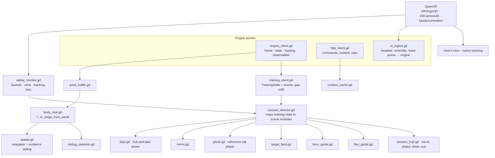

# 11 — VR training architecture

VR is a first-class client of the same training session as the desktop. It renders, guides and
keeps the athlete safe; it computes no kinematics, metrics, scores or recognition.

Decision record: [ADR-033](adr/ADR-033-vr-runtime.md). Extends [docs/08](../../08-vr-client.md).

## 1. What exists

Verified in `apps/vr` (Godot project feature level 4.4, `gl_compatibility` renderer, OpenXR
enabled, GDScript):

| Script | Does | Status |
|---|---|---|
| `engine_client.gd` | Connects to `/api/v1/stream?topics=frame,state`, checks `protocol_version`, reconnects with 0.5–8 s backoff, drops non-increasing `seq`, emits signals | Implemented, **not runtime-validated** (Godot was not installed; see [docs/13](../../13-implementation-status.md)) |
| `pose_buffer.gd` | Renders 50 ms behind the newest frame; interpolates; never extrapolates; clears after 500 ms | Same |
| `debug_skeleton.gd` | Capsules from the skeleton definition, styled by provenance | Same |
| `body_root.gd` | Holds the alignment transform (identity) | Same |
| `status_panel.gd`, `dev_rig.gd`, `training_room.gd` | Status label; desktop orbit camera; room, OpenXR start-up with desktop fallback | Same |

Update, commits of 17 November 2026: the client now imports, parses and renders on Godot 4.5.1 in
desktop mode (OpenXR not started; no headset connected), and gained a status panel with joint
readouts, record/replay buttons, a controller-based room alignment, and `movement_counter.gd`,
which counts squats and kicks from the engine's angles with fixed thresholds. That counter is
**PoC debt**: it is the one place where a client derives a training value, and it is deleted when
the engine's `training` topic provides counts (§3, `training_client.gd`).

Planned in docs/08 and not built: avatar retargeting, mirror, tracker roles.
Everything else in this document is **Proposed**.

## 2. Runtime and technology decisions

| Question | Decision | Why |
|---|---|---|
| Engine | Godot 4 with OpenXR, GDScript (existing ADR-010 kept) | Existing investment; the client parses JSON and sets transforms |
| First target | **PC VR**: headset connected to the PC that runs the engine (SteamVR, Meta Link or equivalent OpenXR runtime); the client talks to `127.0.0.1` | Cameras, GPU inference and the engine are on the PC anyway; no network exposure |
| Standalone headset build | Later (roadmap Phase 6, P2). Requires the engine's LAN mode with authentication ([ADR-031](adr/ADR-031-local-first-execution.md)) and an Android export with the OpenXR vendors plugin | The engine cannot run on the headset |
| Browser VR (WebXR) | **Rejected** for the product | See §2.1 |
| Vendor extensions | Used only behind capability checks, never required: passthrough, hand tracking, runtime body tracking | Portability across runtimes |
| Renderer | Keep `gl_compatibility` | Works on PC and standalone; the scene is simple |

### 2.1 Native versus browser VR

| Aspect | Native (Godot + OpenXR) | WebXR in a browser |
|---|---|---|
| Access to the local engine | Plain `ws://127.0.0.1` | WebXR is available only in secure contexts. A headset browser loading the page from the PC would need HTTPS and `wss://` on the engine; a PC browser on `localhost` works but only with a PC-VR-capable browser |
| SteamVR tracker roles | Through `XR_HTCX_vive_tracker_interaction` on SteamVR | Not exposed |
| Hand tracking | `XR_EXT_hand_tracking` where the runtime has it | Hand Input module, availability varies by browser and device |
| Body tracking extensions | Available through vendor plugins on some runtimes | Not available |
| Passthrough / mixed reality | Vendor extensions | `immersive-ar` on some devices only |
| Performance headroom | Native | Browser overhead; garbage-collection pauses during fast motion |
| Code reuse | Shares nothing with the desktop UI except the contract | Could reuse the three.js viewport |

The reuse argument does not outweigh the access and capability gaps. Reconsidered if a standalone
headset becomes the primary target and the LAN mode with TLS exists.

## 3. Component architecture



| Script (new unless noted) | Responsibility | Never does |
|---|---|---|
| `engine_client.gd` (extended) | Adds topics `training`, `observables`, `markers` | Interpret training semantics |
| `http_client.gd` | JSON over HTTP with the response envelope; commands, content, reference clips | Retry state-changing calls automatically |
| `training_client.gd` | Holds the latest `TrainingState`; ring of events; refills gaps by `event_seq` | Count repetitions itself |
| `session_director.gd` | The only place that maps `TrainingState.phase` / `sub_state` and plan kind to which modules are visible | Hold training state of its own |
| `avatar.gd` | Humanoid retargeting by the rule in docs/08 §6; draws segments by evidence (solid: measured/derived; translucent: inferred; hatched band: twist inferred) | Kinematics beyond one multiplication per bone |
| `mirror.gd` | Mirrored copy of the avatar | — |
| `ghost.gd` | Plays a reference clip (positions from the engine for the current skeleton) and the time-warp from `…/alignment` | Align or warp by itself |
| `target_field.gd` | Draws the targets listed in `TrainingState.current.targets`; reacts to `target_reached` events | Decide hits |
| `form_guide.gd` | Floor arrows for the next step's travel and facing, step prompt, ghost instructor | Judge steps |
| `flex_guide.gd` | Angle arc on the measured joint, hold ring driven by `hold_progress`, baseline marker | Compute angles |
| `session_hud.gd` | World-locked panel: counts, phase, timer, last-repetition measurements with grade, one cue | Show more than one cue |
| `safety_monitor.gd` | §7 | Rely on the engine for headset-side safety |
| `xr_ingest.gd` | §6 | — |

`session_director.gd` module map:

| Plan kind | Modules shown while `active` |
|---|---|
| `technique` | Mirror, ghost (when a reference is selected), targets (when the definition has a `target` and presentation enables it), HUD |
| `combination` | Targets per step, HUD with the step strip, mirror |
| `workout` | Per item, as above |
| `form` | Form guide, ghost instructor in `guided`/`segment`; mirror only in `performance` |
| `mobility` | Flex guide, mirror, HUD |
| `assessment` | Mirror, HUD without cues |
| `free` | Mirror, HUD with the recognised-movement list |

## 4. Experiences

### 4.1 Virtual dojo

The hub: a room whose floor is the calibrated floor (`y = 0` in both frames after
`xr_alignment`), with the training zone drawn on it (§7), a plan picker panel, the athlete
switcher, readiness gates and the start control. Layout rule: every panel is world-locked, at
least 1.5 m from the user's start position, **outside the training zone**, centred 10° below eye
level, and no interactive element is ever placed inside the zone.

### 4.2 Mirror mode

| Aspect | Decision |
|---|---|
| What is shown | The engine's body state on an avatar, reflected across a vertical plane 2.5 m in front of the zone centre, life-size |
| Without `xr_alignment` | The figure is placed at a fixed spot facing the user and mirrored left-to-right; labelled "not aligned to your position" |
| With `xr_alignment` | A true mirror: the reflection stands where a real mirror image would |
| Inspection | Freeze, slow replay of the last repetition (clip from `…/motion`), orbit by hand ray, toggles for joint-angle arcs, guard lines, kick trail, balance marker (`com_proxy_offset`, labelled a proxy) |
| First-person body | **Not rendered.** The engine's body arrives roughly a tenth of a second behind proprioception (target, unmeasured); a lagging body under the user's own head is disorienting. Only the runtime's own hands or controllers are shown in first person |

### 4.3 Ghost comparison

A translucent reference avatar next to the mirror image (default) or superimposed on it.

| Feature | Source |
|---|---|
| Reference motion | `GET /references/{id}/clip` — positions already computed for the viewer's skeleton |
| Temporal alignment | During the repetition the ghost advances by phase: on each `phase_changed` it jumps to that phase's start in the clip and plays at clip speed; after `rep_completed` the exact warp from `GET /training/reps/{s}/{i}/alignment` drives the replay |
| Target trajectory | End-effector path from the clip, drawn as a ribbon |
| Deviation visualisation | Per component with a score below 0.5: the corresponding segment of the athlete's replay is tinted and the component's label floats beside it. No per-joint "error heat map" is drawn from quantities the engine did not grade |
| Slow motion | 0.25×, 0.5×, 1× on the replay |

### 4.4 Target training

Targets are **engine-defined** so that desktop and VR agree and so that reaching one is graded like
any other measurement.

- A technique may declare a `target` ([05 §5](05-technique-library.md)): the striking keypoint, a
  height level and a distance. At item start the engine places targets relative to the athlete's
  start stance and publishes them in `TrainingState.current.targets`
  (`{ id, position_m, radius_m, step_id }`).
- `target_reached` is an engine event: the striking keypoint, with evidence `measured`, came within
  `radius_m` of the target during the strike phase. Without a measured keypoint the target is drawn
  but reports `not_assessed`.
- Targets are stationary, inside the training zone, at least 1.0 m from the play-area boundary, and
  are **visual only**. The UI text never says "hit" or "impact"; it says "reached".
- No target ever appears where reaching it would move the athlete's limb outside the zone; the
  engine clamps placement and the client's safety monitor re-checks it.

### 4.5 Kata / poomsae

Floor arrows show the next step's travel direction and a wedge shows its facing; a ghost
instructor one step ahead in `guided` and `segment` sub-modes; the step prompt names stance and
technique; per-step results appear after each step in `guided` mode and only after the form in
`performance` mode. The form's `footprint_m` must fit the play area (§7), otherwise only `segment`
sub-mode is offered, with the section re-centred.

### 4.6 Flexibility

An arc on the measured joint with the current angle, a marker at the personal baseline, a hold
ring that fills only with **stable** time, and a rest timer. No visual element invites exceeding
the baseline by more than the definition's `progression_step`; the safety text of the definition
is shown on first use.

## 5. Shared session with the desktop

Both clients observe the same `TrainingState`. Typical arrangement: the session is prepared on the
desktop, the athlete puts on the headset and starts it from either side.

| Concern | Decision |
|---|---|
| Starting, pausing, ending | Any client may send commands; the engine serialises them ([06 §7](06-exercise-and-workout-engine.md)) |
| Presentation settings | Per client and per athlete: `bansayo.presentation.vr/v1` stored by the engine ([13 §10](13-configuration-schemas.md)) and fetched with `GET /athletes/{id}/presentation/vr`. They select modules and overlays; they cannot change what is measured |
| Workouts | The same definitions. Nothing in a workout names a client |
| Control while training | No controller is needed during `active`. Flow advances automatically; pause/skip/end are large world-locked buttons at the zone edge, triggered by hand ray or by a 1.5 s palm-up dwell, and are disabled while `sub_state` is `in_rep` |

## 6. XR devices as tracking input (P2)

The headset and hands are the best-tracked points on the body when present. They enter the engine
like any other source ([ADR-022](adr/ADR-022-sensor-ingestion.md)).

| Step | Detail |
|---|---|
| Transport | `xr_ingest.gd` opens `ws://…/api/v1/ingest?source_id=vr-xr` and sends JSON `SourceEvent`s: `device_announced` for `XR-HEAD`, `XR-LEFT`, `XR-RIGHT` (kind `xr_device`, capability `pose`), then `pose` observations in frame `xr_stage` at the headset refresh rate, with `device_time_us` from the XR runtime's predicted display time converted to microseconds |
| Alignment | `xr_alignment` (`T_xr_stage_from_world`) converts to world; without a valid profile the observations are recorded and not used |
| Use in fusion | Head and hand keypoints with method `xr_device`; head rotation for the `head` segment. Controllers held in a fist are offset from the wrist: the wrist keypoint is derived through a fixed grip offset and marked `derived`, not `measured` |
| Hand tracking | Optical hand tracking from the headset loses fast punches and hands outside its cameras' view. Its poses carry the runtime's validity flags as confidence; invalid poses are not sent |
| Runtime body tracking | Where a vendor extension provides body joints they may be ingested as further `xr_device` poses. Upper-body-only on some runtimes; lower body is often synthesised by the runtime — such joints are **not** ingested as measurements |
| Controllers and punching | Holding controllers changes the fist, adds mass and can be thrown. Guidance shown before striking drills: put controllers down or use wrist straps; hand tracking or bare hands with engine-side body tracking is the default |

## 7. Safety

### 7.1 Space model

```text
play area   = rectangle reported by the XR runtime for the stage space (or entered manually)
zone        = circle centred on the session origin, radius R
R           = max over the plan's techniques of safety.min_clear_radius_m   (forms: half the diagonal of footprint_m)
requirement = the zone lies inside the play area shrunk by 0.30 m on every side
```

| Gate (`space_check`, blocking in VR) | Behaviour |
|---|---|
| Zone fits | Session may start; the zone is drawn on the floor |
| Zone does not fit | The plan is refused in VR with the required and available dimensions; the user may re-centre, choose a smaller plan, or train on the desktop |
| Runtime reports no bounds | The user must confirm the clear radius manually on every session; the runtime's own boundary system must be enabled |

### 7.2 Runtime monitoring (`safety_monitor.gd`)

| Condition | Response |
|---|---|
| Headset within 0.5 m of the play-area edge | Boundary grid and, where available, passthrough fade in; `pause` command sent |
| Headset more than `R` from the zone centre | Arrow back to centre; `pause` after 2 s |
| Headset pose invalid or XR session not focused for 0.5 s | `pause`; on resume a 3 s countdown |
| Body stream gap > 500 ms | Figures fade (existing); HUD states tracking is lost; the engine pauses after 3 s by itself |
| Frame time above budget for 1 s | Mirror and ghost detail reduced first; never the boundary rendering |

The runtime's own boundary (guardian/chaperone) is never disabled or hidden by the application.

### 7.3 Design rules

1. Nothing in the scene invites striking at or beyond the zone edge; targets and ghosts live inside
   the zone, panels outside it.
2. No virtual object simulates resistance. Striking drills state that there is no physical target
   and that techniques should be controlled accordingly.
3. No artificial locomotion and no camera motion not caused by the user's head. The engine's head
   segment never moves the view (existing rule).
4. Spinning techniques and forms on a tethered headset show a cable warning; the session director
   limits consecutive same-direction turns in generated warm-ups to one.
5. Fast kicks near the headset cameras can disturb inside-out tracking; a loss of headset tracking
   pauses the session rather than drifting the world.
6. Fatigue and session limits are enforced by the engine ([06 §9](06-exercise-and-workout-engine.md))
   and surfaced on the HUD.
7. Mixed-reality passthrough, where the runtime offers it, is offered as the default view for
   kicking drills so the real room stays visible. **Pending Validation** on hardware.

Headset drift relative to the camera world shows up as a growing disagreement between the
headset's pose and the engine's head keypoint; above 10 cm for 5 s the `xr_alignment` profile
becomes `stale` and true-mirror placement falls back to the unaligned presentation.

## 8. Latency and presentation

| Path | Handling |
|---|---|
| Head and hands in view | Native XR tracking at the headset rate; untouched |
| Engine body (mirror, ghost alignment) | Existing 50 ms interpolation buffer; no extrapolation. End-to-end target in [15 §2](15-performance-and-latency.md) |
| Events (count, cue) | Shown on arrival; audio cue for repetition count is spatialised at the HUD |
| Scored values | Always the engine's; nothing predicted or interpolated is ever displayed as a measurement |

## 9. Configuration

`bansayo.presentation.vr/v1` — example in
[examples/presentation-vr-dojo.yaml](examples/presentation-vr-dojo.yaml): environment, mirror
distance and mode, ghost placement and opacity, overlays per plan kind, HUD content, audio,
passthrough preference, comfort options. Project-level settings (engine URL, render scale) stay in
Godot project settings and `BANSAYO_ENGINE_URL`.

## 10. Failure handling

Inherits the table in docs/08 §7. Additions:

| Situation | Behaviour |
|---|---|
| Reference clip unavailable | Ghost module hidden; HUD notes "no reference" |
| `training` topic unsupported by an older engine | Dojo shows "engine does not support training"; the tracking room still works |
| Presentation profile invalid | Built-in defaults; notice |
| `ingest` rejected | XR input disabled; everything else unaffected |

## 11. Validation

| Step | Check |
|---|---|
| Headless | Import and script parse; `contract_smoke.gd` extended with golden `training_state`, `training_event` and `observables` examples |
| Desktop dev mode | Full session on the simulator with the orbit camera; module map verified per plan kind |
| Headset | OpenXR session start; scale and floor against the real room; boundary gates with a deliberately small play area; pause on tracking loss; motion-to-photon and body-stream latency per [15](15-performance-and-latency.md) |
| Comfort | Checklist review of §7.3 by a person in the headset before any release |

None of the headset checks has been run; the existing client has not been run in Godot at all.
