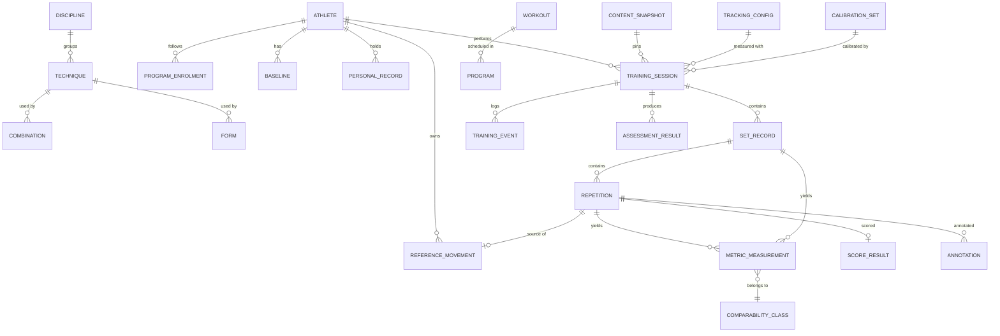
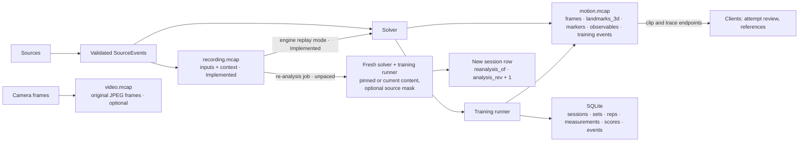

# 12 — Data, sessions and progress

Athlete profiles, the entity model, the analytics store, the rules that keep progress comparable,
recording and re-analysis, and retention.

Decision records: [ADR-029](adr/ADR-029-session-and-analytics-storage.md),
[ADR-034](adr/ADR-034-capability-profiles-and-comparability.md). Status: **Proposed**, building on
the **Implemented** input recording and replay of [docs/06](../../06-recording-and-playback.md).

## 1. Athlete profile

Only what training needs. No date of birth, sex, body mass, health or injury information, no
contact details, no photograph.

```ts
type AthleteId = string;          // ^[a-z0-9][a-z0-9_-]{0,31}$ — chosen at creation, immutable, used as a directory name

interface AthleteProfile {
  schema_version: 1;
  id: AthleteId;
  display_name: string;                       // free text, ≤ 64 characters
  created_utc: string;
  height_m: number;                           // drives skeleton scaling
  dominant_side: "left" | "right" | "ambidextrous" | null;
  default_stance: "orthodox" | "southpaw" | null;
  disciplines: { id: string; style: string | null;
                 experience: "beginner" | "intermediate" | "advanced" }[];
  preferred_discipline: string | null;
  goals: { id: string; text: string; metric: string | null; technique: string | null }[];
  coaching: { level: "minimal" | "standard" | "detailed"; tolerance_scale: number };   // 1.5 | 1.0 | 0.75 by experience unless edited
  enabled_techniques: string[];               // open set for free training
  tracking: { profile_override: CapabilityProfileId | null;
              record_defaults: { inputs: boolean; motion: boolean; video: boolean } };
  consent: { motion_data_utc: string | null; video_utc: string | null };
  retention: { inputs_days: number; motion_days: number; video_days: number } | null;   // null = installation defaults
  safety_ack: { [content_ref: string]: string };   // ContentRef → UTC of acknowledgement
}
```

| Rule | Decision |
|---|---|
| Storage | `<data_dir>/athletes/<id>/profile.json`, written atomically by the engine. The analytics store holds only the id for foreign keys |
| Several athletes | Any number of profiles. Exactly one is **active**; it is engine state (`SystemState.athlete`), changed by `PUT /athletes/active`, refused while a session is running |
| Access control | None between local profiles. The operating-system account is the security boundary ([17 §2](17-security-privacy-and-safety.md)) |
| Consent | No motion data is stored for an athlete until `consent.motion_data_utc` is set; video recording additionally needs `consent.video_utc`. Both are set by explicit UI actions and can be withdrawn (which stops future recording; deletion is a separate action) |
| Calibration scope | Athlete-scoped kinds: `body_proportions`, `mounting`, `marker_mounting`, `heading_alignment`. Their `CalibrationSubject` gains `athlete_id`. Switching athlete unloads the previous athlete's and loads the new one's. `mounting` and `marker_mounting` older than `calibration.mounting_max_age_s` (default 14 400) are `stale`: straps do not survive a day. Rig-scoped kinds (`camera_*`, `floor_plane`, `time_sync`, `marker_geometry`, `imu_bias`, `xr_alignment`) are shared |
| Normalisation | Lengths come from the athlete's skeleton (`body_proportions`), never from profile fields other than `height_m` |

## 2. Data directory

```text
<data_dir>/
├── calibration/                         one JSON per profile (existing)
├── state/                               assignments.yaml (existing), active_athlete, content_state.json
├── db/bansayo.sqlite                    analytics store (§4)
├── athletes/<athlete_id>/
│   ├── profile.json
│   └── presentation/{desktop,vr}.yaml
├── content/user/                        user-authored definitions (13 §2)
├── references/<reference_id>/           reference.json + clip.json (07 §6)
├── sessions/<session_id>/
│   ├── session.json                     existing RecordingSession, extended with athlete_id and artefact flags
│   ├── recording.mcap                   inputs + context (existing)
│   ├── motion.mcap                      solved motion, observables, training events (new)
│   └── video.mcap                       camera frames (new, optional)
└── exports/                             athlete exports
```

A training session and its recordings share one `SessionId` (existing pattern
`YYYYMMDDTHHMMSSZ-xxxx`).

## 3. Entity model



Entities are deliberately flat: each row carries the keys it needs to be read alone
(session, repetition index, metric, class), and no entity is a generic "record" with a type tag
except the event log.

| Entity | Owner / where | Identifier | Key relationships | Versioning | Retention |
|---|---|---|---|---|---|
| Athlete | Engine; `profile.json` + `athletes` row | `AthleteId` | Sessions, references, enrolments | `schema_version` | Until deleted by the user |
| Discipline | Content file | `<discipline>` | Styles, techniques | File `version` | With content |
| Technique (incl. variants) | Content file | `ContentId`; referenced as `ContentRef` | Family; `extends`; metrics; scoring | Integer `version`; snapshot per use | Snapshots kept while any session references them |
| Exercise | Inline plan node inside a workout or session request | Workout item id / session plan | Technique, combination, form | With its container | With its container |
| Combination, Form | Content file | `ContentId` | Techniques | As technique | As technique |
| Workout | Content file | `ContentId` | Exercises | As technique | As technique |
| Program | Content file + enrolment row | `ContentId`; enrolment key (athlete, program) | Workouts | As technique | Enrolment until removed |
| Training session | Analytics store + session directory | `SessionId` | Athlete, plan snapshot, tracking config, calibration set | `analysis_rev`; `reanalysis_of` | Row: with the athlete. Artefacts: §8 |
| Set record | Analytics store | (session, `set_index`) | Session, exercise | — | With the session |
| Repetition | Analytics store | (session, `rep_index`) | Set, technique `ContentRef` | — | With the session |
| Movement event | `events` table (unrecognised movements, stance changes, tracking gaps) and `motion.mcap` (all) | (session, `event_seq`) | Session | — | With the session |
| Metric measurement | Analytics store | Row id; natural key (session, scope, index, metric, side) | Repetition/set/session; comparability class | Metric `ContentRef` | With the session |
| Score result | Analytics store | (session, `rep_index`) | Scoring model `ContentRef`; reference id | Model version | With the session |
| Calibration profile | `calibration/*.json` (existing) | `ProfileId` | Device, segment, athlete | `schema_version` | Until replaced; superseded profiles referenced by a calibration set are kept as part of that set's snapshot |
| Calibration set | Analytics store | 16-hex id | Profile snapshots, QA result | Immutable | While referenced |
| Tracking configuration | Analytics store | 16-hex id ([08 §9.2](08-tracking-and-sensor-fusion.md)) | Sessions | Immutable | While referenced |
| Sensor quality | Per-session summary JSON (per device: rate, loss, state durations, saturation counts) + `events` | Session | Session | — | With the session |
| Reference movement | `references/<id>/` + index row | `ref-…` | Technique, source repetition, athlete | Immutable | Until deleted; pins its source session's `motion.mcap` |
| Assessment result | Analytics store | (session, assessment id, side) | Assessment `ContentRef`; trials | Definition version | With the session |
| Progress record | **Derived**, not stored: a query over measurements. Materialised helpers: `baselines`, `personal_records` | — | Athlete, technique, side, metric, class | Recomputed | Recomputable |

## 4. Analytics store

SQLite, one file, opened only by the engine (`rusqlite` with bundled SQLite). WAL mode,
`foreign_keys = ON`, `secure_delete = ON`. All writes go through one writer thread fed by a
bounded channel from the training runner; a full channel never blocks tracking — the session is
marked `storage_degraded` and the events are retained in memory until the queue drains or the
session ends. Migrations are numbered SQL files applied in order and tracked by `user_version`.

```sql
CREATE TABLE athletes (
  id TEXT PRIMARY KEY, created_utc TEXT NOT NULL);

CREATE TABLE content_snapshots (
  hash TEXT PRIMARY KEY,                       -- SHA-256 of the canonical JSON
  kind TEXT NOT NULL, id TEXT NOT NULL, version INTEGER NOT NULL,
  body_json TEXT NOT NULL, first_used_utc TEXT NOT NULL);

CREATE TABLE tracking_configs (
  id TEXT PRIMARY KEY, profile TEXT NOT NULL, body_json TEXT NOT NULL, first_used_utc TEXT NOT NULL);

CREATE TABLE calibration_sets (
  id TEXT PRIMARY KEY,
  qa TEXT NOT NULL CHECK (qa IN ('pass','warn','fail','not_run')),
  body_json TEXT NOT NULL,                     -- profile ids, hashes and the profiles themselves
  first_used_utc TEXT NOT NULL);

CREATE TABLE training_sessions (
  id TEXT PRIMARY KEY,
  athlete_id TEXT NOT NULL REFERENCES athletes(id) ON DELETE CASCADE,
  started_utc TEXT NOT NULL, ended_utc TEXT,
  status TEXT NOT NULL CHECK (status IN ('active','completed','aborted','interrupted')),
  plan_kind TEXT NOT NULL, plan_ref TEXT, plan_json TEXT NOT NULL,
  origin TEXT NOT NULL CHECK (origin IN ('live','simulated','fixture')),
  engine_version TEXT NOT NULL, observables_rev INTEGER NOT NULL,
  capability_profile TEXT NOT NULL,            -- profile at session start
  tracking_config_id TEXT NOT NULL REFERENCES tracking_configs(id),
  calibration_set_id TEXT NOT NULL REFERENCES calibration_sets(id),
  active_ms INTEGER, rpe INTEGER CHECK (rpe BETWEEN 1 AND 10),
  has_inputs INTEGER NOT NULL DEFAULT 0, has_motion INTEGER NOT NULL DEFAULT 0, has_video INTEGER NOT NULL DEFAULT 0,
  analysis_rev INTEGER NOT NULL DEFAULT 1,
  reanalysis_of TEXT REFERENCES training_sessions(id) ON DELETE CASCADE,
  source_mask_json TEXT,                       -- non-null for a re-analysis with sources disabled
  summary_json TEXT);

CREATE TABLE session_content (
  session_id TEXT NOT NULL REFERENCES training_sessions(id) ON DELETE CASCADE,
  snapshot_hash TEXT NOT NULL REFERENCES content_snapshots(hash),
  PRIMARY KEY (session_id, snapshot_hash));

CREATE TABLE sets (
  session_id TEXT NOT NULL REFERENCES training_sessions(id) ON DELETE CASCADE,
  set_index INTEGER NOT NULL,
  block_id TEXT, item_id TEXT, exercise_kind TEXT NOT NULL, content_ref TEXT, side TEXT,
  target_json TEXT NOT NULL,
  status TEXT NOT NULL CHECK (status IN ('completed','capped','skipped','abandoned')),
  scored INTEGER NOT NULL DEFAULT 1,
  started_t_us INTEGER NOT NULL, ended_t_us INTEGER,
  summary_json TEXT,
  PRIMARY KEY (session_id, set_index));

CREATE TABLE reps (
  session_id TEXT NOT NULL, rep_index INTEGER NOT NULL, set_index INTEGER NOT NULL,
  technique_id TEXT NOT NULL, technique_version INTEGER NOT NULL,
  side TEXT NOT NULL, stance TEXT,
  outcome TEXT NOT NULL CHECK (outcome IN ('completed','incomplete','rejected_quality','wrong_side','excluded')),
  step_id TEXT, step_result TEXT,              -- combinations and forms
  t_start_us INTEGER NOT NULL, t_end_us INTEGER NOT NULL, strike_t_us INTEGER,
  recognition_confidence REAL NOT NULL,
  capability_profile TEXT NOT NULL,            -- profile during this repetition
  phases_json TEXT NOT NULL,
  PRIMARY KEY (session_id, rep_index),
  FOREIGN KEY (session_id, set_index) REFERENCES sets(session_id, set_index) ON DELETE CASCADE);

CREATE TABLE measurements (
  id INTEGER PRIMARY KEY,
  session_id TEXT NOT NULL REFERENCES training_sessions(id) ON DELETE CASCADE,
  scope TEXT NOT NULL CHECK (scope IN ('rep','hold','round','set','session','assessment')),
  rep_index INTEGER, set_index INTEGER,
  technique_id TEXT, side TEXT,
  metric_id TEXT NOT NULL, metric_version INTEGER NOT NULL,
  value REAL, norm REAL, unit TEXT NOT NULL,
  grade TEXT NOT NULL CHECK (grade IN ('A','B','C','X')),
  confidence REAL, sigma REAL, sigma_basis TEXT,
  method TEXT, provenance TEXT NOT NULL,
  comparability_class TEXT NOT NULL,
  reasons_json TEXT);
CREATE INDEX measurements_series
  ON measurements (metric_id, comparability_class, technique_id, side, session_id);

CREATE TABLE scores (
  session_id TEXT NOT NULL, rep_index INTEGER NOT NULL,
  model_id TEXT NOT NULL, model_version INTEGER NOT NULL,
  reference_id TEXT, reference_match REAL, coverage REAL NOT NULL,
  comparability_class TEXT NOT NULL, components_json TEXT NOT NULL,
  PRIMARY KEY (session_id, rep_index),
  FOREIGN KEY (session_id, rep_index) REFERENCES reps(session_id, rep_index) ON DELETE CASCADE);

CREATE TABLE events (
  session_id TEXT NOT NULL REFERENCES training_sessions(id) ON DELETE CASCADE,
  event_seq INTEGER NOT NULL, t_us INTEGER NOT NULL, type TEXT NOT NULL, body_json TEXT NOT NULL,
  PRIMARY KEY (session_id, event_seq));

CREATE TABLE assessment_results (
  session_id TEXT NOT NULL REFERENCES training_sessions(id) ON DELETE CASCADE,
  assessment_id TEXT NOT NULL, assessment_version INTEGER NOT NULL, side TEXT NOT NULL,
  status TEXT NOT NULL CHECK (status IN ('valid','invalid')),
  value REAL, norm REAL, unit TEXT, sd REAL, trials_json TEXT NOT NULL,
  comparability_class TEXT NOT NULL, reasons_json TEXT,
  PRIMARY KEY (session_id, assessment_id, side));

CREATE TABLE baselines (
  athlete_id TEXT NOT NULL REFERENCES athletes(id) ON DELETE CASCADE,
  technique_id TEXT NOT NULL, side TEXT NOT NULL, metric_id TEXT NOT NULL, comparability_class TEXT NOT NULL,
  value REAL NOT NULL, spread REAL NOT NULL, sessions INTEGER NOT NULL,
  from_utc TEXT NOT NULL, to_utc TEXT NOT NULL, set_by TEXT NOT NULL CHECK (set_by IN ('auto','user')),
  PRIMARY KEY (athlete_id, technique_id, side, metric_id, comparability_class));

CREATE TABLE personal_records (
  athlete_id TEXT NOT NULL REFERENCES athletes(id) ON DELETE CASCADE,
  technique_id TEXT NOT NULL, side TEXT NOT NULL, metric_id TEXT NOT NULL, comparability_class TEXT NOT NULL,
  session_id TEXT NOT NULL, rep_index INTEGER, value REAL NOT NULL, set_utc TEXT NOT NULL,
  PRIMARY KEY (athlete_id, technique_id, side, metric_id, comparability_class));

CREATE TABLE reference_index (
  id TEXT PRIMARY KEY, kind TEXT NOT NULL, technique_id TEXT NOT NULL, side TEXT NOT NULL,
  athlete_id TEXT REFERENCES athletes(id) ON DELETE CASCADE,
  source_session_id TEXT, source_rep_index INTEGER, created_utc TEXT NOT NULL);

CREATE TABLE annotations (
  id INTEGER PRIMARY KEY, session_id TEXT NOT NULL, rep_index INTEGER,
  author TEXT NOT NULL, created_utc TEXT NOT NULL, body_json TEXT NOT NULL,
  FOREIGN KEY (session_id) REFERENCES training_sessions(id) ON DELETE CASCADE);

CREATE TABLE program_enrolments (
  athlete_id TEXT NOT NULL REFERENCES athletes(id) ON DELETE CASCADE,
  program_id TEXT NOT NULL, program_version INTEGER NOT NULL,
  started_utc TEXT NOT NULL, state_json TEXT NOT NULL,     -- week, next occurrence, level per workout
  PRIMARY KEY (athlete_id, program_id));
```

A session row is inserted at `session_started` with status `active`. On engine start, any row
still `active` becomes `interrupted` and keeps whatever was written.

## 5. Comparability

### 5.1 The problem

A kick that reads 5 cm higher after adding a camera, changing the pose model, re-laying the floor
board or correcting body proportions may not be a higher kick. The store must never present such
a step as progress.

### 5.2 Measurement context

Every measurement is linked — through its repetition and session — to:

| Context | Field | Changes when |
|---|---|---|
| Metric definition | `metric_id`, `metric_version` | The calculation changes |
| Method | `method` (lowest-fidelity `MethodId` over the window) | The realising sensor path changes |
| Capability profile | `reps.capability_profile` | Sources come or go |
| Tracking configuration | `tracking_config_id` | Devices, detector, solver or analysis settings change |
| Calibration set | `calibration_set_id` + QA | Any valid profile in use changes |
| Engine and observable catalogue | `engine_version`, `observables_rev` | Software changes |
| Technique and scoring versions | `ContentRef`s | Content changes |

### 5.3 Comparability class

```text
comparability_class = hex16( SHA-256( metric_id | metric_version | method_class | detector_id | norm_basis ) )
```

| Component | Value |
|---|---|
| `method_class` | `optical_3d` (`triangulated`, `depth_camera`), `marker` (`marker_cluster`), `inertial` (`imu_mounted`, `imu_gyro`), `fused` (`imu_optical_fused`), `xr` (`xr_device`), `kinematic` (`fk`, `skeleton_fit_axis`, `skeleton_fit_plane`), `planar` (`image_plane`), `inferred` (the rest) |
| `detector_id` | The pose model identifier (for example `rtmpose-m-halpe26`) for classes `optical_3d`, `kinematic` and `planar`; `-` otherwise |
| `norm_basis` | `raw`, or the normalising length and whether `body_proportions` was `valid` or `assumed` (for example `leg_length/valid`) |

For scores the class is the hash of the scoring model reference, the target source and reference
id, and the classes of the contributing measurements.

### 5.4 Rules

| # | Rule |
|---|---|
| C1 | Trends, baselines, personal bests, goals with relative targets and scoring targets are computed **only inside one class** |
| C2 | Measurements of different classes are shown as **separate series**, never joined by a line and never summarised together |
| C3 | Inside one class, a change of calibration set draws a **series-break marker**. If the session median steps across the break by more than twice the pooled within-session spread, the trend statement carries the flag `coincides_with_recalibration` and the change is not labelled as improvement or decline |
| C4 | A measurement whose calibration set has QA `fail` is capped at grade B; `not_run` is capped at B for metrics that list a calibration gate |
| C5 | Non-`live` origins are stored and excluded from every progress query unless `origin=` is given |
| C6 | A repetition's profile is the profile **during that repetition**; a camera that drops out mid-session moves later repetitions to another class instead of contaminating the first |
| C7 | Benchmarks (assessments) declare a `required_profile` and a fixed set of accepted methods; a run outside them is `invalid`, not "less accurate" |

### 5.5 Telling improved movement from improved sensing

| Mechanism | How it works |
|---|---|
| Classes and break markers | C1–C3: a sensing change either changes the class or draws a break |
| **Continuity re-analysis** | After a tracking upgrade, each new session recorded with inputs is re-analysed once more with a **source mask** reproducing the previous tracking configuration (the extra sources disabled). The result is stored as a session with `reanalysis_of` and the old class. The old series therefore continues on identical motion while the new class builds its own history. Enabled per athlete (`continuity.previous_tracking_config_id`), run as a background job after the session, stopped by the user when no longer needed |
| Paired offset | The same re-analysis gives, per metric, paired values (old class, new class) for the same repetitions. Their median difference and spread are shown in Progress as "method difference", so the athlete can see how much of a step is the method. The offset is displayed, **never applied** to stored values |
| Calibration QA | The stature and board-length checks ([09 §7.4](09-optical-markers-and-calibration.md)) catch scale changes at calibration time |

### 5.6 When recalibration is required

| Trigger | Effect until recalibrated |
|---|---|
| Any profile `stale` or `invalid` that a metric gates on | That metric is suppressed |
| `mounting` / `marker_mounting` older than the age limit, or athlete switched | Dependent segments fall down the arbitration table |
| `camera_moved` notice | Camera excluded from triangulation |
| Calibration QA older than 24 h | Assessments refuse to start; training continues |
| Heading alignment stale with no optical correction | Heading-dependent metrics capped at B, then suppressed as sigma grows |

## 6. Progress analytics

Computed by the engine (`bansayo-training::progress`, pure functions over query results) and
served by `GET /progress/…`; clients only chart.

| Quantity | Definition |
|---|---|
| Session value | Median of the grade-A values of one metric, technique, side and class in one session; requires ≥ 3. Spread = interquartile range |
| Baseline | Median of the session values of the first `progress.baseline_sessions` (default 3) sessions in a class, taken within `progress.baseline_window_days` (default 30). Set automatically once, or reset by the user; stored in `baselines` |
| Latest | The most recent session value |
| Best valid | The highest (or lowest, per the metric's `direction`) single grade-A repetition value (`personal_records`), and separately the best session value |
| Rolling trend | Theil–Sen slope over the last `progress.trend_sessions` (default 8, minimum 4) session values against session date, reported per week |
| Change classification | `Δ` = median of the last 3 session values − median of the 3 before (or the baseline when fewer exist). `noise` = max( 2 × 1.4826 × MAD of the earlier window, 2 × median sigma of the measurements, validated minimum detectable change of the method class when a table exists ). `\|Δ\| > noise` → `increased` / `decreased`, else `no_clear_change`. The metric's `direction` (`higher_is_more`, `lower_is_more`, `neutral`) turns this into wording; no metric is called "better" by the engine |
| Consistency | Trend of the within-session spread and of `set_variability` metrics |
| Measurement confidence | Per session: share of grade A, B, C, X; median sigma |
| Symmetry | `asymmetry` metrics per session; trend as above |

Every series point returned by the API carries: session id and date, value, spread, count, grade
mix, `comparability_class`, `capability_profile`, `tracking_config_id`, `calibration_set_id` with
QA, technique and metric versions, and `reanalysis_of` when applicable.

The worked example in the brief ("Week 1: 118 cm … Week 4: 125 cm") would be reported as two
session values in one class with their spreads, and labelled `increased` only if the 7 cm exceeds
the `noise` term above.

## 7. Recording and replay



### 7.1 Artefacts

| Artefact | Content | Default | Purpose |
|---|---|---|---|
| `recording.mcap` | Every accepted `SourceEvent` and the context (existing) — now including `fiducials` and `pose` observations and the athlete's calibration profiles | On | Re-analysis, regression corpus, troubleshooting |
| `motion.mcap` | Channels `/bansayo/frame` (the published `frame` plus `BodyState` evidence), `/bansayo/landmarks_3d`, `/bansayo/markers`, `/bansayo/observables` (every catalogue observable per tick), `/bansayo/training` (every training event and state change) | On | Attempt review without replay; reference creation; charts |
| `video.mcap` | One channel per camera; each message is the camera's original compressed frame with `log_time` = capture `t_us` | **Off** | Visual review, instructor annotation |
| SQLite rows | §4 | Always | Analytics |

Decisions: MCAP for all streamed artefacts (one writer, one reader, indexed by time, existing
dependency); zstd chunk compression for `motion.mcap`; `video.mcap` stores camera MJPEG frames
untouched — no transcoding dependency, exact per-frame timestamps. Export to MP4 is an offline
step that uses `ffmpeg` if the user has it installed; the engine never requires it.

The existing limit — a session is read fully into memory for playback — must be replaced by
indexed reads before camera data is recorded (existing risk R18); the clip and trace endpoints
are written against the MCAP index from the start.

### 7.2 Replay kinds

| Kind | What it does | Determinism |
|---|---|---|
| **Engine replay mode** (existing) | Feeds recorded inputs through the live pipeline for viewing; clients need no playback code | Two replays produce the same frame sequence |
| **Clip playback** (new) | Clients fetch a time range of `motion.mcap` as positions and play it locally | Exact, stored |
| **Re-analysis** (new) | An unpaced job builds a fresh pipeline and training runner from the recording's context and the session's stored plan and commands, runs to the end, and writes a new session row linked by `reanalysis_of`. Options: `content: pinned | current`, `source_mask: [device ids to disable]` | Same engine version + same content snapshot + same mask → identical events and measurements. Across engine versions results may differ; that is the purpose, and the rows carry the versions |

Commands issued during the original session (`start`, `pause`, `set_side`, …) are training events
with `t_us`, so re-analysis replays them at the same session times.

A live session and its own re-analysis may differ by one solver tick of sample-and-hold (existing,
documented limit). When exact reproducibility of stored numbers matters (assessments), the stored
measurement is the live one and re-analyses are additional rows, never replacements.

## 8. Retention, export, deletion

| Artefact | Default retention | Pinned when |
|---|---|---|
| SQLite rows | Until the athlete is deleted | — |
| `motion.mcap` | 365 days | The session is the source of a reference or personal record, or contains a valid assessment |
| `recording.mcap` | 90 days | The user marks the session "keep", or continuity re-analysis is pending |
| `video.mcap` | 14 days | The user marks the session "keep" |

Defaults are `storage.retention` in the engine configuration; an athlete profile may override
them. The retention job runs at engine start and every 24 h, deletes whole files only, updates the
`has_*` flags and logs counts. Storage use per athlete and per artefact type is reported by
`GET /storage/usage`.

| Operation | Behaviour |
|---|---|
| Export | `POST /athletes/{id}/export { include: ["profile","analytics","references","motion","inputs","video"] }` writes a zip under `exports/`: `profile.json`, analytics as JSON Lines plus a CSV of measurements, content snapshots, the selected artefacts. Formats are the documented schemas, so an export is re-importable later (import is not built) |
| Delete a session | Row cascade + directory removal; references and personal records sourced from it are removed and recomputed |
| Delete an athlete | `DELETE /athletes/{id}?confirm=<id>`: cascade, session directories, references, athlete-scoped calibration profiles, athlete directory; then `VACUUM`. Refused while that athlete has an active session |
| Withdraw video consent | Stops video recording; offers deletion of existing `video.mcap` files in the same dialog |

Privacy and security context for these operations is in
[17 §2](17-security-privacy-and-safety.md).

## 9. Failure handling and validation

| Topic | Rule |
|---|---|
| Database unavailable at start | Training sessions cannot be started (`unavailable`); tracking, calibration and recording continue |
| Write failure mid-session | Session continues; `storage_degraded` notice; pending rows flushed at the end or dumped to `sessions/<id>/pending.jsonl` for recovery at next start |
| Corrupt MCAP | Reported as a damaged artefact (existing rule); the session's rows remain |
| Schema migration failure | Engine refuses to open the store and leaves the file untouched; error names the migration |
| Tests | Migration round-trips; property test that deleting an athlete leaves no row or file; golden queries for every progress quantity on a synthetic history, including class separation, break markers and the classification rule; re-analysis determinism test on a recorded simulator session |
