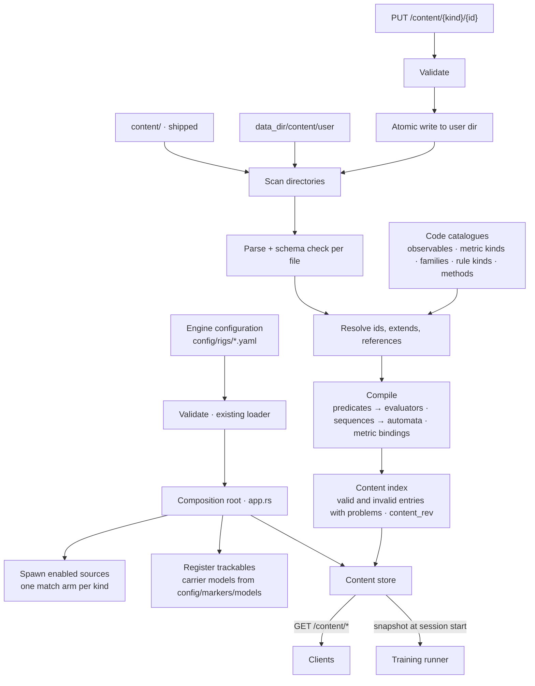

# 13 — Configuration and content schemas

Every YAML file the platform reads: where it lives, its schema, its validation, and the boundary
between what is configured and what is coded.

Decision record: [ADR-030](adr/ADR-030-configuration-and-content.md). Status: **Proposed**, except
the existing engine configuration sections, which are **Implemented**.

Type shapes use TypeScript notation, as in [docs/04](../../04-contracts.md); the Rust `serde`
structs in `bansayo-training::content` and `bansayo-engine::config` are the implementation source
of truth once written. Every struct rejects unknown fields (existing rule).

## 1. Configuration versus code

| Belongs in YAML | Requires code |
|---|---|
| Which sources, cameras, trackers and tag clusters exist and are enabled | A new source adapter, detector or transport |
| Thresholds, rates, limits, tolerances, filter cut-offs | A new solver stage or fusion algorithm |
| Technique phases as predicates over catalogue observables | A new observable ([04 §9](04-movement-domain-model.md)) |
| Metrics as a metric **kind** applied to an observable and a window | A new metric kind ([05 §9](05-technique-library.md)) |
| Combinations, forms, workouts, programs, assessments | A new sequence node type, progression rule kind or plan kind |
| Scoring components, targets, tolerances, weights | A new score mapping function |
| Cues: closed-form conditions, priority, text keys | A new cue condition form; the scheduler's limits |
| Presentation preferences per client | Any rendering behaviour |

There is **no expression language**: no arithmetic, no variables, no user-defined functions, no
conditionals beyond `all`/`any` over predicate atoms, no includes or templates other than
single-level `extends`. A need that does not fit is a signal to add a catalogue entry in code, with
a test.

## 2. Directory organisation

```text
config/                               engine configuration: what is connected and how it is solved
├── bansayo.example.yaml              annotated reference (existing)
├── sim-*.yaml                        simulator rigs (existing)
├── rigs/                             real rigs (new): one file per physical setup
└── markers/models/                   carrier geometry: cuff3-50.yaml, cuff3-60.yaml, plate1-80.yaml, plate2-80.yaml

content/                              shipped training content, read-only at runtime (new)
├── disciplines/<discipline>.yaml
├── techniques/<discipline>/<name>.yaml        all four kinds: dynamic, hold, stance, transition
├── metrics/<group>.yaml                       metric packs
├── scoring/<name>.yaml
├── combinations/<discipline>/<name>.yaml
├── forms/<discipline>/<name>.yaml
├── workouts/<name>.yaml
├── programs/<name>.yaml
├── assessments/<name>.yaml
├── references/<reference_id>/                 reference.json + clip.json
└── i18n/<lang>.yaml

<data_dir>/content/user/              user-authored content, same sub-tree, written only by the engine
<data_dir>/athletes/<id>/presentation/{desktop,vr}.yaml
```

| Rule | Decision |
|---|---|
| One engine configuration file per run | As today (`--config`). No include mechanism |
| One definition per content file | Except metric packs and i18n files, which hold lists |
| File name | The last segment of the id; the directory is not significant to identity — the `id` field is |
| Precedence | An id may exist in only one place. A user file with the id of a shipped definition is a validation error; customisation uses `extends` under a `user.` id |
| Who writes | Shipped content: the repository. User content: the engine, through `PUT /content/…`, atomically (temporary file + rename). Clients never write files |
| The illustrative files of this document set | Live in [examples/](examples/) until the loaders exist; they move to `config/rigs/` and `content/` with the implementation |

## 3. Common header and versioning

```ts
type ContentId  = string;   // ^[a-z][a-z0-9_]*(\.[a-z][a-z0-9_]*){1,4}$
type ContentRef = string;   // "<ContentId>@<version>"

interface ContentHeader {
  schema: string;                 // "bansayo.<kind>/v<major>"
  id: ContentId;
  version: number;                // definition revision, ≥ 1
  status?: "draft" | "reviewed";  // default draft
  reviewed_by?: string; reviewed_on?: string;     // required when reviewed
  extends?: ContentRef;           // techniques only, single level
  names: { display: string; native?: string; aliases?: string[] };
  licence?: string;               // SPDX id; default: the repository licence
}
```

| Version field | Scope | Bumped when | Engine behaviour |
|---|---|---|---|
| `schema` major (`/v1`) | The shape of a kind of file | A field is removed, renamed or changes meaning | The engine lists the majors it reads; an unsupported major makes that file `invalid` with a clear problem. Additive fields do not bump |
| `version` | One definition | Its behaviour changes ([05 §2](05-technique-library.md)) | Stored in every `ContentRef`; a snapshot of each used definition is kept in the analytics store |
| Engine `schema_version` | The engine configuration file | Sections are removed or change meaning | Becomes `2` with the first section added here; the engine reads `1` and `2` |
| `bansayo.observables` revision | The observable catalogue | Any observable is added or its definition changes | Stored per session (`observables_rev`); a definition may declare `requires_observables_rev: n` |
| Persisted JSON `schema_version` | Profiles, references, session metadata | As today | As today |

References between definitions are by `ContentId` in files (the latest loaded version is used) and
by `ContentRef` in everything stored. Loading resolves ids once, builds the snapshot set of a
session at `preparing`, and from then on the session is immune to content edits.

## 4. Engine configuration

Existing sections (`engine`, `api`, `logging`, `skeleton`, `assignments`, `quality`,
`triangulation`, `sources` of kind `simulated`) are unchanged. Additions, with defaults:

```yaml
schema_version: 2

content:
  dirs: [./content]                  # shipped content roots; <data_dir>/content/user is always added

tracking:
  profile_override: null             # null | basic | inertial | multi_view | marker_assisted | hybrid — may only lower
  analysis_rate_hz: null             # null = engine.publish_rate_hz; training rigs set publish_rate_hz to 120

sources:
  - id: cam-left
    kind: camera
    enabled: true
    device: "USB Camera (046d:085c)" # OS device name, or path/URL for file and rtsp
    transport: usb                   # usb | file | rtsp
    resolution_px: [1280, 720]
    rate_hz: 60
    pixel_format: mjpeg              # mjpeg | yuy2
    exposure_s: 0.002                # manual exposure; null = camera default with a degraded reason
    gain: null
    latency_ms: 40                   # used only without a time_sync profile
    processing_profile: body-halpe26
    fiducials: true
    record_video: false
  - id: slime
    kind: slimevr_solarxr
    enabled: false
    url: ws://127.0.0.1:21110
  - id: trackers
    kind: esp32_udp
    enabled: false
    bind: 0.0.0.0:6970
    output_rate_hz: 200
  - id: vr-xr
    kind: client_ingest
    enabled: false

processing_profiles:
  body-halpe26:
    detector: { model_path: models/yolox-m-humanart.onnx, every_frames: 10, score_min: 0.5 }
    pose: { model_id: rtmpose-m-halpe26, model_path: models/rtmpose-m-halpe26.onnx,
            landmark_schema: halpe26, keypoint_score_min: 0.3 }
    execution: [cuda, directml, cpu]
    max_inference_hz: 120

fiducials:
  families: [tag36h11]
  tag36h11: { max_hamming: 1, min_decision_margin: 30 }
  tag25h9:  { max_hamming: 0, min_decision_margin: 40 }
  min_contrast: 40
  quad_decimate: 1.0

trackables:
  - id: CUFF-L-SHIN
    kind: marker_cluster
    enabled: true
    model: cuff3-60                  # config/markers/models/cuff3-60.yaml
    family: tag36h11
    tags: [112, 113, 114]            # in the model's face order
    edge_mm_measured: 60.2

assignments:                         # existing section; cluster ids are assigned like tracker ids
  CUFF-L-SHIN: left_shin

triangulation:                       # existing keys keep their defaults
  mode: gated                        # gated | aligned (ADR-023)
  align_exact_ms: 2
  error_space: pixels                # pixels | normalised
  max_reprojection_error_norm: 0.02  # used when error_space is normalised

gates:
  max_speed_m_s: { default: 15, wrist: 30, ankle: 30, toe: 30, heel: 30 }
  bone_length_tolerance: 0.25
  floor_tolerance_m: 0.05

fusion:
  skeleton_fit: true
  heading_correction: true
  heading_tau_s: 5
  heading_valid_s: 10
  heading_reacquire_deg: 60
  heading_reacquire_s: 2

evidence:
  detector_noise_floor_px: 2.0
  sync_sigma_ms: 4
  imu: { tilt_sigma_rad: 0.035, heading_sigma0_rad: 0.05, heading_drift_rad_s: 0.0017 }

analysis:
  filters: { position_hz: 12, angle_hz: 12 }
  planar_camera: auto                # auto | <camera id>

recognition:
  accept_confidence: { free: 0.75, guided: 0.5 }
  ambiguity_margin: 0.10
  segmenter: { start_above: 1.0, start_hold_ms: 40, end_below: 0.4, end_hold_ms: 150,
               min_ms: 150, max_ms: 4000, merge_gap_ms: 80 }

training:
  countdown_s: 5
  pause_after_tracking_loss_ms: 3000
  free_set_gap_s: 8
  round_gap_ms: 800
  limits: { strikes_per_session: 400, session_minutes: 90 }

coaching:
  cooldown_reps: 3
  tolerance_scale: { beginner: 1.5, intermediate: 1.0, advanced: 0.75 }

progress:
  baseline_sessions: 3
  baseline_window_days: 30
  trend_sessions: 8

calibration:
  intrinsics_max_rms_px: 0.6         # at 1280 px width, scaled linearly with width
  extrinsics_max_rms_px: 1.0
  mounting_max_age_s: 14400
  heading_max_age_s: 1800
  qa_max_age_h: 24

markers:
  geometry_max_rms_mm: 1.5
  mounting_disagreement_rad: 0.26

storage:
  retention: { inputs_days: 90, motion_days: 365, video_days: 14 }
  record_defaults: { inputs: true, motion: true, video: false }

api:
  bind: 127.0.0.1:7700               # existing
  lan: { enabled: false, token_file: null }   # ADR-031; required for any non-loopback bind

diagnostics:
  timing: false                      # per-stage latency histograms on the diagnostics topic (15 §4.1)
```

Every default above that affects measurement is a starting value **pending validation**; the
validation plan names the experiment that sets each ([16 §8](16-accuracy-and-validation.md)).

Complete rigs: [one camera](examples/rig-one-camera.yaml),
[two calibrated cameras](examples/rig-two-cameras.yaml),
[cameras plus tags](examples/rig-cameras-and-tags.yaml),
[cameras plus IMUs](examples/rig-cameras-and-imus.yaml),
[hybrid](examples/rig-hybrid.yaml). Disabling a sensor is `enabled: false` on its source or
trackable.

### 4.1 Carrier model file

```ts
interface CarrierModel {
  schema: "bansayo.carrier/v1";
  id: string;                                  // "cuff3-60"
  nominal_edge_mm: number;
  faces: { index: number;                      // order used by trackables[].tags
           q_cluster_from_tag: Quat;           // tag frame: +X right, +Y up, +Z out of the face
           t_cluster_from_tag_mm: Vec3 }[];
}
```

## 5. Disciplines, metric packs, scoring models

```ts
interface DisciplineDef extends ContentHeader {
  schema: "bansayo.discipline/v1";
  styles: { id: string; display: string }[];
  default_style: string | null;
  uses_lead_rear: boolean;                     // true for striking arts with a fighting stance
  neutral_stance: ContentId;
}

interface MetricPack { schema: "bansayo.metrics/v1"; metrics: MetricDef[] }

interface MetricDef {
  id: string;                                  // "kick.peak_ankle_height"
  version: number;
  label: string;
  kind: "extremum" | "value_at" | "range" | "duration" | "mean" | "median" | "rms"
      | "peak_count" | "settle_time" | "path_deviation" | "set_variability" | "asymmetry";
  obs?: string;                                // observable with role, per kind
  agg?: "max" | "min";
  window?: "rep" | { phase: string } | { from_phase: string; to_phase: string };
  at?: string; from?: string; to?: string;     // anchors: rep_start | rep_end | strike | phase_start:<id> | phase_end:<id>
  of?: string;                                 // for set_variability / asymmetry: another metric id
  stat?: "sd" | "cv" | "iqr";
  points?: string[];                           // for path_deviation: keypoints with roles
  unwrap?: boolean; prominence?: number; below?: number; for_ms?: number;
  unit: string;
  norm?: { by: "leg_length" | "arm_length" | "stature" | "shoulder_width" | "foot_length" };
  direction: "higher_is_more" | "lower_is_more" | "neutral";
  gates: {
    min_rate_hz?: number;                      // below → X
    rate_for_a_hz?: number;                    // below → at most B
    calibration?: CalibrationKind[];
    grade_a_methods: MethodId[];
    grade_b_methods: MethodId[];               // in addition to the A list
    grade_a?: { min_confidence?: number; max_sigma?: number };   // defaults 0.7, none
    grade_b?: { min_confidence?: number };                        // default 0.4
    image_plane?: { views: ("frontal" | "lateral" | "oblique")[]; use: "norm" | "value" };  // absent = never from image_plane
    suppress_when?: Condition[];               // 05 §6 grammar
  };
}

interface ScoringModel extends ContentHeader {      // 07 §7.2
  schema: "bansayo.scoring/v1";
  applies_to: { families: string[] };
  components: {
    id: string; label: string;
    source: { kind: "outcome" } | { metric: string; use: "value" | "norm" } | { kind: "step_results" };
    target?: { from: "reference" }
           | { from: "personal"; stat: "median" | "best"; window_sessions: number }
           | { from: "definition"; value: number; rationale: string };
    direction?: "at_least" | "at_most" | "match";
    tolerance?: { inner: number; outer: number };
    min_grade?: "A" | "B";
    required?: boolean; weight: number;
  }[];
  composite: { id: "reference_match"; min_coverage: number };
}
```

Examples: [metrics-kick.yaml](examples/metrics-kick.yaml),
[scoring-kick-basic.yaml](examples/scoring-kick-basic.yaml). A technique selects its scoring model
with `scoring: <id>`; a session may override it with `plan.scoring`.

## 6. Technique

Field semantics are in [05 §5–6](05-technique-library.md). Formal shape:

```ts
type Unit = "rad" | "rad_s" | "m" | "m_s" | "leg_length" | "leg_length_s" | "arm_length"
          | "arm_length_s" | "shoulder_width" | "foot_length" | "bool";
type Op   = "gt" | "lt" | "between" | "rises_above" | "falls_below" | "local_max" | "local_min" | "changed_by";

interface Atom { obs: string; op: Op; value: number | [number, number]; unit: Unit;
                 ref?: "absolute" | "rep_start" | "phase_start" | "rest";
                 hold_ms?: number; prominence?: number }
type Condition = Atom | { all: (Atom | { any: Atom[] })[] } | { any: (Atom | { all: Atom[] })[] };

interface TechniqueDef extends ContentHeader {
  schema: "bansayo.technique/v1";
  discipline: string; style?: string;
  family: string;                              // closed list, 05 §4
  kind: "dynamic" | "hold" | "stance" | "transition";
  sides: ("left" | "right")[];
  active_limb: "leg" | "arm" | "none";
  mirror_signed?: boolean;                     // default true
  start_stance?: ContentId; end_stance?: ContentId;
  instructions?: string[];                     // i18n keys
  requires_observables_rev?: number;

  // kind: dynamic
  segmentation?: { driver: string; unit: Unit; start_above: number; end_below: number; min_ms: number; max_ms: number };
  phases?: { id: string; label: string; optional?: boolean; enter: Condition; min_ms?: number; max_ms: number }[];
  strike?: { obs: string; op: "local_max" | "local_min"; unit: Unit; prominence?: number; in_phase: string;
             keypoint?: string };              // striking keypoint with role, for targets
  complete?: Condition;

  // kind: hold
  hold?: { enter: Condition; measure: string; tolerance_rad: number;
           max_speed: { obs: string; value: number; unit: Unit };
           support: "none" | "floor" | "wall" | "hand" | "partner" | "strap";
           max_hold_s: number; min_rest_s: number; progression_step?: number };

  // kind: stance
  predicate?: Condition;

  // kind: transition
  transition?: { from: ContentId; to: ContentId; stepping_foot: "lead" | "rear" | "either" | "none";
                 travel?: { direction_deg: number; tolerance_deg: number; min: number; unit: Unit };
                 turn?: { by_deg: number; tolerance_deg: number }; max_ms: number };

  required_observables: string[]; optional_observables?: string[];
  confusable_with?: ContentId[];
  metrics?: { use: string; params?: Record<string, number | string> }[];
  scoring?: ContentId;
  cues?: Cue[];                                // 07 §8.1
  target?: { level: "low" | "middle" | "high"; distance: number; unit: "leg_length" | "arm_length"; radius_m: number };
  tempo?: { slow_scale: number };
  max_gap_ms?: number;
  safety: { notes: string[]; min_clear_radius_m: number; max_reps_per_set: number;
            max_sets_per_session: number; warmup_required: boolean };
  progression?: { level: number; label: string; description: string;
                  constraints?: { stage?: "slow" | "normal"; target_level?: "low" | "middle" | "high"; max_tempo_bpm?: number } }[];
}
```

Target levels resolve against the athlete's own body at item start: `low` = standing knee height,
`middle` = standing `chest` keypoint height, `high` = standing `head` keypoint height.

Example: [technique-roundhouse-kick.yaml](examples/technique-roundhouse-kick.yaml).

## 7. Combination, workout, program

```ts
type Side = "lead" | "rear" | "left" | "right" | "same" | "opposite";
type Node =
  | { step: { id?: string; technique: ContentId; side?: Side; window_ms?: [number, number] } & FormStepAttrs }
  | { repeat: { times: number; sequence: Node[] } }
  | { choice: { options: Node[][] } }
  | { optional: { sequence: Node[] } }
  | { rest: { ms: number } };

interface CombinationDef extends ContentHeader {
  schema: "bansayo.combination/v1";
  discipline: string;
  stance: "orthodox" | "southpaw" | "any";
  sides: "as_written" | "mirrored" | "alternate";
  sequence: Node[];
  scoring?: ContentId;
  safety?: { min_clear_radius_m: number };
}

type Plan =
  | { kind: "technique"; technique: ContentId; side: "left" | "right" | "alternate";
      stages?: ("demo" | "slow" | "normal")[]; reference?: string; coaching?: CoachingLevel; scoring?: ContentId }
  | { kind: "combination"; combination: ContentId; stance?: "orthodox" | "southpaw" | "as_defined";
      tempo_bpm?: number | null; coaching?: CoachingLevel }
  | { kind: "form"; form: ContentId; sub_mode: "guided" | "segment" | "performance"; section?: string;
      tempo_scale?: number; reference?: string }
  | { kind: "mobility"; items: { movement: ContentId; side?: "left" | "right" | "alternate" | "both";
      reps?: number; holds?: number; hold_s?: number; rest_s?: number }[] }
  | { kind: "assessment"; assessment: ContentId; side?: "left" | "right" | "both" }
  | { kind: "free"; technique_set?: ContentId[]; duration_s?: number; coaching?: "off" | "summary_only" };

interface WorkoutDef extends ContentHeader {
  schema: "bansayo.workout/v1";
  discipline?: string;
  intensity: "low" | "moderate" | "high";
  estimated_duration_s: number;
  blocks: {
    id: string; kind: "warmup" | "skill" | "main" | "conditioning" | "cooldown";
    rounds?: number; rest_between_rounds_s?: number;
    items: { id: string; plan: Plan; sets: number;
             target: { reps: number } | { duration_s: number } | { holds: number; hold_s: number };
             rest_s: number; time_cap_s?: number; goals?: Goal[] }[];
  }[];
  levels?: { level: number; overrides: Record<string, Partial<ItemOverride>> }[];
  completion: { require: "all_items" | "main_blocks"; time_cap_s?: number };
}

interface Goal { metric: string; stat: "median" | "best" | "mean" | "sd";
                 compare: "at_least" | "at_most" | "within"; value: number | [number, number];
                 relative_to: "absolute" | "baseline" | "last_session" | "personal_best" }

interface ProgramDef extends ContentHeader {
  schema: "bansayo.program/v1";
  weeks: number;
  schedule: { week: number; day: number; workout: ContentId }[];
  progression: ( { rule: "fixed"; apply_to: ContentId }
               | { rule: "level_ladder"; apply_to: ContentId; advance_when: Cond; regress_when?: Cond }
               | { rule: "double_progression"; apply_to: ContentId; item: string; reps_range: [number, number] }
               | { rule: "deload"; every_weeks: number; level_delta: number } )[];
}
```

Semantics: [06 §4–6](06-exercise-and-workout-engine.md). Examples:
[combination-jab-cross-low-kick.yaml](examples/combination-jab-cross-low-kick.yaml),
[workout-guided-kicking.yaml](examples/workout-guided-kicking.yaml).

## 8. Form

```ts
interface FormStepAttrs {                      // only meaningful inside a form
  count?: number;                              // the style's official count this step belongs to
  stance?: ContentId; lead?: "left" | "right";
  facing_deg?: number;                         // expected facing at the END of the step, relative to the start facing; positive = to the left
  turn?: "left" | "right" | "none";            // direction turned to reach it
  travel_deg?: number | null;                  // direction of the step in the start frame; null = in place
  tempo?: "slow" | "normal" | "fast" | "pause";
  kihap?: boolean;                             // displayed; never assessed
  mirror_of?: string;                          // id of the step this one mirrors
}

interface FormDef extends ContentHeader {
  schema: "bansayo.form/v1";
  discipline: string; style: string;
  footprint_m: [number, number];               // floor extent needed: width (x), depth (z)
  start: { stance: ContentId; facing_deg: 0 };
  tolerances?: { facing_deg?: number; travel_deg?: number };   // defaults 25, 35
  sections: { id: string; label: string; sequence: Node[] }[];
  safety?: { notes: string[] };
}
```

Facing convention: the athlete's facing at the first step is 0°. Angles are measured about world
+Y, **positive to the athlete's left** (counter-clockwise seen from above), so a left quarter turn
is +90°, a right quarter turn −90°, facing back 180°.

Example: [form-taegeuk-1.yaml](examples/form-taegeuk-1.yaml) — a draft whose step list must be
checked by a Kukkiwon-qualified instructor before it is marked `reviewed`.

## 9. Assessment

```ts
interface AssessmentDef extends ContentHeader {
  schema: "bansayo.assessment/v1";
  procedure: string[];                         // instruction keys, shown one by one
  start_conditions: { stance: ContentId; rest_before_s: number; warmup_ack: boolean };
  required_profile: CapabilityProfileId;       // minimum
  calibration: { kinds: CalibrationKind[]; qa: "pass" | "warn"; max_age_h: number };
  movement: ContentId;                         // a technique of any kind
  sides: ("left" | "right")[];
  trials: { count: number; max_extra: number; rest_s: number };
  measure: { metric: string; min_grade: "A" };
  accepted_methods: MethodId[];                // fixes the comparability class
  aggregate: { stat: "median" | "best" | "mean" };
  completion: { min_valid_trials: number };
  uncertainty: { report: ("within_session_sd" | "propagated_sigma")[] };
  safety: { notes: string[] };
}
```

The eight items the brief requires map to: procedure → `procedure`; initial conditions →
`start_conditions`; calibration prerequisites → `calibration`; required sensor quality →
`required_profile`, `measure.min_grade`, `accepted_methods`; measurement method → `movement` +
`measure.metric`; completion criteria → `trials`, `completion`; uncertainty → `uncertainty`;
historical comparability → the comparability class fixed by `accepted_methods`
([12 §5](12-data-and-progress.md)).

Example: [assessment-hip-flexion.yaml](examples/assessment-hip-flexion.yaml).

## 10. Presentation profiles

Per athlete and per client. They choose what is shown; they cannot change what is measured.

```ts
interface VrPresentation {
  schema: "bansayo.presentation.vr/v1";
  environment: "dojo" | "void" | "passthrough";
  mirror: { enabled: boolean; distance_m: number; mode: "true_mirror" | "facing_figure" };
  ghost: { enabled: boolean; placement: "beside" | "superimposed"; opacity: number };
  overlays: { [plan_kind: string]: { joint_angles: boolean; trail: boolean; target_path: boolean;
                                     targets: boolean; balance_marker: boolean; phase_label: boolean } };
  hud: { show_measurements: number;            // how many last-repetition measurements, 0..4
         show_cue: boolean; show_timer: boolean };
  audio: { rep_tone: boolean; metronome: boolean; spoken_cues: boolean; volume: number };
  comfort: { boundary_fade_m: number; cable_warning: boolean };
}

interface DesktopPresentation {
  schema: "bansayo.presentation.desktop/v1";
  units: { length: "cm" | "in"; angle: "deg" };
  live: { camera_inset: boolean; ghost: boolean; trail: boolean; joint_angles: string[] };
  audio: { rep_tone: boolean; metronome: boolean; spoken_cues: boolean; volume: number };
}
```

Example: [presentation-vr-dojo.yaml](examples/presentation-vr-dojo.yaml).

## 11. Validation

Performed by the engine at load, on `POST /content/validate`, and before every write. A problem is
`{ path, code, message }` with the existing path-qualified style
(`phases[2].enter.all[0].obs: unknown observable "ankle_hight.active", did you mean "ankle_height.active"?`).

| Rule | Applies to |
|---|---|
| `schema` major supported; unknown fields rejected; required fields present | All |
| `id` matches its pattern, is unique across shipped and user content, and its first segment is a known discipline, `general` or `user` | All |
| `status: reviewed` has `reviewed_by` and `reviewed_on` | All |
| `extends` resolves, is single-level, and the base has the same `kind` and `family` | Technique |
| Every observable id exists in the catalogue; role suffix is valid for the definition (`.lead`/`.rear` only when the discipline `uses_lead_rear`) | Technique, metric |
| Units are compatible with the observable (a speed observable cannot be compared in `rad`) | Technique, metric |
| Phase ids unique; `in_phase`, window and anchor phases exist; at least one mandatory phase; `max_ms` ≥ `min_ms` | Technique |
| Condition nesting ≤ 1 level; `between` has two ordered values | Technique, metric |
| Every `metrics[].use`, `scoring`, `confusable_with`, `start_stance` resolves; a cue's `component` exists in the scoring model | Technique |
| Scoring: `tolerance.inner < outer`; weights ≥ 0; `definition` targets have a `rationale`; at least one component with weight > 0 | Scoring |
| Sequence nesting ≤ 3; expanded length ≤ 64 (combination) / 200 (form); `window_ms` ordered; `repeat.times` 1–20; `choice` has 2–4 options | Combination, form |
| Form: every step has `facing_deg`; consecutive facings are consistent with `turn`; `mirror_of` resolves | Form |
| Workout: item ids unique; exactly one target form; warm-up block present when any technique requires it; totals within technique safety limits | Workout |
| Program: every scheduled workout resolves; `week` ≤ `weeks`; progression targets exist | Program |
| Assessment: `movement` and `measure.metric` resolve; `accepted_methods` ⊆ the metric's grade-A methods | Assessment |
| Engine config: trackable tag ids unique and within the body range; carrier model exists and face count matches; processing profile and model paths exist; non-loopback `api.bind` requires `api.lan.enabled` | Engine config |

An invalid shipped file makes that definition unavailable and is reported in `GET /content/index`;
it never stops the engine. An invalid engine configuration stops the engine at start (existing
rule).

## 12. Loading and discovery



"Plugin" in this architecture means exactly three things, all discovered as shown: a **source
kind** (code, one match arm), a **content file** (data, scanned), and a **carrier model** (data).
There is no dynamic library loading and no scripting runtime. `content_rev` increments on every
successful rescan and is published in `SystemState`; rescans happen at start and after each
content write — the directories are not watched.

## 13. Example index

| Requirement in the brief | File |
|---|---|
| One-camera basic setup; adding a camera | [examples/rig-one-camera.yaml](examples/rig-one-camera.yaml) |
| Two-camera calibrated setup | [examples/rig-two-cameras.yaml](examples/rig-two-cameras.yaml) |
| Camera plus printed tags; assigning AprilTags to segments | [examples/rig-cameras-and-tags.yaml](examples/rig-cameras-and-tags.yaml) |
| Cameras plus IMUs; disabling a sensor | [examples/rig-cameras-and-imus.yaml](examples/rig-cameras-and-imus.yaml) |
| Hybrid tracking; tracking quality settings | [examples/rig-hybrid.yaml](examples/rig-hybrid.yaml) |
| Roundhouse kick technique | [examples/technique-roundhouse-kick.yaml](examples/technique-roundhouse-kick.yaml) |
| Metric definitions | [examples/metrics-kick.yaml](examples/metrics-kick.yaml) |
| Selecting a scoring model | [examples/scoring-kick-basic.yaml](examples/scoring-kick-basic.yaml) |
| Three-strike combination | [examples/combination-jab-cross-low-kick.yaml](examples/combination-jab-cross-low-kick.yaml) |
| Guided kicking workout | [examples/workout-guided-kicking.yaml](examples/workout-guided-kicking.yaml) |
| Poomsae sequence | [examples/form-taegeuk-1.yaml](examples/form-taegeuk-1.yaml) |
| Flexibility assessment | [examples/assessment-hip-flexion.yaml](examples/assessment-hip-flexion.yaml) |
| VR training environment and coaching overlays | [examples/presentation-vr-dojo.yaml](examples/presentation-vr-dojo.yaml) |
