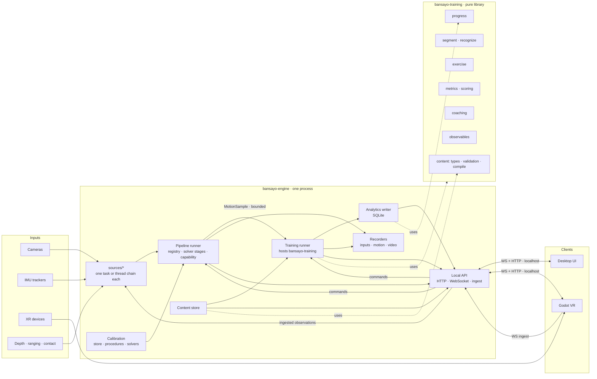
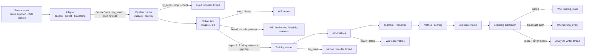

# 14 — Runtime boundaries and API contracts

Which modules exist, which are libraries, which are processes, how they communicate, and the
exact additions to the wire and HTTP contracts of [docs/04](../../04-contracts.md).

Decision records: [ADR-018](adr/ADR-018-training-crate-and-runtime-boundaries.md),
[ADR-035](adr/ADR-035-communications.md). The per-component reference cards (purpose, inputs,
outputs, failure handling, status and so on for each component) are in
[component-reference.md](component-reference.md).

## 1. Four kinds of boundary

| Kind | Instances | Rule |
|---|---|---|
| **Runtime process** | `bansayo-engine` (standalone or hosted in the Tauri shell); the desktop UI (browser or webview); the Godot VR client | Exactly these three kinds. Clients depend on the network contract only (existing rule) |
| **Independently deployable service** | **None** | No broker, no database server, no cloud service, no second backend language ([ADR-031](adr/ADR-031-local-first-execution.md)) |
| **Library (crate)** | `bansayo-contracts` (existing), `bansayo-engine` (existing), **`bansayo-training`** (new) | The compiler enforces: contracts depend on nothing of ours; training depends on contracts only; the engine depends on both |
| **Logical module** | Modules inside the crates (§2) | Enforced by review and by keeping pure modules free of Tokio and I/O (existing rule) |

Go is not introduced. The orchestration, device and session management that Go would do is a few
Tokio tasks inside the one process that already owns the devices; a second runtime would add an
IPC boundary, a second toolchain and a second place for contract types, for no capability gained.
Python is not used at runtime; it remains acceptable only for offline, developer-side model export.

## 2. System architecture



### 2.1 Crates and modules

| Crate / module | Contents | May depend on | Status |
|---|---|---|---|
| `bansayo-contracts` | Adds `motion.rs` (Evidence, BodyState, PlanarBody, ObservableValue), `training.rs` (TrainingState, TrainingEvent, Repetition, MetricMeasurement, ScoreResult, commands), `capability.rs`, `athlete.rs`, `progress.rs`, `fiducial.rs`; extends `observation.rs`, `device.rs`, `calibration.rs`, `wire.rs`, `api.rs`, `state.rs` | `serde`, `ts-rs` | Existing crate, additions Proposed |
| **`bansayo-training`** | `content/` (definition types, validation, compilation), `observables/`, `segment/`, `recognize/` (phase machine, arbiter, DTW, form alignment), `exercise/`, `metrics/`, `scoring/`, `coaching/`, `reference/`, `progress/` | `bansayo-contracts`, `nalgebra`, `serde`, `thiserror`. **No Tokio, no file or network I/O, no clock** | Proposed |
| `bansayo-engine::training` | The training runner actor; builds `MotionSample`; routes commands; owns the session | `bansayo-training`, `pipeline` | Proposed |
| `bansayo-engine::content_store` | Directory scan, YAML parse, index, snapshots, atomic writes | `bansayo-training::content`, `config` | Proposed |
| `bansayo-engine::store` | SQLite writer thread, migrations, queries | `rusqlite`, `bansayo-training::progress` | Proposed |
| `bansayo-engine::sources::{camera, solarxr, esp32_udp, client_ingest}` | New adapters | `sources`, `clock` | Planned / Proposed |
| `bansayo-engine::pipeline::{schema_map, align, gates, markers, skeleton_fit, fuse, capability}` | New solver stages and the capability report | `calibration`, `skeleton`, `math` | Proposed |
| `bansayo-engine::calibration::{procedures, camera, optimize, markers}` | Procedure state machine and solvers | `math` | Proposed |
| `bansayo-engine::recording::{motion, video}` | Additional MCAP writers; indexed reader | `recording` | Proposed |
| `bansayo-engine::api::{training, content, athletes, progress, references, calibration, ingest, cameras}` | Routes | `pipeline` commands, `training` commands, `store` queries | Proposed |

`pipeline/joints.rs` keeps its role and calls `bansayo-training::observables::angles`
([04 §6.1](04-movement-domain-model.md)); this is the one dependency of an existing module on the
new crate.

**The rule that makes exercise logic independent of hardware** is structural: `bansayo-training`
cannot name a device, a source, a detector or a transport, because it cannot import the engine.
Its only tracking input is `MotionSample` plus `CapabilityReport`.

## 3. End-to-end pipeline and concurrency



| Channel | Type | Capacity | Overflow policy | Effect of overflow |
|---|---|---|---|---|
| Ingest (existing) | `mpsc` | Existing | Drop newest, count per device | Device `dropped` counter |
| Pipeline → training | `mpsc<Arc<MotionSample>>` | 512 | Drop newest, set `gap` on the next delivered sample | The training runner treats it as a tracking gap of that length |
| Commands → training | `mpsc` with `oneshot` reply | 32 | Reject with `unavailable` | HTTP 503 |
| `training_state` | `watch` | 1 | Latest wins | None; state is idempotent |
| `training_event` | `broadcast` | 1024 | Lagging receiver loses the oldest | Client sees an `event_seq` gap and refills by HTTP |
| `observables` | `watch` | 1 | Latest wins | Gauges skip a sample |
| Training → analytics writer | `mpsc` | 4096 | **Never dropped**: on full, events accumulate in an in-memory spill list and `storage: degraded` is published | Stored late; flushed at session end or dumped to `pending.jsonl` |
| Training → motion recorder | `mpsc` | 2048 | Drop newest, count | `dropped_events` in the recording state |

One actor owns each piece of state: the pipeline runner owns tracking state (existing); the
training runner owns the session, recognisers and scheduler. They share nothing mutable. A slow
or failed training runner cannot delay tracking; a slow disk or client cannot delay either.

CPU-heavy, non-real-time work — calibration solves, DTW over long clips, form alignment,
re-analysis, export — runs on `spawn_blocking` threads and reports through the owning actor.

## 4. WebSocket contract additions

`GET /api/v1/stream?topics=…&max_rate_hz=…&observables=…`

| Topic | Messages | Delivery | Status |
|---|---|---|---|
| `frame`, `state`, `landmarks_2d`, `landmarks_3d` | Existing | Existing | Implemented |
| `training` | `training_state`, `training_event` | State: on change and at 1 Hz while a session exists; events: every event, in order | Proposed |
| `observables` | `observables` | Latest wins, at most `max_rate_hz`; the ids in `TrainingState.live_observables` plus any listed in the `observables=` query parameter (at most 32) | Proposed |
| `fiducials` | `fiducials` | Bounded queue, lagging client loses the oldest | Proposed |
| `markers` | `markers` | Once per tick in which any cluster was solved | Proposed |
| `diagnostics` | `diagnostics` | At 0.1 Hz while `diagnostics.timing` is on: per-stage latency percentiles and channel drop counters ([15 §4.1](15-performance-and-latency.md)) | Proposed |

```ts
type ServerMessage = /* existing variants */
  | { type: "training_state"; state: TrainingState | null }        // null: no session
  | { type: "training_event"; session_id: SessionId; event: TrainingEvent }
  | { type: "observables"; seq: number; t_us: TimeUs; values: ObservableValue[] }
  | { type: "fiducials"; detections: FiducialDetections }
  | { type: "markers"; t_us: TimeUs;
      clusters: { device_id: DeviceId; q_world_from_cluster: Quat; p_world_m: Vec3; evidence: Evidence }[] }
  | { type: "diagnostics"; window_s: 10;
      stages: { stage: string; p50_us: number; p95_us: number; p99_us: number; max_us: number }[];
      dropped: { channel: string; count: number }[] };
```

Additive changes to existing messages (all optional fields; `protocol_version` stays `1`):

| Message / type | Added |
|---|---|
| `hello` | `capabilities: string[]` — engine feature flags, e.g. `["training","content","athletes","progress","ingest","fiducials"]`; `observables_rev: number`; `keypoint_schema: LandmarkSchema` (`bansayo.body.v1.points`) |
| `frame` | `keypoints: ({ m: Vec3; provenance; method: MethodId; confidence: number \| null; sigma: number \| null } \| null)[]` index-aligned with `keypoint_schema` |
| `SegmentPose` | `observed_position_m: Vec3 \| null`, `twist_provenance: Provenance`, `method: MethodId` |
| `TriangulatedLandmark3D` | `sigma_m: number \| null`, `time_interpolated_views: DeviceId[]` |
| `SystemState` | `athlete: { id: AthleteId; display_name: string } \| null`; `training: { session_id: SessionId; phase: string; title: string } \| null`; `capability: CapabilityReport`; `content_rev: number`; `calibration_procedure: ProcedureState \| null`; `storage: { state: "ok" \| "degraded" \| "unavailable"; reasons: Reason[] }` |
| `FeatureId` | `training`, `content`, `analytics_store`, `fiducials`, `skeleton_fit`, `motion_recording`, `video_recording`, `client_ingest` |
| `CalibrationKind` | `marker_geometry`, `marker_mounting` |
| `CalibrationSubject` | `athlete_id: AthleteId \| null` |

Sequence guarantees added:

- `training_state` is sent immediately after `hello` when the `training` topic is subscribed.
- `training_event.event.event_seq` increases by exactly 1 per session; a client that observes a
  gap must refill with `GET /training/sessions/{id}/events?after_seq=`.
- A `training_state` whose `last_event_seq` is `n` reflects every event up to `n`.
- Events never reference a definition that `GET /content/…` cannot return for the session's
  snapshot.

A client connected to an engine without `"training"` in `hello.capabilities` hides its training
features; subscribing to an unknown topic remains `invalid_request` (existing behaviour), so
clients check `capabilities` first.

### 4.1 Ingest socket (P2)

`GET /api/v1/ingest?source_id=<id>` — client → engine. The source must be configured as
`kind: client_ingest` and enabled; otherwise `not_found`. The client sends JSON text frames, each
one `SourceEvent` ([docs/04 §3](../../04-contracts.md)): `device_announced` first, then
`observation`s. The engine validates each event exactly as for any source, maps `device_time_us`
through the offset estimator, and sends nothing but a first `{ "type": "ingest_ready" }` frame and
close codes (`1008` on a validation failure rate above 10 % in 5 s). Disconnection marks the
devices `disconnected`.

## 5. HTTP contract additions

Base `http://127.0.0.1:7700/api/v1`. Envelope, error codes, origin rules and content-type rules
are the existing ones. A validation failure is `invalid_request` with
`details: { problems: { path, code, message }[] }`. The request body limit stays 16 KiB except on
`/content/*` (256 KiB).

### 5.1 Content

| Method and path | Body | Returns | Notes |
|---|---|---|---|
| `GET /content/index` | — | `{ content_rev, entries: { kind, id, version, status, names, valid, problems, source: "shipped" \| "user", discipline?, family? }[] }` | Everything loaded, valid or not |
| `GET /content/{kind}/{id}` | — | The definition as JSON (`?version=` reads a stored snapshot) | `kind`: `disciplines`, `techniques`, `metrics`, `scoring`, `combinations`, `forms`, `workouts`, `programs`, `assessments` |
| `POST /content/validate` | `{ kind, definition }` | `{ valid, problems }` | No side effect |
| `PUT /content/{kind}/{id}` | The definition as JSON | The stored definition | User content only (`id` starts with `user.`); validates, writes YAML atomically, rescans; `conflict` if a running session's snapshot is unaffected (it always is) — never blocked by a session |
| `DELETE /content/{kind}/{id}` | — | `{ deleted: true }` | User content only; snapshots already taken remain |
| `GET /content/i18n/{lang}` | — | `{ [key: string]: string }` | |

### 5.2 Athletes

| Method and path | Body | Returns | Notes |
|---|---|---|---|
| `GET /athletes` | — | `AthleteProfile[]` | |
| `POST /athletes` | `{ id, display_name, height_m, … }` | `AthleteProfile` | `conflict` if the id exists |
| `GET /athletes/{id}` / `PUT /athletes/{id}` | Profile | `AthleteProfile` | `id` and `created_utc` immutable |
| `DELETE /athletes/{id}?confirm={id}` | — | `{ deleted: true }` | [12 §8](12-data-and-progress.md) |
| `PUT /athletes/active` | `{ athlete_id: AthleteId \| null }` | `SystemState` | `conflict` during a session |
| `POST /athletes/{id}/consent` | `{ motion_data?: boolean; video?: boolean }` | `AthleteProfile` | Sets or clears the consent timestamps |
| `GET` / `PUT /athletes/{id}/presentation/{client}` | Presentation profile | Same | `client`: `desktop`, `vr` |
| `POST /athletes/{id}/export` | `{ include: string[] }` | `{ path, bytes }` | Runs in the background; completion is a `notice` |

### 5.3 Training

| Method and path | Body | Returns | Notes |
|---|---|---|---|
| `POST /training/sessions` | `{ plan: Plan, record?: { inputs, motion, video }, level?: number }` | `TrainingState` (`preparing`) | `conflict` if a session exists, in replay mode, or no active athlete; `unavailable` without the analytics store; `forbidden`-class failures (no consent) are `conflict` with a reason |
| `GET /training/state` | — | `TrainingState \| null` | |
| `POST /training/command` | `{ command: string, args?: object }` | `TrainingState` | [06 §7](06-exercise-and-workout-engine.md) |
| `POST /training/sessions/{id}/rpe` | `{ rpe: 1..10 }` | `{ ok: true }` | After completion |
| `GET /training/sessions?athlete_id=&from=&to=&plan_kind=&limit=` | — | Session summaries, newest first | |
| `GET /training/sessions/{id}` | — | Session row with summary | |
| `DELETE /training/sessions/{id}` | — | `{ deleted: true }` | |
| `GET /training/sessions/{id}/events?after_seq=&limit=` | — | `TrainingEvent[]` | Gap refill and review |
| `GET /training/sessions/{id}/reps` | — | `RepetitionResult[]` without traces | |
| `GET /training/reps/{session_id}/{rep_index}` | — | `RepetitionResult` | |
| `PATCH /training/reps/{session_id}/{rep_index}` | `{ excluded?: boolean; note?: string }` | `RepetitionResult` | Recomputes set and session aggregates |
| `GET /training/reps/{session_id}/{rep_index}/trace?observables=` | — | `{ t_us: number[]; series: { id, values: (number \| null)[], method: MethodId[] }[] }` | From `motion.mcap`; `not_found` if motion was not recorded or has expired |
| `GET /training/reps/{session_id}/{rep_index}/motion?skeleton_rev=` | — | `MotionClip` (positions and rotations per sample) | |
| `GET /training/reps/{session_id}/{rep_index}/alignment?reference=` | — | `{ distance: number \| null; path: [number, number][]; phase_map: { phase, rep: [t0, t1], ref: [t0, t1] }[] }` | DTW of [07 §4.1](07-recognition-and-coaching.md) |
| `POST /training/sessions/{id}/reanalyse` | `{ content: "pinned" \| "current"; source_mask?: DeviceId[] }` | `{ job_id }` | Requires `recording.mcap`; result is a new session row |
| `GET /programs/enrolments?athlete_id=` / `PUT /programs/enrolments/{program_id}` / `DELETE …` | Enrolment | Enrolment with the next proposed session | |
| `GET /training/sessions/{id}/provenance` | — | Engine and catalogue versions, tracking configuration, calibration set with QA, content references, `reanalysis_of` | [32 §3](32-measurement-provenance.md) |

Routes specified with later capabilities, all additive: `GET /content/feasibility`
([22 §7](22-measurement-feasibility.md)); `POST /content/evaluate` and `POST /content/suggest`
([20 §5](20-technique-authoring.md)); `GET /progress/recommendations` and
`POST /progress/recommendations/{id}` with `{ outcome }` ([24 §3](24-adaptive-training.md)).

### 5.4 Progress and references

| Method and path | Returns | Notes |
|---|---|---|
| `GET /progress/series?athlete_id=&technique=&metric=&side=&class=&from=&to=&origin=` | `{ classes: { comparability_class, method_class, detector_id, points: SeriesPoint[], baseline, best, trend, classification, breaks }[] }` | One entry per class; never merged |
| `GET /progress/summary?athlete_id=` | Per technique: last session, headline metrics, new records, classification | Dashboard |
| `GET /progress/assessments?athlete_id=&assessment=` | Assessment results with validity | |
| `GET /progress/method-difference?athlete_id=&metric=&from_class=&to_class=` | Paired median difference and spread from continuity re-analysis | [12 §5.5](12-data-and-progress.md) |
| `POST /progress/baseline` | Resets a baseline (`set_by: user`) | Body: athlete, technique, side, metric, class |
| `GET /references?technique=&athlete_id=` | `ReferenceMovement[]` | |
| `POST /references` | `ReferenceMovement` | Body: `{ kind, source: { session_id, rep_index }, performer?, licence }` |
| `GET /references/{id}` / `DELETE /references/{id}` | | |
| `GET /references/{id}/clip?skeleton_rev=&mirror=` | `MotionClip` computed for the given skeleton | |
| `PUT /references/default` | Sets the default reference of a technique and side | |

```ts
interface MotionClip {
  rate_hz: 60; duration_us: number; skeleton_rev: number;
  samples: { t_us: number; root_m: Vec3; rotations: Quat[]; positions_m: Vec3[];
             inferred: boolean[] }[];          // arrays index-aligned with skeleton segments
  phases: PhaseInterval[]; strike_t_us: number | null;
  paths: { keypoint: string; points_m: Vec3[] }[];   // end-effector paths for trails and target paths
}
```

### 5.5 Calibration, devices, cameras, storage

| Method and path | Body | Returns | Notes |
|---|---|---|---|
| `POST /calibration/procedures` | `{ kind: string; device_ids?: DeviceId[]; params?: object }` | `ProcedureState` | `conflict` if one is running or in replay mode. The existing `POST /calibration/reference-pose` remains and is equivalent to kind `mounting` |
| `GET /calibration/procedures/current` | — | `ProcedureState \| null` | |
| `POST /calibration/procedures/current/command` | `{ command: "capture" \| "finish" \| "commit" \| "discard" \| "cancel" }` | `ProcedureState` | |
| `POST /calibration/check` | — | QA result | [09 §7.4](09-optical-markers-and-calibration.md) |
| `GET /calibration/print/{board\|cluster}?id=&dpi=` | — | PDF | Print-ready sheets at exact scale with a ruler mark |
| `GET /capability` | — | `CapabilityReport` | Also inside `SystemState` |
| `GET /cameras/{id}/preview` | — | `multipart/x-mixed-replace` JPEG stream, ≤ 15 fps | Served only while requested |
| `PUT /cameras/{id}/settings` | `{ exposure_s?, gain?, resolution_px?, rate_hz? }` | `DeviceStatus` | Invalidates calibration per [09 §9](09-optical-markers-and-calibration.md) |
| `GET /storage/usage` | — | Bytes per athlete and artefact type | |

```ts
interface ProcedureState {
  kind: string; state: "collecting" | "solving" | "review" | "committed" | "cancelled" | "failed";
  step: number; steps: number;
  guidance: { key: string; params: Record<string, number> }[];      // what to do now
  progress: { accepted: number; required: number; coverage?: boolean[]; stillness?: number };
  result: { profiles: CalibrationProfileSummary[]; quality: Record<string, number> } | null;
  problems: Reason[];
}
```

## 6. One session, several clients

| Question | Rule |
|---|---|
| How many sessions | At most one training session per engine |
| Who owns it | The engine. A client that disconnects does not end it |
| Who may command it | Any connected client. Commands are applied in arrival order; an invalid command in the current state returns `conflict` |
| Desktop ↔ VR hand-over | No hand-over step exists: both observe the same `TrainingState`. The athlete prepares on the desktop, puts on the headset, and either side sends `start` |
| Reconnect | `hello` → `training_state` → event refill from `last_event_seq` |
| Engine restart mid-session | The session row becomes `interrupted`; clients see `training_state: null`. Sessions are not resumed |
| Replay mode | Training sessions cannot be created in replay mode; re-analysis is a separate job that does not touch the live pipeline |
| Presentation differences | Clients choose what to show from their own presentation profile; the session content is identical |

## 7. Wire types

Types defined elsewhere: `Evidence`, `BodyState`, `ObservableValue`, `MovementEvent`,
`Repetition`, `PhaseInterval` ([04](04-movement-domain-model.md)); `MetricMeasurement`
([05 §8](05-technique-library.md)); `ScoreResult`, `ReferenceMovement`
([07](07-recognition-and-coaching.md)); `CapabilityReport`
([08 §9](08-tracking-and-sensor-fusion.md)); `FiducialDetections`
([09 §3](09-optical-markers-and-calibration.md)); `AthleteProfile`
([12 §1](12-data-and-progress.md)); `Plan` ([13 §7](13-configuration-schemas.md)).

```ts
type PlanKind = "free" | "technique" | "combination" | "workout" | "form" | "mobility" | "assessment";

interface TextRef { key: string;
                    params: Record<string, { value: number; format: "deg" | "cm" | "ms" | "percent" | "count" }> }

interface CueInstance {
  id: string;
  channel: "realtime" | "after_rep" | "after_round" | "after_step" | "after_set" | "session_summary";
  category: "safety" | "tracking" | "technique" | "timing" | "balance" | "guard";
  basis: "measurement" | "reference" | "history" | "style";
  observed: TextRef; suggestion: TextRef;
  drill: { stage?: "slow" | "normal" } | null;
  evidence: { metric: string; grade: "A" | "B"; deviation: number | null }[];
  resolved: boolean;                 // true for the one-off "resolved" cue
}

interface RepetitionResult {
  repetition: Repetition;
  measurements: MetricMeasurement[];
  score: ScoreResult | null;
  cue: CueInstance | null;
  targets: { id: string; reached: boolean | null }[];   // null = not assessed
  scored: boolean; excluded: boolean;
}

interface ReadinessGate { gate: string; state: "pass" | "warn" | "fail"; blocking: boolean; reasons: Reason[] }

interface TrainingState {
  session_id: SessionId;
  athlete_id: AthleteId;
  rev: number;                       // increments on every change
  last_event_seq: number;
  phase: "preparing" | "ready" | "countdown" | "active" | "resting" | "paused" | "completed" | "aborted";
  plan: { kind: PlanKind; ref: ContentRef | null; title: string; level: number | null };
  readiness: ReadinessGate[];
  metric_availability: { metric: string; best_grade: "A" | "B" | "C" | "X"; reasons: Reason[] }[];
  position: { block: number | null; item: number | null; set: number | null; round: number | null; step: string | null };
  current: null | {
    item_id: string; title: string;
    exercise: { kind: PlanKind; ref: ContentRef; side: "left" | "right" | null;
                stage: "demo" | "slow" | "normal" | null; stance: "orthodox" | "southpaw" | null };
    sub_state: "prompting" | "waiting_stance" | "armed" | "in_rep" | "between_reps" | "holding" | "tracking_lost" | null;
    phase_id: string | null;
    counts: { done: number; target: number | null; unit: "reps" | "rounds" | "holds" | "seconds" };
    sets: { done: number; target: number };
    timer: { kind: "countdown" | "rest" | "item" | "hold" | "session";
             started_t_us: TimeUs; duration_ms: number | null; elapsed_ms: number } | null;
    beat: { t0_us: TimeUs; period_us: number } | null;
    targets: { id: string; position_m: Vec3; radius_m: number; step_id: string | null }[];
    expected_steps: { id: string; technique: ContentRef; side: "left" | "right" }[];
    reference_id: string | null;
    instructions: TextRef[];
  };
  totals: { reps_completed: number; reps_other: number; sets_completed: number; elapsed_ms: number; active_ms: number };
  live_observables: string[];
  last_rep: RepetitionResult | null;
  capability_profile: CapabilityProfileId;
  recording: { inputs: boolean; motion: boolean; video: boolean };
  storage: "ok" | "degraded";
}

interface TrainingEvent {
  event_seq: number; t_us: TimeUs;
  type: string;                      // 06 §8
  position: TrainingState["position"];
  data: object;                      // per type, 06 §8
}

interface TrainingCommandRequest {
  command: "start" | "pause" | "resume" | "skip_rest" | "skip_item" | "repeat_item"
         | "skip_demo" | "set_side" | "end" | "ack_safety";
  args?: { side?: "left" | "right"; content_refs?: ContentRef[] };
}
```

Client timers: `timer.started_t_us` is on the session clock. Clients already estimate the mapping
from session time to their own clock from frame arrival (the VR pose buffer does; the desktop adds
the same estimator), and render timers locally from it.

## 8. Communication options evaluated

| Option | Use | Verdict |
|---|---|---|
| In-process function calls | Solver stages; everything inside `bansayo-training`; pipeline → `joints` | **Used** wherever both sides are in one actor |
| Typed bounded channels (Tokio `mpsc`, `watch`, `broadcast`) | Between actors and threads inside the engine | **Used**; every channel has a stated overflow policy (§3) |
| JSON over WebSocket + HTTP | Engine ↔ clients | **Kept** (existing ADR-003). Browser and Godot parse it natively; the training stream is low-rate |
| Binary encoding of the same messages | `frame`, `landmarks_*`, `observables` at high rates | Reserved, additive, only after a measured bottleneck (existing ADR-003) |
| gRPC | — | Rejected (existing): no native browser or Godot support |
| MQTT / broker | — | Rejected (existing): infrastructure without benefit on one machine |
| Tauri IPC | — | Rejected (existing ADR-006): a second data path the VR client could not share |
| Shared memory for camera frames to clients | Preview | Rejected: the preview is a low-rate JPEG stream; analysis never leaves the engine |

## 9. Contract change process

Unchanged from [docs/04](../../04-contracts.md) and existing ADR-004: types are defined once in
`bansayo-contracts`; TypeScript is generated; golden JSON examples are emitted by tests and
compared. Additions required with the first training implementation: golden examples
`training_state.json`, `training_event_rep_completed.json`, `observables.json`,
`repetition_result.json`, `capability_report.json`, `metric_measurement_suppressed.json`,
`sensor_observation_fiducials.json`, `sensor_observation_pose.json`,
`calibration_profile_marker_mounting.json`, `athlete_profile.json`; the Godot contract smoke test
reads the first three.
