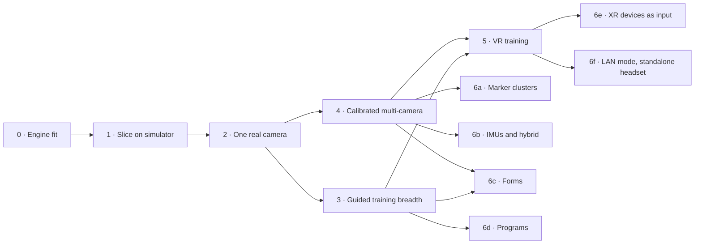
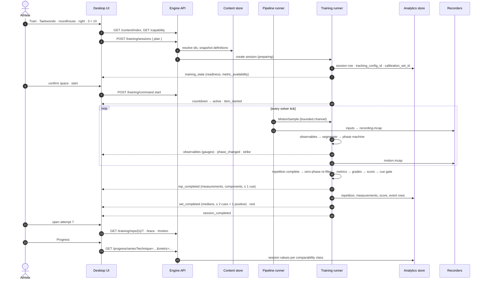

# 18 — Implementation roadmap

A staged path from the repository as it is ([docs/13](../../13-implementation-status.md)) to the
platform described in this set. Nothing in this document is implemented.

## 1. Ordering principles

| # | Principle | Effect on the order |
|---|---|---|
| O1 | A thin end-to-end slice before any broad layer | Phase 1 builds every layer once, for one technique, on the simulator that already exists |
| O2 | Real data before more features | Phase 2 puts the same slice on one webcam. Thresholds tuned only on simulated motion prove nothing (existing R17) |
| O3 | Capability grows by configuration | Multi-camera, tags and IMUs are added after the training stack exists, and are accepted only if **no content file changes** when they arrive |
| O4 | Each phase ends with something an athlete can use | No phase is infrastructure only, except Phase 0, which is kept small |
| O5 | Validation gates claims, not features | A phase may ship with metrics at grade B or suppressed; it may not ship an accuracy statement before its experiments ([16 §10](16-accuracy-and-validation.md)) |

Differences from the phase list suggested in the brief, and why:

| Brief | Here | Reason |
|---|---|---|
| Phase 1 "movement analysis foundation" | Phase 1 (simulator) + Phase 2 (one real camera) | The engine has no real input today. Splitting keeps Phase 1 free of hardware risk and makes the first real-camera result an explicit milestone |
| Phase 2 "guided training" | Phase 3 | Unchanged in content; flexibility is moved **into** it because holds and limb-elevation range work with one camera and are P1 |
| Phase 3 "improved tracking" (calibration, triangulation, tags, IMUs together) | Phase 4 (calibration + multi-view) and Phase 6a/6b (tags, IMUs) | Metric heights need only calibrated cameras. Tags and IMUs are P2 use cases; the AprilTag **detector** still arrives in Phase 4 because the calibration board needs it |
| Phase 4 "VR" | Phase 5 | The VR mirror needs a world skeleton, which exists from Phase 4 |
| Phase 5 "advanced analysis" | Phase 6c–6h | Forms, programs and the rest are independent work packages |

## 2. Overview

| Phase | Objective | Priority | Depends on | Use cases completed |
|---|---|---|---|---|
| 0 | Make the engine fit to carry training | P0 | — | — |
| 1 | Roundhouse-kick slice on the simulator | P0 | 0 | UC-01 – UC-04 (simulated) |
| 2 | The same slice on one webcam | P0 | 1 | UC-01 – UC-04 (`basic`) |
| 3 | Guided training breadth | P1 | 2 | UC-06 – UC-12, UC-18, UC-19 |
| 4 | Calibrated multi-camera tracking | P1 | 2 (3 not required) | UC-05, UC-20 |
| 5 | VR training | P1 | 3, 4 | UC-15 |
| 6 | Extended tracking and advanced analysis (packages a–h) | P2 | 4; 5 for 6e/6f | UC-13, UC-14, UC-16, UC-17 |

Phases 3 and 4 are independent of each other and can run in either order or in parallel.

## 3. Phases

### Phase 0 — Engine fit (P0)

| Item | Content |
|---|---|
| Objective | Remove the defects of fit found in the code and create the seams training plugs into. No athlete-visible feature |
| Required existing capabilities | Everything listed as implemented in docs/13; gates 0–3 green |
| Architecture changes | New crate `bansayo-training` (pure) with `observables::angles` moved out of `pipeline/joints.rs`; contracts `motion.rs` and `capability.rs`; `MotionSample` built from the existing `SkeletonPose` |
| Modules affected | `bansayo-contracts`; `bansayo-engine::{sources, registry, calibration::store, pipeline::{joints, features}, clock, app}`; `apps/desktop/src/{ui, lib}`; simulator |
| Deliverables | T-01 – T-07 of [08 §1.1](08-tracking-and-sensor-fusion.md) (T-04 as reason codes only); the trunk-lean sign reconciliation (O-01); `CapabilityReport` produced from the feature table; simulator additions: feet-capable landmark schema, `angular_velocity`, a scripted roundhouse and front kick with ground-truth phase times; UI primitives missing from the desktop (`Button`, `Field`, `Select`, `Dialog`, `Drawer`, `Readout`); hash routes with sub-segments; golden examples for the new contract types |
| Acceptance criteria | Existing gate scripts and the Playwright journey pass unchanged. Registry test: a device sending orientation then diagnostics still yields orientation to the solver. Observable property tests (rigid-transform invariance, mirror) pass. `frame` joint values are bit-identical before and after for a recorded simulator session, except `trunk_forward_lean`, whose sign change is asserted by a test. `bansayo-training` compiles with no dependency on Tokio or the engine |
| Risks | Scope creep into Phase 1. Guard: nothing here adds a route, a topic or a screen |
| Validation | Unit and replay tests only |
| Deferred | Every new source, stage, store and screen |

### Phase 1 — Roundhouse-kick slice on the simulator (P0)

| Item | Content |
|---|---|
| Objective | UC-01 – UC-04 end to end with simulated cameras, so that each layer of [01 §5](01-product-vision.md) exists once |
| Dependencies | Phase 0 |
| Architecture changes | Training runner actor; content store; analytics store (SQLite); `training` and `observables` topics; `/training`, `/content`, `/athletes`, `/progress` routes; `motion.mcap` |
| Modules affected | `bansayo-training::{content, observables, segment, recognize, metrics, scoring, coaching, exercise, progress}`; `bansayo-engine::{training, content_store, store, recording::motion, api::*}`; desktop `engine/` stores, Train, Technique, Progress |
| Deliverables | Observables needed by kicks ([04 §6](04-movement-domain-model.md)); segmenter and stage-1 phase machine; metric kinds `extremum`, `value_at`, `range`, `duration`; grades; `technique` plan through the one execution path (one-block workout); scoring model and the `after_rep` / `after_set` scheduler; shipped content: Taekwondo roundhouse and front kick, the kick metric pack, `scoring.kick.basic`; athletes with consent; session, set, repetition, measurement, score and event rows; comparability class on every measurement; Train dashboard and live session, attempt review (phase timeline, trace chart, metric table), one progress series |
| Acceptance criteria | On the scripted simulator set of 3 × 10 roundhouse kicks: the count is exact; every phase boundary is within two sample periods of the script; every scripted metric value is within its stated tolerance; two re-analyses of the recording produce identical event logs. Disabling one simulated camera mid-set lowers grades or suppresses metrics per repetition and the session completes. A second session appears beside the first in Progress; a session run with a different pose-model id appears as a separate series. At most one cue per repetition in every recorded session (scheduler replay test). A Playwright journey covers pick → set → summary → attempt → progress |
| Risks | Building generality the slice does not need. Guard: plan kinds other than `technique`, sequence grammar, DTW, references and assessments are not started |
| Validation | Simulator ground truth; replay determinism; table tests of the machines |
| Deferred | Real devices; combinations; builder; references; VR |

### Phase 2 — The slice on one webcam (P0)

| Item | Content |
|---|---|
| Objective | UC-01 – UC-04 for a real athlete at profile `basic` |
| Dependencies | Phase 1; a webcam; the local ONNX models |
| Required existing capabilities | Source task model; `landmarks_2d` observation; Cameras workspace |
| Architecture changes | `camera` source as an OS-thread chain; processing profiles; `PlanarBody` and image-plane realisations; preview endpoint; stage timing diagnostics; indexed MCAP reads (pays existing debt R18) |
| Modules affected | `bansayo-engine::sources::camera`, `pipeline::schema_map`, `recording`, `api::cameras`; desktop Cameras and Train |
| Deliverables | Capture spike and decision ([ADR-020](adr/ADR-020-camera-processing-stack.md)); `ort` integration, person detector, RTMPose with a Halpe-26 model and decision ([ADR-021](adr/ADR-021-pose-estimation-integration.md)); manual exposure control; subject selection; planar scale capture; licence review of the weights (existing R8) |
| Acceptance criteria | A guided roundhouse session on one webcam produces counts, phase durations and normalised image-plane measurements; every metre- and speed-based metric is shown as suppressed with its reason. V-19 for the roundhouse at `basic` is run on recordings of at least three people and reported. The per-stage timings of [15 §2.1](15-performance-and-latency.md) are measured and reported; each budget is met or the corresponding ADR records the consequence. Unplugging the camera pauses the session after 3 s and replugging resumes it |
| Risks | R6, R7, R8 (existing); R22, R23 ([19 §1](19-risks-and-open-questions.md)) |
| Validation | V-19, V-20 (first technique); L-01, L-03, L-06 |
| Deferred | Triangulation with real cameras; any metric in metres |

### Phase 3 — Guided training breadth (P1)

| Item | Content |
|---|---|
| Objective | The training product at `basic`: catalogue, combinations, workouts, mobility, free training, references, review tools |
| Dependencies | Phase 2 |
| Architecture changes | Sequence automaton; remaining plan kinds except `form`; arbiter for open-set recognition; reference store and DTW; re-analysis job; retention job; annotations |
| Modules affected | `bansayo-training::{recognize, exercise, reference, metrics}`; `content/`; `bansayo-engine::{store, api}`; desktop Workouts, Technique, Progress |
| Deliverables | The initial catalogue of [05 §7](05-technique-library.md) with a scripted simulator motion per definition; stances and transitions; combinations with windows and tempo; workouts, levels, goals and the builder; holds and range measurements with the safety behaviour of [17 §3](17-security-privacy-and-safety.md); assessments that are valid at `basic`; free training with `unknown` and `ambiguous`; `athlete_selected` and `personal_best` references with the desktop ghost; stage-2 template verification per technique once its data condition is met; export, deletion, retention |
| Acceptance criteria | A technique is added by a change that touches only `content/` and a simulator motion (demonstrated with one technique not in the initial list). A workout built in the UI is stored as valid YAML and runs. V-22 passes on the simulator. Re-analysing a recorded session with pinned content reproduces its measurements; with current content it produces a new linked session. Deleting an athlete leaves no row or file (property test) |
| Risks | R27, R28, R34 |
| Validation | V-19 – V-22 per shipped definition before `reviewed`; V-24 before the `detailed` coaching level is a default |
| Deferred | Forms; programs; `expert` references (need Phase 4 and a performer release) |

### Phase 4 — Calibrated multi-camera tracking (P1)

| Item | Content |
|---|---|
| Objective | Profile `multi_view`: metric heights, speeds, headings; the calibration wizard (UC-20, UC-05) |
| Dependencies | Phase 2; two or more cameras; a printed board on a rigid panel |
| Required existing capabilities | Triangulation stage; camera profiles as calibration kinds; calibration store and invalidation |
| Architecture changes | Fiducial detector; procedure state machine and solvers; time alignment; plausibility gates; skeleton fit; body proportions; sigma on landmarks; calibration sets and QA in the store |
| Modules affected | `bansayo-engine::{sources::camera::fiducial, calibration::{procedures, camera, optimize}, pipeline::{align, gates, skeleton_fit, capability}}`; desktop Calibration |
| Deliverables | AprilTag binding spike and decision ([ADR-024](adr/ADR-024-fiducial-markers-and-board-calibration.md)); board and print endpoint; intrinsics, extrinsics, floor, time-offset and body-proportion procedures; calibration check; `triangulation.mode: aligned` behind configuration; continuity re-analysis and method-difference display; height assessments |
| Acceptance criteria | V-01 – V-03, V-07 and V-08 are run and reported; [ADR-023](adr/ADR-023-time-aligned-triangulation.md) is decided from V-08. On the owner's rig the calibration check passes. The Phase 1–3 content runs **unchanged** (same content snapshot hashes) and additional metrics reach grade A because their inputs became observable. Removing one of three cameras mid-session changes grades, not the session state. A session from before the upgrade and one after appear as separate series with a method-difference figure from continuity re-analysis. V-12 and V-13 produce the first `validated` sigma tables or a written statement of why not |
| Risks | R9, R19, R20, R21 (existing); R24, R25, R26 |
| Validation | As listed; V-26, V-27 on the first full recordings |
| Deferred | Body clusters; IMU fusion; depth and ranging |

### Phase 5 — VR training (P1)

| Item | Content |
|---|---|
| Objective | UC-15: a saved workout in the headset with mirror, ghost, targets and enforced space safety |
| Dependencies | Phases 3 and 4; Godot installed; a PC VR headset |
| Required existing capabilities | The Godot client scripts — which have never been run ([19 §3](19-risks-and-open-questions.md) O-10). The first task is to run them |
| Architecture changes | None in the engine beyond target placement and `target_reached`; `xr_alignment` procedure |
| Modules affected | `apps/vr` (scripts of [11 §3](11-vr-architecture.md)); `bansayo-engine::calibration::procedures` |
| Deliverables | Runtime validation of the existing client; training, HTTP and content clients; session director; HUD; mirror (unaligned first, true mirror with `xr_alignment`); ghost; target field; flex guide; safety monitor; VR presentation profile |
| Acceptance criteria | Headless import and the extended contract smoke test pass. A workout saved on the desktop in Phase 3 runs in VR with no change to its file. A plan whose zone does not fit the play area is refused with both dimensions shown. Covering the headset sensors pauses the session within 0.5 s. L-04 and L-07 are measured and reported. The comfort checklist of [11 §7.3](11-vr-architecture.md) is completed by a person in the headset |
| Risks | R5 (existing); R31, R32 |
| Validation | [11 §11](11-vr-architecture.md) |
| Deferred | XR devices as tracking input; standalone build; passthrough default |

### Phase 6 — Extended tracking and advanced analysis (P2)

Independent packages; each is taken only when its use case is wanted.

| Package | Objective | Depends on | Key deliverables | Acceptance | Validation |
|---|---|---|---|---|---|
| 6a Marker clusters (UC-13) | Rotation of tagged segments; profile `marker_assisted` | 4 | Carrier models and print files; `marker_geometry`, `marker_mounting`; stage 4; arbitration; simulator fiducial projector | Twist observables reach grade A on tagged segments; removing all tags returns to `multi_view` with no other change | V-04 – V-06, V-09, V-10 |
| 6b IMUs and hybrid (UC-14) | Timing through occlusion; profile `hybrid` | 4; trackers | SolarXR adapter (existing ADR-008); `esp32_udp` when raw rates are needed; heading alignment and correction; anchored FK | A camera-occluded kick keeps its timing metrics with method `imu_gyro`; an IMU can be removed without any content change | V-17, V-18, V-28 |
| 6c Forms (UC-16) | Kata and poomsae | 3, 4 | `form` plan; step machine; symbolic alignment; Heian Shodan and Taegeuk Il Jang with stated style; form guide in both clients | Scripted omissions and insertions recovered; facing and travel `not_assessed` rather than guessed below `multi_view` | V-22 |
| 6d Programs (UC-17) | Multi-week plans | 3 | Enrolment; the closed rule set of [06 §6](06-exercise-and-workout-engine.md) | The proposed next session follows the rules on a synthetic history | Table tests |
| 6e XR devices as input | Head and hands from the headset | 5 | `client_ingest`; grip offset; validity handling | Wrist keypoints carry method `xr_device` and enter a separate comparability class | V-34 |
| 6f LAN mode and standalone headset | Untethered VR | 5 | Token authentication; Android export | The engine refuses any non-loopback bind without a token | [17 §6](17-security-privacy-and-safety.md) |
| 6g Depth, ranging, contact sensors | Profile `extended` | 4 | One adapter per sensor actually owned | The floor reference becomes independent of camera calibration | Per sensor |
| 6h Learned classifier | Free-mode recall | 3 + data | Only when the entry condition of [07 §3.4](07-recognition-and-coaching.md) is met | Beats stages 1–2 on held-out recordings at equal precision | V-21 |

## 4. First vertical slice — roundhouse kick

The complete flow of UC-01 – UC-04. The same flow holds on the simulator (Phase 1), one webcam
(Phase 2) and a calibrated rig (Phase 4); only the capability report and therefore the grades
differ.

| Step in the brief | What happens | Contract or data | Specified in |
|---|---|---|---|
| 1 Select discipline and variant | The picker lists valid definitions from the content index; a variant is a definition id (`taekwondo.dollyeo_chagi`, or a `user.` definition that `extends` it) | `GET /content/index`; `ContentRef` | [05 §2](05-technique-library.md), [13 §3](13-configuration-schemas.md) |
| 2 Configure cameras and sensors | Sources are enabled in the rig file; devices appear in Devices and Cameras; the capability report names the profile and every observable's state | `SystemState.devices`, `CapabilityReport` | [08 §9](08-tracking-and-sensor-fusion.md) |
| 3 Calibrate | `basic`: hold the start stance (planar scale). `multi_view`: the wizard, ending in the calibration check | `ProcedureState`; calibration profiles; QA record | [09 §8](09-optical-markers-and-calibration.md) |
| 4 Start a guided workout | A one-item workout is compiled from the pinned snapshot; readiness gates are evaluated | `POST /training/sessions`; `TrainingState.readiness` | [03 §1](03-training-modes.md), [06 §3](06-exercise-and-workout-engine.md) |
| 5 Perform kicks | Segmenter opens an activity; the phase machine walks chamber → pivot → extension → retraction → recovery | `MovementEvent`, `Repetition` | [07 §2–3](07-recognition-and-coaching.md), [examples/technique-roundhouse-kick.yaml](examples/technique-roundhouse-kick.yaml) |
| 6 See repetitions and live metrics | Count and phase from `TrainingState`; gauges from the `observables` topic | `training_state`, `observables` | [14 §4](14-runtime-and-api-contracts.md), [10 §6](10-desktop-architecture.md) |
| 7 Receive confidence-aware feedback | Metrics graded; components scored against personal or reference targets; one cue passes the evidence gate or none does | `RepetitionResult`, `CueInstance` | [05 §8](05-technique-library.md), [07 §7–8](07-recognition-and-coaching.md) |
| 8 Review attempts | Phase timeline, traces and clip are read from `motion.mcap` by index; no replay needed | `/training/reps/…/{trace,motion}` | [14 §5.3](14-runtime-and-api-contracts.md) |
| 9 Save the session | Nothing to do: rows were written as events occurred; the session row closes with its summary | SQLite schema | [12 §4](12-data-and-progress.md) |
| 10 Compare with earlier sessions | Session medians of grade-A values, one series per comparability class, with break markers | `GET /progress/series` | [12 §5–6](12-data-and-progress.md) |

## 5. How the slice carries everything else

| Later capability | New content (YAML) | New code | Unchanged |
|---|---|---|---|
| Other kicks | A definition each; kick metric pack reused | None | Everything |
| Punches | Definitions; punch metric pack; `scoring.punch.basic` | DTW feature list for the arm-strike family (one table) | Engine, API, UI |
| Knees, elbows, defence | Definitions; metric pack | None beyond family tables | — |
| Technique variants per discipline or instructor | A sibling definition, or `extends` with overrides | None | — |
| Flexibility and mobility | `hold` and `dynamic` mobility definitions; `rom.*` metrics | Hold machine (one item machine); `peak_count`, `settle_time` kinds | Session machine, store, progress |
| Combinations | Combination files | Sequence automaton (once) | Technique machines are reused as step detectors |
| Workouts and programs | Workout and program files | Block iteration; closed progression rules | — |
| Forms | Form files | Step machine; symbolic alignment; four per-step checks | The automaton, DTW, metrics and store from above |
| Assessments | Assessment files | Entry gates and trial aggregation | Metrics, grades, classes |
| More cameras, tags, IMUs | Rig file and calibration only | Solver stages, behind the body-state boundary | `bansayo-training` in its entirety |
| VR | Presentation profile | Godot scenes | Engine and content |

The single foundation that kata, combinations and single techniques share is: observables →
technique phase machines → repetition results. A form or combination never detects movement by
itself; it consumes the tokens that technique machines emit.

## 6. Priorities

| Priority | Work |
|---|---|
| **P0** — essential foundations | Phases 0, 1, 2: engine fit; training crate; observables; phase-machine recognition; exercise engine; grades; analytics store with comparability classes; content store; real camera source; Train, attempt review, one progress series |
| **P1** — high value | Phases 3, 4, 5: catalogue, combinations, workouts and builder, mobility, assessments, free training, references and ghost, re-analysis, export and deletion; calibration wizard, multi-view, skeleton fit, validated tables; VR training |
| **P2** — later | Phase 6 packages: marker clusters; IMUs; forms; programs; XR ingest; LAN and standalone; depth and ranging; learned recognition |

## 7. Not on the roadmap

Partner or sparring analysis; hand, finger and face tracking; cloud sync or accounts; a content
marketplace; automatic program generation; a fisheye camera model; an EKF or factor-graph smoother
(reconsidered only on recorded evidence, [ADR-025](adr/ADR-025-sensor-fusion-ladder.md)); a
FreeMoCap importer (existing ADR-014); a second backend language
([ADR-018](adr/ADR-018-training-crate-and-runtime-boundaries.md)).
