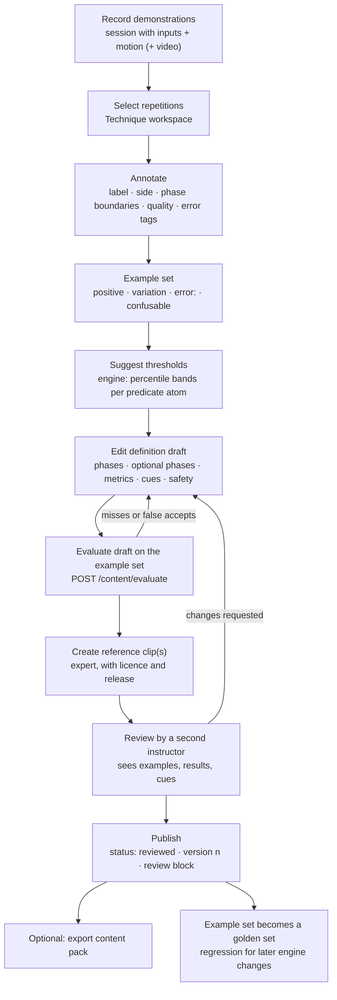

# 20 — Technique authoring and expert validation

How a technique definition comes to exist, who vouches for it, and how the platform avoids
shipping one developer's reading of Karate, Taekwondo or Muay Thai as "correct".

Decision record: [ADR-037](adr/ADR-037-technique-authoring-and-review.md). Status: **Proposed**.
The definition format itself is [05](05-technique-library.md) and
[13 §6](13-configuration-schemas.md); this document adds the workflow around it.

## 1. Capability card

| Item | Content |
|---|---|
| Use case and value | An instructor records a technique, marks its phases, states acceptable variations and common errors, tests the definition against recorded examples and publishes a versioned, attributed definition with a reference clip. Measurable value: detection precision and recall on that instructor's own examples, and cue precision judged by a second instructor |
| Existing support | Technique schema with `status`, `reviewed_by`, `extends`; references; annotations table; Technique workspace components (timeline, traces, compare viewport); re-analysis; content validation and atomic writes |
| Needed now | The annotation body of §4; the `deprecated` status; the evaluate route of §5; `review` block fields. All additive |
| Dependencies | A calibrated rig for `expert` references; consenting performers; at least two instructors per style for review |
| Feasibility and limits | Feasible with the closed catalogues. Limit: a definition can express only what the observables see; some coaching points (tension, intent, breathing, kime) cannot be authored at all |
| Priority | **P0** for the data model and review states; P1 for annotation tools; P2 for the full editor |
| Smallest milestone | An instructor corrects phase boundaries on ten recorded repetitions and the engine reports how the current definition performs on them |
| Evidence before development | Phase 3 authoring experience with hand-written YAML: which fields instructors actually change |

## 2. Principles

1. **A definition is a hypothesis about detection and a set of declared targets, not a standard.**
   It names its style and its reviewer.
2. **Examples before thresholds.** Thresholds are proposed from annotated recordings and then
   reviewed by a person; they are not typed from intuition.
3. **Positive and negative examples.** A definition is tested on executions it must accept, on
   acceptable variations, on named common errors, and on confusable techniques it must reject.
4. **Two people.** The author and the reviewer of a `reviewed` definition are different people.
5. **Versions are immutable once used.** Publishing a change creates `version + 1`; history keeps
   pointing at what it was measured with ([32 §5](32-measurement-provenance.md) I3).

## 3. Workflow



## 4. Data

### 4.1 Annotation (body of the existing `annotations` row)

```ts
interface RepAnnotation {
  schema_version: 1;
  annotator: string;                       // name as entered; not an account
  label: ContentId | "none" | "other";     // what the movement is, in the annotator's judgement
  side: "left" | "right" | null;
  phases: { phase: string; t_start_us: TimeUs; t_end_us: TimeUs }[];   // corrected boundaries
  strike_t_us: TimeUs | null;
  quality: "positive" | "variation" | "error" | "unusable";
  variation: string | null;                // free label, e.g. "switch-step entry"
  error_tags: string[];                    // from the definition's declared common errors, or new
  cue_agreement: { cue_id: string; agree: boolean }[];                 // for V-24
  note: string | null;
}
```

Annotations never overwrite engine output; they sit beside it and are the ground truth for
[16 §5](16-accuracy-and-validation.md).

### 4.2 Example set

```yaml
schema: bansayo.examples/v1
id: user.sensei_a.dollyeo_chagi_examples
version: 3
technique: taekwondo.dollyeo_chagi
items:
  - { session: 20261120T101500Z-a1b2, rep_index: 4, role: positive }
  - { session: 20261120T101500Z-a1b2, rep_index: 9, role: variation, variation: "rear-leg, no step" }
  - { session: 20261120T103000Z-c3d4, rep_index: 2, role: error, error: knee_not_chambered }
  - { session: 20261120T103000Z-c3d4, rep_index: 7, role: confusable, technique: taekwondo.ap_chagi }
```

Roles and what the evaluation expects: `positive`, `variation` → detected as this technique;
`error` → detected, and the cue tied to that error tag fires at the set level; `confusable` → not
detected as this technique. An example set is content (a file under `content/examples/` or the
user tree); the sessions it points to must be kept (`keep` flag).

### 4.3 Definition additions (additive to `bansayo.technique/v1`)

| Field | Meaning |
|---|---|
| `status: draft \| reviewed \| deprecated` | `deprecated` definitions stay loadable for history and are not offered for new sessions |
| `review: { author, reviewer, reviewed_on, style_authority?, examples: ContentRef, results: { precision, recall, n_athletes, n_reps }, notes }` | Replaces the two flat fields; `reviewed` requires `author ≠ reviewer`, an example set, and results |
| `variations: [{ id, label, description }]` | Declared acceptable variations; purely descriptive, they select which optional phases are expected |
| `common_errors: [{ id, label, cue: <cue id> }]` | Names an error and binds it to a cue; error tags in annotations refer to these ids |

## 5. Engine support

| Function | Contract | Notes |
|---|---|---|
| Evaluate a draft | `POST /content/evaluate { definition, examples: ContentRef }` → per item: detected technique and side, outcome, phase-boundary errors against the annotation, metric grades, cues fired; and totals (precision, recall, mean boundary error) | A re-analysis job over the items' `motion.mcap` windows with the draft compiled in memory; nothing is stored |
| Suggest thresholds | `POST /content/suggest { technique, examples }` → for each predicate atom of the draft, the 5th–95th percentile of that observable at the annotated boundary over positive and variation items | A pure function in `bansayo-training::content`; output is a proposal the author edits |
| Reference from an example | Existing `POST /references` | `expert` kind needs `multi_view` and grade-A targets |
| Publish | Existing `PUT /content/techniques/{id}`; the validator enforces the `review` block for `reviewed` | |
| Content pack | Export of definitions, example-set manifests, references and licences as a bundle ([26 §3](26-instructor-and-remote-coaching.md)) | Sessions are included only with the performers' consent flags |

## 6. Technique Editor (desktop)

A mode of the Technique workspace ([10 §6.3](10-desktop-architecture.md)), not a new application.

| Panel | Built from | Function |
|---|---|---|
| Example browser | `AttemptBrowser` | Filter by session, label, role; multi-select |
| Timeline | `PhaseTimeline` with draggable boundaries | Correct phases; engine boundaries shown ghosted beneath |
| Traces | `TraceChart` | The observables used by the draft's predicates, with threshold lines; suggested bands as shaded regions |
| Viewport | `CompareViewport` | Skeleton playback, trajectories, two examples side by side |
| Definition form | New, schema-driven | Phases, conditions as pick-lists over the catalogue, optional flags, metrics, cues, safety; shows validation problems inline |
| Evaluation | New table | Per-example result; confusion summary; boundary error histogram |
| Review | New | Reviewer identity, checklist, sign-off |

The form offers only catalogue entries, so everything it can produce validates. Editing raw YAML
remains possible and is validated the same way.

## 7. Review rules

| Rule | Decision |
|---|---|
| Who may review | A person the installation's owner names as instructor for that style. The platform records the name and the stated authority; it cannot verify credentials and says so |
| Minimum evidence for `reviewed` | The protocol of [05 §12](05-technique-library.md): ≥ 30 repetitions from ≥ 3 athletes, annotated; results stored in the `review` block |
| Disagreement between instructors | Resolved by **separate definitions** (variants), never by averaging |
| Shipped definitions | Start as `draft` and are labelled so in the UI until reviewed ([19 §3](19-risks-and-open-questions.md) O-18) |
| Scoring tolerances and cue texts | Part of the same review; cue precision per V-24 |
| Withdrawal | A reviewer can withdraw; the definition returns to `draft` in a new version |

## 8. Limits stated to authors

- Only catalogue observables can be referenced; a missing observable is a request to the project.
- A definition tuned on one rig carries that rig's detector conventions; evaluation results state
  the comparability class they were obtained in.
- Authoring at `basic` yields a definition whose world-coordinate conditions are untested.

## 9. Validation

Round-trip tests of the evaluate route on the simulator's scripted motions (known boundaries);
V-19, V-20, V-24 on real example sets; a property test that any form-produced definition passes
the validator.
