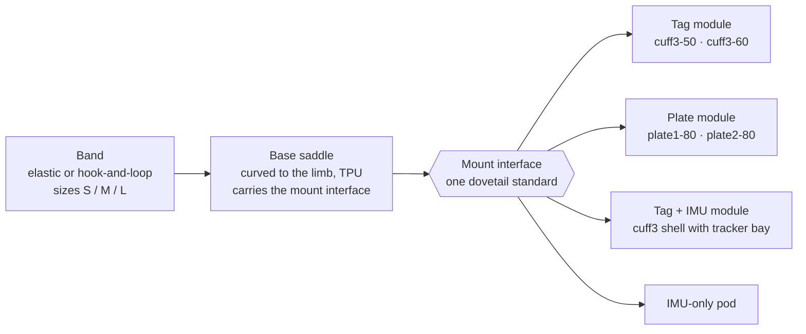

# 21 — Wearable hardware and printed-tag engineering

A modular family of 3D-printed wearables: optical-only bands, optical-plus-IMU bands, detachable
marker mounts and multi-face tag holders. Tag families, size arithmetic, cluster calibration and
fusion rules are in [09](09-optical-markers-and-calibration.md); this document covers the physical
design, its failure modes and its registration data.

Status: **Proposed**. Nothing has been printed or tested; dimensions are design starting points.

## 1. Capability card

| Item | Content |
|---|---|
| Use case and value | Inexpensive, reprintable wearables that make segment rotation observable (tags), keep timing through blur and occlusion (IMU), and let each calibrate the other. Measurable value: twist observables at grade A; IMU mounting and heading obtained without a separate procedure |
| Existing support | Mounting calibration by reference pose; device registry and assignments; the cluster design of [09 §5–6](09-optical-markers-and-calibration.md); carrier model files ([13 §4.1](13-configuration-schemas.md)) |
| Needed now | Two additive fields in the carrier model (§5); the mount interface dimensions fixed before anything is printed, so that modules stay interchangeable |
| Dependencies | A printer; the AprilTag detector (package 6a); trackers (package 6b); lab Block D and E |
| Feasibility and limits | Printing and wearing are straightforward. The limits are physical: soft tissue moves, tags blur at strike speed, larger tags decode further but wear worse |
| Priority | **P0** for the design rules and data model; P2 for building (packages 6a, 6b) |
| Smallest milestone | One `cuff3-60` on a shin: decode envelope and mounting repeatability measured (V-05, V-09) |
| Evidence before development | V-05 with flat printed tags on a board, which needs no wearable at all: if the envelope at the owner's cameras is too short, sizes change before any carrier is designed |

## 2. Product family



| Module | Contents | Segments | Notes |
|---|---|---|---|
| **B-O** optical band | Base + `cuff3` tag module | Upper arm, forearm, thigh, shin | No electronics; washable base |
| **B-OI** optical + IMU band | Base + `cuff3` shell holding a tracker board and cell | Thigh, shin, forearm | The tag frame and the sensor frame are related by the print: §5 |
| **P-O** plate | Base (or harness clip) + `plate1-80` / `plate2-80` | Chest, upper back, sacrum | Larger tags; slower segments |
| **I** IMU pod | Base + enclosed tracker | Any; feet | For segments where tags are useless (blur, range) |
| Calibration board | Flat rigid panel | — | Not worn |

The **mount interface** is the only standard: one dovetail (or equivalent keyed slide) with a
spring latch, a single orientation, and a flat datum face. Every module declares its geometry
relative to that datum, so a base can stay on the limb while modules are swapped, and a module can
be reprinted without recalibrating the others.

## 3. Engineering trade-offs

| Concern | Analysis | Design rule |
|---|---|---|
| Tag size vs wearability | Range grows linearly with tag edge ([09 §4.1](09-optical-markers-and-calibration.md)); a 60 mm face on a shin is acceptable, on a forearm it catches the guard | Sizes per segment as in 09; no tag below 40 mm; wrists, hands, ankles, feet untagged |
| Multi-face geometry | Three faces at 0° and ± 60° keep one face within about 30° of a camera over a 180° arc | `cuff3`; faces are flat inserts, the saddle is curved |
| Flatness | A bent tag shifts corners | Tags are bonded to rigid inserts (PETG or PLA), not to the flexible base; flatness ≤ 0.5 mm |
| Slippage along and around the limb | Tapered limbs and sweat move a band distally and rotationally | Wide base (≥ 40 mm), silicone or textured inner face, two straps on thigh modules; slip is **detected**, not prevented: cluster-versus-landmark disagreement stales the mounting ([09 §12](09-optical-markers-and-calibration.md)) |
| Skin and muscle movement | The carrier rides on soft tissue that shifts with contraction and at impact-like decelerations | Placement over the least muscular aspect (distal third, antero-lateral shin, lateral thigh); stated limitation ([19 §1](19-risks-and-open-questions.md) R35); quantified by V-09, V-10 |
| Clothing | A band over loose fabric rotates with the fabric | Worn on skin or tight garments; the wizard says so |
| Comfort and injury | Hard edges against the limb or the floor | Flexible base (TPU), rounded rigid parts, nothing over joints, shin crest, instep or knuckles; breakaway latch so a snagged module releases |
| Impact resistance | Self-contact, floor contact in falls and sweeps | Rigid inserts recessed 1–2 mm below a flexible rim; modules are cheap and reprintable by design — they are sacrificial, limbs are not. **Not rated for partner contact or pad work** |
| Mass and wobble | Added mass at the distal limb increases wobble and changes the movement | Target ≤ 40 g optical, ≤ 60 g with tracker and cell (targets, unweighed) |
| Battery placement | Cell mass and heat; puncture risk | Cell on the proximal side of the module, inside a closed bay, away from striking and landing surfaces; no cell on foot or forearm strike surfaces |
| Tag surface | Glare, sweat, abrasion | Matte laminate or matte print; replaceable inserts; same id on reprint keeps the mounting profile ([09 §5.3](09-optical-markers-and-calibration.md)) |
| Print tolerance | Edge length and face angles differ from CAD | Edge measured with calipers and entered; `marker_geometry` refinement measures the faces ([09 §6.1](09-optical-markers-and-calibration.md)) |
| IMU axes | Sensor orientation in the bay must be known and repeatable | Keyed bay; one orientation only |

## 4. Sensor placements

| Segment | Optical | IMU | Reason |
|---|---|---|---|
| Pelvis (sacrum) | `plate2-80` | Yes | Pelvis orientation anchors hip angles and headings |
| Chest | `plate1-80` | Yes | Trunk rotation; shoulder–hip separation |
| Thigh | `cuff3-60` | Yes | Hip rotation; chamber |
| Shin | `cuff3-60` | Yes (expect saturation in fast kicks) | Knee extension timing; shin rotation |
| Foot | — | Pod on the instep **only for non-contact drills** | Pivot and foot yaw without heel and toe landmarks |
| Upper arm | `cuff3-50` | Optional | Shoulder rotation |
| Forearm | `cuff3-50` | Yes | Punch timing; pronation |
| Hand, wrist, ankle, head | — | — | Too small, too fast, or better served by landmarks or the headset |

Minimum useful sets: kicks — pelvis, both thighs, both shins; punches — chest, both forearms.

## 5. Registration data

Additive to `bansayo.carrier/v1` ([13 §4.1](13-configuration-schemas.md)):

```ts
interface CarrierModel {
  // existing: schema, id, nominal_edge_mm, faces[]
  mount: { interface: "bansayo-dovetail-1" };                      // which datum the geometry refers to
  imu?: { q_cluster_from_sensor: Quat; t_cluster_from_sensor_mm: Vec3 };   // present on B-OI modules
}
```

Consequence of the `imu` block: for a B-OI module the tracker's mounting on the segment follows
from the cluster's, with no separate capture:

```text
q_segment_from_sensor = q_segment_from_cluster · q_cluster_from_sensor
```

and the cluster's optical heading is the tracker's heading reference whenever a face is visible
([08 §7.2](08-tracking-and-sensor-fusion.md)). The derived mounting profile records
`method: carrier_model` and depends on `marker_mounting`; if the print's bay tolerance proves too
loose (V-09), the dependency is dropped and the ordinary reference-pose capture is used for both.

Identification: every printed module carries its cluster id and tag ids as embossed text; the
configuration lists them under `trackables` ([13 §4](13-configuration-schemas.md)). Replacement and
reassignment rules are in [09 §5.3](09-optical-markers-and-calibration.md) and
[09 §9](09-optical-markers-and-calibration.md).

## 6. Deliverables of the hardware work (when it starts)

| Deliverable | Location |
|---|---|
| Parametric CAD sources and print-ready files per module and size | `hardware/wearables/` in the repository, under the repository licence |
| Carrier model YAML per module, generated from the CAD parameters | `config/markers/models/` |
| Print and assembly notes: material, layer height, insert bonding, strap lengths | `hardware/wearables/README.md` |
| Tag sheets at exact scale with a ruler mark | `GET /calibration/print/cluster` ([14 §5.5](14-runtime-and-api-contracts.md)) |

## 7. Test plan

| Test | Method | Pass |
|---|---|---|
| Decode envelope per module | V-05 | Covers the rig's working distance |
| Dynamic decode | V-06 | Readable through chamber and guard phases |
| Mounting repeatability | V-09 | Spread small enough for grade-A twist, or twist stays grade B |
| Slip | 50 kicks and 50 punches; compare mounting before and after against a re-captured reference pose | Change below `markers.mounting_disagreement_rad`, or the slip notice fired |
| Drop and snag | Module dropped from 1.5 m; latch pulled | Inserts intact or cheaply replaced; latch releases |
| Comfort | 30-minute session; athlete report | No pressure points; no restriction of range |
| IMU bay tolerance | Compare `carrier_model` mounting with reference-pose mounting | Agreement within the tilt sigma |

## 8. Safety

Rules of [17 §3.1](17-security-privacy-and-safety.md) (wearables row) apply. Additionally:
lithium cells are enclosed and never charged while worn; wearables are removed for partner work;
any module that cracks is discarded.
