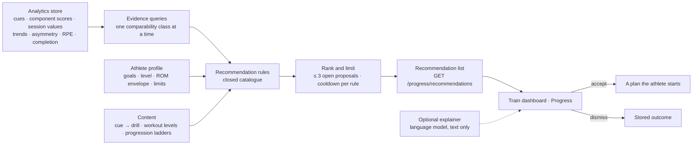

# 24 — Adaptive training and intelligent coaching

A progression layer that notices recurring weaknesses, proposes corrective drills, adjusts
difficulty and suggests rest or a change of exercise — using only graded measurements. Extends the
per-session coaching of [07 §8](07-recognition-and-coaching.md) and the program rules of
[06 §6](06-exercise-and-workout-engine.md) across sessions.

Decision record: [ADR-039](adr/ADR-039-adaptive-training-rules-and-language-models.md).
Status: **Proposed**, P1; the language-model part is experimental.

## 1. Capability card

| Item | Content |
|---|---|
| Use case and value | After a few weeks the Train screen says "your right support pivot has been short in 4 of 6 sessions — a slow-stage pivot drill is suggested", with the evidence one tap away. Value: the share of proposals the athlete accepts, and whether the flagged component then changes beyond the noise term |
| Existing support | Stored cues with basis and evidence; component scores; session values, trends, change classification and asymmetry ([12 §6](12-data-and-progress.md)); cue `drill` hints; workout levels; closed progression rules; session RPE; safety limits |
| Needed now | Nothing beyond storing cues, component scores and RPE from the first session (already specified). The `Recommendation` type and rule kinds below are documented, not built |
| Dependencies | ≥ 4 sessions per athlete and technique in one comparability class; V-24 (cue precision); V-33 (noise term) |
| Feasibility and limits | Rule-based proposals are straightforward. The limit is validity: a recommendation is only as good as the cue it rests on, and no rule here knows about pain, fatigue or life outside training |
| Priority | P1 (rules); experimental (language model) |
| Smallest milestone | One rule, `focus_from_recurring_cue`, producing one proposal on the Train dashboard |
| Evidence before development | V-24 cue precision ≥ 0.8 for the cues the rule may use; otherwise it amplifies wrong corrections |

## 2. Principles

1. **Proposals, never actions.** The engine proposes a drill, a level change or rest; the athlete
   starts or dismisses it. Nothing is scheduled or modified silently.
2. **Grounded.** Every proposal lists the stored measurements and cues it rests on; a proposal that
   cannot is not issued.
3. **Closed rules.** Recommendation rules are a catalogue in code with parameters in YAML, like
   progression rules. No learned policy.
4. **Conservative.** Rules may lower difficulty or suggest rest on one signal; they raise
   difficulty only on sustained evidence and never beyond the safety limits.
5. **Silence is acceptable.** With too little or too poor data there is no recommendation.

## 3. Pipeline



```ts
interface Recommendation {
  id: string;
  rule: string;                                  // catalogue id
  kind: "corrective_drill" | "difficulty_down" | "difficulty_up" | "rest" | "switch_exercise" | "reassess" | "recalibrate";
  technique: ContentRef | null; side: "left" | "right" | null;
  evidence: { type: "cue" | "component" | "trend" | "asymmetry" | "completion" | "rpe" | "volume";
              ref: string; sessions: SessionId[]; summary: TextRef }[];
  proposal: { plan: Plan } | { level_delta: -1 | 1; workout: ContentId } | { rest_days: number } | null;
  basis: "measurement" | "reference" | "history" | "style";
  created_utc: string; expires_utc: string;
  outcome: "open" | "accepted" | "dismissed" | "expired";
}
```

## 4. Rule catalogue (initial)

| Rule | Fires when | Proposes | Guard |
|---|---|---|---|
| `focus_from_recurring_cue` | The same corrective cue was issued at set level in ≥ 3 of the last 5 sessions of a technique and side | The cue's `drill` (for example slow stage, or a named drill definition) | Cue basis and grade as stored; one focus per technique |
| `address_asymmetry` | An `asymmetry` metric is classified outside its noise term in the same direction over ≥ 4 sessions | Extra sets on the weaker side in the next workout (level override) | Never worded as a defect; asymmetry is shown, not judged |
| `regress_on_decline` | Completion rate < 0.6 in two consecutive sessions of a workout, or set-over-set decline of a scored component in ≥ 3 sets of a session | Level − 1, or the definition's lower progression step | Applies the existing `level_ladder` semantics |
| `advance_on_stability` | The `level_ladder` advance condition holds and no corrective cue recurs | Level + 1 | Never past the definition's safety limits or the ROM envelope ([23 §5.2](23-biomechanics-model.md)) |
| `suggest_rest_on_variability` | Within-session `set_variability` rose across sets beyond the noise term **and** RPE ≥ 8, or the strike-volume limit was reached | End the block; rest; a mobility or technique-slow session next | Wording: "consider"; no physiological claim |
| `switch_on_plateau` | `no_clear_change` for ≥ 8 sessions on the athlete's stated goal metric | A different drill from the same family, or a reassessment | Plateau is stated as a measurement fact |
| `reassess_envelope` | The ROM envelope is older than 6 weeks and mobility goals exist | The matching assessment | — |
| `recalibrate_before_judging` | A trend change coincides with a calibration or class break ([12 §5.4](12-data-and-progress.md) C3) | A calibration check instead of any training advice | Blocks other rules for that metric |

Rules read only grade-A session values (grade B for cue recurrence, as in the scheduler), within
one comparability class. Parameters (counts, windows) are configuration; each rule has a cooldown
so a dismissed proposal does not return for `adaptive.cooldown_days` (default 14).

## 5. Long-term athlete development

| Element | Realisation |
|---|---|
| Goals | `AthleteProfile.goals` (existing): text plus optional metric and technique; rules prefer evidence on goal metrics |
| Periodisation | Programs with `deload` and `level_ladder` (existing). No automatic program generation |
| Skill ladder | The `progression` list of each definition; a recommendation may point to the next or previous step |
| History of advice | Recommendations and outcomes are stored, so "was the advice followed, and what happened next" is a query, and rules can be evaluated retrospectively on golden histories |

## 6. Language models

| Question | Decision |
|---|---|
| May a language model judge technique, produce scores or choose cues? | **No.** Those come from metrics, scoring models and rules with versions ([32 §5](32-measurement-provenance.md) I7) |
| May it phrase results? | Optionally: an **explainer** that receives a structured summary (the recommendation, its evidence records, measurement values with grades and units) and returns prose |
| Guard rails | The prompt contains only stored, already-graded facts. The output is checked mechanically: every number in it must appear in the input; banned words of [17 §4.2](17-security-privacy-and-safety.md) are rejected; on failure the template text is shown instead. Output is labelled "generated explanation" and is never stored as a cue or measurement |
| Where it runs | Off by default. A local model, or a user-supplied endpoint, chosen explicitly; a remote endpoint sends the summary off the machine and the setting says so ([ADR-031](adr/ADR-031-local-first-execution.md)) |
| Conversation | A question-answering mode over the athlete's own stored data is the same contract with retrieval restricted to that data; it remains experimental |

## 7. What this layer never does

Diagnose, comment on pain or injury, prescribe training load as medical or physiological advice,
compare athletes with each other, or act without the athlete's confirmation.

## 8. Validation

Table tests of each rule on synthetic histories; retrospective evaluation on stored histories
(would the rule have fired, and what followed); acceptance and dismissal rates; instructor review
of a sample of proposals with their evidence. For the explainer: the mechanical checks above as
unit tests, and a blind comparison with template text by an instructor.
