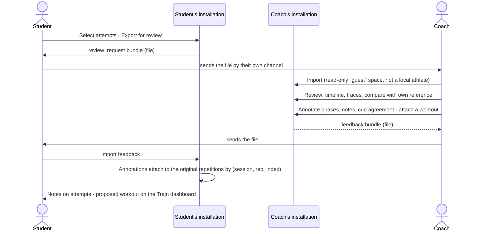

# 26 — Instructor mode and remote coaching

Instructor-defined workouts, session review, annotated recordings and feedback sharing — without a
server, an account or live streaming.

Decision record: [ADR-041](adr/ADR-041-coaching-exchange-by-bundles.md). Status: **Proposed**, P2.

## 1. Capability card

| Item | Content |
|---|---|
| Use case and value | A student sends selected attempts to a coach; the coach reviews them in the same Technique workspace, marks corrections, attaches a workout and returns it; the student sees the notes on the attempts and can start the workout. Value: turnaround without scheduling; corrections tied to exact moments |
| Existing support | Per-athlete export ([12 §8](12-data-and-progress.md)); annotations; references; content as files with `user.` ids and licences; compare viewport; workouts and programs as content |
| Needed now | The bundle manifest of §3 and the rule that every exported entity keeps its identifiers and versions. Import is not built |
| Dependencies | Technique workspace (Phase 3); a way to move a file (the user's own: e-mail, drive, messenger) |
| Feasibility and limits | Feasible. Limits: the coach's installation must read the bundle's schema versions; a coach without the student's rig sees what was recorded, not more |
| Priority | P2; multi-athlete live sessions are out of scope |
| Smallest milestone | Export three repetitions with motion and notes from one installation and open them read-only in another |
| Evidence before development | A real coach–student pair asking for it; Phase 3 review tools in use |

## 2. Roles

No accounts and no permissions ([02 §4](02-use-cases-and-personas.md)). "Instructor" is whoever
authors content, records references and writes annotations; on a shared installation that is
simply another profile. Across installations the instructor is identified by the `annotator` and
`author` names inside files, which are claims, not credentials.

## 3. Bundle

One zip file with a manifest; the same container serves content packs
([20 §5](20-technique-authoring.md)), review requests and feedback.

```yaml
schema: bansayo.bundle/v1
kind: review_request            # content_pack | review_request | feedback
created_utc: 2026-12-01T18:30:00Z
from: { name: "Dani", installation: "a1b2c3" }       # free text + random installation id
athlete: { alias: "student-7f3a", height_m: 1.78 }   # no profile id or display name unless chosen
consent: { share_motion: true, share_video: false, purpose: "coaching review", recipient: "Sensei A" }
contents:
  sessions:
    - id: 20261201T170000Z-q1w2
      reps: [3, 7, 12]            # only these windows of motion.mcap are included
      include: [motion]           # motion | video | inputs
  content: [ "taekwondo.dollyeo_chagi@2", "scoring.kick.basic@1" ]   # snapshots, so the coach sees the same definitions
  references: []
  annotations: []
  workouts: []
provenance: [ tracking_config, calibration_set ]     # copied so measurements stay explainable
```

| Rule | Decision |
|---|---|
| Minimal by default | Selected repetitions only; skeleton-level motion; video only with the separate consent |
| Identity | The athlete is an alias unless the sender chooses otherwise |
| Self-contained | Content snapshots and provenance records travel with the measurements ([32 §3](32-measurement-provenance.md)) |
| Integrity | A SHA-256 per file in the manifest; no signatures (there is no key infrastructure to trust) |
| Transport | Whatever the two people use; the application neither uploads nor downloads |

## 4. Flows



| Flow | Notes |
|---|---|
| Instructor-defined workout | A content pack containing workout, technique variants and references; imported under the sender's `user.` namespace; ids never collide with shipped content |
| Session review | Above. Imported sessions live in a guest area: visible in Technique, excluded from every local athlete's progress |
| Comparing two recordings | `CompareViewport` with two repetitions (student vs student earlier, or student vs the coach's reference), time-aligned by the engine ([07 §4.1](07-recognition-and-coaching.md)) |
| Annotated video | When video was shared, annotations carry `t_us`; the video frame nearest that time is shown beside the skeleton. No drawing-on-video tool is planned |
| Progress dashboard for a coach | A bundle of kind `review_request` may include progress series (measurements with classes); the coach sees the same charts, read-only |
| Feedback into adaptive training | An imported workout appears as a proposal with `basis: style` and the coach's name ([24](24-adaptive-training.md)) |

## 5. Import rules (when built)

| Rule | Decision |
|---|---|
| Validation | Schema majors must be supported; every content item passes the normal validator; unknown items are skipped with a report |
| Trust | Imported definitions are `draft` locally regardless of their status at the source; the source's review block is shown as a claim |
| Isolation | Guest sessions cannot become golden sessions or references without the bundle's consent flags allowing it |
| Conflicts | Same id and version with different content hash → refused, both hashes shown |
| Size | Bundles above a configured size ask for confirmation |

## 6. Explicitly separate from core tracking

Live remote sessions, video calls, multi-athlete classes, a coach dashboard service and any
account system are **not** part of this architecture. They would be a different product layer on
top of bundles; nothing in the engine is shaped for them, and
[ADR-031](adr/ADR-031-local-first-execution.md) names the conditions for reconsidering.

## 7. Privacy

[17 §2](17-security-privacy-and-safety.md) applies. An export is the only moment data leaves the
installation; the export dialog lists exactly what is inside, the consent recorded in the manifest
states purpose and recipient, and the application cannot recall a sent file — the dialog says so.

## 8. Validation

Round trip: export → import on a clean installation → measurements, snapshots and provenance are
identical by hash; annotations attach to the right repetitions; guest data is absent from every
progress query.
