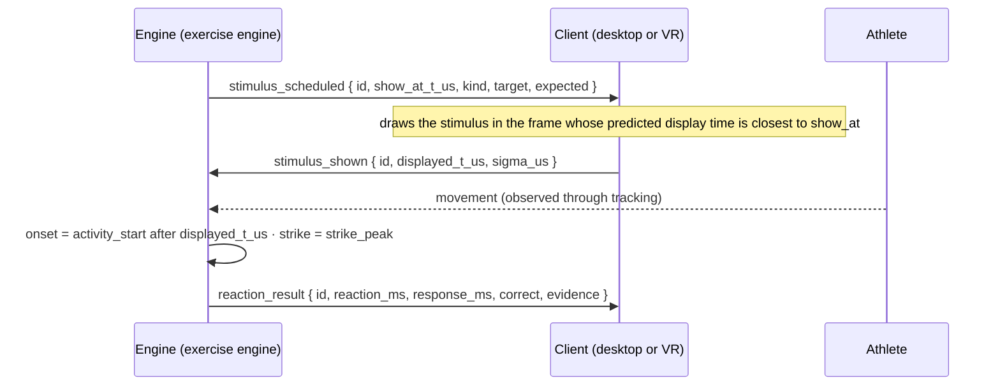

# 27 — Reaction, defence and decision-making drills

Unrehearsed training: targets that appear at random, guard-recovery and defensive reactions,
rhythm challenges, and the event and timing model that a later virtual opponent would need.

Status: **Proposed**, P2. Nothing here is built or scheduled before Phase 5.

## 1. Capability card

| Item | Content |
|---|---|
| Use case and value | "A target lights up left or right at a random moment; strike it" — measured as reaction time (stimulus to movement onset), response time (stimulus to strike), and correctness of the response chosen |
| Existing support | Engine-defined targets and `target_reached` ([11 §4.4](11-vr-architecture.md)); the session clock shared with clients; activity segmenter and strike events with interpolated times; the sequence automaton with `choice` |
| Needed now | Nothing built. Two contract reservations are documented: the `stimulus` event pair of §3 and the client display acknowledgement. Both are additive |
| Dependencies | Measured display latency per client ([15 §4.2](15-performance-and-latency.md) L-03, L-04); camera rate ≥ 60 fps; VR targets (Phase 5) |
| Feasibility and limits | Feasible as a drill. As a *measurement*, reaction time is limited by display-time knowledge and onset resolution: with a 60 fps camera, onset is known to about ± 8 ms plus timestamp uncertainty — coarse against differences of tens of milliseconds between athletes or sessions |
| Priority | P2 |
| Smallest milestone | A two-target drill on the desktop with stimulus and response logged and reaction time reported with its uncertainty |
| Evidence before development | L-03/L-04 display latency and its jitter; V-16 onset timing error |

## 2. Drill types

| Drill | Stimulus | Expected response | Measures |
|---|---|---|---|
| Simple reaction | One target, random delay | The declared technique | Reaction time, response time |
| Choice reaction | One of N targets or colours | Technique and side mapped to each | The same, plus choice accuracy |
| Go / no-go | Target or decoy | Strike or hold still | False-start and miss rates |
| Guard recovery | A cue after the athlete's own strike | Guard position reached | `guard_recovery_time` after the cue |
| Defensive reaction | An incoming indicator (direction arrow, later a ghost attack) | Block, check or step from the definitions | Reaction time; correct defence |
| Rhythm challenge | Beat with accents or gaps | Strikes on accents only | `tempo_error`; false strikes |
| Growing combination | A sequence shown once, lengthened each round | Reproduce it | Sequence accuracy against length |

Each is a plan of a new kind `reaction` that reuses technique definitions as responses; no
technique is redefined for it.

## 3. Event and timing model

| Element | Decision |
|---|---|
| Scheduling | The engine schedules stimuli **ahead of time** on the session clock (≥ 200 ms lead) from a seeded pseudo-random generator stored with the session, so a session is replayable and re-analysable |
| Display time | The client reports when the stimulus actually reached the display, on the session clock, with its own uncertainty: predicted display time in VR; frame presentation time plus the measured display latency on desktop. This is the one place a client sends timing to the engine during training; it travels as a `POST /training/command` variant (`ack_stimulus`), not a new channel |
| Without an acknowledgement | The result is stored with `displayed_t_us = show_at_t_us`, sigma = one display frame + the configured display latency sigma, and is capped at grade B |
| Onset | The segmenter's `activity_start` back-dated by threshold interpolation ([04 §7](04-movement-domain-model.md)); IMU gyroscopes, when present, give the better onset |
| Anticipation | Onset earlier than 100 ms after display is recorded as `anticipated`, not as a fast reaction |
| Uncertainty | `sigma(reaction) = sqrt(sigma_display² + sigma_onset²)`; stored like any metric and gated: grade A needs sigma ≤ 10 ms |
| Tracking latency | Irrelevant to the value: both times are on the session clock at capture and display, not at processing ([15 §1](15-performance-and-latency.md) L1). It matters only for how soon feedback appears |
| Audio stimuli | Not planned first: output latency of audio devices is larger and less known than display latency |

Reaction metrics are new entries built from the existing `duration` kind with anchors
`stimulus:<id>` and `onset` (two anchor additions, like `peak:` in
[23 §3.2](23-biomechanics-model.md)).

## 4. Towards virtual opponents

A virtual opponent is, architecturally, a source of scheduled stimuli with a rendered body: its
"attacks" are `stimulus_scheduled` events with a ghost clip attached and an expected defence. The
event model above is sufficient for scripted and randomised opponents. Anything adaptive (an
opponent that responds to the athlete's movement in real time) needs low-latency recognition of
intent that this platform does not have and does not plan; it is research.

## 5. Safety

Unpredictable stimuli raise the risk of uncontrolled strikes and of leaving the zone. Rules, in
addition to [17 §3](17-security-privacy-and-safety.md) and [11 §7](11-vr-architecture.md):
targets appear only inside the zone and never behind the athlete; turn-inducing stimuli are
limited to 90° per stimulus; reaction drills are unavailable when the space gate passed only by
manual confirmation in VR; a warm-up block is mandatory; speed is never the scored quantity —
correctness and time are reported separately.

## 6. Validation

Seeded replay reproduces the stimulus schedule; a synthetic "athlete" in the simulator responding
after a scripted delay yields that delay within the stated sigma; L-03/L-04 fix the display terms.
