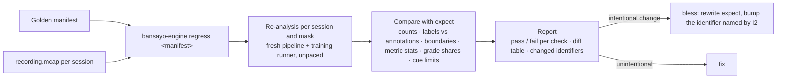

# 28 — Motion dataset, golden sessions and regression evaluation

How recordings become a labelled corpus, and how a fixed set of them protects tracking,
recognition and scoring against regressions.

Decision record: [ADR-038](adr/ADR-038-golden-sessions.md). Status: **Proposed**; the underlying
input recording and deterministic replay are **Implemented**.

## 1. Capability card

| Item | Content |
|---|---|
| Use case and value | Any change to a solver stage, observable, definition or scoring model is evaluated against the same recorded movements before it ships; the result is a diff of counts, boundaries, metric values and grades |
| Existing support | `recording.mcap` with context; deterministic replay; replay regression tests (commit `4403ea5`); re-analysis design ([12 §7.2](12-data-and-progress.md)); annotations ([20 §4](20-technique-authoring.md)) |
| Needed now | The manifest of §3; the runner of §5; the consent flag of §4. No new storage format |
| Dependencies | Real recordings (cameras connected); annotators; consent from each performer |
| Feasibility and limits | High: inputs are already recorded. Limits: recordings made with a smoothed or since-replaced detector cannot be un-smoothed; video is needed to re-run a *new* pose model |
| Priority | **P0** for synthetic golden sessions (they exist today as tests in spirit); P1 for real ones; research for any learning use |
| Smallest milestone | Three simulator sessions with expected-result files, run by one command in CI |
| Evidence before development | None for synthetic. For real sessions: the first physical-camera recordings |

## 2. Corpus layers

| Layer | Content | Lives in | Used for |
|---|---|---|---|
| **Synthetic golden** | Simulator recordings with scripted ground truth (phase times, peak values, injected faults) | Repository, `golden/synthetic/` (small: landmarks and samples only) | CI on every change; exact expectations |
| **Real golden** | Selected real sessions with annotations: per technique, positive and negative examples, several athletes and skill levels, occlusions, camera loss, lighting variants | `<data_dir>/golden/` on the validator's machine; never in the repository | Pre-release regression; validation experiments |
| **Example sets** | Per-technique annotated repetitions ([20 §4.2](20-technique-authoring.md)) | Content + kept sessions | Definition review; become real golden on publication |
| **Working corpus** | Everything else recorded with inputs | Session directories | Ad hoc evaluation; candidate golden sessions |

Recording format is unchanged: a session directory with `recording.mcap` (inputs and context),
optionally `video.mcap`, and `motion.mcap` as produced at the time. Raw and fused streams share the
session clock, so they are synchronised by construction.

## 3. Golden manifest

```yaml
schema: bansayo.golden/v1
id: golden.real.kicks_2026_12
sessions:
  - session: 20261203T180000Z-k9x2
    origin: live
    rig: three-cam-60          # human label; the tracking configuration is inside the recording
    tags: [roundhouse, intermediate, occlusion:left_cam_30pct]
    has_video: true
    annotations: required
    expect:
      content: pinned          # re-analyse with the snapshots stored in the session
      reps: { completed: 30, tolerance: 0 }
      labels: { precision_min: 0.95, recall_min: 0.95 }           # against annotations
      phase_boundary_ms: { mean_abs_max: 25 }
      metrics:
        - { metric: kick.peak_ankle_height, stat: session_median, value: 1.182, tolerance: 0.005, min_grade_a_share: 0.8 }
      cues: { max_per_rep: 1 }
    masks:                      # the same session re-analysed with sources disabled
      - { name: two-cam, disable: [cam-rear], expect: { reps: { completed: 30, tolerance: 1 } } }
      - { name: one-cam, disable: [cam-rear, cam-right], expect: { reps: { completed: 30, tolerance: 2 } } }
```

`value` fields are written **by the runner** when a session is promoted to golden ("bless"), from
the build that was validated at that time; a person reviews the diff. They are not hand-typed.

## 4. Consent, labels and privacy

| Topic | Rule |
|---|---|
| Consent | Promotion to golden or inclusion in an example set needs `consent.dataset_use_utc` on the athlete profile (additive field): use of the recording for evaluation on this installation. Sharing outside the installation is a separate, per-export consent recorded in the bundle manifest |
| Withdrawal | Removing consent removes the athlete's sessions from manifests; the runner reports the missing items rather than failing silently |
| Labels | `RepAnnotation` ([20 §4.1](20-technique-authoring.md)); session tags for skill level (`beginner`, `intermediate`, `advanced`, self-declared), occlusion, lighting, clothing, rig |
| Positive and negative | Negative means "must not be detected as X" or "must trigger error tag Y"; non-movement segments (walking, drinking, adjusting straps) are kept deliberately |
| Splits | Any tuning of thresholds uses a **tuning** subset; reported figures come from **held-out athletes**. The split is by athlete, never by repetition, and is recorded in the manifest (`split: tune \| test`) |
| De-identification | Exports can replace athlete ids and drop names; skeleton data may still identify a person by build or gait and is treated as personal data regardless ([17 §2.1](17-security-privacy-and-safety.md)) |
| Video | Kept only where a future pose model must be re-run; otherwise golden sessions are landmark-level |
| Licence | Each golden session records the terms the performer agreed to; default is local evaluation only |

## 5. Regression runner



| Aspect | Decision |
|---|---|
| Form | A subcommand of the engine binary reusing the re-analysis job; no separate tool or service |
| Determinism | Same build + same content + same mask → identical output (existing replay guarantee) |
| Layers checked | Tracking (landmark availability, reprojection, sigma, profile), recognition (counts, labels, boundaries), metrics (values, grades), scoring and coaching (component availability, cue limits) |
| Changed numbers | A failing metric check is resolved either by fixing the regression or by declaring the change: the developer bumps the identifier required by [32 §5](32-measurement-provenance.md) I2 and blesses. The report lists which identifiers changed, so a silent change is impossible to merge unnoticed |
| CI | Synthetic golden on every change. Real golden before a release and whenever a solver stage, observable or shipped definition changes |
| Performance | Runs at re-analysis speed (target ≥ 10 × real time, [15 §2.2](15-performance-and-latency.md)) |
| Results history | Reports are written to `docs/validation/regress/` with build and manifest hashes |

## 6. Evaluation metrics per layer

Defined once in [16](16-accuracy-and-validation.md); the runner computes the subset that needs no
external reference: detection precision and recall against annotations, boundary error, count
error, grade shares, yield under masks, paired method differences between masks (V-26, V-27, V-34).

## 7. Towards learning (research, not planned work)

| Possible use | Entry condition | Constraint |
|---|---|---|
| Stage-2 templates | ≥ 10 confirmed repetitions per technique and side from ≥ 2 athletes | [07 §3.4](07-recognition-and-coaching.md) |
| Learned recogniser for free mode | ≥ 200 per class from ≥ 10 athletes and a measured shortfall | Held-out athletes; never writes metrics ([32 §5](32-measurement-provenance.md) I7) |
| Threshold fitting | Any example set | Proposals only; a reviewer accepts them ([20 §5](20-technique-authoring.md)) |
| Pose model evaluation | Golden sessions with video | A new model is a new detector id and class |

No external dataset is imported ([19 §2](19-risks-and-open-questions.md)).

## 8. Failure handling and validation

A missing session, annotation or consent is reported per item and the run continues; a corrupt
recording fails that item. The runner itself is tested by a synthetic session with a deliberately
broken expectation that it must flag.
