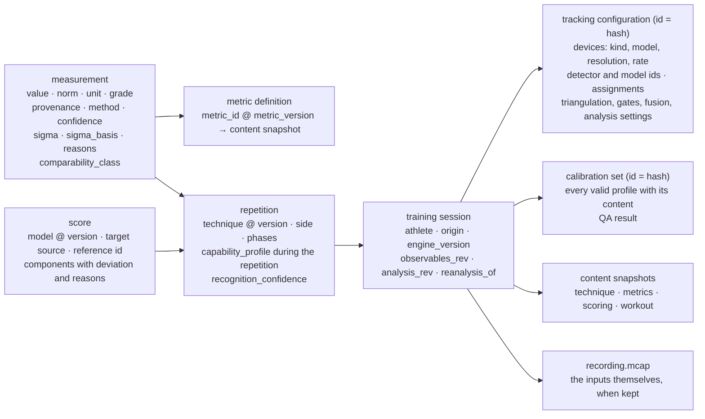

# 32 — Measurement provenance, explainability and scoring integrity

How every number can be traced to the devices, calibration, algorithms and definitions that
produced it; how observed, estimated, predicted and unavailable are told apart; and how future
changes are prevented from silently altering the meaning of history.

Decision record: [ADR-036](adr/ADR-036-measurement-status-and-immutable-provenance.md). This
document integrates rules already spread over [04 §3](04-movement-domain-model.md),
[05 §8](05-technique-library.md) and [12 §5](12-data-and-progress.md); it does not replace them.

## 1. Capability card

| Item | Content |
|---|---|
| Use case and value | "Why does it say 1.18 m, and is that comparable with last month?" has a complete answer from stored data |
| Existing support | Origin, provenance, confidence and reasons (implemented); `Evidence`, grades, comparability classes, tracking-configuration and calibration-set ids, content snapshots (proposed in this set) |
| Needed now | The status vocabulary of §2; the provenance record of §3 on every stored measurement from the first training session; the invariants of §5 |
| Dependencies | The analytics store (Phase 1); validation reports for `validated` sigmas |
| Feasibility and limits | Fully feasible. Limit: provenance proves how a number was made, not that it is accurate |
| Priority | **P0** |
| Smallest milestone | A repetition's detail view shows, for one metric, value, status, uncertainty, method, devices, calibration set with QA, definition and engine versions |
| Evidence before development | None; this is a storage discipline |

## 2. Four statuses

The brief's four words map onto the existing `Provenance` enum and the grade rule; no parallel
vocabulary is introduced.

| Status (UI word) | `Evidence.provenance` | Meaning | May be stored as a measurement | Grade |
|---|---|---|---|---|
| **Observed** | `measured` | The quantity itself was sensed and converted through valid calibration (a triangulated keypoint, a gyroscope rate, a tag cluster pose) | Yes | A or B |
| **Estimated** | `derived` | Computed from observed quantities through a stated model: kinematics, differentiation, a single-view projection, body proportions | Yes | A, B or C by the metric's gates |
| **Estimated (model fill)** | `inferred` | Supplied by a model in the absence of observation: rest pose, floor-contact root, a monocular lifter | **Never** as a metric; drawn in the inferred style only | — |
| **Predicted** | *(no enum member)* | A value for a time later than the newest observation | **Never produced by the engine.** A client may extrapolate for display; such values are flagged in the client and cannot enter any message to the engine | — |
| **Unavailable** | `unavailable` | Not observable now; always accompanied by reasons | Stored as grade X with `value: null`, so that the absence is itself recorded | X |

Rules:

1. A combined value takes the weakest status of its inputs ([04 §3](04-movement-domain-model.md)).
2. There is deliberately **no `predicted` member** in the wire enum: nothing may emit one. Adding a
   predictor would require adding the member, and therefore an ADR.
3. "Observed" does not mean "accurate". Accuracy is the sigma and, once validated, its report.
4. Validity for progress is the grade, not the status: only grade A enters baselines, records and
   assessments.

## 3. The provenance record

What is stored with every measurement, and where ([12 §4](12-data-and-progress.md)).

| Question | Answered by |
|---|---|
| Which devices? | `Evidence.sources` on live values; the session's tracking configuration for stored ones |
| Which calibration, and was it checked? | `calibration_set_id` → profiles and QA |
| Which algorithm? | `method`, `engine_version`, `observables_rev`, `metric_version`, detector id inside the tracking configuration |
| How uncertain? | `sigma` with `sigma_basis` (`propagated` or `validated`), `confidence`, grade |
| Valid for what? | Grade; assessment `status`; comparability class |
| Why missing or degraded? | `reasons` |
| Can it be recomputed? | `has_inputs` on the session; re-analysis produces a linked session |

One additive route serves the joined record for a session:
`GET /training/sessions/{id}/provenance` → `{ engine_version, observables_rev, analysis_rev,
tracking_config, calibration_set, content: ContentRef[], reanalysis_of, validation_reports: string[] }`.
Per-measurement fields are already in `MetricMeasurement`.

## 4. Explaining a score

An explanation is assembled by the client from stored fields; the engine generates no prose.

| Element shown | Source field |
|---|---|
| "Height: 0.82 of leg length, grade A, ± 0.02 estimated" | `MetricMeasurement` |
| "Target: your median over the last 5 sessions (0.85)" | `ComponentScore.target` (`from`, `value`, `ref_id`) |
| "Shortfall 0.03, inside the inner tolerance → component 1.0" | `deviation`, the scoring model snapshot's `tolerance` |
| "Pivot: not scored — pose model has no foot points" | `ComponentScore.reasons` |
| "Reference match: band 4 of 5, coverage 0.7" | `ScoreResult` |
| "Cue shown because the pivot component was below 0.5 in 3 of the last 4 repetitions" | `CueInstance.evidence`, cue definition snapshot |
| "Measured with 3 cameras, model rtmpose-m, calibration checked: pass" | §3 route |

A score that cannot be explained this way is a defect in the scoring model, not a presentation
problem.

## 5. Integrity invariants

Stated as rules a test can check.

| # | Invariant | Enforced by |
|---|---|---|
| I1 | A stored measurement, score or assessment result is **never updated**. The only mutable fields of a repetition are `excluded` and `note` | Store API has no update for those tables; re-analysis inserts a new session linked by `reanalysis_of` |
| I2 | Any change that can alter a number changes at least one of: `metric_version`, `observables_rev`, the detector id, or `tracking_config_id` | Review rule, checked mechanically by I5 |
| I3 | A definition referenced by any stored row remains retrievable in exactly that version | Content snapshots keyed by hash |
| I4 | A calibration set referenced by any session remains retrievable with its profiles | `calibration_sets.body_json` |
| I5 | Re-analysing a **golden session** with pinned content on a new build reproduces its stored measurements within the declared tolerance, or the build declares which of the I2 identifiers it changed | Regression runner ([28](28-dataset-and-regression.md), [ADR-038](adr/ADR-038-golden-sessions.md)) |
| I6 | A trend, baseline, record or target never spans two comparability classes | Query layer; golden query tests |
| I7 | No model, learned or otherwise, writes into `measurements` or `scores` except through a metric kind or scoring model with a version | Catalogue boundary ([ADR-030](adr/ADR-030-configuration-and-content.md)) |
| I8 | A `validated` sigma cites a report that exists in `docs/validation/` | Loader check on the validated table |
| I9 | Simulated and fixture origins never appear in progress unless requested | Query default |

Future learned components (a recogniser, a pose model, a lifter) are covered by I2 and I7: a new
pose model is a new detector id and so a new comparability class; a learned recogniser changes
which repetitions exist but cannot touch a metric formula; a learned "quality" estimate could only
enter as a new, versioned metric with its own grade gates and validation.

## 6. Privacy-preserving recording

Covered in [17 §2](17-security-privacy-and-safety.md); the provenance-specific points:

- The default recording is skeleton-level (landmarks, samples, solved motion); video is opt-in.
  Provenance and re-analysis need the inputs, not the images.
- Tracking configurations and calibration sets contain device models and geometry, no personal
  data; they can be exported with a validation report without the athlete's rows.
- Exports for sharing may replace the athlete id by a random one and drop `display_name`
  ([26](26-instructor-and-remote-coaching.md), [28 §4](28-dataset-and-regression.md)).

## 7. Content licensing

Every definition and reference carries a licence field ([13 §3](13-configuration-schemas.md),
[07 §6.4](07-recognition-and-coaching.md)); snapshots keep it. A stored score names the reference
it was computed against, so removing a reference never orphans the explanation, only the ability
to extend it.

## 8. Failure handling and validation

| Case | Behaviour |
|---|---|
| Tracking configuration or calibration set cannot be written | The session does not start (`unavailable`): a measurement without provenance is not stored |
| A referenced snapshot is missing (corruption) | The row is shown with "definition unavailable" and excluded from trends |
| Tests | I1: attempt updates through every route; I3/I4: delete content and calibration files after a session and read the session back; I5: the golden runner; I6: golden queries |
