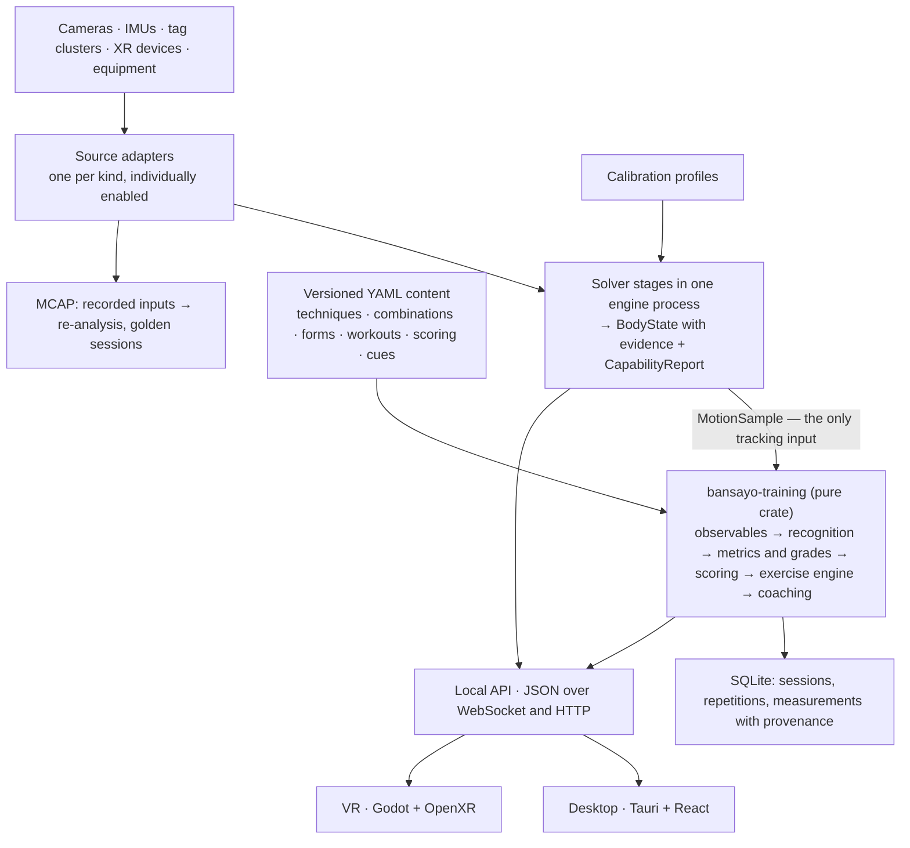

# Bansayo — martial arts training and movement intelligence architecture

Architecture for turning the Bansayo tracking engine into a martial-arts training, movement
analysis, flexibility and coaching platform for Karate, Taekwondo, Muay Thai and general mobility,
on desktop and in VR, with any mix of cameras, printed tags, IMUs and future sensors.

This set is **design only**. It builds on, and does not replace, the engine documentation in
[docs/](../../README.md) (`01`–`13`), whose decisions ADR-001 – ADR-017 remain in force.

## How to read it

| If you want | Read |
|---|---|
| The idea in ten minutes | [01](01-product-vision.md), then [18 §4](18-implementation-roadmap.md) (the first slice) |
| What can actually be measured | [22](22-measurement-feasibility.md), [05 §10–11](05-technique-library.md) |
| To start implementing | [18](18-implementation-roadmap.md), [14](14-runtime-and-api-contracts.md), [component-reference](component-reference.md) |
| To know what is unproven | [19](19-risks-and-open-questions.md), [16](16-accuracy-and-validation.md) |
| Why a decision was made | [adr/](adr/README.md) |

## Status legend

| Tag | Meaning |
|---|---|
| **Implemented** | In the tree, with evidence in [docs/13](../../13-implementation-status.md) |
| **Partial** | Exists on simulated inputs only, or without the named part |
| **Planned** | Specified in `docs/01`–`docs/12` before this set |
| **Proposed** | Introduced by this set |
| **Pending Validation** | A decision that waits for a named experiment |

Status statements in documents 01–14 were verified against the code on 16 November 2026. Commits
of 17 November 2026 (to `0be8e3e`) added a physical-camera source, pose inference, calibration
import, interpolation, a camera-only skeleton and VR client changes;
[08 §1.2](08-tracking-and-sensor-fusion.md) and [18 §2.1](18-implementation-roadmap.md) record
them and how the design absorbs them. They were read from docs/13 and commit messages, not from
the code ([19 §3](19-risks-and-open-questions.md) O-22).

## Documents

### Core architecture

| # | Document | Contents |
|---|---|---|
| 01 | [Product vision](01-product-vision.md) | Goals, non-goals, validated pipeline, what is reused |
| 02 | [Use cases and personas](02-use-cases-and-personas.md) | Personas, UC-01 – UC-20, canonical journey |
| 03 | [Training modes](03-training-modes.md) | Seven modes as plans of one engine |
| 04 | [Movement domain model](04-movement-domain-model.md) | Canonical skeleton, evidence, observables, events |
| 05 | [Technique library and metrics](05-technique-library.md) | Definition schema, initial catalogue, grades, metric catalogue |
| 06 | [Exercise and workout engine](06-exercise-and-workout-engine.md) | Lifecycle, sequence grammar, workouts, programs, events |
| 07 | [Recognition, references, scoring, coaching](07-recognition-and-coaching.md) | Phase machines, alignment, references, component scores, cue scheduler |
| 08 | [Tracking inputs and sensor fusion](08-tracking-and-sensor-fusion.md) | Sources, camera stack, IMUs, fusion, capability profiles, failure |
| 09 | [Optical markers and calibration](09-optical-markers-and-calibration.md) | Tag choice and arithmetic, clusters, procedures, frames |
| 10 | [Desktop architecture](10-desktop-architecture.md) | Workspaces, state ownership, components, flows |
| 11 | [VR architecture](11-vr-architecture.md) | Runtime choice, experiences, shared session, safety |
| 12 | [Data, sessions and progress](12-data-and-progress.md) | Athlete, entities, SQLite schema, comparability, recording, retention |
| 13 | [Configuration and content schemas](13-configuration-schemas.md) | YAML layout, versioning, engine config, validation, discovery |
| 14 | [Runtime boundaries and API contracts](14-runtime-and-api-contracts.md) | Crates, processes, channels, topics, routes, wire types |
| 15 | [Performance and latency](15-performance-and-latency.md) | Budgets and how they are measured |
| 16 | [Accuracy, trust and validation](16-accuracy-and-validation.md) | Experiments V-01 – V-36, defaults → experiments, uncertainty in the UI |
| 17 | [Security, privacy and safety](17-security-privacy-and-safety.md) | Data inventory, threats, physical safety, claims |
| 18 | [Implementation roadmap](18-implementation-roadmap.md) | Phases 0–6, first vertical slice, priorities |
| 19 | [Risks and open questions](19-risks-and-open-questions.md) | R22+, licences, open items, pending decisions, self-review |
| — | [Component reference](component-reference.md) | Fifteen-item card per component |

### Future capabilities and extensibility

Each opens with a capability card: use case and value, existing support, what is needed now,
dependencies, feasibility, priority, smallest milestone, evidence required first.

| # | Document | Priority |
|---|---|---|
| 20 | [Technique authoring and expert validation](20-technique-authoring.md) | P0 data model · P1/P2 tools |
| 21 | [Wearable hardware and printed tags](21-wearable-hardware.md) | P0 design rules · P2 build |
| 22 | [Measurement feasibility matrix](22-measurement-feasibility.md) | P0 |
| 23 | [Biomechanics model, personalisation, footwork](23-biomechanics-model.md) | P0 definitions · P1 metrics |
| 24 | [Adaptive training and intelligent coaching](24-adaptive-training.md) | P1 · language model experimental |
| 25 | [Mixed reality, avatars, spatial calibration](25-mixed-reality-and-avatars.md) | P1 design · P2 passthrough default |
| 26 | [Instructor mode and remote coaching](26-instructor-and-remote-coaching.md) | P2 |
| 27 | [Reaction, defence and decision drills](27-reaction-and-decision-drills.md) | P2 |
| 28 | [Dataset, golden sessions, regression](28-dataset-and-regression.md) | P0 synthetic · P1 real |
| 29 | [Tracking hardware laboratory](29-tracking-hardware-lab.md) | P0 to run early |
| 30 | [Instrumented equipment](30-instrumented-equipment.md) | P2, contract only |
| 31 | [Deployment and device lifecycle](31-deployment-and-device-lifecycle.md) | P1 |
| 32 | [Measurement provenance and explainability](32-measurement-provenance.md) | P0 |

## The architecture in one page

Five rules carry the design:

1. **One engine, two presentations.** Clients compute nothing.
2. **Training reads observables, never devices.** A crate boundary makes that structural.
3. **Content is data over closed catalogues.** No expression language.
4. **Every value says how it was obtained; unreliable values are suppressed, not smoothed.**
5. **Progress is compared only inside a comparability class; stored results are never rewritten.**

## Required diagrams

| Brief | Where |
|---|---|
| 1 Overall system architecture | [14 §2](14-runtime-and-api-contracts.md) |
| 2 Sensor-to-feedback pipeline | [14 §3](14-runtime-and-api-contracts.md), [01 §5](01-product-vision.md) |
| 3 Tracking provider architecture | [08 §2](08-tracking-and-sensor-fusion.md) |
| 4 Calibration and coordinate transformations | [09 §10](09-optical-markers-and-calibration.md) |
| 5 Sensor fusion | [08 §7](08-tracking-and-sensor-fusion.md) |
| 6 Exercise execution lifecycle | [03 §1](03-training-modes.md), [06 §3](06-exercise-and-workout-engine.md) |
| 7 Technique recognition pipeline | [07 §1](07-recognition-and-coaching.md) |
| 8 Coaching feedback pipeline | [07 §8](07-recognition-and-coaching.md) |
| 9 Desktop application components | [10 §5](10-desktop-architecture.md) |
| 10 VR application components | [11 §3](11-vr-architecture.md) |
| 11 Data entities and relationships | [12 §3](12-data-and-progress.md) |
| 12 Session recording and replay | [12 §7](12-data-and-progress.md) |
| 13 Device failure and recovery | [08 §10](08-tracking-and-sensor-fusion.md) |
| 14 Configuration and plugin discovery | [13 §12](13-configuration-schemas.md) |
| First-slice sequence; phase dependencies | [18 §4](18-implementation-roadmap.md), [18 §2](18-implementation-roadmap.md) |
| Authoring workflow; regression runner; provenance chain; recommendation pipeline; wearable family | [20 §3](20-technique-authoring.md), [28 §5](28-dataset-and-regression.md), [32 §3](32-measurement-provenance.md), [24 §3](24-adaptive-training.md), [21 §2](21-wearable-hardware.md) |

## YAML examples

Illustrative files in [examples/](examples/), indexed against the brief in
[13 §13](13-configuration-schemas.md): five rigs (one camera, two cameras, cameras + tags,
cameras + IMUs, hybrid), roundhouse technique, kick metrics, kick scoring model, three-strike
combination, guided kicking workout, Taegeuk Il Jang form, hip-flexion assessment, VR dojo
presentation. They parse as YAML; no loader exists yet to check them against the schemas
([19 §3](19-risks-and-open-questions.md) O-19).

## What is not here

No application code, no prototypes, no measured results. Every accuracy-related number is a design
value or a target with a named experiment.
