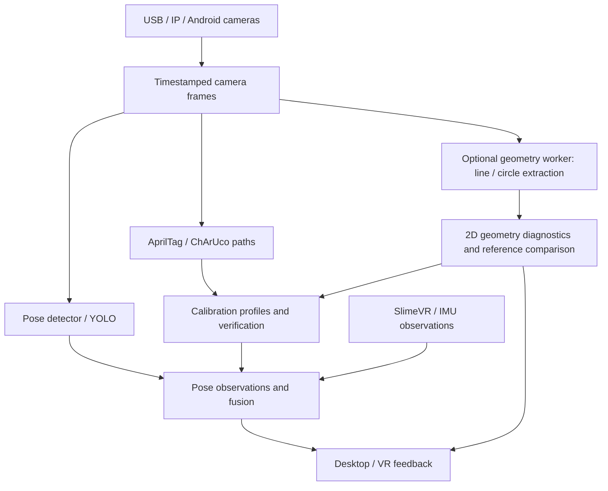

# Hough-transform geometry detection for Bansayo

**Status:** Proposed optional capability — not implemented  
**Priority:** Medium overall; high-value use cases are room-reference assistance and camera-movement warnings  
**Date:** 2026-11-19  
**Scope:** Camera setup, environmental geometry, optical marker experiments, and calibration diagnostics

## 1. Decision summary

Add an **optional, best-effort 2D geometry detector** to the camera pipeline. Its primary purpose is to detect and compare stable lines or circles in camera images, not to estimate the human skeleton.

- **Use Hough lines or a line-segment detector** for floor markings, training-area boundaries, and stable scene references.
- **Use Hough circles only experimentally** for simple wearable marker observations.
- **Use YOLO/pose estimation** for people and joints; **AprilTag/ChArUco** for identifiable targets and geometric calibration; **multi-view triangulation** for 3D optical positions; **IMUs/SlimeVR** for orientation and angular-motion observations.
- Geometry-only results must **never silently change calibrated camera poses**, invent metric scale, claim 3D marker locations, or raise the confidence of body measurements.
- Run the detector on bounded, latest-frame work queues at a configurable low frequency. Tracking must continue if this feature is disabled, slow, or unavailable.

This is a design proposal, not a statement that Bansayo already performs Hough-based tracking.

## 2. Why Hough transforms?

A Hough transform votes in a parameter space for shapes supported by image pixels. It can identify a long straight line even when its visible edges contain gaps. For a line, a common parameterization is:

    rho = x * cos(theta) + y * sin(theta)

A circular Hough transform votes for possible center/radius combinations. These algorithms operate on **image-plane geometry**, typically extracted from grayscale edges. Neither algorithm inherently provides camera calibration, object identity, metric distance, depth, body joints, or 3D position.

### Use-case ranking

| Use case | Benefit | Priority | Important limitation |
| --- | --- | --- | --- |
| Assist room geometry and training-area setup | Detect floor lines, tape and environmental references | High | A line is not a world-coordinate calibration |
| Monitor reference geometry after calibration | Flag possible camera movement or scene change | High | Lighting, occlusion and moving objects cause false alarms |
| Detect circular markers on rigid wearable fixtures | Cheap per-camera 2D marker candidates | Medium / experiment | Unidentified circles are ambiguous; tilted circles project as ellipses |
| Find marked exercise zones | Detect visible zone boundaries or floor stripes | Medium | Requires sufficiently visible markings and configuration |
| Assist fiducial diagnostics | Secondary image evidence when investigating poor detections | Low | Cannot replace AprilTag IDs/corners or ChArUco calibration |
| Improve pose/joint tracking directly | Limited potential | Low | Human limbs are articulated, non-rigid and frequently occluded |

## 3. Relationship to the existing architecture

Bansayo currently uses a Rust engine with camera capture/pose processing, camera calibration profiles, a designed multi-camera fusion path, and optional AprilTag detection. The AprilTag integration currently exposes **raw image-plane corner observations**, not complete 3D wearable tracking or camera/IMU fusion. The existing calibration contracts and invalidation rules remain authoritative.

**Proposed flow:**



The diagram shows intended integration points, **not** completed Hough functionality. Calibration verification may generate a warning or invalidate a profile through established procedures; it must not use a line-match score as proof of accurate extrinsics.

Design boundaries:

1. **Camera source / vision worker:** decode, sample, extract 2D geometric candidates; preserve original frame timestamp, camera ID, resolution and pixel-coordinate convention.
2. **Calibration:** own any reference geometry, device dependencies, profile persistence, comparison thresholds and staleness decisions.
3. **Pipeline:** keep 2D diagnostics separate from calibrated observations; never promote candidates into 3D positions without the necessary calibration, matching and geometry checks.
4. **Contracts/API:** publish typed, explicitly provisional diagnostic results only when consumers need them.
5. **Desktop UI:** offer overlays and meaningful reasons for degraded reference matching. The VR app should only display useful status, not perform detection.
6. **Configuration:** YAML, default disabled; each source may opt in. Reject invalid combinations and unrecognized values rather than silently defaulting.
7. **Observability:** structured tracing, per-camera counters and rate/latency statistics; do not log image contents or persist raw frames by default.

For related design authority, see [architecture](02-architecture.md), [calibration and fusion](05-calibration-and-fusion.md), [implementation status](13-implementation-status.md) and [AprilTag support](apriltag.md).

## 4. Proposed detection methods

### 4.1 Straight lines and room references

Processing sequence:

1. Acquire the **latest** suitable frame, not a queued historical frame; record the source timestamp and resolution.
2. Apply the available intrinsic calibration to undistort points/images **when valid**. If absent, treat results as uncalibrated pixel observations.
3. Apply a configurable region of interest (ROI), typically excluding people and unreliable moving areas.
4. Downscale to a configured processing resolution, convert to grayscale and optionally denoise.
5. Extract edges (for example, Canny) and apply **probabilistic Hough lines** (OpenCV HoughLinesP) or a line-segment detector (OpenCV LineSegmentDetector).
6. Map segment endpoints back to original image pixels. Merge compatible short segments; reject weak, too-short or unstable candidates.
7. Keep geometric descriptors: angle, normalized endpoints, length, support/quality, frame timestamp and ROI.
8. Compare against a reference captured in an intentionally stationary scene; tolerate incomplete visibility rather than forcing a full match.

Compare at least these backends in a prototype:

| Algorithm | Advantage | Tradeoff |
| --- | --- | --- |
| Probabilistic Hough (HoughLinesP) | Robust to gaps; familiar tunable edge/line controls | Can create spurious lines in clutter |
| Line Segment Detector (LSD) | Direct line-segment extraction; often useful with fine scene structure | May produce many fragments requiring matching |
| Feature-based matching / homography | Better suited to detecting camera displacement in textured scenes | Requires stable feature matches and robust outlier rejection |

**Critical distinction:** Hough lines are a candidate generator. For movement monitoring, compare them to previously observed stable features and, where appropriate, corroborate with fiducials or feature-based registration. Parallel line families, vanishing points and planar homographies can support setup diagnostics but do not by themselves recover reliable metric camera pose.

### 4.2 Simple circular markers

Use circle detection only as a research branch:

- Detect radius-constrained candidates in a known band/fixture region.
- Associate candidates across frames using temporal continuity and across cameras using calibration, epipolar consistency and synchronized timestamps.
- Do **not** infer marker identity from circle detection alone. Multiple identical circles can be mismatched.
- Perspective turns circles into ellipses; HoughCircles may fail at oblique views. Compare ellipse fitting and retroreflective or high-contrast marker designs.
- A camera observing a single circle gives a **2D image location**, not distance or 3D position. A calibrated multi-view association could be triangulated with explicit uncertainty.

**Preferred wearable option:** identifiable AprilTag markers on rigid attachments, where practical. Circles should only be adopted if hardware trials show a clear advantage in size, visibility, latency, or cost.

### 4.3 Training-area boundaries

For a deliberately marked practice area, detect and label visible floor lines. Transform them into floor/world coordinates **only** if a valid plane and camera extrinsic calibration are available. Otherwise, draw an image-plane overlay with no metric claims.

Applications include aiding zone setup and later warnings about leaving an agreed practice area. Do not infer collision-safe physical limits from an uncertain line detection.

## 5. Camera-movement and alignment monitoring

A useful reference-monitoring system requires **known good calibration and a stable reference scene**:

1. After validated camera calibration, optionally capture stable environment features as a versioned **reference snapshot** associated with the camera ID, intrinsics, extrinsics, capture resolution, ROI, and calibration revision.
2. Sample frames at a low rate. Match current reference lines/features with orientation, length, position and geometric-consistency checks.
3. Separate **insufficient evidence** (person covering the view, darkness, weak features) from **possible movement** (enough stable features agree on a change).
4. Require a configurable persistence window and hysteresis before issuing a warning. Provide the evidence count/quality and indicate *possible camera movement*, not measured movement.
5. If independent calibration reprojection evidence or a verified fiducial confirms movement, invoke existing calibration-staleness rules; otherwise ask the user to verify or recalibrate.
6. Never silently overwrite existing calibration profiles or auto-adjust the world transform using a Hough-only match.

Typical outputs: `stable`, `possible_movement`, `insufficient_reference`, `occluded`, `uncalibrated`, `disabled`. These are **proposed** statuses, not current API enums.

Re-capture the reference after intentional camera repositioning, lens/resolution changes, significant environmental rearrangement, or recalibration. Preserve the previous snapshot for diagnostics until a new one is validated.

## 6. Performance and implementation strategy

The engine currently uses Rust and does **not** list OpenCV as an engine dependency. Therefore **do not assume OpenCV is already packaged**.

Recommended sequence:

- Prototype HoughLinesP, LSD and feature matching using offline frames and reproducible benchmarks.
- Decide whether OpenCV provides enough additional quality to justify its native-library, platform and packaging costs. A lightweight Rust implementation may be preferable for a narrow feature; avoid inventing an entire computer-vision framework.
- If OpenCV is chosen, keep it behind one small optional adapter/feature with defined loading/build behavior for Windows, Linux and Android where applicable. Do not force a new native dependency on users who do not enable geometry detection.
- Reuse the camera capture/timestamp path and latest-frame/backpressure conventions; do not introduce a second camera capture.
- Prefer sampled processing at setup and occasional monitoring rather than every pose-inference frame.
- Log disabled/unavailable/failed detector states without impacting the pose and IMU pipelines.

A **candidate** YAML design (not currently recognized by the application):

```yaml
vision_geometry:
  enabled: false
  mode: reference_monitor
  algorithm: hough_lines_p
  max_detection_hz: 2
  processing_width_px: 640
  min_line_length_px: 32
  max_line_gap_px: 12
  reference:
    enabled: false
    min_matched_features: 6
    warning_persistence_samples: 3
  circles:
    enabled: false
    min_radius_px: 4
    max_radius_px: 40
```

All values above are **initial experiment parameters**, not validated defaults. Thresholds need calibration across resolutions and cameras, and config should use the project's existing camera/engine settings conventions. Per-camera ROI and enablement may be added only when a real use case warrants them.

### Suggested future diagnostic record

Include:

- `camera_id`, `frame_t_us`, processing resolution, and reference/calibration revision.
- Algorithm, per-frame status, line/circle candidates with image-pixel coordinates and detection scores.
- Reference match count and consistency score; distinct reasons for insufficient information versus possible movement.
- Processing duration, skipped frames and error reason.
- Validity/uncertainty/provenance labels; **no** world coordinates or 3D marker poses from raw 2D results.

Avoid broadcasting large candidate arrays to every VR client. The preview/diagnostics endpoint is a better first consumer.

## 7. Validation and acceptance criteria

Use recorded test imagery (with consistent camera IDs, timestamps and known reference positions) and hardware trials. Evaluate both false positives and missed detections; visual attractiveness is not a substitute for calibration correctness.

| Test | Acceptance expectation |
| --- | --- |
| Feature disabled | No additional native dependency required and no change to existing tracking behavior |
| Stable calibrated camera | No repeated false movement warnings across lighting and normal athlete motion |
| Camera intentionally rotated/translated | Reports possible movement on supported scenes after the configured persistence window |
| Reference blocked or absent | Emits insufficient-evidence status rather than a confident camera-movement claim |
| Camera resolution/intrinsics change | Snapshot invalidated or marked incompatible; no comparison across mismatched geometry |
| 2–4 cameras active | Workers remain isolated; processing cannot block primary capture or pose inference |
| Detector failures or camera unplug | Recover gracefully with structured diagnostics; other sources continue |
| Replay | Deterministic candidate and comparison results for controlled stored inputs where algorithms permit |
| Circular marker test | Measure pixel localization, identity confusion, oblique-view failures and cross-camera matching |
| Calibration quality | Hough-only results never create or silently update metric extrinsics/floor-plane profiles |

**Measure:** per-camera detection p50/p95, CPU and memory cost, skipped frames, main-pipeline frame rate, movement-alert precision/recall, and robustness under partial occlusion and lighting changes. Set final performance limits from target-machine measurements, including 2–4 concurrent cameras; do not present unmeasured values as achieved.

## 8. Delivery phases and TODOs

**Phase G0 — research/benchmark (first):**

- **TODO:** Collect representative static and moving test frames (USB, RTSP/IP, Android) with consent and known camera changes.
- **TODO:** Benchmark HoughLinesP versus LSD versus feature registration, including low light, clutter, floor tape, walls and athlete occlusion.
- **TODO:** Decide on native OpenCV dependency versus minimal Rust implementation based on measurable benefits and packaging cost.

**Phase G1 — optional detector:**

- **TODO:** Add isolated geometry-detection adapter, YAML validation, bounded latest-frame worker, logging and unit tests.
- **TODO:** Publish typed image-plane diagnostics and optional desktop overlay; keep disabled by default.
- **TODO:** Confirm existing camera, AprilTag, pose, recording and VR behavior is unchanged.

**Phase G2 — camera-reference monitoring:**

- **TODO:** Add explicit reference capture, versioning, calibration dependency checking and conservative comparisons.
- **TODO:** Add warning-only flow, insufficient-evidence states, user confirmation and traceable validation metrics.
- **TODO:** Integrate only **confirmed** camera changes with existing calibration-staleness handling.

**Phase G3 — optional marker study (defer):**

- **TODO:** Compare circles, ellipse detection, high-contrast/retroreflective dots and AprilTag fixtures on real moving bands.
- **TODO:** Test synchronized multi-camera association, triangulation quality and IMU-fusion value before adding any marker-position contract.
- **TODO:** Drop the feature if it cannot outperform simpler fiducials or current pose landmarks for the use case.

## 9. Non-goals and risks

- **Not a replacement** for pose networks, ChArUco, AprilTag, camera intrinsics/extrinsics, multi-view triangulation or IMU fusion.
- **Not automatic metric room reconstruction** from arbitrary floor/wall lines.
- **Not automatic camera recalibration** without validated geometric evidence.
- **Not reliable identification** of identical unencoded circles or body parts.
- Risks: reflective surfaces, repetitive parallel lines, curved/occluded markings, rolling-shutter distortion, moving scenery, lighting changes, excessive native dependencies, and false confidence from weak matches.

## 10. References

- [How Hough Transforms Enable Computers To See — Hackaday](https://share.google/m0mz3odcF6kWmA4mP) (source article shared during design discussion)
- [OpenCV Hough Line Transform](https://docs.opencv.org/4.x/d9/db0/tutorial_hough_lines.html)
- [OpenCV Hough Circle Transform](https://docs.opencv.org/4.x/d4/d70/tutorial_hough_circle.html)
- [OpenCV Line Segment Detector](https://docs.opencv.org/4.x/db/d73/classcv_1_1LineSegmentDetector.html)
- [AprilTag project](https://github.com/AprilRobotics/apriltag)

**Recommendation:** prioritize a small G0/G1 experiment for environment references and camera-alignment warnings **after the main camera-calibration and multi-camera triangulation paths are demonstrably reliable**. Do not let Hough work delay the core martial-arts motion-tracking PoC.
