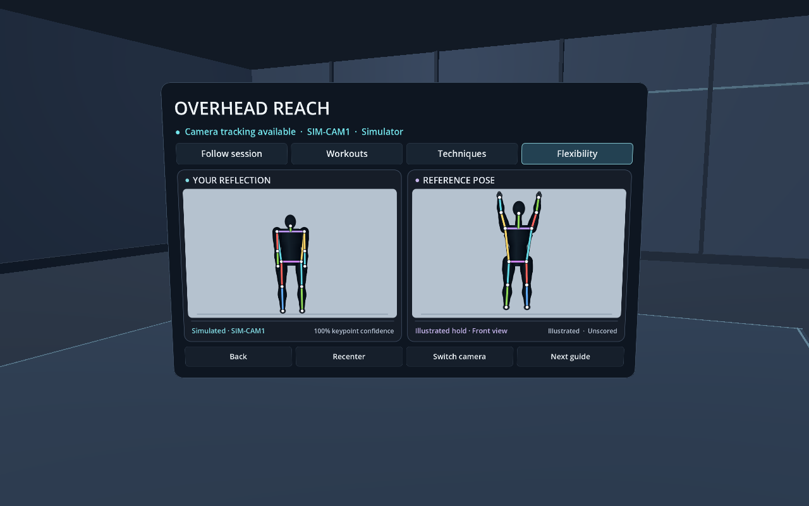

# Bansayo VR coaching visuals

This 1280 × 800 PNG comes directly from the root viewport of the running Godot 4.5.1 desktop preview on macOS. The room received standing landmarks from the Rust simulator in `config/sim-training.yaml`. The mirror was set to **Flexibility → Overhead reach**, with `SIM-CAM1` selected. Both figures use the silhouette and skeleton overlay. The image uses the project's Compatibility renderer.

## Camera match

The baseline was reproduced from `998a3b3` with the same scene, simulator camera, viewport dimensions and exercise. Both runs reported the same transform and vertical field of view. The redesign changes the panel's size and retains its center.

| Setting | Before and after |
| --- | --- |
| Camera position in metres | `(1.943269, 1.438705, 4.022872)` |
| Camera basis X | `(0.900447, 0, -0.434965)` |
| Camera basis Y | `(-0.052071, 0.992809, -0.107795)` |
| Camera basis Z | `(0.431837, 0.119712, 0.893972)` |
| Vertical FOV | `45°` |
| Mirror center in metres | `(1.073338, 1.258705, 2.221978)` |

The 3D mannequin uses lightweight procedural meshes on the engine's existing segment transforms. This keeps the renderer compatible with the current skeleton definitions and provenance while giving the torso and limbs distinct cross-section profiles. Headset rendering and physical-camera validation are pending.
